# MHI2Q CarPlay cluster integration

_Production overview and offline candidate documentation._

---

Production implementation for Audi MHI2Q (MU1316, QNX 6.5 ARMv7):

- stock `libairplay.so` 210.81 inside `dio_manager`;
- `LD_PRELOAD` hook for CarPlay negotiation, route guidance, telephony (recents/favorites,
  signal, hold and mute), altScreen stream 111 and the buffered/upmixed 5.1 audio path;
- external QNX renderers for maneuver graphics and cluster video;
- one Java patch for cluster context, BAP/RGI, the cluster telephone tab (CarPlay calls), cover art
  and steering-wheel input.

The shipped path always keeps stock `libairplay.so`. From-source libairplay/dio experiments are
research records, not production dependencies or authorities for stock 210 behavior.

**Disclaimer:** use at your own risk. These patches modify firmware binaries and system
configuration on your infotainment unit. The installer keeps a `.carplay-stock` backup of every
file it replaces, but back up anything you change by hand as well. The authors are not
responsible for any damage, bricked units or warranty issues resulting from their use.

<a id="gallery"></a>

## 🎨 Gallery

<p align="center">
  <br />
  <sub>Cluster maneuver renderer driven through a demo route</sub>
</p>

**Virtual Cockpit: CarPlay map on the cluster, route guidance beside it**

<p align="center">
  
  
</p>
<p align="center">
  
  
</p>

**Audi front PDC no longer hides CarPlay** · **Cover art on the cluster**

<p align="center">
  
  
</p>

**Head-up display**

<p align="center">
  
  
  
</p>

<a id="features"></a>

## 🎯 Features

There is nothing to switch on: plug in the iPhone and CarPlay starts as usual; the cluster
features below follow it automatically.

- **CarPlay map in the Virtual Cockpit.** The phone streams its own map to the cluster (Apple's
  second-screen "altScreen" stream). It shows while CarPlay is connected, even without an active
  route. The **Audi View** button switches the cluster between its classic and large layouts as
  with the stock navigation, and the **steering-wheel roller** zooms the cluster map. A short
  animation fills the cluster until the first video frame arrives.
- **Turn-by-turn on the cluster.** During CarPlay navigation the cluster shows a 3D maneuver
  arrow beside the map. Its distance bar fills as the turn approaches and blinks just before it.
  The cluster also shows lane arrows, distance to the turn, arrival time and remaining distance.
  Needs an app that sends CarPlay route guidance: Apple Maps does, Waze does not
  ([details](docs/cluster-and-rgi/THIRD_PARTY_NAV_APPS.md)).
- **Route text in the Virtual Cockpit.** A text line under the map names the exit sign or the
  next road (the current road when there is nothing else); long names scroll. Press **OK** (the
  left steering-wheel roller) to switch it to arrival time and time left, and press again to go
  back ([details](docs/cluster-and-rgi/RGI_AND_BAP_BRIDGE.md#-route-text-eta-and-the-mfw-ok-key)).
- **Head-up display.** The same maneuver icons, lane arrows and distance appear on the HUD.
- **Cover art on the cluster.** The now-playing album art shows on the cluster media screen.
- **CarPlay calls on the cluster phone tab.** Instead of the stock "Your iPhone is in Apple
  CarPlay mode" note, the Virtual Cockpit telephone tab works as with a Bluetooth phone: caller
  name and number, call state and timer, accept / hang up (tab or steering wheel), hold, mute and
  dialling, recents and favorites, the missed-call indication, signal and carrier. There is no
  caller photo: iPhone does not send one to the car. Confirmed on the car
  ([details](docs/cluster-and-rgi/CARPLAY_TELEPHONY.md)).
- **Parking popups no longer hide CarPlay.** When the Audi front PDC / parking view pops up,
  CarPlay stays on screen beside it instead of being replaced.
- **5.1 surround for CarPlay music (B&O).** The head unit feeds the external B&O amplifier six
  channels instead of two, and the amplifier's own Virtual Cabin processing spreads them over the
  cabin speakers ([details](docs/audio/README.md)).
  - *Spatial input:* Spatial Audio / Dolby Atmos tracks from Apple Music arrive as real 5.1 in
    Apple's APAC codec. The head unit decodes them and plays each channel on its own speaker
    group, with no upmix.
  - *Stereo input* (most music, and apps such as Spotify): the head unit's scene renderer
    upmixes it. It reads the stereo image itself: instruments the mix places off-centre move to
    the rear speakers as whole objects, the room ambience goes behind as a wide layer, vocals,
    bass and drums stay anchored in front, and a small network (the mask net) decides per band
    which parts may move; the subwoofer gets its own bass feed. Calls and Siri stay plain stereo.
    Measured under QEMU, the renderer takes about 1-2 ms of each 16 ms audio period on the audio
    thread and the network runs on its own thread
    ([details](docs/build-and-deploy/SCENE_BACKEND_DEPLOY.md)); the car has not heard it yet.
  - Built for the B&O amplifier only. The startup script enables it unconditionally for now;
    cars with the internal amplifier have no six-channel route and are untested.

<a id="documentation"></a>

## 📚 Documentation

All documentation is one linked Markdown tree in [`docs/`](docs/README.md). Start at
[`docs/README.md`](docs/README.md), then the per-domain maps.

> 🗺️ **Looking for a note? See the [documentation map](docs/DOCS_MAP.md)**: every note, one mindmap per domain, with links.

_Mindmap of every documentation note, by domain and topic group._

```mermaid
mindmap
  root((MHI2Q CarPlay docs))
    Audio
      Upmix runtime
        Stereo to 5.1 Upmix
        Stereo-to-rear scene algorithm
        Upmix Calibration and Tuning
        Upmix Compute Budget
        Upmix Code Retirement Map
      Upmix research and history
        Upmix History and Results
        UPMIX rework baseline
        UPMIX rework proposal
        UPMIX radical directions
        Upmix Stability
        Current Track A on the matched full40 harness
        Upmix Training History
        Upmix Datasets and Teachers
        Upmix Literature
        Upmix domain model and qualification map
        HSSR Model
      Listening and release
        CarPlay Upmix Listening Protocol
        Upmix Listening and Deploy Log
        Upmix Release and Acceptance
      Amplifier and DSP
        Virtual Cabin and Amp RE
        J525 Wiring and Speakers
        SHARC B Processors
        SHARC DSP Blocks
        Internal Amp Path
      Codecs and routing
        APAC Codec
        Cinemo AAC Decoder
        Dolby Atmos
        Discrete 5.1 Routing
        Buffered Audio Path
        Buffered Playback Lifecycle
        Call and Siri Routing
        QNX Audio Topology
        iOS 26 type-103 connection triage
    Cluster and RGI
      Contexts and layout
        Cluster Contexts
        KDK Geometry and Animation
        VC Layout and Fonts
        VC FPK State Machine
        PDC Small Stage
        Nav Initializing Screen
      Route guidance
        RGI and BAP Bridge
        iAP2 Route Guidance TLVs
        Maneuver Mapping
        Lane Guidance
        Distance Bargraph
        HUD Renderer
        NavSD FctID Matrix
        Third-party Nav Apps
      Phone and telephony
        CarPlay Telephony
        iAP2 Communications
        VC Telephone Tab
        Phone Tab Gating
        Smartphone Tab and Kombi DSI
      Open research
        CarPlay speed-limit investigation
        iAP2 StartRoadObjectDetection and Type research
    AltScreen and Video
      Cluster video
        AltScreen Cluster Video
        Video Pipeline
        Cluster Loader
        Cluster Video Encoder
        Reconnect and Lifecycle
      Pacing and input
        AltScreen Frame Rate
        AltScreen Pacing Validation
        AltScreen Input Commands
      Features
        Cover Art Pipeline
        Enhanced Siri Contract
        CarPlay Video Playback
        CarPlay Feature Survey
        Partial 360 Camera Preflight
      History
        AltScreen RE History
    Connect and USB
      USB session
        USB and NCM Connect
        Session Lifecycle
        iOS Version Gate
        HMI Startup and Identity
      Replug recovery
        USB Replug Recovery
        SI Stack and Replug Race
      Network and phone data
        PF Firewall
        Vehicle Data To Phone
        Now Playing Cold Start
    Wireless CarPlay
      Receiver and ownership
        Wireless CarPlay with MU1316 stock AirPlay 210.81
        Stock210 wireless readiness, restart and wired priority
        Receiver startup gap for wireless CarPlay
        dio receiver bridge
        Smartphone Integrator ownership for wireless startup
      Bluetooth graft
        MHI2Q RFCOMM graft
        Offline insertion survey for the MHI2Q btstack
        MU1316 btstack launcher path
        RFCOMM server channel for iAP2
        RFCOMM connection, transmit, and credit ABI
        CarPlay Bluetooth discovery
      iAP2 and MFi bootstrap
        Offline iAP2 bridge daemon prototype
        Vendored LIVI iAP2 crates
        Software MFi for offline tests
        P5092 bootstrap reference versus the MU1316/P5087 wireless mod
      Pairing and media
        Stock 210.81 HTTP boundary for hook/wireless
        Stock 210.81 paired media adapters
        AirPlay 280.33.8 pairing
      iOS, radio and hardware
        iOS 26/27 selection of stock AirPlay 210 MFi-SAP
        iOS wireless CarPlay gates
        Wireless CarPlay and Wi-Fi
        Wireless CarPlay on the Head Unit
        Wireless CarPlay PF profiles, offline
      Evidence
        Stock 210 + hook/wireless
        Wireless CarPlay investigation history
        Wireless documentation migration
    CarPlay Laboratory
      vphone sender
        vphone CarPlay laboratory
        vphone and QNX timing measurements
        Native CarPlay screen test
      Earlier labs and review
        iOS virtual machine laboratory
        Wireless hook review against iOS and MHI2Q 210
    Build and Deploy
      Build and release
        Build System
        Deploy and Release
        Scene Backend Deploy
        VIN Protection
      Audits and recovery
        Production Audits
        Issue 24
        RE Artifacts
    Reference
      System
        Architecture
        Hook to Java Bus
        Record Replay Tooling
      Formats and ports
        iOS CarPlay Spatial Wireformat
        MHI2 MU1439 Port
      History and comparisons
        Archive and History
        Repository Comparison
```

<!-- BEGIN generated:full-mindmap -->

<!-- END generated:full-mindmap -->

| Domain | Entry point |
| --- | --- |
| Audio (upmix, scene renderer, J525 amp, codecs, 5.1 routing) | [`docs/audio/README.md`](<docs/audio/README.md>) |
| Cluster and route guidance (contexts, BAP/RGI, HUD renderer, CarPlay telephony) | [`docs/cluster-and-rgi/README.md`](<docs/cluster-and-rgi/README.md>) |
| AltScreen and video (stream 111, OMX pipeline, loader) | [`docs/altscreen-and-video/README.md`](<docs/altscreen-and-video/README.md>) |
| Connect and USB (NCM, replug recovery, PF, session lifecycle) | [`docs/connect-and-usb/README.md`](<docs/connect-and-usb/README.md>) |
| Wireless CarPlay (stock210 hook, btstack graft, iAP2/MFi; parked) | [`docs/wireless-carplay/README.md`](<docs/wireless-carplay/README.md>) |
| CarPlay laboratory (vphone sender, native video, QNX timing) | [`docs/carplay-lab/README.md`](<docs/carplay-lab/README.md>) |
| Build and deploy (toolchain, release map, VIN protection) | [`docs/build-and-deploy/README.md`](<docs/build-and-deploy/README.md>) |
| Architecture overview | [`docs/reference/ARCHITECTURE.md`](docs/reference/ARCHITECTURE.md) |

Read [`docs/LANDMINES.md`](docs/LANDMINES.md) before touching a subsystem. Long-form white papers
are in `docs/research/`; primary evidence (papers, manuals, data files, decompiled stock Java) is in
`docs/sources/`.

<a id="repository-layout"></a>

## 🗂️ Repository layout

| Path | Purpose |
| --- | --- |
| `hook/` | Shipping native `libcarplay_hook.so` source |
| `java_patch/` | The only Java patch source |
| `maneuver_render/` | GLES maneuver overlay renderer (cluster plane 98) |
| `altscreen_render/` | OMX/GLES altScreen video renderer and PRISM loader (cluster plane 99) |
| `apac_decoder/` | APAC decoder port behind the optional `libcarplay_apac.so` |
| `common/` | Shared QNX Screen surface code |
| `models/` | The scene renderer's mask net (`scene-masknet-c/`) |
| `deploy/` | On-unit runtime scripts, SI child config, patched firmware and PF/deva recipes |
| `scripts/` | Host build and test entry points |
| `install_MoreIncredibleBash/`, `uninstall_MoreIncredibleBash/`, `logging_MoreIncredibleBash/` | M.I.B. SD install / remove / log-collection scripts |
| `protector/` | VIN-lock protector used by the protected build |
| `tools/` | Host tools (upmix renderer and benches, QSA emulator, amp model, …) |
| `assets/` | RE working sets (`soundamp/`, `vc-fonts/`) and visual references |
| `toolchain/qnx65-abi/` | QNX Screen/OpenMAX ABI headers used only for cross-compilation |
| `docs/` | The documentation (GitHub-rendered; also opens as an Obsidian vault) |
| `build/` | Build outputs (untracked, empty in git) |
| `logs/` | Ignored local evidence: vehicle captures, HU logs, iPhone sysdiagnose, state traces |

Build output, raw unit logs and generated class trees are intentionally kept outside Git.
The cleanup archive is under `/Users/luka/Desktop/AUDI_2/LocalLogs/`.

<a id="build"></a>

## 🔧 Build

Native code needs the QNX 6.5 ARMv7 cross-toolchain image from
[luka-dev/qnx65-armv7-toolchain](https://github.com/luka-dev/qnx65-armv7-toolchain). Build it once:

```sh
git clone https://github.com/luka-dev/qnx65-armv7-toolchain
cd qnx65-armv7-toolchain
./host-scripts/qnx-run.sh build        # qnx65-armv7-toolchain:latest (GCC 8.5)
./host-scripts/qnx-run.sh build 4.9    # optional: :4.9 (GCC 4.9.4)
```

Then run from this repository's root:

```sh
./scripts/build_java.sh
./scripts/build_hook.sh
./scripts/build_renderers.sh
```

Native builds run in the `qnx65-armv7-toolchain` Docker image; `:latest` (the default) is GCC 8.5,
`QNX_TOOLCHAIN_VARIANT=4.9` selects GCC 4.9.4. Renderer import libraries are generated during the
build; the resulting ELFs resolve the real Screen/EGL/GLES/OpenMAX libraries on the unit.

| Variant | Command | Output |
| --- | --- | --- |
| Production | `./scripts/build_hook.sh` | the one image: WARN/ERROR log only; `touch /mnt/app/carplay_verbose` turns on INFO, audio captures and pace reports for the next session |
| No audio module | `HOOK_AUDIO=0 ./scripts/build_hook.sh` | hook without the type-103 audio path, no codec |
| State trace | `AUDIO_STATE_TRACE=1 ./scripts/build_hook.sh` | compact `/tmp/carplay_state_trace.log` ledger (see `scripts/carplay_state_trace.sh`) |
| VIN-locked | `./scripts/build_hook_protected.sh <VIN>` | stamped `.so` files in `build/protected_<VIN>/` |

Build outputs (binaries only; builds never package a release):

```text
build/carplay_hook.jar
build/unprotected/libcarplay_hook.so
build/unprotected/libcarplay_apac.so
build/maneuver_render
build/altscreen_render
```

Models are versioned in `models/`: `scene-masknet-c/scene_masknet_c.bin`, the scene
renderer's fine mask net c, with its manifest and the knob settings it was measured at.

Tests: `./scripts/run_tests.sh`.

AltScreen pacing offline checks (ASan/UBSan, fault injection, Clang analysis and
libFuzzer): `bash scripts/test_altscreen_pacing.sh`. The report and reproducer
corpus are written to `build/altscreen-pacing-validation/`; `FUZZ_SECONDS` changes
the budget per target (default 30 seconds; three targets). This performs no vehicle operations.
Static operation comparison: `python3 scripts/compare_altscreen_static.py`.
The current AltScreen candidate enables decoded-output mailbox selection;
`ALTSCREEN_PRESENT_FIFO=1` selects the FIFO fallback. See
[frame pacing contracts](docs/altscreen-and-video/ALTSCREEN_FRAME_RATE.md) for
recovery, ownership, protocol and validation limits.

The 2026-10-09 input candidate adds paced roller intent, command priority and
latest pending state, including the pre-commit/CF/expired-selection review fixes.
[Input commands](docs/altscreen-and-video/ALTSCREEN_INPUT_COMMANDS.md) documents
configuration and cancellation boundaries;
[validation](docs/altscreen-and-video/ALTSCREEN_PACING_VALIDATION.md) records the
source-hashed offline results. Vehicle latency and FPS were not measured for
these input changes.

<a id="deployment"></a>

## 🚀 Deployment

**Compatibility.** Audi MHI2Q only: the installer reads the firmware version from E2P and stops on
anything else. The Java part replaces whole stock HMI classes, so it ships per firmware family and
is chosen by the region in that version string: US, ER and JP (verified on MU1316 P5087, MU1329
P5092, MU1017 P1017) get `carplay_hook.jar`, CN (verified on MU1003 K1004) gets
`carplay_hook_cn.jar`. Any other region installs CarPlay without the Java part (no cluster/HUD
features) until it is added. Also needed:

- a fully digital instrument cluster (Audi virtual cockpit); cars with an analog cluster are not
  supported;
- preferably, the latest firmware available for the unit, flashed before installing the patch.

With these in place it should almost certainly work, as long as nothing went wrong during the
install itself.

A release is assembled by hand. Stage the build outputs, the models and the `deploy/` runtime files
into `install_MoreIncredibleBash/mod/carplay/root/`, each at its on-unit path (for example
`mod/carplay/root/mnt/app/root/hooks/libcarplay_hook.so`), and put `carplay_child.json` in
`mod/carplay/`. Copy the contents of `install_MoreIncredibleBash/` onto the M.I.B. SD card, so the
card holds `mod/custom.sh` and `mod/carplay/`, then run `mod/custom.sh` from M.I.B. The
source-to-unit map, file modes and hashes are in
[Deploy and Release](<docs/build-and-deploy/DEPLOY_AND_RELEASE.md>).

- `custom.sh` copies every file under `SD:/mod/carplay/root/` to the same path under `/` on the
  unit, replaces the SI `carplay` child by path, widens the CarPlay rule in all four PF profiles
  and registers the iAP2 route-guidance and telephony message IDs in `dio_manager.json` (without
  them no route guidance arrives, and the cluster phone tab has no lists, hold or mute). It keeps
  a `.carplay-stock` backup of everything it replaces or edits, and never stops processes or
  reboots the HU.
- **Manual install** (no M.I.B.; needs a root shell on the unit over SSH or Telnet): the same steps
  by hand, what to copy where and what to change in each config file, in
  [Manual install](<docs/build-and-deploy/DEPLOY_AND_RELEASE.md#-manual-install-without-mib>).
- Uninstall: copy `uninstall_MoreIncredibleBash/` over the card and run it; it restores every
  `.carplay-stock` backup and deletes the owned files.
- The runtime integration (renderer supervision, environment, spatial/upmix settings) lives in
  [`deploy/smartphone_integrator/`](deploy/smartphone_integrator/README.md); the shipped audio
  calibration is set in `deploy/smartphone_integrator/carplay_startup.sh` and documented in
  [Stereo to 5.1 Upmix](<docs/audio/STEREO_TO_5_1_UPMIX.md>).

Disconnect CarPlay first and reboot the HU manually after installing. Deploying the Java jar always
means a full unit restart (it is on j9's boot classpath).

<a id="references"></a>

## 📚 References

Thanks for the prior work and knowledge that helped figure this out:

- https://github.com/ludwig-v/wireless-carplay-dongle-reverse-engineering
- https://github.com/EthanArbuckle/iPhone18-3_26.1_23B85_Restore
- https://github.com/adi961/mib2-android-auto-vc
- [@fifthBro](https://t.me/fifthBro)
- https://github.com/xPaiiN for telephony magic
