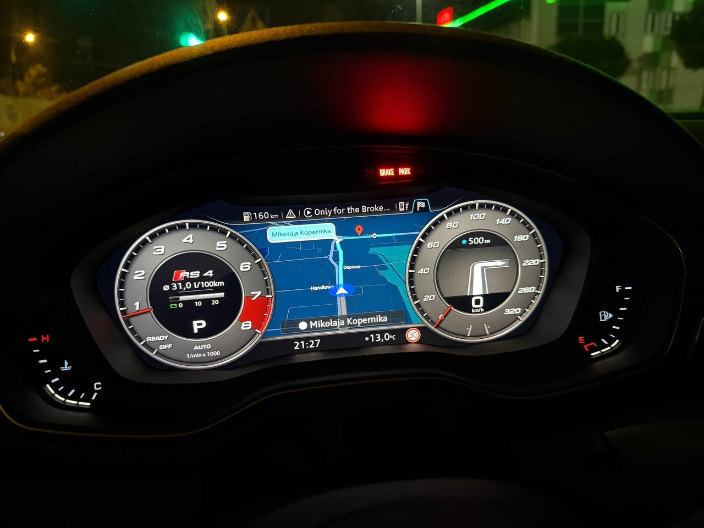
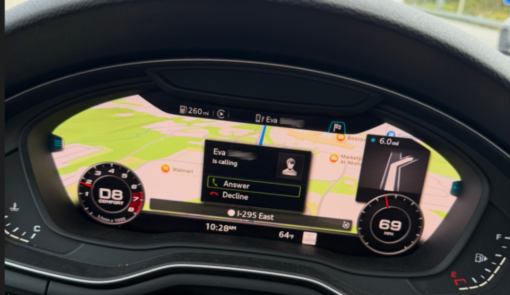
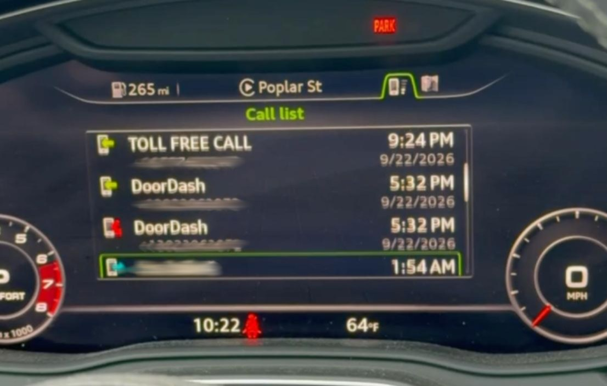
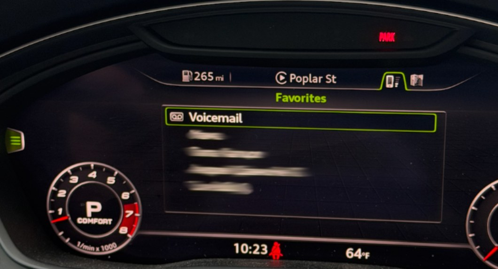
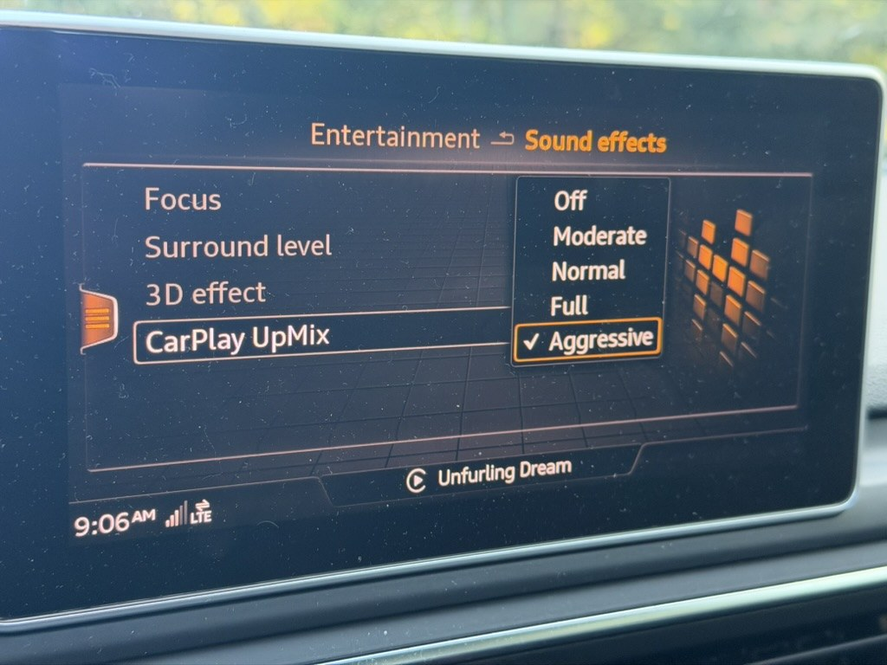
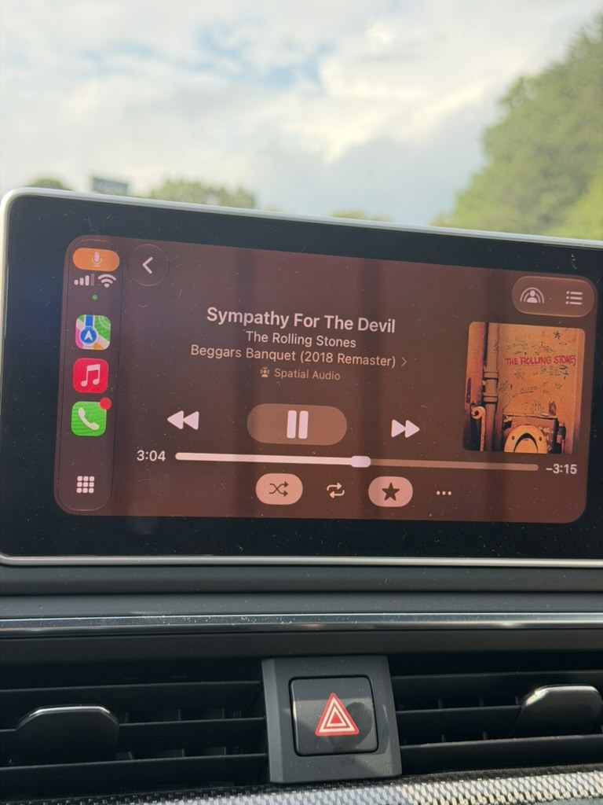

# MHI2Q CarPlay cluster integration

Bring CarPlay maps, turn-by-turn directions, calls and album art to your Audi Virtual Cockpit —
the digital instrument panel behind the steering wheel. Cars with an external amplifier also
get 5.1 surround sound.

This mod is for **Audi MHI2Q** infotainment systems. After installation, connect your iPhone by
USB and use CarPlay as usual. See [compatibility and installation](#installation) before starting.

**Use at your own risk.** This mod changes the MMI system software. The installer saves backups
of the system files it replaces, but these do not guarantee recovery from a failed installation.
The authors are not responsible for damage, bricked units or warranty issues.

<a id="gallery"></a>

## 🎨 Gallery

**Virtual Cockpit: CarPlay map on the cluster, route guidance beside it**

<p align="center">
  
  
</p>
<p align="center">
  
  
</p>
<p align="center">
  
  
</p>

**Audi front PDC no longer hides CarPlay** · **Cover art on the cluster**

<p align="center">
  
  
</p>

**CarPlay calls on the cluster phone tab**

<p align="center">
  
  
  
</p>

**5.1 sound: CarPlay UpMix in the MMI · Spatial Audio from Apple Music**

<p align="center">
  
  
</p>

**Head-up display**

<p align="center">
  
  
</p>

<a id="contents"></a>

## 📍 Contents

- [Gallery](#gallery)
- [Installation](#installation) · [Compatibility](#requirements) · [Uninstall](#uninstall)
- [Features](#features) · [CarPlay settings](#mmi-settings)
- [Troubleshooting and logs](#logging)
- [Build from source](#build) · [Technical documentation](#documentation)
- [Help wanted](#help-wanted) · [License](#license) · [References](#references)

<a id="installation"></a>
<a id="deployment"></a>

## 📦 Installation

> [!WARNING]
> **UPDATE YOUR MMI SOFTWARE BEFORE INSTALLING THIS MOD.**
>
> Your MMI must already be running one of the latest versions, example listed below.
> **Installing on older or unsupported software can brick the MMI** — it may stop at the Audi
> logo and no longer start normally. Use the correct firmware for your unit and region.
>
> The CarPlay installer does **not** update your MMI firmware. If it warns about an unsupported
> version, stop and resolve that first. **Do not run it again to bypass the warning.**
>
> Already stuck on the logo? Follow the [recovery guide](https://github.com/luka-dev/mib2q-carplay-rgi/issues/24#issuecomment-5849641990).

<a id="requirements"></a>

### Check compatibility first

You need:

- An **Audi MHI2Q** infotainment system running one of the versions below. Check the full
  software version in your MMI's version information screen; the car model alone is not enough.
- **Audi Virtual Cockpit**, the fully digital instrument panel. Analog instruments are not supported.
- An SD card with **M.I.B. (More Incredible Bash)** already set up, and access to the
  **Green Engineering Menu (GEM)**. This guide starts from a working M.I.B. setup.
- The prepared CarPlay installation archive (`install_*.zip`) from the
  [Releases page](https://github.com/luka-dev/mib2q-carplay-rgi/releases).
  Download it from the release's **Assets** section. The **Source code** ZIP is not an installation package.

| Region | Supported MMI software versions |
| --- | --- |
| **US** — North America | `MHI2Q_US_AUG22_P5087`, `MHI2Q_US_AUG22_P5145` |
| **ER** — Europe / rest of world | `MHI2Q_ER_AUG22_P5092`, `MHI2Q_ER_AUG22_P5152` |
| **JP** — Japan | `MHI2Q_JP_AUG22_P1017` |
| **CN** — China | `MHI2Q_CN_AUG22_K1004` |

**Sound system:** 5.1 sound and UpMix are supported on all external amplifiers used with these
MHI2Q systems, including **B&O and Bose**. Cars using the MMI's built-in amplifier keep normal
stereo sound; the map, calls and other cluster features are still available.

**Other CarPlay mods:** uninstall any other CarPlay mods using their own uninstallers before
proceeding. Conflicting mods can cause malfunctions or brick the MMI.

<a id="install-with-mib"></a>

### Install with M.I.B.

If you have not set up M.I.B. yet, follow the instructions in the
[M.I.B. GitHub repository](https://github.com/Mr-MIBonk/M.I.B._More-Incredible-Bash) first.

1. **Unzip the installation package on your computer.**
   Open the `install_MoreIncredibleBash` folder inside it.

2. **Copy its `mod` folder to your M.I.B. SD card.**
   Put it at the top level of the card, alongside the existing `apps` and `esd` folders.
   Merge the folders and replace matching files if asked. Keep all files inside `carplay` together.

   ```text
   M.I.B. SD card/
   ├── apps/                 <- already on the card
   ├── esd/                  <- already on the card
   └── mod/
       ├── custom.sh
       ├── command.sh
       └── carplay/          <- copy this folder with all its contents
   ```

   Check that `custom.sh` is directly inside `mod`. Do not put the outer
   `install_MoreIncredibleBash` folder on the card.

3. **Disconnect your iPhone and insert the card into SD1.**
   CarPlay must be disconnected while the installer runs.

4. **Open the Green Engineering Menu and run the installer.**
   Find the button combination for your car in the
   [M.I.B. menu and reboot shortcuts](https://github.com/Mr-MIBonk/M.I.B._More-Incredible-Bash/wiki/%22hidden-menus%22---key-combinations).
   Select **m.i.b. → Advanced Settings → Run Custom Script**.
   On M.I.B. V3.7.1 and older, the same option is called **Run individual script**.

5. **Wait for the completion message.**
   The installer checks the files and saves backups before replacing system files.
   At the end, it spends another 20 seconds saving changes. Wait until you see:

   ```text
   DONE (install). Reboot the HU to load.
   ```

   Here, **HU** means the MMI head unit. Do not restart it or remove the card while the
   installer is still running. If it reports a failure, record the message and resolve it
   before continuing.

6. **Restart the MMI with the iPhone still disconnected.**
   Use the **Reboot** combination for your car in the
   [same shortcut table](https://github.com/Mr-MIBonk/M.I.B._More-Incredible-Bash/wiki/%22hidden-menus%22---key-combinations).
   Once the MMI has fully started,
   reconnect your iPhone.

<a id="reboot-and-check"></a>

### Check that it works

Open CarPlay and Apple Maps, then check the map in the Virtual Cockpit. Start a route to check
the turn arrows and lane guidance. You can also check album art on the media tab and calls on
the phone tab.

To adjust the map, route guidance or audio, see [CarPlay settings](#mmi-settings).

<a id="uninstall"></a>

### Uninstall

1. Disconnect your iPhone.
2. Open `uninstall_MoreIncredibleBash` from the installation archive. Copy its `mod` folder
   to the top level of the M.I.B. SD card, replacing `custom.sh` and `command.sh`.
3. Insert the card into **SD1** and run **m.i.b. → Advanced Settings → Run Custom Script**
   (or **Run individual script**) in the Green Engineering Menu.
4. Wait for the saving step to finish and for `DONE (uninstall). Reboot the HU.` to appear.
5. Restart the MMI.

The uninstaller restores the saved system files and removes the files added by this mod.
M.I.B.'s conflicting `NavActiveIgnore` add-on is removed during installation and is not restored
by uninstalling. See the [installer details](docs/build-and-deploy/DEPLOY_AND_RELEASE.md#-the-mib-sd-install).

<a id="features"></a>

## 🎯 Features

<a id="virtual-cockpit-and-hud"></a>

### 🗺️ Maps and directions behind the steering wheel

- **CarPlay map in the Virtual Cockpit.** See the map even when no route is active.
  Classic, Sport and expanded map views are supported where available on your cluster.
  Press **VIEW** to change the layout; use the steering-wheel map zoom roller to zoom in or out.
- **Turn-by-turn directions.** See 3D turn arrows, roundabout exits, the distance to the next
  turn and recommended lanes beside the map. The distance bar fills as you approach the turn.
- **Road names and arrival time.** Long road names scroll. Press **OK** on the left
  steering-wheel roller to switch between road information and arrival time / time remaining.
- **Head-up display.** If your car has a HUD, turn arrows, lane guidance and distance also
  appear on the windshield.
- **Album art.** The Virtual Cockpit media tab shows the cover of the music playing in CarPlay.

What appears depends on the navigation app and the information it sends. Apps that provide
route guidance let the car draw its own turn arrows and lane guidance. Other apps may show
their own directions inside the map instead. Waze does not provide native cluster/HUD guidance
in the versions examined by this project; do not assume every app supports every feature.
See [navigation app support](docs/cluster-and-rgi/THIRD_PARTY_NAV_APPS.md).

The map requests up to **30 fps** for smoother movement. The actual rate depends on the iPhone,
app and connection; a steady 30 fps on the car has not yet been confirmed.
[Technical details](docs/altscreen-and-video/MAPS_30FPS_PROFILE.md).

<a id="audio-and-upmix"></a>

### 🔊 5.1 surround sound and UpMix

These features work with **external amplifiers, including B&O and Bose**:

- **Spatial Audio.** Supported Apple Music Spatial Audio / Dolby Atmos tracks play in 5.1,
  with separate front, centre, rear and bass channels.
- **UpMix for ordinary music.** Expands stereo music from apps such as Spotify and YouTube Music
  into surround sound. Vocals stay focused at the front, while instruments and ambience can
  extend behind you. Choose **Off**, **Normal** or **Intense** in CarPlay settings.
- **Normal voice audio.** Calls, Siri and navigation prompts keep their normal voice playback.

Cars with the MMI's built-in amplifier keep stereo audio, and the surround options are hidden
automatically. There is no amplifier type to select during installation.

On supported B&O systems, the **Sound effects** menu also offers a **Surround On/Off** switch
and **AudioPilot** road-noise compensation. Amplifier sound controls differ between systems;
B&O's surround bypass does not behave the same way on Bose.

See [audio documentation](docs/audio/README.md) for the audio processing and
[amplifier comparison](docs/audio/ODIS_AMP_MAPPING.md#external-amplifier-support) for compatibility details.

<a id="calls-and-controls"></a>

### 📞 Calls and everyday controls

- **Calls on the Virtual Cockpit phone tab.** See the caller's name and number, call status,
  timer, recent calls and favourites. Answer, reject or end calls from the steering wheel;
  hold, mute, call waiting and keypad dialling are also available. Caller photos are not available.
- **MMI touchpad navigation.** Swipe to move the selection through CarPlay lists and buttons.
  Faster swipes move further.
- **Siri with a short press.** Press the steering-wheel voice button briefly to open Siri
  while CarPlay is connected. A long press still works.
- **Parking sensors beside CarPlay.** The parking sensor display can appear alongside CarPlay
  instead of covering the whole screen.
- **Car information for the iPhone.** Sends wheel speed, remaining fuel range, outside temperature
  and the low-fuel warning for apps that use them.
- **Improved USB reconnection.** Includes fixes for CarPlay failing to reconnect after the
  iPhone is unplugged and plugged back in.

<a id="mmi-settings"></a>

### ⚙️ CarPlay settings

You can open these settings at any time, even when CarPlay is disconnected.
Go to **Main Menu → Settings → Connection manager**, highlight **Audi smartphone interface**,
push the rotary knob **to the right**, and select **CarPlay settings**.

| Setting | What it does | When it takes effect |
| --- | --- | --- |
| **Spatial Audio** — On / Off | Enables 5.1 sound in supported apps. External amplifier required. | Reconnect the iPhone |
| **UpMix** — Off / Normal / Intense | Sets how much surround sound is added to stereo music. External amplifier required. | Immediately |
| **Maps on Cluster** — On / Off | Shows or hides the CarPlay map in the Virtual Cockpit. | Reconnect the iPhone |
| **Maneuver Cards Position** — Left / Center / Right | Places the phone's turn cards and arrival time on the map. | Reconnect the iPhone |
| **Route Guidance** — On / Off | Shows or hides the car's 3D turn arrows in the Virtual Cockpit and HUD. | Immediately |
| **Map Cards during Guidance** — Hidden / Shown | Hides the phone's turn cards while the car shows its own guidance, or keeps both visible. | Immediately |
| **Guidance Maneuver Preview** — Always next maneuver / Follow road when far | Shows the next turn early, or a straight-ahead arrow until you get closer. | Immediately |

<a id="logging"></a>

## 📝 Troubleshooting and logs

If something goes wrong, include your full MMI software version, iPhone model, iOS version,
navigation or music app, and the steps that caused the problem. For a wrong turn arrow,
include what you expected to see and when it happened.

You can collect diagnostic logs with M.I.B.; no terminal connection is needed:

1. Copy the `mod` folder from `logging_MoreIncredibleBash` in this repository to the top level
   of your M.I.B. SD card, replacing the previous scripts.
2. Run it from the same Green Engineering Menu option used for installation.
   This saves the current logs and turns on more detailed logging.
3. Reconnect the iPhone and reproduce the problem.
4. Run the logging script again **before restarting the MMI**. Restarting clears the session logs.
5. Attach the newest numbered folder inside `carplay_logs` on the SD card to your bug report.

For log files, SSH commands and diagnostic details, see
[log collection](docs/build-and-deploy/DEPLOY_AND_RELEASE.md#collecting-logs) and
[logging options](docs/build-and-deploy/BUILD_SYSTEM.md#logging-options).

<a id="build"></a>
<a id="manual-install"></a>
<a id="repository-layout"></a>

## 🔧 Build from source

To compile your own installation package, start with the [Build System](docs/build-and-deploy/BUILD_SYSTEM.md)
guide. For package contents and manual installation over SSH, see
[Deploy and Release](docs/build-and-deploy/DEPLOY_AND_RELEASE.md).

<a id="documentation"></a>

## 📚 Technical documentation

The guides in [`docs/`](docs/README.md) cover implementation, reverse engineering, test results
and development work. Use the [full topic index](docs/README.md#notes-by-topic) or start here:

| Topic | Guide |
| --- | --- |
| Surround sound, UpMix and amplifiers | [Audio](docs/audio/README.md) |
| Turn arrows, lanes, HUD and calls | [Cluster and route guidance](docs/cluster-and-rgi/README.md) |
| Cluster maps, video and steering-wheel input | [AltScreen and video](docs/altscreen-and-video/README.md) |
| USB connection and reconnection | [Connect and USB](docs/connect-and-usb/README.md) |
| Emulators and test tools | [CarPlay laboratory](docs/carplay-lab/README.md) |
| Building and installing packages | [Build and deploy](docs/build-and-deploy/README.md) |
| How the components work together | [Architecture](docs/reference/ARCHITECTURE.md) |

Before changing the code, read [known pitfalls](docs/LANDMINES.md).

<a id="help-wanted"></a>

## 🤝 Help wanted

Bug reports, fixes, documentation improvements and test reports from other cars are welcome.
Please include your MMI software version and sound system, and describe what worked or failed.
The [log collection steps](#logging) help us investigate problems.

<a id="license"></a>

## 📄 License

GNU General Public License v3.0 or later ([LICENSE](LICENSE)): use, change and share it, also
commercially, as long as the source of what you distribute stays open under the same license and
the copyright notices stay in place. Stock firmware files, jars, fonts and other third-party
material in the repository keep their owners' terms; [NOTICE](NOTICE.md) lists them.

<a id="references"></a>

## 🔗 References

Thanks for the prior work and knowledge that helped figure this out:

- [EthanArbuckle/iPhone18-3_26.1_23B85_Restore](https://github.com/EthanArbuckle/iPhone18-3_26.1_23B85_Restore)
- [adi961/mib2-android-auto-vc](https://github.com/adi961/mib2-android-auto-vc)
- [OneB1t/VcMOSTRenderMqb](https://github.com/OneB1t/VcMOSTRenderMqb)
- [@fifthBro](https://t.me/fifthBro)
- [xPaiiN](https://github.com/xPaiiN) for telephony magic
- [Matze89x](https://github.com/Matze89x) for actively testing experimental stuff
- thx to every contributor
- and everyone who reported their bugs
