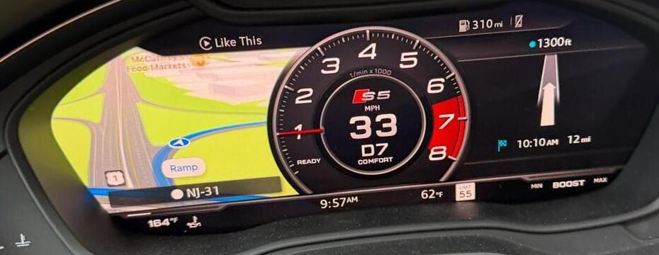
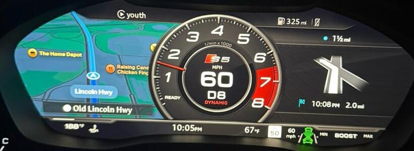
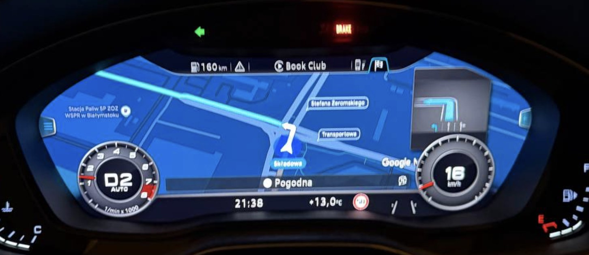
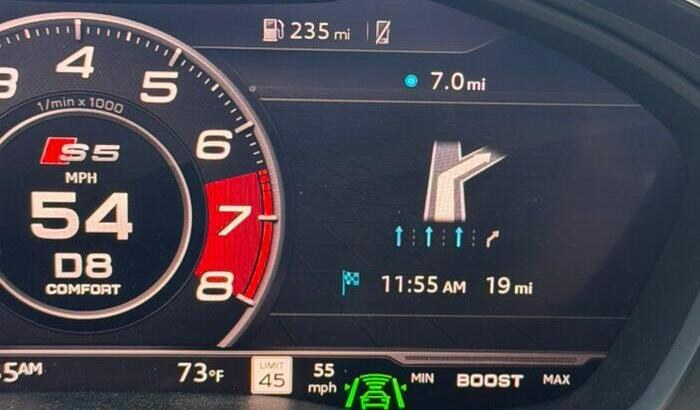
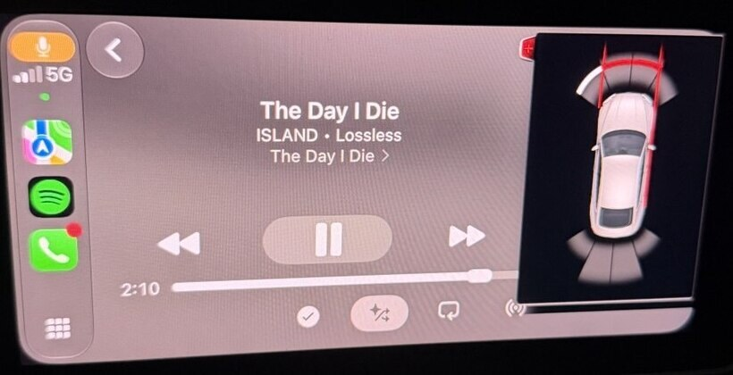
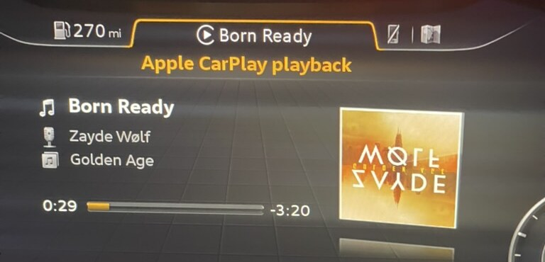
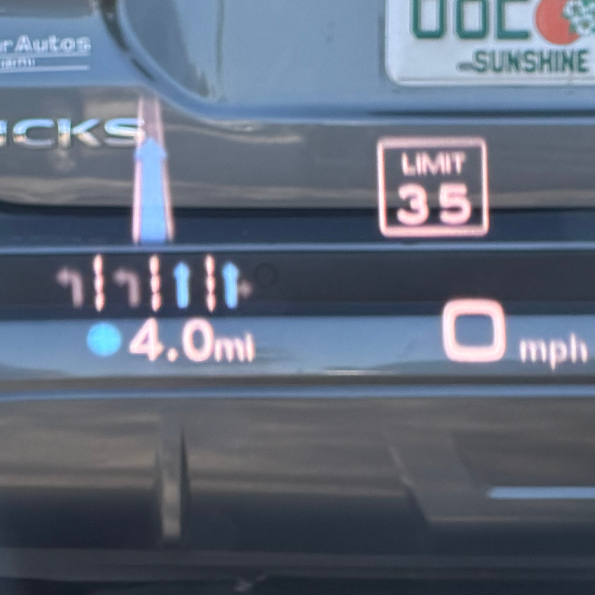
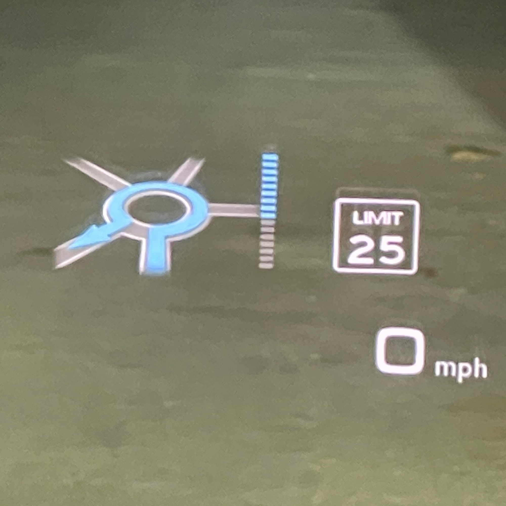
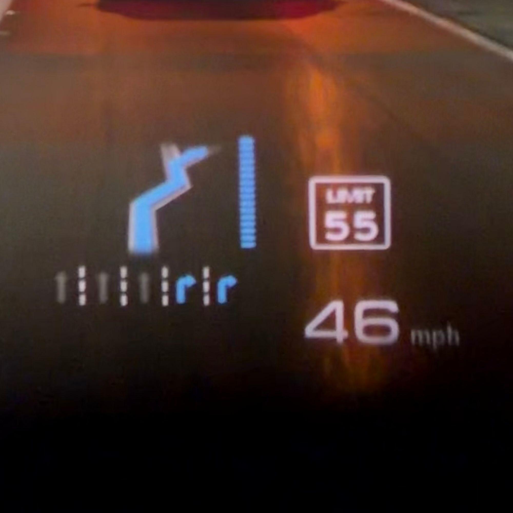

# MHI2Q CarPlay cluster integration

Production implementation for Audi MHI2Q (MU1316, QNX 6.5 ARMv7):

- stock `libairplay.so` 210.81 inside `dio_manager`;
- `LD_PRELOAD` hook for CarPlay negotiation, route guidance, altScreen stream 111 and the
  buffered/upmixed 5.1 audio path;
- external QNX renderers for maneuver graphics and cluster video;
- one Java patch for cluster context, BAP/RGI, cover art and steering-wheel input.

The shipped path always keeps stock `libairplay.so`. From-source libairplay/dio experiments are
research records, not production dependencies or authorities for stock 210 behavior.

**Disclaimer:** use at your own risk. These patches modify firmware binaries and system
configuration on your infotainment unit. The installer keeps a `.carplay-stock` backup of every
file it replaces, but back up anything you change by hand as well. The authors are not
responsible for any damage, bricked units or warranty issues resulting from their use.

## Gallery

<p align="center">
  <br />
  <sub>Cluster maneuver renderer driven through a demo route</sub>
</p>

**Virtual Cockpit: CarPlay map on the cluster, route guidance beside it**

<p align="center">
  
  
</p>
<p align="center">
  
  
</p>

**Audi front PDC no longer hides CarPlay** · **Cover art on the cluster**

<p align="center">
  
  
</p>

**Head-up display**

<p align="center">
  
  
  
</p>

## Features

There is nothing to switch on: plug in the iPhone and CarPlay starts as usual; the cluster
features below follow it automatically.

- **CarPlay map in the Virtual Cockpit.** The phone streams its own map to the cluster (Apple's
  second-screen "altScreen" stream). It shows while CarPlay is connected, even without an active
  route. The **Audi View** button switches the cluster between its classic and large layouts as
  with the stock navigation, and the **steering-wheel roller** zooms the cluster map. A short
  animation fills the cluster until the first video frame arrives.
- **Turn-by-turn on the cluster.** During CarPlay navigation the cluster shows a 3D maneuver
  arrow beside the map. Its distance bar fills as the turn approaches and blinks just before it.
  The cluster also shows lane arrows, distance to the turn, arrival time and remaining distance.
  Needs an app that sends CarPlay route guidance: Apple Maps does, Waze does not
  ([details](docs/cluster-and-rgi/THIRD_PARTY_NAV_APPS.md)).
- **Route text in the Virtual Cockpit.** A text line under the map names the exit sign or the
  next road (the current road when there is nothing else); long names scroll. Press **OK** (the
  left steering-wheel roller) to switch it to arrival time and time left, and press again to go
  back ([details](docs/cluster-and-rgi/RGI_AND_BAP_BRIDGE.md#-route-text-eta-and-the-mfw-ok-key)).
- **Head-up display.** The same maneuver icons, lane arrows and distance appear on the HUD.
- **Cover art on the cluster.** The now-playing album art shows on the cluster media screen.
- **Parking popups no longer hide CarPlay.** When the Audi front PDC / parking view pops up,
  CarPlay stays on screen beside it instead of being replaced.
- **5.1 surround for CarPlay music (B&O).** The head unit feeds the external B&O amplifier six
  channels instead of two, and the amplifier's own Virtual Cabin processing spreads them over the
  cabin speakers ([details](docs/audio/README.md)).
  - *Spatial input:* Spatial Audio / Dolby Atmos tracks from Apple Music arrive as real 5.1 in
    Apple's APAC codec. The head unit decodes them and plays each channel on its own speaker
    group, with no upmix.
  - *Stereo input* (most music, and apps such as Spotify): a small model running on the head
    unit (HSSR) upmixes it. Vocals and lead parts stay anchored in front, secondary parts and
    room ambience move to the rear speakers with short delays for depth, and the subwoofer gets
    its own bass feed. Calls and Siri stay plain stereo. It is cheap: measured on the unit
    (2026-09-05 build), a 21 ms block of audio takes about 5 ms of one CPU core, so it runs roughly 4× faster than
    real time and uses under a quarter of a core
    ([measurements](docs/audio/UPMIX_COMPUTE_BUDGET.md#-measured-krait-wall-time)).
  - Built for the B&O amplifier only. The startup script enables it unconditionally for now;
    cars with the internal amplifier have no six-channel route and are untested.

## Documentation

All documentation is one linked Markdown tree in [`docs/`](docs/README.md). Start at
[`docs/README.md`](docs/README.md), then the per-domain maps:

| Domain | Entry point |
| --- | --- |
| Audio (upmix, HSSR model, J525 amp, codecs, 5.1 routing) | [`docs/audio/README.md`](<docs/audio/README.md>) |
| Cluster and route guidance (contexts, BAP/RGI, HUD renderer) | [`docs/cluster-and-rgi/README.md`](<docs/cluster-and-rgi/README.md>) |
| AltScreen and video (stream 111, OMX pipeline, loader) | [`docs/altscreen-and-video/README.md`](<docs/altscreen-and-video/README.md>) |
| Connect and USB (NCM, replug recovery, PF, session lifecycle) | [`docs/connect-and-usb/README.md`](<docs/connect-and-usb/README.md>) |
| Build and deploy (toolchain, release map, VIN protection) | [`docs/build-and-deploy/README.md`](<docs/build-and-deploy/README.md>) |
| Architecture overview | [`docs/reference/ARCHITECTURE.md`](docs/reference/ARCHITECTURE.md) |

Read [`docs/LANDMINES.md`](docs/LANDMINES.md) before touching a subsystem. Long-form white papers
are in `docs/research/`; primary evidence (papers, manuals, data files, decompiled stock Java) is in
`docs/sources/`.

## Repository layout

| Path | Purpose |
| --- | --- |
| `hook/` | Shipping native `libcarplay_hook.so` source |
| `java_patch/` | The only Java patch source |
| `maneuver_render/` | GLES maneuver overlay renderer (cluster plane 98) |
| `altscreen_render/` | OMX/GLES altScreen video renderer and PRISM loader (cluster plane 99) |
| `apac_decoder/` | APAC decoder port behind the optional `libcarplay_apac.so` |
| `common/` | Shared QNX Screen surface code |
| `models/` | HSSR upmix models (q6d main model, V11 guard) |
| `deploy/` | On-unit runtime scripts, SI child config, patched firmware and PF/deva recipes |
| `scripts/` | Host build and test entry points |
| `install_MoreIncredibleBash/`, `uninstall_MoreIncredibleBash/` | M.I.B. SD install/remove scripts |
| `protector/` | VIN-lock protector used by the protected build |
| `tools/` | Host tools (upmix renderer and benches, QSA emulator, amp model, …) |
| `assets/` | RE working sets (`soundamp/`, `vc-fonts/`) and visual references |
| `toolchain/qnx65-abi/` | QNX Screen/OpenMAX ABI headers used only for cross-compilation |
| `docs/` | The documentation (GitHub-rendered; also opens as an Obsidian vault) |
| `build/` | Build outputs (untracked, empty in git) |
| `logs/` | Ignored local evidence: vehicle captures, HU logs, iPhone sysdiagnose, state traces |

Build output, raw unit logs and generated class trees are intentionally kept outside Git.
The cleanup archive is under `/Users/luka/Desktop/AUDI_2/LocalLogs/`.

## Build

Native code needs the QNX 6.5 ARMv7 cross-toolchain image from
[luka-dev/qnx65-armv7-toolchain](https://github.com/luka-dev/qnx65-armv7-toolchain). Build it once:

```sh
git clone https://github.com/luka-dev/qnx65-armv7-toolchain
cd qnx65-armv7-toolchain
./host-scripts/qnx-run.sh build        # qnx65-armv7-toolchain:latest (GCC 8.5)
./host-scripts/qnx-run.sh build 4.9    # optional: :4.9 (GCC 4.9.4)
```

Then run from this repository's root:

```sh
./scripts/build_java.sh
./scripts/build_hook.sh
./scripts/build_renderers.sh
```

Native builds run in the `qnx65-armv7-toolchain` Docker image; `:latest` (the default) is GCC 8.5,
`QNX_TOOLCHAIN_VARIANT=4.9` selects GCC 4.9.4. Renderer import libraries are generated during the
build; the resulting ELFs resolve the real Screen/EGL/GLES/OpenMAX libraries on the unit.

| Variant | Command | Output |
| --- | --- | --- |
| Quiet production | `LOG=0 ./scripts/build_hook.sh` | logging, audio probe captures and pace diagnostics compiled out |
| No audio module | `HOOK_AUDIO=0 ./scripts/build_hook.sh` | hook without the type-103 audio path, no codec |
| State trace | `LOG=0 AUDIO_STATE_TRACE=1 ./scripts/build_hook.sh` | compact `/tmp/carplay_state_trace.log` ledger (see `scripts/carplay_state_trace.sh`) |
| VIN-locked | `./scripts/build_hook_protected.sh <VIN>` | stamped `.so` files in `build/protected_<VIN>/` |

Build outputs (binaries only; builds never package a release):

```text
build/carplay_hook.jar
build/unprotected/libcarplay_hook.so
build/unprotected/libcarplay_apac.so
build/maneuver_render
build/altscreen_render
```

Models are versioned in `models/`: `hssr-q6d-moises-a/hssr_model.bin` (main) and
`hssr-selection-v11/hssr_guard.bin` (vocal guard, loaded from beside the main model).

Tests: `./scripts/run_tests.sh`.

## Deployment

**Compatibility.** The patch is not limited to US, EU or CN units, nor to one MU train: it is
meant for any MHI2Q MU firmware (developed on MU1316). What matters is:

- a fully digital instrument cluster (Audi virtual cockpit); cars with an analog cluster are not
  supported;
- preferably, the latest firmware available for the unit, flashed before installing the patch.

With both in place it should almost certainly work, as long as nothing went wrong during the
install itself.

A release is assembled by hand. Stage the build outputs, the models and the `deploy/` runtime files
into `install_MoreIncredibleBash/mod/carplay/root/`, each at its on-unit path (for example
`mod/carplay/root/mnt/app/root/hooks/libcarplay_hook.so`), and put `carplay_child.json` in
`mod/carplay/`. Copy the contents of `install_MoreIncredibleBash/` onto the M.I.B. SD card, so the
card holds `mod/custom.sh` and `mod/carplay/`, then run `mod/custom.sh` from M.I.B. The
source-to-unit map, file modes and hashes are in
[Deploy and Release](<docs/build-and-deploy/DEPLOY_AND_RELEASE.md>).

- `custom.sh` copies every file under `SD:/mod/carplay/root/` to the same path under `/` on the
  unit, replaces the SI `carplay` child by path, widens the CarPlay rule in all four PF profiles
  and registers the iAP2 route-guidance message IDs in `dio_manager.json` (without them no route
  guidance arrives). It keeps a `.carplay-stock` backup of everything it replaces or edits, and
  never stops processes or reboots the HU. For a manual install of the message IDs, see the
  [procedure](<docs/build-and-deploy/DEPLOY_AND_RELEASE.md#-route-guidance-message-ids-in-dio_managerjson>).
- Uninstall: copy `uninstall_MoreIncredibleBash/` over the card and run it; it restores every
  `.carplay-stock` backup and deletes the owned files.
- The runtime integration (renderer supervision, environment, spatial/upmix settings) lives in
  [`deploy/smartphone_integrator/`](deploy/smartphone_integrator/README.md); the shipped audio
  calibration is set in `deploy/smartphone_integrator/carplay_startup.sh` and documented in
  [Stereo to 5.1 Upmix](<docs/audio/STEREO_TO_5_1_UPMIX.md>).

Disconnect CarPlay first and reboot the HU manually after installing. Deploying the Java jar always
means a full unit restart (it is on j9's boot classpath).

## References

Thanks for the prior work and knowledge that helped figure this out:

- https://github.com/ludwig-v/wireless-carplay-dongle-reverse-engineering
- https://github.com/EthanArbuckle/iPhone18-3_26.1_23B85_Restore
- https://github.com/adi961/mib2-android-auto-vc
- [@fifthBro](https://t.me/fifthBro)
