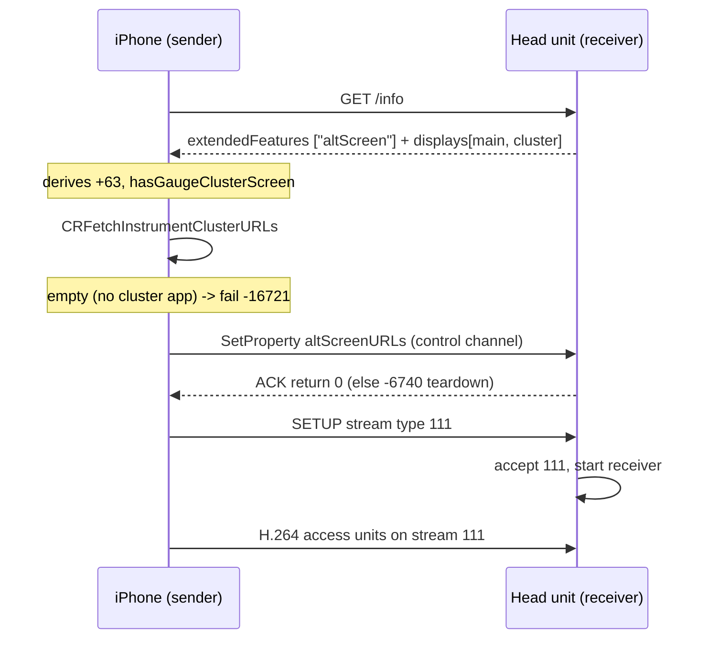

# AltScreen Cluster Video

*The gate that makes CarPlay offer the instrument cluster, and the wiring that gets its video onto a MOST/LVDS panel.*

---

## 🎯 What altScreen is

altScreen is CarPlay's **second display** — the Audi Virtual Cockpit instrument cluster. On the AirPlay wire the cluster pixels ride **screen stream type 111** (the main touchscreen is type 110). The phone only offers 111 if the head unit advertises a cluster display in `/info`, so everything begins with the advertisement being *believed* by the phone. **[decompile]**

The panel is **1440 × 542** visible — the Audi Kombi (LVDS2) resolution, from firmware `ifs2/ifs_display/proc/boot/qcdisplaycfg_MMX2.xml` (`uVisWidth='1440' uVisHeight='542'`). This is the geometry advertised in `/info` (so the phone encodes 111 at exactly this size) and the OMX decode window default. It is **not** 1920×720. **[car]**

## 🔐 The activation gate

Verified against the iOS 26.1 sender decompile (`AirPlaySender.framework`, the phone is the AirPlay sender). The chain: **[decompile]**

Steps in words:

1. Phone reads car `/info` `"extendedFeatures"` — a CFArray of feature-key strings — and checks for `"altScreen"`. The `displays` array must also contain a display whose properties include `"Instrument Cluster"` → `hasGaugeClusterScreen`. `extendedFeatures` alone is insufficient; the second display is what actually sets the flag. **[decompile]**
2. Present → `carEndpoint` derived storage **+63 = 1**. **[decompile]**
3. `+63` → phone calls `APCarPlay_CRFetchInstrumentClusterURLs` (needs a cluster-capable app installed, e.g. Apple Maps). Empty → activation fails **-16721** (app-side, not HU-controllable — this is why Apple Maps works and Waze does not). **[decompile]**
4. Non-empty → phone sends `SetProperty("altScreenURLs", [...])` over the **control** channel. This is a handshake/metadata exchange (which app's cluster scene supplies content), **not** an HTTP video URL. The HU must store and ACK it (~250 ms, else `-6740`). **[decompile]**
5. Pixels then ride the type-111 **SETUP** stream — the same push transport as the main screen. Codec is H.264/AVC by default (HEVC only if the phone opts in); our OMX decoder is AVC, matching the default. **[decompile]**

### Where extendedFeatures is declared

Stock libairplay 210 has **no** altScreen at all (too old). The decision was to declare `extendedFeatures ["altScreen"]` in the **dio_manager patch** via `AirPlayReceiverServerSetProperty`, not in libairplay — feature *policy* belongs to dio, and dio's config wins over the platform hook. See `memory/altscreen_ios26_gate_verified.md` and `Patches/dio_manager-mhi2q/`. **[decompile]**

## ⚠️ Error codes

| Code | Layer | Meaning |
|---|---|---|
| `-16721` | app-side (phone) | Cluster URL list empty — no installed app has a cluster scene. Not HU-fixable. |
| `-6740` | accessory-side (libairplay) | altScreen advertised but stream 111 rejected / URLs not ACKed in time → teardown loop (looks like a dio restart, not a crash). |
| `-6735` | HU (our module) | `viewArea` ack sent before altScreen video is up; harmless, self-heals to status 0 after `VIDEO_ON`. |

## ❌ P0 — forceKeyFrame must use `uuid`, not `displayUUID`

`alt_request_cluster_idr` (`altscreen_hook.c:1578`) built the IDR request with `alt_params_new(0)` + `set_str("displayUUID", ...)`. But iOS 26.6 reads `params["uuid"]` for this command — `displayUUID` is a **HID** key. So every cluster IDR-recovery request falls back to the **primary** screen. With show-UI gated behind the first cluster IDR, **the cluster goes permanently black.** **[decompile]**

Fix (one line): `alt_params_new(1)` + delete the `displayUUID` line — every other command already keys on `uuid`. iOS 26.6 confirmed the other four command schemas correct (`showUI` / `updateViewArea` / `setNightMode{uuid}` / `changeMapZoomLevel{zoomDirection 0=in}`). See `memory/production_full_audit_9295b04.md` and [[Landmines]]. **Severity: P0 — cluster permanently black.**

## 🔧 The cluster delivery sink

libairplay cannot render directly to the cluster: `screenstream.c` `_SelectDisplay` only reaches QNX-Screen-enumerated displays, and the cluster is MOST/LVDS. So altScreen reuses **`altscreen_render`** (and the `c_render` displaymanager machinery) as a new frame *source* for the same cluster sink that native route guidance uses. CarPlay cluster and native RG are mutually exclusive on the panel, so one renderer suffices via mode switch. See [[Video Pipeline]] and [[Cluster and RGI MOC]]. **[car]**

Main-screen 110 black (fixed) — the fabricated-UUID trap

iOS fetches `/info` **once** at session start and builds all display/stream config from that snapshot — no re-fetch. Stock `AirPlayReceiverSessionScreen_CopyDisplayUUID` keys main-screen video on the **real** main display UUID. The hook's `main_disp_modernize` used to inject a **fabricated** main `uid` / `initialVideoStreams` UUID (`A0000000-…`), so iOS routed main video on the modern uid while the stock decoder waited on the real UUID → main 110 black. Cluster 111 worked because the hook owns both the descriptor and the receiver. Fix (on-unit verified): read the real main uuid via `cf_getval(mainDisp,"uuid")` and set `uid` + `initialVideoStreams` to it, no fabrication. See `memory/reconnect_flak_lifecycle_debounce.md`. **[car]**

---

## 📌 Input path (zoom / knob)

Cluster commands are semantic/BAP, not HID — the cluster advertises no `primaryInputDevice`. Map zoom went back and forth: `changeMapZoomLevel` is a *semantic* session command (focus-independent), while the knob is HID. Per the production audit, `CMD_ALT_ZOOM` is **live at `0x0110`** (corrects the older "dropped" note). See `memory/altscreen_zoom_vs_hid.md` and [[Cluster and RGI MOC]]. **[decompile]**
