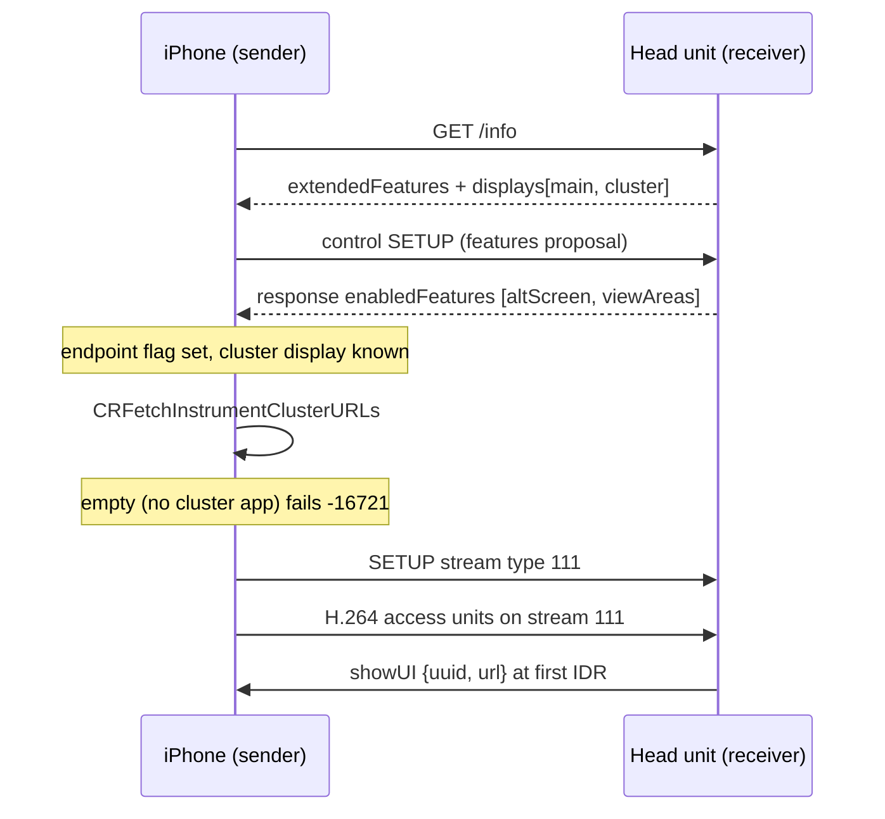

# AltScreen Cluster Video

*The gate that makes CarPlay offer the instrument cluster, and the wiring that puts its video on the MOST/LVDS cluster.*

---

## 🎯 What altScreen is

altScreen is CarPlay's **second display**, the Audi Virtual Cockpit instrument cluster. On the AirPlay wire the cluster pixels ride **screen stream type 111**; the main touchscreen is type 110. The phone offers 111 only when the head unit advertises a cluster display and negotiates the feature. Everything therefore starts with an advert the phone *believes*. **[decompile]**

The panel is **1440 × 542** visible pixels, the Audi Kombi (LVDS2) resolution. The source is firmware `ifs2/ifs_display/proc/boot/qcdisplaycfg_MMX2.xml` (`uVisWidth='1440' uVisHeight='542'`). The hook advertises exactly this geometry (`CLUSTER_W`/`CLUSTER_H`, `hook/altscreen/altscreen_hook.c:229-230`), so the phone encodes 111 at this size. It is also the renderer's default decode window (`ALTSCREEN_W`/`ALTSCREEN_H`, `altscreen_render/sink_omx_qnx.c:818-819`). It is **not** 1920×720. **[car]**

## 🔐 The activation gate

The chain below comes from the iOS 26.1 sender decompile (`AirPlaySender.framework`; the phone is the AirPlay sender). The hook side is verified in the current source. **[decompile]** / **[code]**

In words:

1. **`/info` advert.** The hook interposes stock `AirPlayCopyServerInfo` (`hook/framework/airplay_seams.c:98`). It adds `extendedFeatures = ["altScreen", "viewAreas"]` plus the `[main, cluster]` display tree, under both `displays` and `displayPanels`, to the dictionary stock returns. The cluster entry carries its own uuid (it must differ from main's), `type: 111` and `properties: ["Instrument Cluster"]` (`hook/altscreen/altscreen_hook.c:11-28`, `:406-441`, `:790-870`). The advert goes out only when every primitive of the 111 receiver resolves. A partial advert would restart the CarPlay session (`altscreen_hook.c:785-799`). **[code]**
2. **Control-SETUP negotiation.** The hook appends `altScreen` and `viewAreas` to the control-SETUP *response* `enabledFeatures`, keeps the features stock already accepted, and never echoes the phone's proposal (`altscreen_hook.c:1822-1860`). **[code]** The code comment records an iOS 26.6 disassembly: the phone reads the negotiated set from the response, and `carEndpoint_Activate` sets `endpoint[+0x3E]` from it. `/info` `extendedFeatures` alone does **not** set that flag, and stock 210 writes no `enabledFeatures`. **[decompile]**
3. **Cluster URLs (iOS side).** With the flag set, the phone calls `APCarPlay_CRFetchInstrumentClusterURLs`, which needs an installed app with a cluster scene (for example Apple Maps). An empty list fails activation with **-16721**. The failure is on the app side and the HU cannot fix it, which is why Apple Maps works and Waze does not. **[decompile]**
4. **`altScreenURLs` (iOS 26.1 model).** A non-empty list makes the phone send `SetProperty("altScreenURLs", [...])` over the **control** channel. It is handshake metadata that says which app's cluster scene supplies content, **not** an HTTP video URL. The receiver must ACK it within about 250 ms or the phone tears down with `-6740`. The current hook has no `altScreenURLs` handler, so the ACK path is stock's. **[decompile]**, handler **[open]**
5. **Stream 111.** Pixels ride a type-111 **SETUP** stream on the same push transport as the main screen. The hook owns the 111 receive/decrypt/AVCC→Annex-B path (`altscreen_hook.c:4-9`). The codec is H.264/AVC by default, with HEVC only if the phone opts in. The renderer's decoder is `OMX.qcom.video.decoder.avc` (`altscreen_render/sink_omx_qnx.c:46`). **[decompile]** / **[code]**
6. **Scene selection (HU side).** Stock 210 has no policy layer for `suggestUI`, so the hook chooses the cluster scene. At the first IDR it sends `showUI {uuid, url}`, then night mode and the cached view area (`altscreen_hook.c:1416-1429`). The Maps URL depends on RGI state (`altscreen_hook.c:2551-2584`); [[Third-party Nav Apps]] has the URL model. **[code]**

> [!note] Open discrepancy between iOS 26.1 and 26.6 RE
> The iOS 26.1 RE in this note said that `extendedFeatures` containing `"altScreen"` sets `carEndpoint` +63, and that the `"Instrument Cluster"` property sets `hasGaugeClusterScreen`. The hook's iOS 26.6 comments say something different on three points (`altscreen_hook.c:424-433`, `:1834-1836`):
>
> - `altScreen` sets `+0x3E` (62), and `+0x3F` (63) is `uiContext`.
> - The 111 gate is the negotiated `enabledFeatures` flag, plus at least two raw displays, plus a cluster UUID different from display 0.
> - `"Instrument Cluster"` maps to `supportsInstrumentClusterContent`, **not** `hasGaugeClusterScreen`.
>
> The hook implements both sides, so it works either way. Whether 26.1 and 26.6 really differ, or the earlier reading was wrong, is **[open]**.

### Where the advert is declared

Stock libairplay 210 contains **no** `extendedFeatures` support: the string occurs zero times in the binary. An earlier plan declared the key in a dio_manager patch through `AirPlayReceiverServerSetProperty`. On stock that path is a **no-op**; it works only on the 280/from-source lib (`altscreen_hook.c:11-18`, `:684-697`). Production therefore interposes the `/info` builder in the LD_PRELOAD hook with no dio binary patch, and adds the control-SETUP `enabledFeatures` injection. Two value-checked env gates control it, and the shipped startup script sets both to `1`: `ALTSCREEN_HANDLE_ALT` and `ALTSCREEN_ADVERT_DISPLAYS` (`altscreen_hook.c:704-712`, `:721`, `:792`; `deploy/smartphone_integrator/carplay_startup.sh:53-54`). The old from-source attempts now live in `Patches/dio_asm_to_c/_legacy_attempt/`. See `memory/altscreen_ios26_gate_verified.md`. **[code]**

## ⚠️ Error codes

| Code | Layer | Meaning |
|---|---|---|
| `-16721` | app side (phone) | The cluster URL list is empty because no installed app has a cluster scene. The HU cannot fix this. |
| `-6740` | accessory side (libairplay) | altScreen was advertised, but stream 111 was rejected or the URLs were not ACKed in time. The result is a teardown loop that looks like a dio restart, not a crash. |
| `-6735` | HU (our hook) | The hook returns this when there is no committed altScreen session yet (`altscreen_hook.c:2115-2118`). It reaches Java as the `viewArea` ack status. It is harmless: the hook caches the zone mode and replays it at the first IDR (`altscreen_hook.c:1425`, `:2525-2528`). |

## ✅ forceKeyFrame targets the cluster by `uuid` (resolved)

**History.** At audit `9295b04`, `alt_request_cluster_idr` built its IDR request with `alt_params_new(0)` + `set_str("displayUUID", ...)`. iOS 26.6 reads `params["uuid"]` for this command, and `displayUUID` is a **HID** key. Every cluster IDR-recovery request therefore fell back to the **primary** screen, and because the show-UI step waits for the first cluster IDR, the cluster could stay black for good. That was rated P0. See `memory/production_full_audit_9295b04.md`. **[decompile]**

**Current code.** `alt_request_cluster_idr` builds `{type:"forceKeyFrame", params}` with `alt_params_new(1)`, which keys the cluster `uuid`. There is no `displayUUID` in it, and it logs `cluster forceKeyFrame uuid=...` (`hook/altscreen/altscreen_hook.c:2502-2523`). `alt_params_new(1)` presets `uuid` = the cluster display (`:2360-2368`). The other cluster commands use the same key: `showUI` (`:2581`), `setNightMode` (`:2407`), `changeMapZoomLevel {zoomDirection 0=in}` (`:2485-2486`), and `updateViewArea {uuid, viewAreaIndex}` (`:2277-2283`). See [[Landmines]]. **[code]**

## 🔧 The cluster delivery sink

libairplay cannot render straight to the cluster. `screenstream.c` `_SelectDisplay` reaches only displays that QNX Screen enumerates, and the cluster is MOST/LVDS. The cluster is instead fed by DisplayManager-managed windows. Both renderers open one through the shared `common/cluster_surface.c` primitive (`common/cluster_surface.h:7-19`):

| Renderer | Displayable | Content |
|---|---|---|
| `altscreen_render` | `99` | CarPlay cluster video / PRISM loader (`altscreen_render/screen_egl_present.c:45`) |
| `maneuver_render` | `98` | Maneuver popup overlay (`maneuver_render/platform_qnx.c:4`) |

Java selects the context: `81 = {99}` when there is no navigation and `80 = {98, 101/102, 99}` when navigation is active (`java_patch/com/luka/carplay/core/AltScreenModule.java:41-46`). The two renderers are **layered in one context**, not a mode switch of one renderer. The old `c_render` name no longer exists in the tree. See [[Video Pipeline]], [[Cluster Contexts]] and [[Cluster and RGI MOC]]. **[code]**

Main-screen 110 black (fixed): the fabricated-UUID trap

---

iOS fetches `/info` **once** at session start and builds all display and stream config from that snapshot, with no re-fetch. Stock `AirPlayReceiverSessionScreen_CopyDisplayUUID` keys main-screen video on the **real** main display UUID. The hook's `main_disp_modernize` used to inject a **fabricated** main `uid` / `initialVideoStreams` UUID (`A0000000-…`). iOS then routed main video on the fabricated uid while the stock decoder waited on the real UUID, so main 110 stayed black. Cluster 111 worked because the hook owns both its descriptor and its receiver. **[car]**

Current code reads the real main uuid with `cf_getval(mainDisp, "uuid")` and sets `uid` + `initialVideoStreams` to it. If the stock uuid is missing it **refuses the altScreen advert** instead of fabricating one (`hook/altscreen/altscreen_hook.c:547-581`). See `memory/reconnect_flak_lifecycle_debounce.md`. **[code]**

---

## 📌 Input path (zoom / knob)

Cluster commands are semantic, not HID. The cluster advertises no `primaryInputDevice` (`altscreen_hook.c:508-509`). Live testing showed that a virtual HID knob moves only the main UI, even with the cluster `displayUUID`. The zoom therefore uses the semantic `changeMapZoomLevel` command, keyed on `uuid` with `zoomDirection` `0` = in (`altscreen_hook.c:2452-2459`, `:2485-2486`). `CMD_ALT_ZOOM` is **live at `0x0110`** (`hook/framework/bus_protocol.h:92`, `java_patch/com/luka/carplay/bus/CarplayBus.java:54`), with handler `zoom_on_cmd` registered at `altscreen_hook.c:2635`. `ALTSCREEN_ZOOM_INVERT` flips the direction (`:2480`). See `memory/altscreen_zoom_vs_hid.md` and [[Cluster and RGI MOC]]. **[code]**
