# AltScreen Frame Rate

*Why the cluster video arrived at 20–27 fps against an advertised 30, what the phone's sender policy actually does, what the stock MU1316 decoder does differently, and what was changed, measured, or deliberately left alone.*

---

## 📋 Summary

The cluster stream (type 111) is advertised with `maxFPS = 30` (`hook/altscreen/altscreen_hook.c:408-412`). Recorded input ran at **20–27 fps**. Static RE of the iOS 26.6 and 27.0 sender found **no fixed 20 fps cap**. Several independent mechanisms can each lower the delivered count, and in the saved windows the lower count was already present **before** our decoder. **[decompile]** / **[car]**

What is in the code today: the OEM-ABI decoder-order setup, explicit `xFramerate = 30<<16`, a presenter worker off the OMX callback thread, swap interval 2, and no output-age filter. **[code]** The live per-stage measurement that would name the cause is still **[open]**.

```mermaid
flowchart LR
  accTitle: Where cluster frames can be lost or delayed
  accDescr: The phone scene, encoder and outgoing queue can drop frames; the hook receive thread, the localhost link, the OMX decoder and the presenter can delay them; the VC capture timer samples independently.
  scene["phone scene and encoder"]
  sinkq["phone outgoing queue, 67 ms"]
  hook["hook receive, decrypt, forward"]
  link["TCP 19831"]
  omx["OMX decode, about 4 pictures deep"]
  present["presenter, glFinish, swap"]
  capture["VC capture timer, 33 ms"]
  scene --> sinkq
  sinkq --> hook
  hook --> link
  link --> omx
  omx --> present
  present --> capture
  classDef warning fill:#fef9c3,stroke:#ca8a04,stroke-width:2px,color:#713f12
  classDef primary fill:#dbeafe,stroke:#2563eb,stroke-width:2px,color:#1e3a5f
  classDef neutral fill:#f3f4f6,stroke:#6b7280,stroke-width:2px,color:#1f2937
  class scene,sinkq warning
  class hook,link,omx,present primary
  class capture neutral
```



---

## 📊 What the saved HU evidence shows

| Observation | Value | Meaning |
|---|---|---|
| Receipt timestamps per 600 decoded frames (`lag-first-snapshot.txt`) | 20.15, 27.35, 27.23, 27.35, 20.83 fps | Local hook→renderer receipt time carried through OMX, not phone PTS. 20 fps is **not** a fixed cap. |
| After the age-filter hotfix | socket arrivals 52 ms / GPU posts 50.62 ms; later 61 / 62.11 ms | Output tracks input. |
| Decode-worker intake age | 0–5 ms | No persistent downstream congestion in those windows. |
| `eglSwapBuffers` alone | about 0.3 ms | Excludes `glFinish` and everything else in the present, so it does **not** rule out GPU waiting. |
| Earlier session (1800 posts) | about 64 ms interarrival, 2 ms mean swap | Proves activity, not picture freshness. |

The lower frame count is present before decoding. That still does not separate the phone from the hook: receive, decrypt and forward share one thread, so a blocked forward would also slow reads from the phone socket. **[car]**

Sources: [[Sources/ALTSCREEN_FRAME_RATE_INVESTIGATION|ALTSCREEN_FRAME_RATE_INVESTIGATION]], [[Sources/ALTSCREEN_AGE_FILTER_HU_REGRESSION|ALTSCREEN_AGE_FILTER_HU_REGRESSION]], [[Sources/reference/ALTSCREEN_LATENCY_AUDIT_2026_09_14|ALTSCREEN_LATENCY_AUDIT_2026_09_14]]

## 🔍 The phone's sender policy (iOS 26.6 / 27.0 binaries)

Verified in the 26.6 (23G71) Mach-O files and the 27.0 (24A5418b) dyld cache; addresses are unslid VAs. **[decompile]**

### Bandwidth ladder

27.0 `screenstream_copyNetworkInfo` @ `0x250f4e9c0` reads the transport's `AverageTxCapacity`:

```text
estimated bandwidth = clamp(AverageTxCapacity * 0.75, bwMin, bwMax)
defaults: bwMin = 1,000,000 bps; bwMax = 40,000,000 bps; missing capacity -> bwMin
< 0.5 Mbps -> 10 fps | < 1 Mbps -> 20 fps | < 4 Mbps -> 30 fps | else 60 fps
then clamp to the display's maxFPS
```

| Fact | Evidence |
|---|---|
| Scale and minimum constants identical in 26.6 and 27.0 | 26.6 `0x22796bed0`, 27.0 `0x25120a570` |
| Maximum initialised as double 40,000,000 | `0x418312d000000000` |
| Generic initial max/current/target fps = 60, fixed fps = 0 | then constrained by the display `maxFPS` |
| Five-second adjustment hysteresis | `0x2510e028c`–`0x2510e0294` |
| Result published as `recommendedFPS` | `0x250f4ec24`–`0x250f4ec38` |
| Optional phone-side prefs (`com.apple.airplay`) | `encoderBWFixed`, `encoderFPSFixed`, `maxFPS`, `bwMin`, `bwMax`; not `/info` keys the hook could advertise |

Because the default floor is 1 Mbps, the 10/20 fps branches are **never selected by default**; with our `maxFPS = 30` the ladder recommends 30. `maxFPS` is a ceiling, not a minimum (26.1 `AirPlaySender_10.mm:6278` maps `MaxFPS`; `AirPlaySender_19.mm:1303` `screenstream_initDisplayInfo` clamps to it). The 26.1 text decompile shows the ladder thresholds but loses arguments (one bandwidth term reads as ×0), so numeric defaults must come from the binaries.

### Wired branch and 110 versus 111

`APEndpointStreamScreenCreate` reads `IsConnectedOverUSB` (`0x2510dfe40`–`0x2510dfe60`) and `IsCarPlay` (`0x2510dfe88`–`0x2510dfea8`). When both are true the policy uses the maximum fps directly and skips the ladder. A charging cable alone does not prove this; the session must actually run over USB. The same function selects 110 versus 111 by comparing the display UUID with the primary display UUID (`0x2510dfc00`–`0x2510dfc88`); the fps policy does not branch on that. `CarPlayAlternate` in the activation options is the `DisplayLabel`, not an fps preset (`0x251177358`–`0x2511773b0`).

### Thermal limit (a separate layer)

27.0 `-[DBThermalMonitor suggestedFrameRateLimit]` @ `0x25e43fb44`, table at `0x2696b0fb0`:

| Internal thermal level | Suggested fps limit |
|---|---|
| 0 (normal) and other levels | none |
| 1 | 15 |
| 2 | 5 |
| 3 | 5 |

The internal pref `FrameRateLimit` in `com.apple.carplay.internal` can override the constrained levels. The limit is applied to compatible scenes (`DBSceneHostViewController.mm:1383-1398`) and consumed by the instrument-cluster layout controller (`DBInstrumentClusterLayoutViewController.mm:126`, `DashBoard_02.mm:956`). Levels are not Celsius. Nothing shows a thermal limit fired on the user's phone.

### Frames dropped before the TCP receiver

Production `vdsink_ShouldDropFrame` @ `0x250f52e80` compares the **accumulated media duration** of the phone's outgoing queue against a limit and increments an overflow counter; it does not flush. `vdsink_Start` sets the limit to `CMTimeMake(67, 1000)` = **67 ms** (`0x25104f3a0`–`0x25104f3bc`), overridable by `SinkMaxFrameQueueDuration`; stream activation supplies 67 ms for normal screen latency or 5000 ms when a different presentation latency is selected (`0x251176d94`–`0x251176dc4`). Two 33.33 ms samples fit; three do not. The queue is created at stream `+0x68`, passed into `APVirtualDisplaySinkCreate` (`0x2510e1108`–`0x2510e1134`), filled by `vdsink_PushFrame` (`CMBufferQueueEnqueue`, `0x250f525dc`) and drained by `screenstream_dequeueAndProcessSampleBuffer`. The sender tracks `submitSurfaceFPS`, sent rate and `sinkOverflowDropFPS` separately (`0x250f4f274`–`0x250f4f2d8`).

So a short drain stall drops frames even with ample bandwidth. Our possible contribution is indirect: the hook reads, decrypts and forwards synchronously, so a sustained forward stall stops phone-socket reads and eventually back-pressures the sender. That is **[open]** on the HU.

Sources: [[Sources/ALTSCREEN_FRAME_RATE_INVESTIGATION|ALTSCREEN_FRAME_RATE_INVESTIGATION]] (its `output/ios-fps/` evidence files are not preserved)

## ⚙️ The stock MU1316 path to 30 fps

Static comparison of six MU1316 ARM ELFs (VAs without slide; `.so` base 0, `videoencoderservice` base `0x100000`; VA is not always the file offset, for example the Qualcomm string sits at VA `0x229f2`, file `0x22a0e`). **[decompile]**

### DisplayPictureBuffer: our old call was the wrong ABI

Stock `COMXVideoDecoder::enableDecoderOrderMode` @ `0x86ea8` (called with `true` from `configure` @ `0x89ffc`, `0x8a020`–`0x8a04c`):

1. Zero a **20-byte** struct, `nSize = 20`, version `0x101`.
2. `GetExtensionIndex("OMX.QCOM.index.config.video.DisplayPictureBuffer")` (string VA `0xafdf0`).
3. **GetParameter** (OMX slot `+0x18`, call `0x86f38`).
4. Write `enabled` at `+12`; when enabling, write 1 at `+16`.
5. **SetParameter** (slot `+0x1c`, call `0x86f68`), result checked.

The lower layer agrees: `libmmiVdec_asic_AF.so` `GetExtensionIndex` @ `0x18ccc` maps the name to index `0x7f100008` (literal `0x192a4`); `SetOmxExtParam` @ `0x175f0` branch `0x17ab0` reads `+12`/`+16` (if `+12 = 1`, requires `+16 = 1`) and sends QVD property `0x12`; `GetOmxExtParam` @ `0x165f0` branch `0x1675c` reads it back. The word "config" in the extension name does not mean SetConfig. Our renderer used to send a **12-byte** `OMX_CONFIG_BOOLEANTYPE` (flag at `+8`) via SetConfig and ignored the result, which carries neither field.

Stock `configure` also sets `xFramerate = fps << 16` on both ports (`0x8a0dc`/`0x8a0e4`, `0x8a170`/`0x8a180`); our old `_ConfigurePorts` left the component default.

### Stock frees the decoder callback from presentation

```text
COMXVideoDecoder::onFillBufferDoneCallback 0x86d18
  -> CScreenRender::onJob_renderFrame 0x8af08 -> CRenderFrameCommand
  -> CCommandThread::enqueueCommand(..., 100) 0x8af78 -> return
screenRenderThread / CCommandThread::thread 0x72698
  -> CRenderFrameCommand::execute 0x8b754 -> CScreenRender::render 0x8b5c0
  -> screen_post_window(native buffer, flags=0) 0x8b690
  -> reuse callback 0x8b7a0 -> reuseOutputBufferCallback 0x86580 -> FillThisBuffer 0x8660c
```

Enqueueing can block when full, but the callback never posts to the screen itself. Input decode is also a command: `decode` @ `0x869e0` copies into a CBlob, `job_decodeFrame` @ `0x88318` feeds OMX. Stock posts native tiled YUV straight to hardware layer 59; that does not prove such a buffer is compatible with IPTE/MOST capture of plane 99, so our EGL→RGBA conversion stays.

### No PTS scheduler in stock

`ScreenStreamProcessData` converts host ticks to microseconds (`0x85068`–`0x8506c`), but `job_decodeFrame` puts the low word in `nTickCount` (`0x88414`) and **zeroes `nTimeStamp`** (`0x88410`, zero literal `0x88520`). `CScreenRender::config` sets native Screen swap interval **1** (property 45, `0x8be28`–`0x8be3c`). Carrying sender PTS in our protocol would be new logic, not a restored hidden stock scheduler.

### The VC capture clock is an independent 33 ms timer

`videoencoderservice` `CServiceController::adjustTimer` @ `0x10a694` computes integer `1000 / fps` (`0x10a7bc`–`0x10a7c8`), passes it to `TimerGroup::modifyTimer` (`0x10a824`–`0x10a834`), then `startTimer` (call `0x10a858`). `libutil::TimerGroup::modifyTimer` @ `0x577ac` keeps the integer; `startTimer` @ `0x588e0` calls `osal::Timer::start(unsigned,bool)`; `libosal::Timer::start` @ `0x3593c` calls `timer_settime` @ `0x359a4`. For 30 fps the period is **33,000,000 ns**, with no compensation for the lost ⅓ ms. `CDisplayTimer::process` @ `0x10b478` has trylock and skip branches, so tick count ≠ captured pictures. The timer applies to remoteDisplayId 0 (display 4, the VC), including the stock map, not only our planes. The idealised model (steady 30 Hz source, 33 ms capture) gives about **10 repeats per 1000 captures** (~33 s); that is arithmetic, not an HU measurement. See [[Cluster Video Encoder]].

**Decision (2026-09-15): `videoencoderservice` stays stock.** Luka confirmed the stock map is already smooth at 30 fps. The `libvc_capture_clock.so` preload/wrapper/installer candidate was stopped, never installed, and is not part of any release. Do not patch libosal globally or raise `setUpdateRate` to 60: that changes other timers and load and creates no phone frames. One Java call cannot turn integer 33 ms into 33⅓ ms.

Sources: [[Sources/ALTSCREEN_STOCK_30FPS_PATH|ALTSCREEN_STOCK_30FPS_PATH]], [[Sources/VC_CAPTURE_CLOCK|VC_CAPTURE_CLOCK]] (their `output/stock-fps-20260915/` manifest, `verify.py` and `capture-clock-model.json` are not preserved)

## ✅ What was implemented (2026-09-15 candidate, now in source)

| Change | Current code |
|---|---|
| DisplayPictureBuffer via the 20-byte OEM ABI: version `0x101`, GetExtensionIndex → GetParameter → set `+12`/`+16` → SetParameter → readback; word `+8` preserved from Get; decoder does not start on an unconfirmed mode | `altscreen_render/sink_omx_qnx.c:53`, `:488-515` **[code]** |
| `xFramerate = 30<<16` on both ports, verified by readback | `sink_omx_qnx.c:427-470` **[code]** |
| `FillBufferDone` only queues the native output index into a bounded FIFO sized to the actual OMX output pool; one presenter worker draws and returns the buffer after GPU completion; duplicate/foreign callbacks and recycle errors enter recovery | `sink_omx_qnx.c:174-313` **[code]** |
| Stop closes the callback gate, stops the worker, bounded 1500 ms drain; on hang the isolated renderer exits without freeing live GPU memory | `sink_omx_qnx.c:328`, `:615-630` **[code]** |
| `maneuver_render`: one helper for first and re-bind, checks MakeCurrent and SwapInterval(2), native interval set before `eglCreateWindowSurface` | `maneuver_render/platform_qnx.c:105-140` **[code]** |

Kept unchanged: native 32m allocation, RGBA plane 99, per-frame UV rebind, `glFinish`, two RGBA buffers, swap interval 2, the simple PRISM loader, recovery in the decode-input worker under `gl_lock`. Input timestamp age is **not** used to drop output. Diagnostics separate worker-entry spacing, swap time and full present cost; worker spacing is not phone packet rate. Host tests covered every vendor-ABI step with readback, 20/25/30 fps decode delays, FIFO, busy-GPU callbacks, empty outputs, stop with queued/live frames, duplicate/foreign outputs and bounded fatal drain, under ASan/UBSan, plus the QNX 6.5 GCC 8.5 ARM build. The candidate was **not** deployed when written; on-unit OMX readback logs and an input/output rate measurement are still **[open]**.

Sources: [[Sources/ALTSCREEN_30FPS_IMPLEMENTATION|ALTSCREEN_30FPS_IMPLEMENTATION]]

## ❌ The output-age filter regression (removed)

A 200 ms decoded-output age cutoff (`alt_present_obsolete()`, added in the latency candidate) starved a healthy decoder. Verified on MU1316 on 2026-09-14 after deploying `6d057db`. **[car]**

- Qualcomm output retains about **four pictures** of input latency. At 20 fps decoded pictures were already 200–220 ms old; at lower rates 275–283 ms. Newer compressed input did not mean a newer decoded picture existed.
- `outputSkipped` rose 2700 → 3221 over 600 decoded pictures, later 5920 → 6520; GPU presentation gaps reached **15.3 s** while intake stayed current.
- Fix: every non-empty decoded output goes to the presenter before its OMX buffer is recycled. Timestamps remain diagnostic only.
- Live PID 18681993 after the fix: 600 decoded / 600 GPU posts, output 50.62 ms (max 114.81) against input 52 ms; later 3600/3600, 62.11 ms (max 172.22) against 61 ms.
- Hotfix renderer SHA-256 `76edae9be98109f4a38bd5eac71afd1e33d26af5dcb03dcacd32d341d45624dc`, bundle `carplay-production-6d057db-20260914-alt1.zip`; the original `6d057db` altScreen binary must not be redeployed.

> ⚠️ Do not restore an output-age filter. The decode queue's **1024 items / 24 MiB** (`altscreen_render/main.c:99-100`) caps memory, not latency; startup needs that buffering while OMX becomes ready.

Sources: [[Sources/ALTSCREEN_AGE_FILTER_HU_REGRESSION|ALTSCREEN_AGE_FILTER_HU_REGRESSION]]

## 🔍 Synchronous presentation audit

Before the presenter worker, `screen_egl_present_frame` ran inside `_OnFillDone`: entry → loader stop/join → `gl_lock` → `eglMakeCurrent` → `eglWaitNative` → refresh external EGLImage → draw → `glFinish` → timed swap → release context → return → `OMX_FillThisBuffer`. The old "arrival" statistic was decoded-callback entry spacing (it includes the previous callback's work), and "swap" excluded `glFinish`. A host fault-injection test with 50 ms in `glFinish` and 0.3 ms in swap produced four sequential presents of 50.3 ms each — a **19.88 fps ceiling with a cheap swap**. That is a fault-injection example, not an observed QNX delay. **[model]**

Other statistic bugs found: arrival ignored equal timestamps, swap sums were divided by the arrival-interval count, and counters should reset per generation and exclude config records. A separate thread alone cannot make a genuine 50 ms GPU operation deliver 30 fps; it only removes callback coupling.

### Hook send budget is per fragment

`av_send_all_locked` starts a fresh `AV_SEND_STALL_LIMIT_MS = 1000` deadline on each call (`hook/altscreen/altscreen_av.c:35`, `:183-215`). The length and the payload are separate calls, and a reconnect config replay adds another pair, all under `g_lock` on the phone receiver thread. A back-pressured frame can therefore span almost 2 s (almost 4 s with replay). The socket is non-blocking; `poll` with a monotonic deadline is the effective clock, not `SO_SNDTIMEO`. This is a worst-case bound, not an observed event. **[code]**

### Prioritised next changes (conditional on measurement)

| Priority | Change | Acceptance check |
|---|---|---|
| 1 | Default-off renderer timing probe: full present, loader handoff, lock, context acquire/release, native wait/image refresh, draw/finish, swap, OMX recycle; startup separate from steady state; own sample count per metric | Pair with the hook pace probe to find which stage eats the 33.33 ms budget. **Not implemented.** |
| 2 | One monotonic send deadline per forwarded AU/config transaction | Short writes, EINTR/EAGAIN, aggregate expiry, config+IDR recovery |
| 3 | If hook work is high, separate socket draining from bounded forwarding | Keep AES-CTR advancing for every consumed AU; overflow must trigger continuity recovery, never arbitrary P-frame drops |
| 4 | If presenter/OMX time is high, fix the costly phase first | Hold native buffers until sampling finishes; do not revive the always-running compositor |
| 5 | After stable 30 unique decoded pictures/s, check HU→VC capture cadence | Java's 30 fps request and interval 2 are configuration, not proof |

Sources: [[Sources/ALTSCREEN_FRAME_RATE_INVESTIGATION|ALTSCREEN_FRAME_RATE_INVESTIGATION]]

## 🔧 The pace probe

Build-time only: `LOG=0 AUDIO_STATE_TRACE=0 ALTSCREEN_PACE_TRACE=1 LOG_RGD_PACKET_RAW=0 bash scripts/build_hook.sh`; production leaves `ALTSCREEN_PACE_TRACE=0` (`scripts/build_hook_common.sh:57`). Output goes to `/tmp/carplay_alt_pace.log` via the bounded async logger, one summary per 300 video AUs plus a final summary; each receiver starts a fresh accumulator (`hook/altscreen/pace_trace.h`, `altscreen_hook.c:1259-1320`, `:1483-1505`). Only NTP deltas are recorded, never absolute timestamps or video bytes. **[code]**

| Field | Meaning |
|---|---|
| `n`, `fwd` | Received video AUs / successfully forwarded |
| `arrival_us` | Mean/max between completed phone reads |
| `samples`, `zero` | Intervals counted, including same-time bursts |
| `read_us` | Header+body read time, includes network waits |
| `work_us` | Local decrypt, commands and forward |
| `pts_us`, `pts_n`, `bad` | Mean/max plausible sender NTP deltas (header params at offset 8); missing, repeated, backward or >10 s jumps counted as invalid |

| Pattern | Reading |
|---|---|
| Arrival and PTS ≈ 50,000 µs, work small | The stream already carries ~20 fps timing upstream; look at sender policy/scene/network |
| PTS ≈ 33,333, arrival ≈ 50,000, work large | Our receive/forward path falls behind |
| PTS ≈ 33,333, work small, long reads/bursts | Transport or sender delivery stalls |
| Hook arrival ≈ 33,333, renderer slower | Localhost link, queue or decoder |

The deferred live check: keep the fixed `alt1` renderer, install only the probe hook (`build/diagnostics/altscreen-pace-20260915/`), collect 30–60 s of animated map, compare USB with Wi-Fi if available. **[open]**

## 💬 Present cadence and swap interval 2 (history)

On 2026-08-30 the cluster video "did not look like 30 fps" while `maneuver_render` on the same panel felt smooth. `altscreen_render` then posted at `eglSwapInterval(1)` on a 60 Hz surface, driven by arrival, and its loader used a software 33.33 ms pacer. `maneuver_render` used interval 2 with the swap as its only pacer (`maneuver_render/main.c:935` still states the rule). Commit `aae23c2` set `EP_SWAP_INTERVAL 2` in init **and** in the surface-recovery path (which had its own hard-coded 1), set Screen property 45 before `eglCreateWindowSurface` with a readback, and removed the loader's software pacer (under interval 2 it would have halved the loader to 15 fps). **[code]** (`altscreen_render/screen_egl_present.c:59`, `:160-173`, `:547`, `:1121`)

> 📌 **Correction (2026-09-15).** The rationale that interval 2 phase-locks VC capture is wrong: capture is an independent 33 ms timer, and 33 ms ≠ 1/30 s. Slow callback arrival does not imply a slow phone. Interval 2 stays until a measured A/B says otherwise. The maneuver/altscreen comparison was not controlled: one renderer generates frames, the other decodes them.

Prior art from `Tools/retroarch-qnx/src/gfx/drivers_context/qnx_ctx.c`, same Screen/Adreno stack: **[decompile]**

- `:425-432` — the native window has its own `SCREEN_PROPERTY_SWAP_INTERVAL` (45); this firmware accepts `eglSwapInterval()` without reliably updating it. Set both, the Screen side before `eglCreateWindowSurface`, or the subdriver snapshots libdisplayinit's default of 1.
- `:349-360` — `display_create_window()` yields two buffers; interval 0 alone is not asynchronous because there is no third buffer to dequeue.
- `:709-713` — creating the EGL surface while the old OEM display context is active throttles the first GL submission per frame to the old compositor cadence (~30 Hz) even at interval 0. Our context routing is asynchronous from Java, so its order relative to `eglCreateWindowSurface` is not guaranteed.
- `:193-252` — bounded vsync: `screen_wait_vsync()` dlsym'd from `/proc/boot/libscreen.so.1` inside `TimerTimeout(..., 25 ms)`, with a monotonic software pacer fallback. Not needed here.
- Screen property ids: `BUFFER_COUNT=4`, `DISPLAY=11`, `SWAP_INTERVAL=45`, `RENDER_BUFFER_COUNT=53`, `DISPLAY_COUNT=59`, `DISPLAYS=60`, `CONTEXT=95`.

The later worker design matches what this audit proposed (a present thread recycling OMX buffers from that thread is legal); the third RGBA buffer and an `EGL_KHR_fence_sync` fence in place of `glFinish` were not adopted.

Sources: [[Sources/reference/CLUSTER_PRESENT_CADENCE|CLUSTER_PRESENT_CADENCE]]

---

## 📚 Sources

- [[Sources/ALTSCREEN_FRAME_RATE_INVESTIGATION|ALTSCREEN_FRAME_RATE_INVESTIGATION]] — iOS sender fps policy RE, synchronous-present audit, pace probe.
- [[Sources/ALTSCREEN_STOCK_30FPS_PATH|ALTSCREEN_STOCK_30FPS_PATH]] — stock MU1316 OMX/present path, DisplayPictureBuffer ABI, 33 ms capture timer.
- [[Sources/ALTSCREEN_30FPS_IMPLEMENTATION|ALTSCREEN_30FPS_IMPLEMENTATION]] — the implemented renderer candidate and its tests.
- [[Sources/ALTSCREEN_AGE_FILTER_HU_REGRESSION|ALTSCREEN_AGE_FILTER_HU_REGRESSION]] — on-car proof the 200 ms age filter starved output.
- [[Sources/VC_CAPTURE_CLOCK|VC_CAPTURE_CLOCK]] — why the capture-clock experiment was stopped.
- [[Sources/reference/CLUSTER_PRESENT_CADENCE|CLUSTER_PRESENT_CADENCE]] — swap-interval history and RetroArch QNX prior art.
- [[Sources/reference/ALTSCREEN_LATENCY_AUDIT_2026_09_14|ALTSCREEN_LATENCY_AUDIT_2026_09_14]] — the latency candidate that introduced the age filter.

Related: [[Video Pipeline]], [[Cluster Video Encoder]], [[Cluster Loader]], [[AltScreen and Video MOC]].
