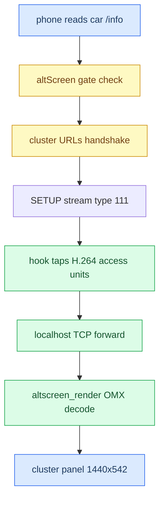

# AltScreen and Video MOC

*Map of content for CarPlay's second screen — the instrument-cluster video (altScreen, stream 111) and the whole decode-to-panel delivery path.*

---

## 📋 What this section covers

CarPlay can drive a **second display**: the Audi instrument cluster (Virtual Cockpit). Apple calls it *altScreen*; on the wire it is AirPlay screen **stream type 111**. The phone will only offer it if the head unit advertises the right `/info`, so the whole feature hinges on a gate. Once the phone streams H.264 to us, the hook forwards it over a localhost TCP link to `altscreen_render`, which OMX-decodes it and posts frames to the cluster panel over MOST/LVDS.

Start with [[AltScreen Cluster Video]] for the activation gate and the cluster wiring, then [[Video Pipeline]] for the decode/delivery internals, [[Cluster Loader]] for the boot animation, and [[Reconnect and Lifecycle]] for what breaks on replug. For the hub and the trap list see [[Home]] and [[Landmines]]; cluster route-guidance graphics (the *other* frame source for the same sink) live in [[Cluster and RGI MOC]].

## 📊 The whole path

## 🔗 The notes

| Note | What it covers |
|---|---|
| [[AltScreen Cluster Video]] | The activation gate (`"altScreen"` in `/info` → cluster URLs → stream 111), the iOS 26 URL model, error codes, panel geometry, the P0 forceKeyFrame key bug. |
| [[Video Pipeline]] | The OMX decode chain (screenstream parity, `altscreen_render`), the Nagle/`TCP_NODELAY` rubber-banding fix, load-bearing `glFinish`/rebind, the 30 fps investigation. |
| [[Cluster Loader]] | The boot animation: a GLES2 fragment shader baked into `altscreen_render`, Apple-boot look, replacing the old CPU rasteriser. |
| [[Reconnect and Lifecycle]] | Reconnect flakiness = lifecycle churn with no debounce; the advert race; the main-screen black-frame UUID fix. |

## 💡 Truth levels

Claims are tagged **[car]** confirmed on the unit, **[decompile]** from reverse engineering, **[open]** unverified. Headline: stream 111 decode-to-panel is **[car]** (a session ran 13,056 frames / 5 min); the exact delivered frame rate and its causes are still **[open]**. Provenance lives in `docs/ALTSCREEN_*.md` and the memory topic files.
