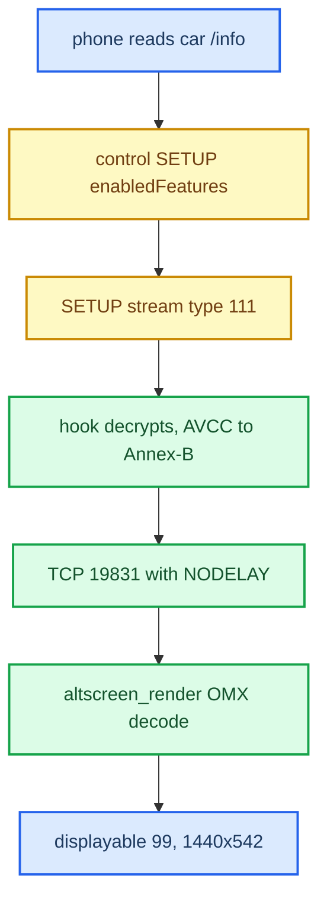

# AltScreen and Video MOC

*Map of content for CarPlay's second screen: the instrument-cluster video (altScreen, stream 111) and the path from decode to panel.*

---

## 📋 What this section covers

CarPlay can drive a **second display**: the Audi instrument cluster (Virtual Cockpit). Apple calls it *altScreen*. On the wire it is AirPlay screen **stream type 111**. The phone offers it only when the head unit advertises the cluster display and negotiates the feature, so the whole feature depends on that gate. Once the phone streams H.264, the hook converts it to Annex-B and forwards it over localhost TCP `:19831` to `altscreen_render`. The renderer OMX-decodes it and draws it into the managed cluster displayable `99` (`altscreen_render/protocol.h:24`, `altscreen_render/screen_egl_present.c:45`).

Read [[AltScreen Cluster Video]] first for the activation gate and the cluster wiring. Then read [[Video Pipeline]] for the decode and delivery internals, [[Cluster Loader]] for the PRISM waiting animation, and [[Reconnect and Lifecycle]] for replug behaviour. [[Home]] is the hub and [[Landmines]] holds the trap list. Cluster route-guidance graphics, the *other* frame source in the same cluster context, are covered in [[Cluster and RGI MOC]].

## 📊 The whole path

## 🔗 The notes

| Note | What it covers |
|---|---|
| [[AltScreen Cluster Video]] | The activation gate: the hook-injected `/info` advert plus control-SETUP `enabledFeatures`, then stream 111. Also the iOS URL model, error codes, the 1440×542 panel, and the forceKeyFrame `uuid` fix (resolved). |
| [[Video Pipeline]] | The OMX decode chain (native 32m buffers → EGLImage → RGBA plane 99), the Nagle/`TCP_NODELAY` fix, the load-bearing `glFinish` and per-frame rebind, the presenter worker thread, and the 30 fps investigation. |
| [[Cluster Loader]] | The PRISM waiting animation: an embedded glass-Apple material shader in `altscreen_render/loader/`, drawn until the first decoded picture takes over. |
| [[Reconnect and Lifecycle]] | Lifecycle churn on a fast replug, now absorbed by a 400 ms deactivate debounce. Also covers the advert correction, the main-screen UUID fix, and renderer supervision. |

## 💡 Truth levels

Claims are tagged **[car]** for confirmed on the unit, **[decompile]** for reverse engineering, **[code]** for verified in the current source, and **[open]** for unverified. The stream 111 path from decode to panel is **[car]**: one session ran 13,056 frames in 5 min. The frame rate actually delivered, and what causes it, is still **[open]**. Provenance lives in `docs-obsidian/Sources/ALTSCREEN_*.md` and the memory topic files.
