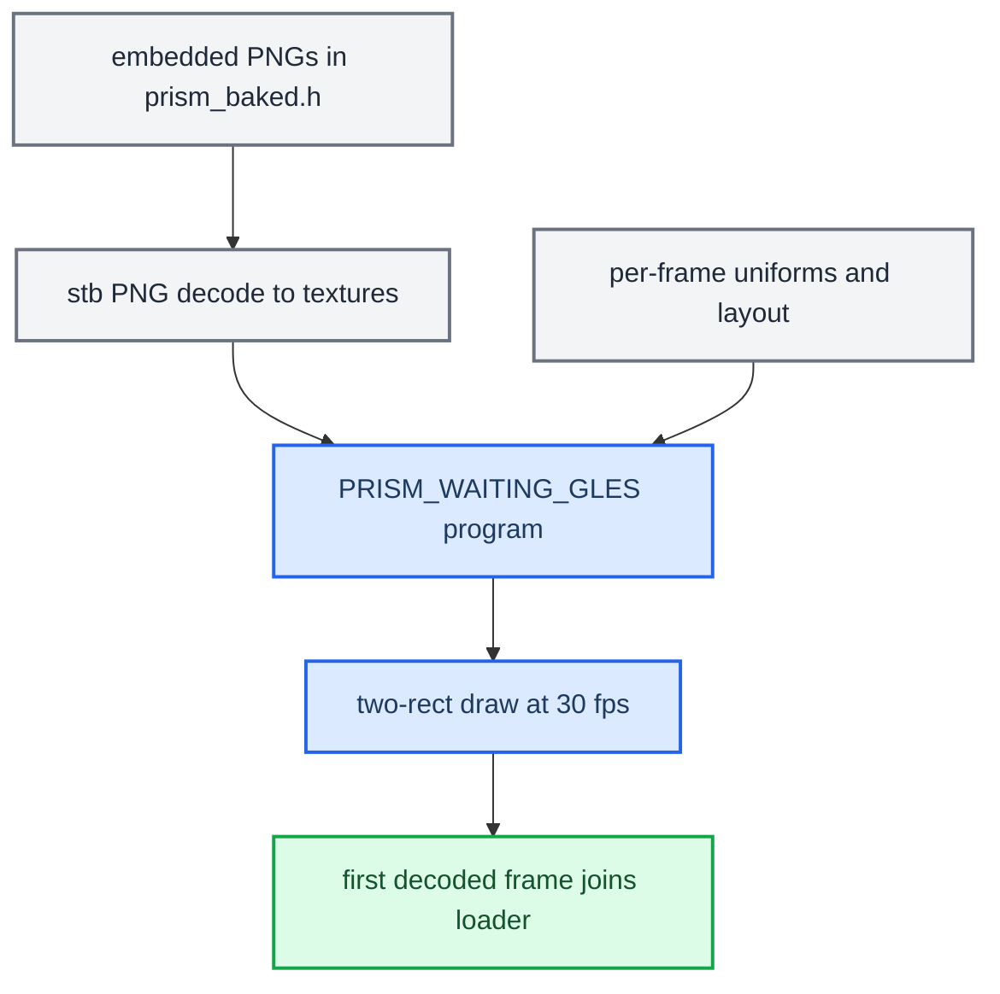

# Cluster Loader

*The CarPlay cluster waiting animation: PRISM, a glass Apple lit by moving spectral light, drawn by `altscreen_render` until the first decoded picture arrives.*

---

## 🎯 What it is

Before the first decoded video frame arrives, the cluster needs something on screen. The production loader is **PRISM**, a GLES2 fragment shader that draws a glass Apple silhouette whose light moves inside the material, plus the `@LuKa_dev` signature (`altscreen_render/loader/prism.frag:1-2`, `tools/loader_preview/PRISM.md:1-9`). The first decoded picture stops and joins the loader thread, and native video is then presented directly, with no transition (`altscreen_render/screen_egl_present.c:959-961`). **[code]**

It replaced the earlier Apple-boot loader (white logo, 12-segment HIG spinner, SF Pro signature, art baked into `common/loader_assets.h`). That shader loader was deployed and seen live at 30 fps with a clean `VIDEO_ON` takeover **[car]**. Its files no longer exist in the tree: there is no `common/loader_assets.h` and no `common/carplay_loader.*`. See `memory/loader_shader_altscreen_port.md` for the history.

## 📚 The look

- An opaque black window. Only two rectangles are drawn: the logo and the signature. No shader runs over the rest of the panel (`altscreen_render/loader/prism_waiting.h:5-7`).
- A glass Apple silhouette of constant size. Only its glass and lighting develop over time (`prism.frag:54`).
- Curved light volumes and soft internal caustics, with no external streak, orb or separate spinner (`prism.frag:1-2`, `:24-37`).
- The `@LuKa_dev` signature in SF Rounded Medium, 122×18 panel pixels (`altscreen_render/loader/prism_baked.h:9104-9105`, `PRISM.md:4-5`).

The artwork stays inside the selected VC safe area. The geometry comes from `altscreen_render/loader/loader_layout.h:30-42`: **[code]**

| View | View rectangle (px) | Content rectangle after padding (px) |
|---|---|---|
| Full, either style | `270, 90, 900, 362` | `270, 90, 900, 304` |
| Compact, Sport | `90, 135, 360, 317` | `90, 135, 360, 252` |
| Compact, Classic | `540, 135, 360, 317` | `540, 135, 360, 252` |

The view comes from the live view-area mode and the style from the VC layout style (`screen_egl_present.c:745-749`).

## ⚙️ Implementation

| Element | Detail |
|---|---|
| Shader | `PRISM_WAITING_GLES` in the generated `altscreen_render/loader/prism_baked.h:9339`. Its source is `altscreen_render/loader/prism.frag`. It is compiled as `loader_program` (`screen_egl_present.c:247-288`). |
| Uniforms | `iRes`, `iTime`, `uContent`, `uSigRect`, `uMaterial`, `uSig`, set each frame in `ep_loader_frame` (`screen_egl_present.c:738-784`). |
| Art | Two PNGs embedded in `prism_baked.h`: a 512×512 material and the signature. They are decoded from memory by a PNG-only `stb_image` (`STBI_NO_THREAD_LOCALS`, `altscreen_render/loader/prism.c:1-18`). There is no file IO at boot. |
| Timing | The loader starts on the completed silhouette at `t = 2.7 s` (`EP_PRISM_VISIBLE_MS`, `screen_egl_present.c:808-812`). It runs at a 33.3 ms period, and at 66.7 ms while a stream is pending decode (`altscreen_render/pipeline_timing.h:6-9`, `screen_egl_present.c:830-832`). |
| Stop | The stop request does not take `gl_lock`. If the join times out in an EGL/Adreno wedge, the renderer exits safely instead of freeing live images (`screen_egl_present.c:878-914`, `ALT_LOADER_STOP_WAIT_MS = 750`). |
| Build | `altscreen_render/Makefile` builds `loader/prism.c` into the QNX sink and depends on the four loader headers. |

## 🔧 Host preview and tuning

`tools/loader_preview/` holds `prism_preview.c`, the macOS preview, which uses the same loader implementation. Controls are **R** replay, **V** full/compact, **S** Sport/Classic, **G** guides, **Space** pause, and **Esc** close. Stills are captured with `--time`, `--capture`, `--frames`, `--view` and `--style`. `make bake` regenerates `prism_baked.h` from the material and signature generators (`bake_prism.py`, `prepare_material.py`, `prepare_signature.py`), which needs Python, Pillow, NumPy, SciPy and the local macOS font (`tools/loader_preview/PRISM.md:32-58`). **[code]**

## ✅ Status

Offline checks: `make -C tools/loader_preview check check-bake` and `make -C altscreen_render hostcheck` (syntax-only against stub headers, `altscreen_render/Makefile:60-67`). The Docker ARM build via `scripts/build_renderers.sh` asserts `emutls = 0` (`scripts/build_renderers.sh:95-100`). **[code]**

`PRISM.md` itself says that Adreno performance, Screen pacing and reconnect behaviour still need HU testing (`tools/loader_preview/PRISM.md:69`). The on-unit look and pacing of PRISM are therefore **[open]**. See `memory/graphics_root_egl_trap.md`, `memory/qnx_tls_emutls_trap.md`, and [[Video Pipeline]] for the delivery path the loader hands over to.

---

## 📌 Related

`altscreen_render` is a persistent renderer. `carplay_monitor.sh` starts or adopts it, restarts it only when it is missing, and leaves it alive across ordinary `dio_manager` exits. Java never spawns or kills it (`deploy/smartphone_integrator/README.md:72-89`). See [[Reconnect and Lifecycle]] and [[AltScreen and Video MOC]].
