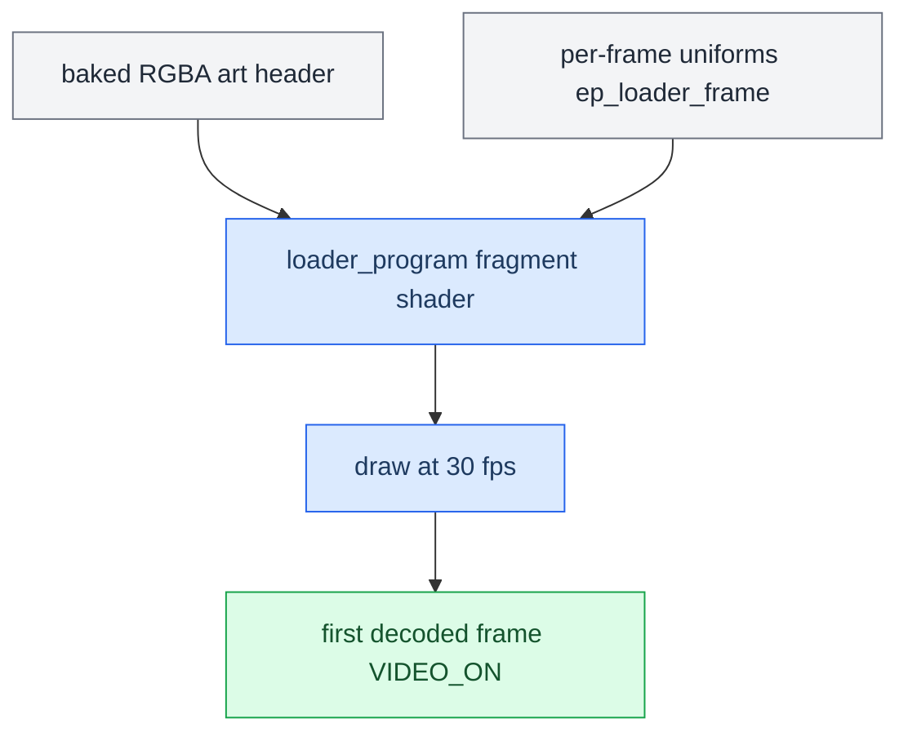

# Cluster Loader

*The CarPlay cluster boot animation — a GLES2 fragment shader baked into `altscreen_render`, styled like the Apple boot screen.*

---

## 🎯 What it is

Before the first decoded video frame arrives, the cluster needs something on screen. The loader is a **GLES2 fragment shader** (per-pixel anti-aliasing, true gradients) that replaced the old CPU integer rasteriser. It runs at 30 fps and **stops on the first decoded video frame** (`VIDEO_ON` takeover). **[car]**

## 📚 The look (Apple boot)

- Pure-black field.
- White Apple logo (baked texture).
- HIG activity indicator below it — a 12-segment SDF capsule spinner, ~1.1 s/rev.
- `@LuKa_dev` signature (SF Pro Semibold) bottom-left.

The whole group is vertically centred in the fullscreen safe area, then **lifted** so it clears the reserved bottom band (lower half of grid row 5, `y >= 406`, 12 px gap) which holds important cluster info. **[car]**

## ⚙️ Implementation

| Element | Detail |
|---|---|
| Shader | `altscreen_render/screen_egl_present.c` `loader_program`, GLES2 `precision highp float;`. |
| Uniforms | `iRes` / `iTime` / `uCenter` / `uScale` / `uLogo` / `uSig` / `uSigC` / `uSigH` / `uSigA`, computed per-frame in `ep_loader_frame` (fullscreen safe rect `270,90,900,362` + lift). |
| Art | Baked raw-RGBA in `common/loader_assets.h` (logo 192², signature 384×64, ~245 KB) — no file IO or PNG decode at boot. |
| Orientation | NDC-top = physical-top; `p.y` up via `0.5 - py/H`, no flip. |
| Retired | `common/carplay_loader.c` (CPU rasteriser) dropped from the Makefile and build script; `carplay_loader.h` kept only for `CARPLAY_LOADER_FRAME_INTERVAL_NS`. |

## 🔧 Host preview and tuning

`tools/loader_preview/` (macOS GLFW + GL2.1, GLSL120) runs the same shader math. Debug overlays `G` = grid (A1..P6), `V` = view (off/fullscreen/duo) are dev-only and **not** ported. Env knobs: `CR_T` freeze ms, `CR_GRID`, `CR_VIEW`, `CR_OCC` / `CR_GAP` tune the lift. Assets sourced from `apple_logo.png` (rsvg) and `sig.png` (PIL from SF NS Semibold). **[car]**

## ✅ Status

`make hostcheck` (stub EGL/GLES) + Docker ARM build pass (machine=ARM, `emutls=0`, 299 KB). Deployed and verified live: loader visible at 30 fps, then decoded-video takeover to `VIDEO_ON`. See `memory/loader_shader_altscreen_port.md`, `memory/graphics_root_egl_trap.md`, `memory/qnx_tls_emutls_trap.md`, and the delivery it hands off to in [[Video Pipeline]].

---

## 📌 Related

The loader thread / stop / 30 fps scaffolding is unchanged from the CPU-loader era; only the drawing changed. Renderers are always-on framework services (Java never spawns or kills them). See [[Reconnect and Lifecycle]] and [[AltScreen and Video MOC]].
