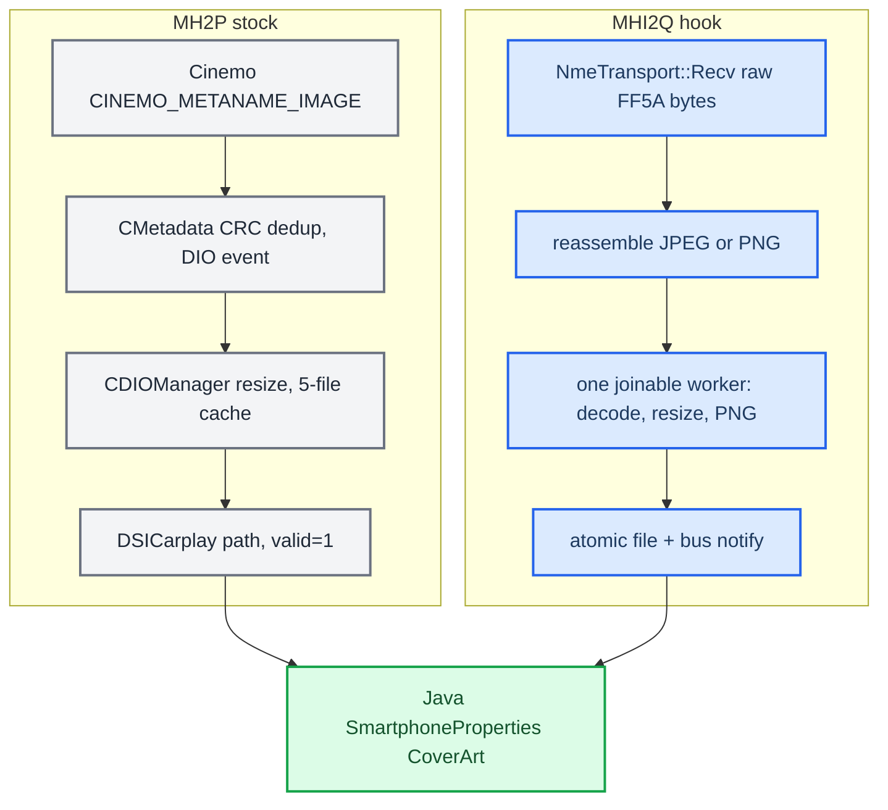

# Cover Art Pipeline

*How the now-playing album art reaches the head unit: the stock MH2P design, our lower-level MHI2Q hook that reassembles and decodes JPEGs itself, and the parser regression that briefly rejected real iPhone transfers.*

---

## 📋 Two very different designs

Stock MHI2Q's `DSICarplay` `coverArtUrl` path never delivered art on this unit, so the hook takes the raw iAP2 file transfer, rebuilds the image, and publishes a PNG path to Java. The newer MH2P firmware does the same job much higher up, inside `dio_manager`, on existing threads. **[decompile]** / **[code]**

## 🔍 Stock MH2P

Binary `Firmwares/HU/MH2p_US_LB636_P2712/extracted_app_mh2p_lb/eso/bin/apps/dio_manager`. Java does not decode images and no decode runs inside a low-level `NmeTransport::Recv` callback. **[decompile]**

| Stage | Evidence |
|---|---|
| Queue metadata init | `CIAP2ServiceCinemo_onJob_start` @ `0xA2604` allocates a `CMetadataInitJob`; `airplay::CCommandThread::enqueueCommand(..., -1)` @ `0xA2858` on the existing command thread |
| Listener init | `CMetadataInitJob_execute` @ `0x9FFCC` → `CMetadata_init` @ `0xA0032`; callback registered at `0xA5F1A` |
| Detect art | `CMetadata_eventCallback` @ `0xA6140` handles Cinemo event 21, reads `CINEMO_METANAME_VFS_IAP_FLAGS` (`0xA630E`), tests bit `0x20` (`0xA6362`) |
| Get the image | requests `CINEMO_METANAME_IMAGE` (`0xA64B6`), a completed object with pointer, size and CRC (`0xA63BE`-`0xA63D0`); no FF5A/JPEG reassembly |
| Dedup + dispatch | CRC compare `0xA6400`, copy into a DIO event `0xA6432`, dispatch `0xA6438` |
| Cache/resize/write | `CDIOManager_onEvent_updateNowPlayingCoverArt` @ `0x817F4` reads settings (`0x8188E`-`0x818C4`): default 5-file rotation, 1 MiB resize threshold; `CImage` write at `0x81946` |
| Notify HMI | `CDSICarplayImpl_updateCoverArt` @ `0x8BAD4` (call at `0x81958`); listener at `0x8BBB6` sends a path plus `valid=1`, not bytes |

Config keys: `IAP2_COVERART_PATH`, `IAP2_COVERART_CACHE`, `IAP2_COVERART_LIMIT`, `IAP2_COVERART_WIDTH`, `IAP2_COVERART_HEIGHT`, `IAP2_COVERART_RESETDELAY`. Java: `de.audi.app.terminalmode.dsi.carplay.CarplayDSILifecycleController.updateCoverArtUrl(ResourceLocator, int)` validates the flag, maps null to an empty locator and calls `smartphoneProperties.getCoverArt().accept(res)`; the property is `Property<ResourceLocator>` named `CoverArt` in `SmartphoneProperties`. The `mh2p-cluster` repository adds only a no-op `CarPlayClusterIntegration.updateCoverArtUrl`.

## ⚙️ Our MHI2Q hook

The hook enters far lower: `NmeTransport::Recv(NmeArray<uchar>&)` (`hook/framework/hook_framework.c:1025-1060`) hands raw link bytes to the cover-art module, which reassembles FF5A file-transfer frames (`hook/coverart/coverart_stream.c`, 9-byte link header, max 65535), decodes with a PNG/JPEG-only `stb_image` (`STBI_NO_THREAD_LOCALS`, `coverart_hook.c:21-44`), resizes to **256×256** "contain", PNG-encodes, and atomically writes `/var/app/icab/tmp/37/coverart.png` before a bus notify (`coverart_hook.c:61-90`, `:338-412`). Limits: 500 B minimum, **800,000 B** maximum, 4096 px maximum side, 8 Mpixel maximum (`:70-78`). Doing this inline would block the Cinemo/iAP2 receive thread, so a worker is functionally necessary unless a lifetime-safe stock executor were exposed at our boundary; MH2P's `airplay::CCommandThread` is not interposable and cannot be assumed on MHI2Q. **[code]**

The "stock-like" cleanup that shipped keeps a one-slot latest-wins queue, registers the module through lazy framework initialisation instead of a constructor, starts **one joinable worker** only when the first complete image is ready, and stops and `pthread_join`s it before bus shutdown instead of polling a detached thread (`coverart_hook.c:595-690`, `:747-790`, `:860-900`). Callback quiescence protects a concurrently copied sink pointer. **[code]**

Sources: [[Sources/reference/MH2P_STOCK_COVERART_PIPELINE|MH2P_STOCK_COVERART_PIPELINE]]

## ❌ The size-only Setup regression (2026-09-12)

After deploying `a05f774`, parser hardening from `13801f2` rejected two formats the iPhone really sends; the host tests had covered corrupt data but not these valid variants. The altScreen half (a `bodySize 0` VideoConfig) is in [[Video Pipeline]]. The cover-art half: file-transfer session 2, checksums and sequences were all fine, but every Setup was rejected before first data because the real Setup body was **8 bytes**, only a uint64 BE size (for example `000000000002251b` = 140,571 bytes), with no uint16 type. CatPlay builds the extended form (size + type + optional metadata), and requiring it from every sender was the mistake. **[car]**

Now accepted: size-only (8 bytes) and typed (≥ 10 bytes) Setup. Rejected: 0–7 or 9 bytes, known non-artwork types (artwork type is `FILE_ARTWORK = 2`), files over 800,000 bytes (`hook/coverart/coverart_stream.c:81-98`). Without a type, a JPEG or PNG signature at the start is mandatory; length and first/last data still define assembly and completion; ordering, checksums, generations, memory limits and atomic publication are unchanged. Diagnostics log only counters and header metadata, at most 64 entries per generation at INFO, never image content or control payloads. **[code]**

On the HU after the fix, single- and multi-packet JPEGs of 28,078 and 230,971 bytes were accepted, decoded from 600×600 and published as PNG; repeats of the same art did not rewrite the file; the PNG read back from the HU passed header and all-chunk CRC checks, and Luka saw the art on screen. altScreen reached `VIDEO_ON` with more than 1200 frames in the same session. Deployed hook SHA-256 `a565332a83825754ce86dbfcc366a5ca2cc72f87a2e567ffaa4184992bf48557`; renderer and JAR unchanged; the temporary `/tmp/carplay_verbose` was removed afterwards. Local logs and backups (`local_logs/alt-screen-20260912T152303Z/`, `build/alt-cover-fix-*/`) are git-ignored. **[car]**

Sources: [[Sources/reference/ALTSCREEN_COVERART_LIVE_REGRESSIONS|ALTSCREEN_COVERART_LIVE_REGRESSIONS]]

---

## 📚 Sources

- [[Sources/reference/MH2P_STOCK_COVERART_PIPELINE|MH2P_STOCK_COVERART_PIPELINE]] — stock MH2P native pipeline and the MHI2Q worker cleanup.
- [[Sources/reference/ALTSCREEN_COVERART_LIVE_REGRESSIONS|ALTSCREEN_COVERART_LIVE_REGRESSIONS]] — the size-only Setup and empty VideoConfig regressions.
- `memory/mhi2_mu1439_coverart_path.md`, `memory/qnx_tls_emutls_trap.md`.

Related: [[Hook to Java Bus]], [[CarPlay Feature Survey]], [[AltScreen and Video MOC]].
