# Partial 360 Camera Preflight

*A deferred feature: keep CarPlay on the left of the main screen while the stock top-view camera and OPS parking graphics use the right side. What the preflight proved about contexts, crops and camera ownership, and the coordinator contract any implementation must follow.*

---

## 📋 Status

**Deferred by Luka on 2026-09-14.** The research, host tests and transition design are kept; no implementation, HU experiment or release happens without a separate go-ahead. The goal: CarPlay left, stock Bird View top-down camera plus OPS right, and the stock full-screen parking view must still take over on reverse or when the parking ECU demands it. The composition `{16, 17, 59}` (HMI, camera, CarPlay video) is a hypothesis; no context ID has been chosen. Production Java/C/shell files were not changed by this work. **[open]**

Reproduce from the repo root: `bash scripts/test_partial360_preflight.sh` (recompiles current Java to a temp dir at target 1.4 and runs stock classes from `MU1316-combined.jar` and `MU1316-final.jar` with stubbed DSI/HMI; business bytecode, OPS models and our DisplayManager table are real) and `python3 tools/partial360_native_preflight.py` (static fingerprint/disassembly checks of the matching MU1316 ELFs and config). Six contract groups pass on both JARs, and `PdcResourcePolicyTest` passes with the current guard; the unpatched tracker reproduces `pure OPS 108 toggled Main Wizard`, so the test really separates old from fixed behaviour. Their `output/partial360-preflight/` results are regenerated, not kept. **[code]**

## ⚠️ What the naive design gets wrong

| Finding | Detail |
|---|---|
| Context 91 does not exist on A5 | Our `DisplayManagerMIB2High` allocates **82** A5 contexts (`DC_SIZE_A5 = 82`, stock 0..78 + CarPlay 80/81) and **158** on G24 (`java_patch/de/audi/tghu/fwhmi/DisplayManagerMIB2High.java:39-40`); on G24, 91 is already stock `12 + 79` = `{20, 16, 22, 19}`. Both stock confirmation paths (`switchContext()`, `processEvent()`) report `context % 79`, so 91 would read back as 12. Table holes (A5 `[34, 65, 70, 79]`, G24 `[34, 65, 70, 113, 144, 149]`) are **not** free IDs: 70 is classified video-only by `isVideoOnlyContext()`. `3 = {16, 17}` and `78 = {16, 59}` exist; no stock context combines 17 and 59. |
| A Bird View request is not a VPS activation | `AbstractParkingSystemVPSComponent.switchVPSView(4)` only sets `view = 4, mode = 9`, keeps the previous popup/screen and calls `changeDisplayContent()`; an OPS popup (1) stays OPS. A real VPS activation runs update view/mode → `activateComponentRVC(17)` → `addPopupRequest(FULLSCREEN, 2100000)` → `startupMgr.setRVCActive(true)` → `notifyParkingSystemActive` → interapp 108. Evo VPS returns full-screen `2100000` for every checked popup ID (2, 3, 8, 12, 13, 14, 16, 18). Suppressing only 108 is not enough. |
| The PDC guard must stay narrow | The current guard deliberately exempts only a lone OPS component `2`; VPS component `4` removes the exemption (`java_patch/com/luka/carplay/pdc/PdcSmallStageGuard.java`). A partial mode needs its own bounded state, not "any parking while CarPlay". |
| Two incompatible crop APIs | `HMIService.getDisplayManager().setCropping(displayable, terminal, srcXYWH, dstXYWH)` addresses directly (terminal translated, first two args swapped: HMI `(17, 0, …)` → DSI `(0, 17, …)`; cluster terminal 1 → DSI 4). `IDisplayManagerService.setCropping(...)` ignores its first argument and takes the displayable from the generic `DisplayManagerState`. `activateComponentRVC(17)` calls `startComponent(17, 0, 0)` without updating that state, so with generic state 59 a later interapp crop hits CarPlay's 59. Use the explicit HMI crop. |
| Extents are not rectangles | `getExtends(17)` on a cold cache fires a DSI request and returns `null`; a warm cache returns the same mutable `int[]` that `DSIDisplayListener.getExtents()` later overwrites, so copy it. Extents are surface sizes; HMI `setCropping()` remembers only the destination, and `getPosition()` also returns a borrowed array. |
| Target geometry | Screen bag right area **`(720, 0, 304, 480)`**. The Bird View source ROI is unknown; squeezing the full 1024×480 into 304×480 is not approved. Firmware profiles (IFS and system copies identical, not proof of the active mode): `rvc` source `(0, 48, 702, 384)` → target `(0, 56, 720, 384)`; `zfas`/TopView `(0, 0, 1024, 480)` → same. |
| OPS background will not follow | `OPSViewModeHandler` uses `PARKING_VPS_SYSTEM_TYPE_CHOICE = 2100180` (0 none, 1 rear-only, 2 front/top/side; TopView available = 0 in the choice model). OPS modes 0 `OVER_TOPVIEW_FULL`, 1 `OVER_TOPVIEW_REDUCED`, 2 `STANDALONE`; backgrounds 1 FULL, 2 REDUCED, 3 STANDALONE. Type 0 stays standalone even after `updateVPSView(4)`; type 2 + view 4 picks full overlay 1. Reduced background 2 waits for `notifyScreenConnected(2100001)` (or ARA), which a partial mode never gets; do not fake it. Popup `2100008` background icon controllers need a visual check. |

**[decompile]** (stock Java from `Tools/jxe2jar/out/MU1316-vf/`, verified by execution on the matching JARs)

## ⚙️ Native: the camera can start without Java

`libdm_modMain.so` (SHA-256 `bd4c0424…ef6ec`, 661,228 bytes, QNX ARM32 LE, VA = file offset). **[decompile]**

| Address | Function | Consequence |
|---|---|---|
| `0x358ac` | `CContextManager::preContextSwitchHook`, capture call at `0x35c6c` with origin 0 | Switching to a context with a capture displayable can start HU capture by itself |
| `0x60480` | `CDSIDisplaymanagement::evtStartComponent`, capture at `0x607d4` with origin 1 | Explicit component start is a different owner |
| `0x5a4ac` | `CCaptureInterface::stopCapturing`, origin compare `0x5a4d4`-`0x5a4dc` | Stop depends on the owner; order matters |
| `0x59900` | `CCaptureInterface::isDisplayableReady` | A successful request is not the first frame |
| `0x5dab0` | `CDSIDisplaymanagement::evtSetCropping` | Updates position, size, crop, then capture/decoder |
| `0x59c70` | `CCaptureInterface::evtSetRVCEnabled` | A native branch can force context `-2` and back; Java is not the only context writer |
| `0xa0aa8` | `m_captureConfigs`, 7 × 56 bytes | IDs `[17, 27, 27, 47, 48, 49, -125]`; 59 is not a capture profile |

If the component start comes first, a later context switch does not become the capture owner (`startCapturing()` on an active profile succeeds without reassigning origin), so switching back to 78 is not a guaranteed stop. That 17 and 59 are different mechanisms argues for an experiment, but proves nothing about the compositor running both without stalls or a DIO reset.

## 🔄 The coordinator contract (design only)

States `OFF`, `REQUESTING_CAMERA`, `PARTIAL_VISIBLE`, `RESTORING`, `STOCK_TAKEOVER`, driven on the stock HMI queue with no new poll thread, each activation carrying a generation so late callbacks cannot revive a closed camera. Entry only with an active CarPlay screen, allowed side OPS, confirmed Bird View support (`VPSSupportedViews.isBirdview()`, not mere camera presence) and no full parking takeover. Track separately: source request/ack, component-start ownership, geometry snapshot/profile, own context, popup instance and partial resource exemption.

```mermaid
stateDiagram-v2
  accTitle: Partial camera coordinator states
  accDescr: From off the coordinator requests the camera, shows the partial view once confirmed, restores on OPS close, and yields to stock on reverse or full-screen takeover; every callback is checked against the current generation.
  [*] --> off
  off --> requesting: OPS appears during CarPlay
  requesting --> partial_visible: source, geometry and guard confirmed
  requesting --> off: unavailable, refused or timeout
  partial_visible --> restoring: OPS closed
  restoring --> off: own composition left, capture stopped, geometry restored
  partial_visible --> stock_takeover: reverse, fullscreen camera, PLA or ARA
  requesting --> stock_takeover: reverse, fullscreen camera, PLA or ARA
  stock_takeover --> off: stock owns camera and geometry
```

| Event | Required behaviour |
|---|---|
| OPS appears in CarPlay | Prepare source/geometry and the bounded guard first; show only after confirmation |
| Camera unavailable / refused / timeout | Keep normal OPS + CarPlay; remove only our own requests and geometry |
| OPS closes | Drop partial state; return to 78 only if this CarPlay session still owns the HU |
| HOME / other app / disconnect | Cancel pending callbacks; never switch back over the new screen |
| Reverse / fullscreen camera / PLA/ARA | Drop the exemption before the resource notification; hand camera and geometry to stock; send no late stop for its camera |
| Fast full → partial → full | Check owner/generation on every callback; old cleanup must not touch the new fullscreen |
| Repeated request/ack/visible | Idempotent: no second source start, no snapshot overwrite |
| DSI service lost/returned | Reset confidence in context/crop/frame and rebuild from live state |

Normal close removes our composition, confirms leaving it, then stops our capture and restores geometry; a takeover must not run that reverse sequence because stock may already need the source. Classify transitions from the incoming content/involved systems before 108/107 notifications (as the PDC fix does), not from `controller.getCurrentDisplayContent()`, which can still describe the previous popup.

Before any default implementation, on the HU: capture displayable 17's stock geometry and Bird View content per `screen/view/mode`; try a bounded `16 + 17 + 59` composition with a verified ID (z-order, no black/stale frame, input latency, no decoder restart); confirm a camera readiness signal and native ownership order instead of a fixed delay; check OPS graphics alignment over the video; run the transition table, especially reverse during a pending frame and late cleanup after takeover.

---

## 📚 Sources

- [[Sources/reference/CARPLAY_PARTIAL_360_PREFLIGHT|CARPLAY_PARTIAL_360_PREFLIGHT]] — the preflight research, host-test results and coordinator design.
- `Sources/CARPLAY_PDC_SMALL_STAGE_ROOT_CAUSE.md` — the PDC guard it builds on (owned by another domain).

Related: [[Video Pipeline]], [[Cluster Contexts]], [[AltScreen and Video MOC]].
