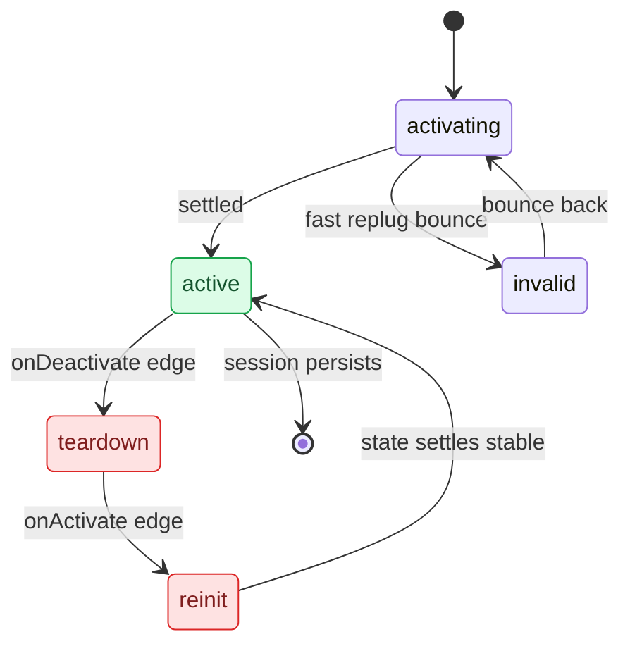

# Reconnect and Lifecycle

*Why CarPlay sometimes takes three replugs to come back — lifecycle churn without debounce, plus the advert race and the main-screen UUID fix.*

---

## 🔍 The symptom

On-unit diagnosis (build `34c4c9d`, 2026-08-11) of intermittent reconnect — "после перевтыка не работает", took 3 replugs. Crucially, **the altScreen pipeline is not the problem**: across 4 dio sessions the phone offered stream 111 reliably (2–3 s), and video decoded and rendered fine (one session ran 13,056 frames / 5 min). The "no 111 stream in request" log lines are just the phone's *other* SETUP requests (main/audio), not a failure. **[car]**

## ⚠️ Root cause — lifecycle churn with no debounce

`TerminalModeBapCombi.updateActiveDeviceState()` drives `CarPlayApp.onActivate/onDeactivate` off the stock TMDevice ConnectionState. On a fast replug the device bounces **ACTIVATING ↔ INVALID ↔ ACTIVE**, and each edge makes `CarPlayApp.lifecycleLoop` do a full `BAPBridge` takeover teardown / re-init + cluster context flap **81 ↔ 74**. Ten `onActivate/onDeactivate` generations were observed. **[car]**

`lifecycleLoop` (`CarPlayApp.java:208`) coalesces edges **only** if a newer edge lands while `applyLifecycle` is already running; if the deactivate is picked up first it runs the full teardown, then re-inits when activate arrives. There is no grace on the inactive→active transient. The 3rd replug worked simply because the device state finally settled into stable ACTIVE. **[car]**

### Proposed fix (debounce)

Debounce the inactive edge in `lifecycleLoop`: on `wantActive=false`, bounded-wait ~400 ms; if a newer (active) generation arrives during the grace, skip the teardown and coalesce to active. Optionally gate `AltScreenModule` viewArea sends until `videoAvailable=true` to kill the harmless `viewArea ack status=-6735`. Status **[open]** — not yet implemented (the on-unit session that was fixed via the UUID change below did not churn, so it was not yet needed). See `memory/reconnect_flak_lifecycle_debounce.md`.

## 🔧 Main-screen 110 black — the UUID fix

Separate but co-occurring failure mode. iOS fetches `/info` **once** at session start and builds all display/stream config from that snapshot — no re-fetch. The hook's `main_disp_modernize` used to inject a **fabricated** main `uid` / `initialVideoStreams` UUID (`A0000000-…`); iOS 26.1 routed main video on that modern uid while the stock decoder waited on the **real** `ScreenCopyMain` UUID → main 110 black. Cluster 111 worked because the hook owns both the descriptor and the receiver. **[decompile]**

Fix (implemented + on-unit verified 2026-08-11): read the real main uuid via `cf_getval(mainDisp,"uuid")` and set `uid` + `initialVideoStreams` to it, no fabrication (fall back to the old constant only if the stock uuid is missing). Live log confirmed the real uuid and a **stable** session (onActivate=1 / onDeactivate=0, no churn, no teardown, 1792+ frames); Luka confirmed 110 works. **[car]**

## 💡 The advert-race correction

An older hook-era note said "altScreen advert must stay OFF or the cluster flaps 80 ↔ 74." On this build that is **superseded**: the startup script exports `ALTSCREEN_HANDLE_ALT=1` + `ALTSCREEN_ADVERT_DISPLAYS=1` (advert ON) and altScreen streams fine with it on. The advert is **not** the reconnect driver — the lifecycle churn above is. Keep the caveat in mind only for the pure-hook cluster-context path documented in [[Cluster and RGI MOC]]. **[car]**

## ⚡ Fast-replug recovery timing

The ~3 s delay is SI (Smartphone Integrator) serializing stop → relaunch (Controller state machine + DownTimer + RestartDeviceStack jobs), gated on the old child fully stopping plus `restartDelay`. It recovers, just slowly. Fixes deployed to make **our** teardown fast rather than patch the core Harman service: **[car]**

| # | Change | Where |
|---|---|---|
| 1 | Hook `read_exact` poll tick 500 ms → 60 ms | `altscreen_hook.c` ~975 — 111 receiver notices teardown in ≤60 ms. |
| 2 | SIGKILL renderers immediately (was SIGTERM + 1 s + SIGKILL) | `carplay_processes.sh` `cp_stop_renderer_snapshot` — frees plane-99/EGL/OMX at once. |
| 3 | `stopTimeout` 5000 → 2000, `restartDelay` 2000 → 500 | `smartphone_integrator.json` `children.carplay` (inline; needs reboot to apply). |

---

## 📌 Deploy notes

`scripts/deploy_unit.sh` (hook only); renderers live at `/mnt/app/root/hooks/{altscreen_render,maneuver_render}`, restarted by the supervisor. SSH `root@10.173.189.1`, options must be inline not via a shell variable (macOS ssh breaks otherwise). The live Java tree is `java_patch/`. Never reboot the unit without asking. See [[Reconnect and Lifecycle]] siblings [[Cluster Loader]] and [[Video Pipeline]], and the overall map in [[AltScreen and Video MOC]].
