# Video Pipeline

*How a type-111 H.264 access unit becomes a pixel on the cluster panel — decode, delivery, and the frame-rate hunt.*

---

## ⚙️ The delivery path

The hook taps H.264 access units off the phone socket, forwards each over a localhost TCP link to `altscreen_render`, which OMX-decodes and posts frames to the cluster plane. **[car]**

```mermaid
flowchart LR
  accTitle: AltScreen video delivery from phone to cluster plane
  accDescr: Phone stream 111 into the hook receiver, TCP forward with TCP_NODELAY, altscreen_render socket reader and decode worker, OMX decode, presenter draw and post to plane 99.
  phone["phone stream 111 AU"]
  recv["hook receiver decrypt"]
  fwd["TCP forward NODELAY"]
  reader["render socket reader"]
  omx["OMX qcom AVC decode"]
  present["presenter draw glFinish"]
  plane["post to plane 99"]
  phone --> recv
  recv --> fwd
  fwd --> reader
  reader --> omx
  omx --> present
  present --> plane
  class phone,plane primary
  class recv,fwd success
  class reader,omx,present neutral
  classDef primary fill:#dbeafe,stroke:#2563eb,color:#1e3a5f
  classDef success fill:#dcfce7,stroke:#16a34a,color:#14532d
  classDef neutral fill:#f3f4f6,stroke:#6b7280,color:#1f2937
```

## 🔧 The OMX decode chain

`altscreen_render`'s decoder mirrors stock libairplay's `dio::COMXVideoDecoder` chain, component **`OMX.qcom.video.decoder.avc`**. The from-source `screenstream.c` reimplements it (the leaked SDK shipped only a GStreamer stub). Parity fixes applied: **[decompile]**

| Aspect | Fix |
|---|---|
| AVCC → Annex-B | avcC → SPS/PPS header + per-frame NAL-prefix rewrite to `00 00 00 01` (raw AVCC breaks the qcom decoder). |
| Port definition | Full `OMX_IndexParamPortDefinition` both ports; output `eColorFormat=0x7F000004` (qcom 32m tiled NV12). |
| Decoder-order mode | POC order via `OMX_GetExtensionIndex("OMX.QCOM.index.config.video.DisplayPictureBuffer")` — **20-byte** struct, GetParameter → set `+12`/`+16` → SetParameter → readback (the stock ABI; our old 12-byte boolean SetConfig was **not** equivalent). |
| Zero-copy output | Screen buffer vaddr bound to the OMX output port via `OMX_UseBuffer`; FillBufferDone reverse-maps and posts directly — no memcpy/de-tile. |
| Screen format/usage | `FORMAT=0x1000C` (qcom tiled NV12), `USAGE=0x484`, exact stock literals (built on-stack inside libairplay, never crosses the `.so` boundary). |

Two concurrent AVC decoders (dio main 110 + `altscreen_render` cluster 111) is **safe**: firmware caps at 4 concurrent decode clients. See `memory/screenstream_omx_parity.md` and `Patches/libairplay-mhi2q/SCREENSTREAM_PARITY.md`. **[decompile]**

## ⚡ Rubber-banding = missing TCP_NODELAY

Cluster video felt like rubber-banding (2026-09-06). Everything downstream was innocent — EGL swap 0.3 ms, no drops, decode queue never full — yet arrival at presentation was avg 48 ms / max 204–233 ms against advertised `maxFPS=30`. **[car]**

Cause: `altscreen_av.c` wrote each frame as **two** records — `[u32 BE len]` then the access unit — on a socket that never set `TCP_NODELAY`. The header ships immediately, leaving data unacked; Nagle then holds the sub-MSS access unit until the header is ACKed, and the renderer never writes back, so nothing piggybacks the ACK. Fixed at `hook/altscreen/altscreen_av.c` (@cb94115). After: all three arrival counters agree at **avg 34 / max 71–99 ms** (29.4 fps). **[car]**

Attribution is not airtight — the average had already recovered one window earlier on the old hook after a stream break. The degradation that builds the 48 ms state within a session and resets on reconnect still has an **[open]** trigger. Three permanent arrival counters (hook first-hop, render socket, render post-decode), logging every 600 frames, are now in place to catch it. See `memory/altscreen_delivery_nagle.md`.

## 🔍 Load-bearing operations — do not remove

The presenter runs synchronously in the decoder's FillDone callback: loader handoff → `eglMakeCurrent` → refresh external EGLImage binding → draw → **`glFinish`** → `eglSwapBuffers` → `OMX_FillThisBuffer`. Two operations look redundant but are not: **[car]**

- **`glFinish`** is the ownership barrier before OMX can overwrite the sampled source buffer. Removing it to look faster corrupts frames.
- The **per-frame external-image rebind** fixed verified stale UV / green frames on this Adreno driver.

Neither has been proven redundant. A separate presenter thread alone cannot make a genuinely 50 ms GPU op deliver 30 fps — it could only remove callback coupling, subject to the same ownership. See [[Landmines]].

## 📊 The 30 fps investigation

Recorded input was 20–27 fps against `maxFPS=30`. Static RE (iOS 26.6/27.0 binaries + stock MU1316) found **no fixed 20 fps cap** — several independent mechanisms can each lower delivered frames: **[decompile]**

| Mechanism | Finding |
|---|---|
| Bandwidth ladder | `AverageTxCapacity * 0.75` clamped to `[1 Mbps, 40 Mbps]` selects 10/20/30/60 fps; the **default floor is 1 Mbps**, so the ladder recommends ≥30 with our `maxFPS=30`. `maxFPS` is a ceiling, not a minimum. |
| Sink overflow drop | Phone's outgoing queue `vdsink_ShouldDropFrame` drops when accumulated media duration exceeds a limit (default `CMTimeMake(67,1000)` = 67 ms ≈ two 33 ms frames). A short drain stall triggers drops even with ample bandwidth. |
| Thermal | `DBThermalMonitor` suggests 15 fps (level 1), 5 fps (levels 2–3); no limit at normal level 0. |
| Wired branch | A `wired car connection` / `IsConnectedOverUSB && IsCarPlay` branch uses max fps directly, bypassing the ladder. |

**Conclusion:** the lower frame count is present before our decode in the sampled windows, but static evidence does **not** justify changing `maxFPS`, bypassing queue/thermal limits, or claiming the phone intentionally sends 20 fps. A default-off pace probe (`ALTSCREEN_PACE_TRACE=1`, output `/tmp/carplay_alt_pace.log`) is prepared but the live measurement remains **[open]**. See `docs/ALTSCREEN_FRAME_RATE_INVESTIGATION.md`, `docs/ALTSCREEN_STOCK_30FPS_PATH.md`, `docs/ALTSCREEN_30FPS_IMPLEMENTATION.md`.

Stock capture cadence and the 33 ms timer

Stock VC capture uses an independent timer: `videoencoderservice::adjustTimer` computes integer `1000/fps` → for 30 fps a **33,000,000 ns** period, with no compensation for the lost ⅓ ms. `eglSwapInterval(2)` does not synchronise this timer with incoming frames. The idealised model (steady 30 Hz source, capture every 33 ms) gives ~10 repeats per 1000 captures — arithmetic of two clocks, not an HU measurement. The candidate `libvc_capture_clock.so` was **stopped** after Luka confirmed the stock map is smooth; `videoencoderservice` stays stock. Do not patch libosal or raise `setUpdateRate` to 60 — it changes other timers and creates no phone frames. **[decompile]**

---

## 📌 Implementation candidate (not on-unit)

The 30 fps rework (built, not deployed): OEM-ABI DisplayPictureBuffer setup with readback, explicit `xFramerate=30<<16` on both ports, and a single presenter worker that dequeues native OMX output indices from a bounded FIFO (capacity = actual OMX output pool, no extra allocations), returning each buffer only after GPU completion. It keeps native 32m allocation, RGBA plane 99, UV rebind, `glFinish`, two RGBA buffers, swap interval 2, and the simple loader. Status **[open]** — needs on-unit OMX readback + input/output rate verification.
