# Video Pipeline

*How a type-111 H.264 access unit becomes a pixel on the cluster panel, how stock stream 110 reaches the main screen for comparison, and which renderer operations are load-bearing.*

---

## ⚙️ The delivery path

The hook reads stream 111 off the phone socket, decrypts it and converts AVCC to Annex-B ([[AltScreen Cluster Video]] has the receiver). Each access unit then goes over localhost TCP `:19831` to `altscreen_render` (`hook/altscreen/altscreen_av.c:289-316`, `hook/altscreen/altscreen_av.h:27`, `altscreen_render/protocol.h:24`). The renderer feeds OMX, and a presenter worker draws each decoded buffer into the RGBA plane of displayable `99`, which `videoencoderservice` captures for the VC ([[Cluster Video Encoder]]). **[car]** / **[code]**

```mermaid
flowchart LR
  accTitle: AltScreen video delivery from phone to cluster plane
  accDescr: Stream 111 enters the hook receiver, is forwarded over TCP 19831 with TCP_NODELAY, read by altscreen_render, decoded by OMX, queued to a presenter worker, drawn with glFinish and swapped to plane 99.
  phone["phone stream 111 AU"]
  recv["hook decrypt, Annex-B"]
  fwd["TCP 19831 NODELAY"]
  reader["render socket reader"]
  omx["OMX qcom AVC decode"]
  worker["presenter worker FIFO"]
  plane["draw, glFinish, plane 99"]
  phone --> recv
  recv --> fwd
  fwd --> reader
  reader --> omx
  omx --> worker
  worker --> plane
  classDef primary fill:#dbeafe,stroke:#2563eb,stroke-width:2px,color:#1e3a5f
  classDef success fill:#dcfce7,stroke:#16a34a,stroke-width:2px,color:#14532d
  classDef neutral fill:#f3f4f6,stroke:#6b7280,stroke-width:2px,color:#1f2937
  class phone,plane primary
  class recv,fwd success
  class reader,omx,worker neutral
```



The renderer reports `VIDEO_ON` (`0x81`, the current stream has a successfully presented picture) and `VIDEO_OFF` (`0x82`) to Java as a **client** of `AltscreenControlServer` on `:19832`; Java sends `ALTCMD_VIEW_AREA` (`0x01`, full/compact, style, raw preset) back over the same link (`altscreen_render/protocol.h:32-42`, `java_patch/com/luka/carplay/core/AltscreenControlServer.java:32-34`). Java starts that server unconditionally (`java_patch/com/luka/carplay/core/CarPlayApp.java:73`). The choice of TCP to a separate process (decision **B**, 2026-07-29) keeps one OMX decoder per process and isolates a GL/OMX crash from dio_manager; see [[AltScreen RE History]]. **[code]**

### The localhost link

| Property | Value |
|---|---|
| Framing | `[u32 BE length][Annex-B payload]`, two send records per AU; renderer `frame_io.c` reads exactly 4 bytes then the body; max message 4 MiB (`altscreen_render/protocol.h:28`) |
| First record per connection | Cached SPS/PPS flagged `CODECCONFIG` (`altscreen_av.c:47-50`, `:223-237`) |
| Socket | Non-blocking, `SO_SNDBUF` 512 KiB, `SO_SNDTIMEO` 500 ms, `TCP_NODELAY`, connect timeout 250 ms (`altscreen_av.c:35-36`, `:125-142`, `:168-169`) |
| Short writes | `av_send_all_locked` completes each record, polls `POLLOUT`, gives up after `AV_SEND_STALL_LIMIT_MS = 1000` per call (`altscreen_av.c:183-215`) |
| Renderer queue | Independent socket reader and decode worker; queue bounded at **1024 items / 24 MiB** as a memory cap (`altscreen_render/main.c:99-100`) |
| Watchdogs | Screen/EGL startup watchdog 15 s → `_exit(92)`; decode-thread exit wait 1500 ms (`main.c:39-55`, `:361`) |

## 🔍 Stock stream 110 for comparison

The main HU screen never passes through our renderers. Verified 2026-09-13 against the MU1316 binary (`libairplay.so` 210.81, SHA-256 `01c116b1…3656f2`, ELF32 ARM LE, VA = file offset in `.text`) and a saved car trace; no live check (SSH timed out). **[decompile]** / **[car]**

```text
iPhone H.264 -> RTSP SETUP streams[{type:110, streamConnectionID}]
  <- {type:110, dataPort} (preferred -6030, dynamic fallback)
  -> TCP to dataPort -> dio_manager / libairplay _ScreenThread
  -> ProcessFrames: 128-byte header + body, AES-CTR for video
  -> ScreenStreamProcessData: avcC/AVCC -> Annex-B
  -> dio::OmxVideoImpl -> COMXVideoDecoder -> OMX.qcom.video.decoder.avc
  -> native Qualcomm 32m Screen buffers -> FillBufferDone -> screenRenderThread
  -> CScreenRender::render -> screen_post_window -> displayable 59
Java/HMI: context 78 = {16 HMI + popups, 59 CarPlay video}
```

| Link | Stock evidence |
|---|---|
| Singleton screen setup | `_ScreenSetup` @ `0x26f9c`, slot `+5136/+5140`; key derive with `session+456` at `0x27094`-`0x270b0`; preferred port -6030 at `0x270e4`-`0x27118`; response `{type:110,dataPort}` at `0x27134`-`0x27160` |
| Receiver thread | `_ScreenThread` @ `0x24220`: `SocketAccept` 10 s timeout (`0x242a0`-`0x242b0`), `StartSession` @ `0x2a3b8` (main screen via `ScreenCopyMain`, call `0x2a414`), `ProcessFrames` @ `0x2b154`; on exit `StopSession` (call `0x24400`) then `NetSocket_Delete` |
| Decrypt / config | opcode 0 via `AES_CTR_Update` (call `0x2b7b0`); opcode 1 avcC unencrypted; `_ScreenStreamSetProperty` @ `0x85590` builds the Annex-B header (`H264ConvertAVCCtoAnnexBHeader` calls `0x85830`/`0x85884`) |
| Decoder | `ScreenStreamCreate` @ `0x85ce4` → `IVideoAbstraction::createVideoImpl`; `OmxVideoImpl::initialize` @ `0x8c638`; `COMXVideoDecoder::open` @ `0x871e8` (`OMX_GetHandle` call `0x87220`); `configure` @ `0x89ffc` requests `0x7f000004` (`0x8a148`-`0x8a17c`) |
| Window | `OmxVideoImpl::configure` @ `0x8c388` writes ID 59 (`0x8c4dc`-`0x8c4e0`); `convertColorFormatOMX2Screen` @ `0x8c184` → format `0x1000c` |
| Buffers | `setOutputBuffers` @ `0x86c4c` → `CScreenRender::sharedBuffers` @ `0x8b9e0`; `goToIdleState` @ `0x892fc` → `attachBuffers` @ `0x88f60` → `CBufferPool::attach` @ `0x88d40` (`UseBuffer` via slot `+0x34`) |
| Output | `onFillBufferDoneCallback` @ `0x86d18` → `onJob_renderFrame` @ `0x8af08` → `CRenderFrameCommand::execute` @ `0x8b754` → `CScreenRender::render` @ `0x8b5c0` (`screen_post_window` call `0x8b690`) → reuse callback (`0x8b78c`-`0x8b7a0`) |
| Window setup | `CScreenRender::config` @ `0x8bcc8`: context, window, group `dio_manager.airplay.qnx.screen_render`, class `media`; `selectDisplay` @ `0x8aa80` only picks QNX Screen displays (not MOST) |

Saved trace `log/live_20260812_black110_restart/sloginfo.txt:5422-5498` shows `NONE → INITIALIZING` with latency parameter **25 ms**, receiver/decoder priority 17, 4 decoder command slots, decoder and window **1024×480 @ 30 fps** at `(0,0)`, window 59, **12 input + 12 output buffers**, 12 WFD native images of format `0x1000c`, Loaded → Idle → Executing, then avcC and READY. `latency=25` is a parameter, not a measured phone-to-glass delay, and **READY is not the first shown frame**: `ProcessFrames` calls `ScreenStreamProcessData` (`0x2b7dc`) then `UpdateState` (`0x2b7f4`) while OMX runs asynchronously. There is no EGL/RGBA pass in the stock chain; the decoded buffer is posted directly. **[car]**

In the current hook, SETUP and TEARDOWN wrappers still call stock for 110; the hook's 111 receiver uses preferred port -6031 and creates no stock ScreenStream, so stopping only 110 does not stop 111, while a full AirPlay teardown clears both. The old main-screen loader and `CScreenRender` interposition are gone ([[Cluster Loader]]). HMI visibility loss and video teardown are different events. **[code]**

Sources: [[Sources/reference/STOCK_STREAM_110_HU|STOCK_STREAM_110_HU]] (its `output/r2/stock-stream110-20260913/` artefacts are not preserved)

## 🔐 Screen crypto variants

Stock MHI2Q 210 always uses the legacy AES-CTR screen key (session `+0x1c8` = 456). Newer libairplay builds can use ChaCha20-Poly1305 for paired sessions, so offsets and ciphers are **not portable**. The MH2P build `MH2p_US_LB636_P2712` (`libairplay.so` **320.17.1**, version strings at `0xc1e1c`/`0xc8014`, SHA-256 `f94f1b66…ddc5dc`, Thumb code, VA = file offset) was checked statically on 2026-09-16 for a friend's port. **[decompile]**

| Fact | Evidence (320.17.1) |
|---|---|
| Legacy AES session key moved to `session+0x1f8` (504), IV at `+0x208` | `AirPlayReceiverSessionSetSecurityInfo` @ `0x35894` |
| Screen setup tests `pairVerifySession` at `session+0x3e4` | `0x37382`-`0x3738a` |
| Paired branch: 32-byte key → `AirPlayReceiverSessionScreen_SetChaChaSecurityInfo` | helper `0x34d44` at `0x373a4`, setter call `0x373b4` |
| Unpaired branch: legacy AES | `0x3858a` forms `session+0x1f8`, `0x38594` `AirPlay_DeriveAESKeySHA512ForScreen`, `0x385a0` `SetSecurityInfo` |

Paired screen key: `HKDF-SHA512(IKM = pair-verify 32-byte shared secret, salt = "DataStream-Salt" + decimal streamConnectionID, info = "DataStream-Output-Encryption-Key", L = 32)`, no trailing NUL; use the **111 stream's own** connection ID; the label says "Output" even though the HU receives. Prefer the exported `PairingSessionDeriveKey(pairVerifySession, salt, saltLen, info, infoLen, 32, key)` (@ `0x81528`, secret at pairing object `+0x156`) over calling the compiler-specialised helper. AEAD framing for an opcode-0 record: AAD = the complete 128-byte header (whose `bodySize` still includes the tag), ciphertext = `body[0 : bodySize-16]`, tag = last 16 bytes, nonce = per-stream 8-byte little-endian counter from zero, incremented once per verified video record only (not for config records or TCP reads), algorithm `chacha20_poly1305_init_64x64` (key at screen `+0x2c4`, nonce `+0x2e4`, `ProcessFrames` @ `0x3bf70`, `0x3cd64`-`0x3cdd8`). Confirm by observing which setter stock calls for 110, and validate the first tag before parsing NALs; a single `forbidden_zero_bit` error is a downstream symptom, not a key test. radare2's PLT labels were wrong in this ELF; calls were re-resolved with Capstone and pyelftools (`output/r2/mh2p-screen-crypto-20260916/`, not preserved). No live decrypt was done.

The 2026-09-11 Showcase comparison reached the same conclusion from the other side: Showcase decrypts screens with ChaCha20-Poly1305 over the header AAD, while our 111 path keeps stock 210's AES-CTR; different negotiated protection, not a reason to change cipher.

Sources: [[Sources/reference/MH2P_SCREEN_CRYPTO_320_2026_09_16|MH2P_SCREEN_CRYPTO_320_2026_09_16]], [[Sources/reference/SHOWCASE_AIRPLAY2_REVIEW|SHOWCASE_AIRPLAY2_REVIEW]]

## 🔧 The OMX decode chain

`altscreen_render` is a standalone receiver matched against stock libairplay 210's `dio::COMXVideoDecoder` chain. Its component is **`OMX.qcom.video.decoder.avc`** (`altscreen_render/sink_omx_qnx.c:1-24`, `:46`). **[code]**

| Aspect | Current implementation |
|---|---|
| AVCC → Annex-B | Done in the **hook**, not the renderer. The first record on each connection is the cached SPS/PPS, flagged `CODECCONFIG` (`altscreen_av.c:47-50`, `:223-237`, `sink_omx_qnx.c:7-10`). |
| Port definition | Native Qualcomm 32m tiled output, OMX `0x7F000004` (`sink_omx_qnx.c:52`). Explicit `xFramerate = 30<<16` on both ports, verified by readback (`sink_omx_qnx.c:427-470`). Linear NV12 `0x27` cannot leave Loaded on MU1316. |
| Decoder-order mode | `OMX.QCOM.index.config.video.DisplayPictureBuffer` through a **20-byte** `GetParameter` → set `+12`/`+16` → `SetParameter` → readback. This is the OEM ABI; the old 12-byte `SetConfig` was not equivalent (`sink_omx_qnx.c:53`, `:474-515`). Details in [[AltScreen Frame Rate]]. |
| Output buffers | Native Screen WINDOW buffers bound with `OMX_UseBuffer` (`sink_omx_qnx.c:563-598`). After `FillBufferDone`, EGL imports the same buffer through a non-owning pixmap alias (`EGL_NATIVE_PIXMAP_KHR`). The GPU then de-tiles, converts YUV to RGB and draws into the RGBA8888 window of displayable `99` (`altscreen_render/screen_egl_present.c:1-21`). |
| Screen format/usage | `0x1000C` (qcom tiled NV12) and `USAGE = 0x484` exactly (Screen reports `0x487` after adding its own bits). Extra READ/WRITE/GLES bits split the chroma storage and gave a solid-green picture (`screen_egl_present.c:46-51`). |
| PortSettingsChanged | Ignored for stock-210 parity. Rebuilding live output buffers races `FillDone`/`FreeBuffer` (`sink_omx_qnx.c:141-145`). The early port's full output reconfig was dropped. |
| Start failures | Capped at 3 consecutive `_StartDecoder` failures, then a 30 s cooldown: each failed `GetHandle` can hold a hardware slot, and starving the pool made dio's own decoder fail (`kBadReferenceErr`) into a CarPlay crash loop. A session that reached Executing refreshes the budget (`sink_omx_qnx.c:948-968`, `:1007-1035`). |
| IDR gate | A new or rebuilt decoder refuses picture NALs until an IDR (`needsIDR`); SPS/PPS survive a failed start so the next IDR is not mislabeled `CODECCONFIG`; a latched decoder error ends the transport instead of rebuilding on a P-frame (`sink_omx_qnx.c:936-985`). |
| Reconnect | A normal TCP disconnect tears down OMX only; Screen buffers, pixmap aliases, EGLImages, context and the managed RGBA window persist ("reusing persistent EGL/Screen presenter across reconnect", `sink_omx_qnx.c:397`, `:992-1011`). |

Stock `screen_read_window` is deliberately unused: on this BSP it copied tiled bytes without YUV→RGBA conversion (`screen_egl_present.c:20-21`). The from-source `screenstream.c` parity work is a separate legacy experiment, now at `Patches/dio_asm_to_c/_legacy_attempt/libairplay-mhi2q/SCREENSTREAM_PARITY.md`. Running two AVC decoders at once (dio main 110 plus the cluster 111) is **safe**: firmware `libmmkiVdec_asic_AF.so` `sub_99F8` allows 4 concurrent decode clients. See `memory/screenstream_omx_parity.md`. **[decompile]**

### Stock native-buffer contract (why 32m)

| Stock address | Behaviour |
|---|---|
| `0x8a164`-`0x8a18c` | Requests Qualcomm output colour `0x7f000004` |
| `0x8b350`-`0x8b39c` | Creates Screen WINDOW buffers before OMX enters Idle |
| `0x8b4cc` | Reads each buffer's `SCREEN_PROPERTY_POINTER` |
| `0x88fa8` | Passes those pointers to OMX output headers |
| `0x86db0` | Delivers the filled output buffer to the consumer |
| `0x8b660`-`0x8b694` | Maps the filled pointer back to its Screen buffer |
| `0x86614` | Recycles it with `FillThisBuffer` |

The live `eglsub-screen.so` has an explicit format-`0x1000c` import branch at `0x691c`, reads planar offsets at `0x6344` and validates the UV offset at `0x6998`; `libEGL.so.1` exports `eglWaitNative` @ `0x51a8`, `eglCreateImageKHR` @ `0x5b3c`, `eglSwapBuffers` @ `0x5e48`. The accepted diagnostic run logged `source ABI fmt=0x1000c usage=0x487 size=1440x542 stride=1536 planar=0,835584,0`, `SOURCE PROBE ... UVavg=115 range=0..170`, `RGBA PROBE avg=44,70,106 range=0..255`. Those one-shot readbacks are removed from the frame path. **[car]** / **[decompile]**

Sources: [[Sources/research/altscreen/reports/ALTSCREEN_BLACK_DIAGNOSIS|ALTSCREEN_BLACK_DIAGNOSIS]], [[Sources/research/altscreen/reports/IOS26_ALTSCREEN_REWORK_PLAN|IOS26_ALTSCREEN_REWORK_PLAN]]

## ✅ Receiver-robustness fixes (2026-09-11/12)

A review against Showcase (`4dbf3a2a…`, a full iOS CarPlay receiver), `airplay2` (`834c6c2e…`, Swift prototype whose mirroring/audio services only print) and `airplay2-receiver` (`6c343d36…`, Python handler without its `ap2` package) found five P2 continuity bugs, all fixed with host tests: **[code]**

| Trigger | Bug | Fix |
|---|---|---|
| New avcC mid-connection | cache updated but not re-fed to OMX once `fedConfig` was set | re-feed with `CODECCONFIG`; next picture must be IDR (replay: OMX now gets 3 packets, the last a whole 17-byte AU, instead of one 11-byte packet) |
| SPS/PPS and IDR in one AU | whole AU classified as config and the picture skipped | NAL scan separates parameter sets, pictures and IDR (3- and 4-byte start codes) |
| OMX rejects input or buffer too small | `_FeedInput` returned `void`; dependent P-frames kept coming | error reaches the decoder worker → queue cleared, socket `shutdown`, reader closes; the hook's config+IDR recovery takes over |
| Decoder (re)start | a fresh decoder could get config + P-frame without IDR | continuity loss ends the connection; explicit IDR gate; 3-start/30 s cap kept |
| Hook connect | `av_connect_locked` restored blocking mode, letting one send outlive the deadline | socket stays non-blocking |

A delayed error from an old decoder generation cannot clear the new queue; the worker only `shutdown`s, the reader owns `close` so the fd number is not reused mid-read. Showcase's buffered-audio framing (2-byte length + 12-byte RTP) differs from our captured APAP (BE32 length, 15-byte header, 24-bit sequence) and must not be copied. The Monocypher cross-check (1000 Poly1305, 5000 ChaCha20 incl. 32-bit counter carry, 4000 APAP AEAD with tampered-tag rejection, IETF nonce `[0,0,0,0] + nonce8` equivalence) passed on synthetic data. Presentation still ignores sender timestamps (Showcase honours `RespectTimestamps`); that difference is not proven to cause any fault.

On 2026-09-12, after `a05f774`, a parser hardening in `13801f2` rejected two formats the iPhone really sends. The altScreen one: at stream start the phone sends opcode 1 with **`bodySize 0`** (flags `0x56`); the avcC parser failed and the receiver closed before the first frame. An empty VideoConfig now keeps the current avcC; a non-empty one must still carry whole SPS/PPS, including with ClearScreen set (seen live with a valid 40-byte avcC). This matches Apple's `AirPlayReceiverSessionScreen.c` `kAirPlayScreenOpCode_VideoConfig`, which calls `ScreenStreamSetAVCC` only when `bodySize > 0`. After the fix the HU got avcC, the first IDR and more than 1000 (later 1200) frames. The cover-art half of that regression is in [[Cover Art Pipeline]]. Hook SHA-256 `a565332a…48557`. **[car]**

Sources: [[Sources/reference/SHOWCASE_AIRPLAY2_REVIEW|SHOWCASE_AIRPLAY2_REVIEW]], [[Sources/reference/ALTSCREEN_COVERART_LIVE_REGRESSIONS|ALTSCREEN_COVERART_LIVE_REGRESSIONS]]

## ⚡ Rubber-banding = missing TCP_NODELAY

Cluster video felt like rubber-banding (2026-09-06). Everything downstream looked innocent: EGL swap took 0.3 ms, there were no drops, and the decode queue never filled. Arrival at presentation was still avg 48 ms / max 204–233 ms against the advertised `maxFPS=30`. **[car]**

The cause: the hook writes each frame as **two** records, `[u32 BE len]` then the access unit, and the socket had no `TCP_NODELAY`. The header ships at once and leaves data unacked. Nagle then holds the sub-MSS access unit until the header is ACKed. The renderer never writes back, so nothing carries the ACK early, and the hold lasts the delayed-ACK timer. The fix sets `TCP_NODELAY` on the renderer link (`hook/altscreen/altscreen_av.c:135-142`, @`cb94115`). Framing is still two records, now sent through the short-write-safe `av_send_all_locked` (`altscreen_av.c:184-251`). After the fix the arrival counters agree at **avg 34 / max 71–99 ms** (29.4 fps). **[car]** / **[code]**

The attribution is not airtight. The average had already recovered one window earlier, on the old hook, after a stream break. Something builds the 48 ms state during a session and resets it on reconnect, and that trigger is still **[open]**. Three arrival counters are in place to catch it:

| Counter | Where | Cadence | Build |
|---|---|---|---|
| Hook pace (arrival/read/work/pts) | `altscreen_hook.c:1267-1283`, `:1490` | every 300 AUs | only when `ENABLE_LOGGING` or `ENABLE_ALTSCREEN_PACE_TRACE` |
| Render socket arrival | `altscreen_render/main.c:420-434` | every 600 frames | always |
| Render worker-entry and swap | `altscreen_render/screen_egl_present.c:1014-1030` | every 600 frames | always |

See `memory/altscreen_delivery_nagle.md`.

## 🔍 Load-bearing operations: do not remove

`_OnFillDone` only queues the output slot. A dedicated `_PresentThread` dequeues it, so `glFinish` and the swap can never block Qualcomm's component thread (`altscreen_render/sink_omx_qnx.c:222-264`, `:284-313`). Per frame the worker runs: loader stop/join → `eglMakeCurrent` → refresh the external EGLImage → draw → **`glFinish`** → `eglSwapBuffers` → `OMX_FillThisBuffer` (`screen_egl_present.c:961-998`, `sink_omx_qnx.c:236-247`). Two of these steps look redundant but are not: **[car]** / **[code]**

- **`glFinish`** (`screen_egl_present.c:993`) is the ownership barrier before OMX may overwrite the sampled source buffer. Removing it to look faster corrupts frames.
- **Re-targeting the external image each frame** (`screen_egl_present.c:966-979`) fixed verified stale-UV / solid-green frames on this Adreno 320 driver.

Neither has been proven redundant. The loader join at `:961` is also an ownership barrier: no loader draw can race the first decoded frame. Texture coordinates flip **only V** (Screen buffers are top-left origin); the first colour run proved an extra S flip mirrored the picture (`screen_egl_present.c:935-937`). See [[Landmines]].

## 📊 Frame rate

Recorded input ran at 20–27 fps against `maxFPS = 30`; there is no fixed 20 fps cap in the iOS sender, and the lower count was already present before our decoder. The renderer now matches the stock OEM decoder contract and presents from a worker, keeps swap interval 2, and has no output-age filter. The sender policy, the stock comparison, the age-filter regression, the capture-clock decision and the pace probe are all in [[AltScreen Frame Rate]]. The live per-stage measurement is **[open]**.

<details>
<summary>History: the black/green renderer, crashes and supervisor races (2026-08-03)</summary>

---

- The first accepted colour run decoded real Maps video at 1440×542 and swapped more than 2,040 RGBA frames with readable road labels, closing the black/green renderer fault. **[car]**
- A fast unplug/replug exposed a supervisor race: the old cleanup took a fresh process snapshot after its 1 s SIGTERM wait and SIGKILLed the **new** renderer (old PIDs `16244865/16269442`, new `20762758/20803713`). The hook got `EPIPE`; the new decoder had SPS/PPS but no IDR and showed green (native probe `UVavg=0 range=0..38`). Fix: snapshot renderer PIDs when dio exits and signal only that immutable set (`deploy/smartphone_integrator/carplay_startup.sh`, `carplay_processes.sh`). Renderer PID files reduce `pidin ar` snapshots to at most one adoption per boot/upgrade.
- A reported whole-HU freeze ended in a full reboot, so the trigger is unrecoverable (RAM `/tmp` logs gone, clock reset, ~881 MiB of 2 GiB free after boot). Four persistent cores `/mnt/ota/system/core/altscreen_render{,.1,.2,.3}.core.gz` are all `SIGSEGV/MAPERR` in thread 1 at Qualcomm `egl14.so` `+0x16428`: evidence of EGL churn risk, not of the reboot. Mitigations: bounded IDR requests, persistent presenter across reconnect, no steady-state file I/O, no `fsync` after each hook log write, renderer keeps only current + one previous log (`altscreen_render/main.c:503`), counters every 600 frames.
- Main-screen startup was measured at 2.9–3.4 s from hook init to stock 110 READY; the 111 setup took 6 ms inside `alt_setup`. At the time the renderer waited 750 ms (`ALTSCREEN_MAIN_GRACE_MS`) before opening its OMX/EGL pipeline to give 110 priority; that knob is no longer in the source.

</details>

**Related:** [[Archive and History]] — the earlier video designs and why they were dropped.


---

## 📚 Sources

- [[Sources/reference/STOCK_STREAM_110_HU|STOCK_STREAM_110_HU]] — the stock main-screen 110 chain with addresses and a saved car trace.
- [[Sources/reference/MH2P_SCREEN_CRYPTO_320_2026_09_16|MH2P_SCREEN_CRYPTO_320_2026_09_16]] — MH2P 320.17.1 screen key offsets and ChaCha20-Poly1305 framing.
- [[Sources/reference/SHOWCASE_AIRPLAY2_REVIEW|SHOWCASE_AIRPLAY2_REVIEW]] — five continuity bugs found by comparing with Showcase/airplay2.
- [[Sources/reference/ALTSCREEN_COVERART_LIVE_REGRESSIONS|ALTSCREEN_COVERART_LIVE_REGRESSIONS]] — empty VideoConfig regression.
- [[Sources/research/altscreen/reports/ALTSCREEN_BLACK_DIAGNOSIS|ALTSCREEN_BLACK_DIAGNOSIS]] — stock native-buffer contract, first colour frames, crash evidence.
- [[Sources/research/altscreen/reports/IOS26_ALTSCREEN_REWORK_PLAN|IOS26_ALTSCREEN_REWORK_PLAN]] — the 4-client OMX limit.
- `memory/altscreen_delivery_nagle.md`, `memory/screenstream_omx_parity.md`.

Related: [[AltScreen Frame Rate]], [[AltScreen Cluster Video]], [[Cluster Loader]], [[Cluster Video Encoder]], [[AltScreen and Video MOC]].
