```mermaid
flowchart LR
  accTitle: AltScreen video delivery from phone to cluster plane
  accDescr: Stream 111 enters the hook receiver, is forwarded over TCP 19831 with TCP_NODELAY, read by altscreen_render, decoded by OMX, queued to a presenter worker, drawn with glFinish and swapped to plane 99.
  phone["phone stream 111 AU"]
  recv["hook decrypt, Annex-B"]
  fwd["TCP 19831 NODELAY"]
  reader["render socket reader"]
  omx["OMX qcom AVC decode"]
  worker["presenter worker FIFO"]
  plane["draw, glFinish, plane 99"]
  phone --> recv
  recv --> fwd
  fwd --> reader
  reader --> omx
  omx --> worker
  worker --> plane
  classDef primary fill:#dbeafe,stroke:#2563eb,stroke-width:2px,color:#1e3a5f
  classDef success fill:#dcfce7,stroke:#16a34a,stroke-width:2px,color:#14532d
  classDef neutral fill:#f3f4f6,stroke:#6b7280,stroke-width:2px,color:#1f2937
  class phone,plane primary
  class recv,fwd success
  class reader,omx,worker neutral
```

# Video Pipeline

*How a type-111 H.264 access unit becomes a pixel on the cluster panel: decode, delivery, and the frame-rate hunt.*

---

## ⚙️ The delivery path

The hook reads stream 111 off the phone socket, decrypts it and converts AVCC to Annex-B. Each access unit then goes over localhost TCP `:19831` to `altscreen_render` (`hook/altscreen/altscreen_av.c:289-316`, `hook/altscreen/altscreen_av.h:27`, `altscreen_render/protocol.h:24`). The renderer feeds OMX, and a presenter worker draws each decoded buffer into the RGBA plane of displayable `99`. **[car]** / **[code]**

The renderer reports `VIDEO_ON` (`0x81`) and `VIDEO_OFF` (`0x82`) to Java as a **client** of `AltscreenControlServer` on `:19832` (`altscreen_render/protocol.h:32-41`, `java_patch/com/luka/carplay/core/AltscreenControlServer.java:32-34`). Java starts that server unconditionally (`java_patch/com/luka/carplay/core/CarPlayApp.java:73`). **[code]**

## 🔧 The OMX decode chain

`altscreen_render` is a standalone receiver matched against stock libairplay 210's `dio::COMXVideoDecoder` chain. Its component is **`OMX.qcom.video.decoder.avc`** (`altscreen_render/sink_omx_qnx.c:1-24`, `:46`). **[code]**

| Aspect | Current implementation |
|---|---|
| AVCC → Annex-B | Done in the **hook**, not the renderer. The first record on each connection is the cached SPS/PPS, flagged `CODECCONFIG` (`altscreen_av.c:47-50`, `:223-237`, `sink_omx_qnx.c:7-10`). |
| Port definition | Native Qualcomm 32m tiled output, OMX `0x7F000004` (`sink_omx_qnx.c:52`). Explicit `xFramerate = 30<<16` on both ports, verified by readback (`sink_omx_qnx.c:427-470`). |
| Decoder-order mode | `OMX.QCOM.index.config.video.DisplayPictureBuffer` through a **20-byte** `GetParameter` → set `+12`/`+16` → `SetParameter` → readback. This is the OEM ABI; the old 12-byte `SetConfig` was not equivalent (`sink_omx_qnx.c:53`, `:474-512`). |
| Output buffers | Native Screen WINDOW buffers bound with `OMX_UseBuffer` (`sink_omx_qnx.c:563-598`). After `FillBufferDone`, EGL imports the same buffer through a non-owning pixmap alias (`EGL_NATIVE_PIXMAP_KHR`). The GPU then de-tiles, converts YUV to RGB and draws into the RGBA8888 window of displayable `99` (`altscreen_render/screen_egl_present.c:1-21`). |
| Screen format/usage | `0x1000C` (qcom tiled NV12) and `USAGE = 0x484` exactly. Extra READ/WRITE/GLES bits split the chroma storage and gave a solid-green picture (`screen_egl_present.c:46-51`). |
| PortSettingsChanged | Ignored for stock-210 parity. Rebuilding live output buffers races `FillDone`/`FreeBuffer` (`sink_omx_qnx.c:141-145`). |

Stock `screen_read_window` is deliberately unused: on this BSP it copied tiled bytes without YUV→RGBA conversion (`screen_egl_present.c:20-21`). The from-source `screenstream.c` parity work is a separate legacy experiment, now at `Patches/dio_asm_to_c/_legacy_attempt/libairplay-mhi2q/SCREENSTREAM_PARITY.md`. Running two AVC decoders at once (dio main 110 plus the cluster 111) is **safe**, because the firmware allows 4 concurrent decode clients. See `memory/screenstream_omx_parity.md`. **[decompile]**

## ⚡ Rubber-banding = missing TCP_NODELAY

Cluster video felt like rubber-banding (2026-09-06). Everything downstream looked innocent: EGL swap took 0.3 ms, there were no drops, and the decode queue never filled. Arrival at presentation was still avg 48 ms / max 204–233 ms against the advertised `maxFPS=30`. **[car]**

The cause: the hook writes each frame as **two** records, `[u32 BE len]` then the access unit, and the socket had no `TCP_NODELAY`. The header ships at once and leaves data unacked. Nagle then holds the sub-MSS access unit until the header is ACKed. The renderer never writes back, so nothing carries the ACK early, and the hold lasts the delayed-ACK timer. The fix sets `TCP_NODELAY` on the renderer link (`hook/altscreen/altscreen_av.c:135-142`, @`cb94115`). Framing is still two records, now sent through the short-write-safe `av_send_all_locked` (`altscreen_av.c:184-251`). After the fix the arrival counters agree at **avg 34 / max 71–99 ms** (29.4 fps). **[car]** / **[code]**

The attribution is not airtight. The average had already recovered one window earlier, on the old hook, after a stream break. Something builds the 48 ms state during a session and resets it on reconnect, and that trigger is still **[open]**. Three arrival counters are in place to catch it:

| Counter | Where | Cadence | Build |
|---|---|---|---|
| Hook pace (arrival/read/work/pts) | `altscreen_hook.c:1267-1283`, `:1490` | every 300 AUs | only when `ENABLE_LOGGING` or `ENABLE_ALTSCREEN_PACE_TRACE` |
| Render socket arrival | `altscreen_render/main.c:420-434` | every 600 frames | always |
| Render worker-entry and swap | `altscreen_render/screen_egl_present.c:1014-1030` | every 600 frames | always |

See `memory/altscreen_delivery_nagle.md`.

## 🔍 Load-bearing operations: do not remove

`_OnFillDone` only queues the output slot. A dedicated `_PresentThread` dequeues it, so `glFinish` and the swap can never block Qualcomm's component thread (`altscreen_render/sink_omx_qnx.c:222-264`, `:284-313`). Per frame the worker runs: loader stop/join → `eglMakeCurrent` → refresh the external EGLImage → draw → **`glFinish`** → `eglSwapBuffers` → `OMX_FillThisBuffer` (`screen_egl_present.c:961-998`, `sink_omx_qnx.c:236-247`). Two of these steps look redundant but are not: **[car]** / **[code]**

- **`glFinish`** (`screen_egl_present.c:993`) is the ownership barrier before OMX may overwrite the sampled source buffer. Removing it to look faster corrupts frames.
- **Re-targeting the external image each frame** (`screen_egl_present.c:966-979`) fixed verified stale-UV / solid-green frames on this Adreno 320 driver.

Neither has been proven redundant. The loader join at `:961` is also an ownership barrier: no loader draw can race the first decoded frame. See [[Landmines]].

## 📊 The 30 fps investigation

Recorded input was 20–27 fps against `maxFPS=30`, which the hook advertises (`altscreen_hook.c:408-412`). Static RE of the iOS 26.6/27.0 binaries and stock MU1316 found **no fixed 20 fps cap**. Several independent mechanisms can each lower the delivered frame count: **[decompile]**

| Mechanism | Finding |
|---|---|
| Bandwidth ladder | `AverageTxCapacity * 0.75`, clamped to `[1 Mbps, 40 Mbps]`, selects 10/20/30/60 fps. The **default floor is 1 Mbps**, so with our `maxFPS=30` the ladder recommends at least 30. `maxFPS` is a ceiling, not a minimum. |
| Sink overflow drop | The phone's outgoing queue (`vdsink_ShouldDropFrame`) drops frames when the queued media exceeds a limit: default `CMTimeMake(67,1000)` = 67 ms, about two 33 ms frames. A short drain stall causes drops even with ample bandwidth. |
| Thermal | `DBThermalMonitor` suggests 15 fps at level 1 and 5 fps at levels 2–3. There is no limit at normal level 0. |
| Wired branch | A `wired car connection` / `IsConnectedOverUSB && IsCarPlay` branch uses the max fps directly and bypasses the ladder. |

**Conclusion.** In the sampled windows the lower frame count is already present before our decoder. The static evidence does **not** justify changing `maxFPS`, bypassing the queue or thermal limits, or claiming the phone deliberately sends 20 fps. The pace probe is a **build-time** switch, `ALTSCREEN_PACE_TRACE=1` (default `0`, `scripts/build_hook_common.sh:57`). In a `LOG=0` build its output goes to `/tmp/carplay_alt_pace.log` (`hook/framework/logging.h:34-35`, `:64-65`). The live measurement is still **[open]**. See `docs/ALTSCREEN_FRAME_RATE_INVESTIGATION.md`, `docs/ALTSCREEN_STOCK_30FPS_PATH.md` and `docs/ALTSCREEN_30FPS_IMPLEMENTATION.md`.

Stock capture cadence and the 33 ms timer

---

Stock VC capture runs on its own timer. `videoencoderservice::adjustTimer` computes the integer `1000/fps`, which for 30 fps is a **33,000,000 ns** period with no compensation for the lost ⅓ ms. The renderer keeps `eglSwapInterval(2)` (`screen_egl_present.c:54-59`), and that does not synchronise the capture timer with incoming frames. The idealised model (steady 30 Hz source, capture every 33 ms) gives about 10 repeats per 1000 captures. That is arithmetic of two clocks, not an HU measurement. The candidate `libvc_capture_clock.so` was **stopped** after Luka confirmed the stock map is smooth, so `videoencoderservice` stays stock. Do not patch libosal or raise `setUpdateRate` to 60: it changes other timers and creates no phone frames. **[decompile]**

---

## 📌 The 30 fps rework is in the source

The rework is now in the current renderer source: **[code]**

- OEM-ABI DisplayPictureBuffer setup with readback (`sink_omx_qnx.c:488-512`).
- Explicit `xFramerate = 30<<16` on both ports, verified (`:427-470`).
- One presenter worker that dequeues native OMX output indices from a bounded FIFO. The FIFO capacity equals the OMX output pool, so there are no extra allocations. Each buffer goes back only after GPU completion (`:222-280`).

It keeps the native 32m allocation, RGBA plane 99, the UV rebind, `glFinish`, two RGBA buffers (`screen_egl_present.c:52`) and swap interval 2. Still **[open]**: on-unit OMX readback logs and a measurement of the input/output rate on this build.
