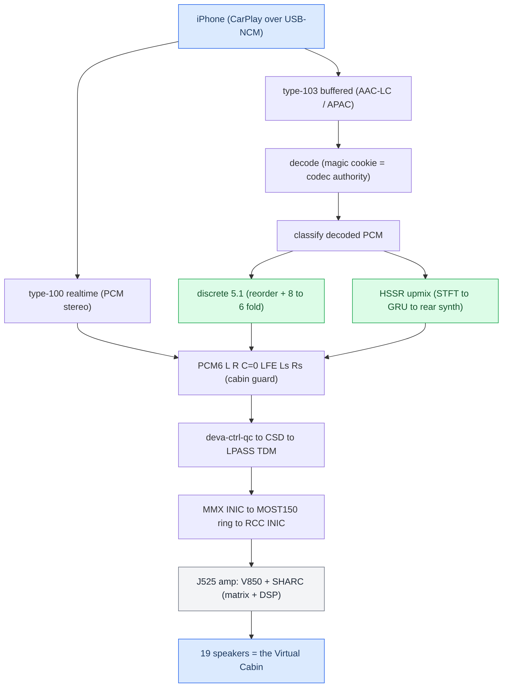

# Audio MOC

*Map of content for the whole stereo→5.1 CarPlay audio pipeline — phone to the 19 speakers of the Audi B&O "Virtual Cabin".*

---

## 📋 What this section covers

Two problems had to be solved to play surround over CarPlay: **get the right six PCM channels** to the amp, and **synthesize six channels for the stereo content that is 99% of what people play**. The J525 B&O amplifier is already a complete 5.1 renderer, so the head unit only feeds it `L R C LFE Ls Rs` and lets it do the acoustics — that division of labour is the [[Virtual Cabin and Amp RE|Virtual Cabin]].

This MOC is the entry point. Start with [[Stereo to 5.1 Upmix]] for the end-to-end flow, then branch into the model, the amp, Dolby, or the discrete path. For the hub note and the trap list see [[Home]] and [[Landmines]].

## 📊 The whole pipeline

## 🔗 The notes

| Note | What it covers |
|---|---|
| [[Stereo to 5.1 Upmix]] | End-to-end pipeline: ingest, where upmix vs discrete kicks in, the frozen calibration, what ships. |
| [[HSSR Model]] | The AI: why separation failed, the second-scene design, the runtime, every model iteration V9→q6d, calibration. |
| [[Virtual Cabin and Amp RE]] | The J525 amp reverse-engineered: two-SoC topology, the single-byte routing decision, the SHARC DSP chain. |
| [[Dolby Atmos]] | What Atmos is on CarPlay, why phone-side spatial is blocked, what HSSR borrowed and where it diverges. |
| [[Discrete 5.1 Routing]] | The native 5.1 path: deva mirror driver, CSD min_voices fix, SAD `asad=0xfc`, magic-cookie codec authority. |

## 💡 Truth levels

Throughout these notes, claims are tagged: **[car]** confirmed on the unit, **[model]** static-RE / offline render, **[open]** unverified. The honest headline: discrete 5.1 is **[car]**; the amp DSP is **[model]** static RE; no blind listening or cabin SPL has ever been measured.

Provenance lives in `docs/research/UPMIX.md` and its three companion papers.
