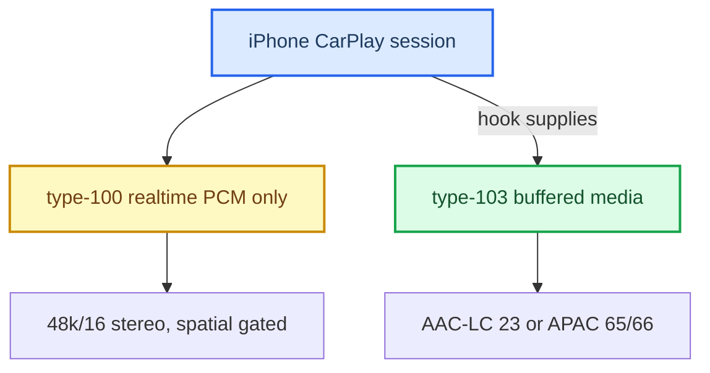
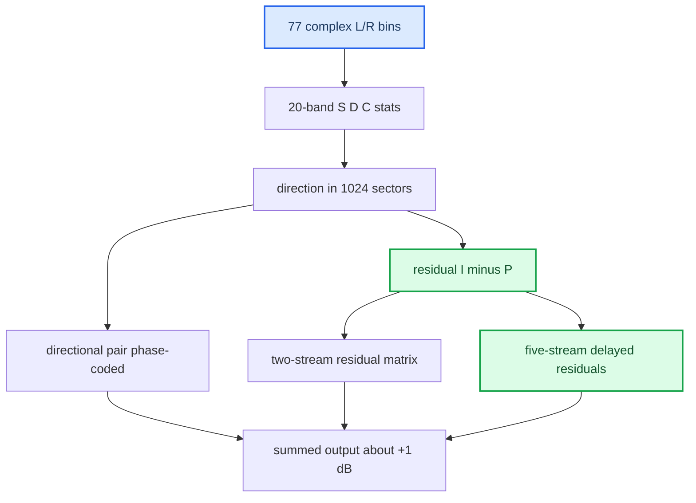

# Dolby Atmos

*What "Dolby Atmos" actually is on the CarPlay wire, why phone-side realtime spatial is blocked, and what HSSR borrowed from Dolby's own spatial DSP — and where it deliberately diverges.*

---

## 🎯 The two questions

"Dolby Atmos on CarPlay" is **not a wire codec**. It is a *content tier*: the phone picks the Atmos rendition of a track and renders it on-device into whatever buffered transport the car accepts. Statically, iOS 27's screen-receiver mask names **AAC-ELD 5.1.2** (bit 42) as the spatial format; **on this car the Atmos tier actually arrived as APAC** on the buffered type-103 stream — index 65 (5.1, UI badge "Dolby Atmos") or 66 (5.1.2, 8 channels) — and an AAC 5.1.2 offer (index 40) was never selected **[car]**. Dolby EC3/DDPLUS never crosses the CarPlay link, and raw multichannel PCM is never offered on the realtime stream.

Two very different "Dolby" questions live here — keep them separate:

1. **The transport question** — what Atmos *is* on the wire, and why the phone won't send it to us in real time.
2. **The DSP question** — how Dolby distributes objects to a surround field, and what principles [[HSSR Model|HSSR]] borrowed.

> **Scope & honesty.** This is analysis, **not** a redistribution of anything Dolby. **The Dolby binary, Dolby's own PDF, and our raw RE dumps have been removed from the repo** — Dolby-proprietary material is not kept here; this analysis is the only retained Dolby artifact. Numbers below are results of our *own* reverse-engineering (static disassembly + Unicorn emulation of extracted kernels). Provenance: `docs-obsidian/Research/DOLBY_ATMOS_TEARDOWN.md`.

## ⚙️ Two CarPlay audio streams

The realtime stream is PCM passthrough only — stock 210 libairplay never decodes AAC (`AudioConverterNew_compat` is a dead stub). `[car]`: realtime CarPlay = `'lpcm'` 48 kHz/16/stereo on `mpl5_dio_ent`. The hook upmixes that stereo media PCM itself (`AUDIO_REALTIME_UPMIX=on`, `deploy/smartphone_integrator/carplay_startup.sh:86`). See [[Stereo to 5.1 Upmix]] for how both streams feed the pipeline.

## 🔍 What "Dolby Atmos" is on the transport

It is a content tier the phone renders into a buffered multichannel transport; the "Dolby" flag switches **content, not transport** (`[model]`, static RE of the iOS 27 shared cache, high confidence):

- The iOS 27 screen-receiver format mask is `0x1440800` (non-spatial) vs `0x40001440800` (spatial-allowed). The delta is **exactly one bit — 42**.
- The 48 kHz multichannel bits are all **AAC/ALAC**: bit 39 = AAC-LC 5.1, bit 40 = AAC-LC 5.1.2, bit 41 = AAC-ELD 5.1, **bit 42 = AAC-ELD 5.1.2 (the spatial bit)**. The transport selector `APAudioFormatSelectTransportFormatForAudioSourceInputFormat` — which, since its 44.1 kHz base mask cannot match our 48 kHz realtime advert, governs the **buffered** stream — has the entire vocabulary {21,22,23,39,40,41,42} — **no PCM bit and no EC3/DDPLUS bit can ever be selected.** Dolby DDPLUS (bit 50) is absent from the mask entirely.
- The `DCXEnabled` accessory flag maps to `dolbyAtmosAudioSupported`; when set, the phone fetches the Atmos rendition of the track, renders that master on-device, and ships it in the negotiated buffered transport — statically AAC 5.1.2, on this car APAC. So: **Dolby = the source tier; the buffered codec = the wire.** Full bit/index table: [[iOS CarPlay Spatial Wireformat]].

External corroboration: Volvo's CarPlay "Spatial Audio, powered by Dolby Atmos" (EX90/EX60/ES90, Bowers & Wilkins only, announced 2026-08-28) ships as a *car-side* software update, consistent with a car-side buffered implementation rather than a bit flip.

### What the Atmos flag does on the phone

Traced in iOS 27 `MediaToolbox` + `AirPlaySupport` **[decompile]** — it selects a different *asset*, never a different wire format:

1. `FPSupport_GetAtmosSupport@0x196E415B8` reads Atmos support as a property of the current output device (the `ac3/ec3/atmosIsDecodable … atmosCanPassthrough` booleans).
2. `itemfig_isAtmosSupported@0x1970D46DC` accepts an item if the route can pass Atmos through, **or** `itemfig_isSpatializationAllowed@0x1970D4BBC`, **or** a channel-count check that actually compares against `16` — a buffered-AirPlay sentinel (`FPSupport_GetMaxPhysicalOutputChannelCount@0x197315E4C` returns 16/2 for a buffered output, the real count for an ordinary route) — so a 6-channel CarPlay route alone does **not** unlock the tier.
3. HLS alternate selection then fetches the Atmos rendition (`FigAlternateSelectionUtility_AlternateListHasATMOSAlternate@0x196E2F9A0`, `HighestAtmosBitrateFilter@0x196CFDB74`, preference `AutoSwitchAtmosVariants`), and the phone renders that master into the route's transport.

The accessory's `DCXEnabled` Bool (wire key, inside `mainBufferedInfo`) sets CarKit `dolbyAtmosAudioSupported` (ivar `+0x16`); the hop from that ivar into the CoreAudio route property is inferred, not traced **[open]**. The hook keeps `DCXEnabled` **absent**: declaring Atmos while the transport stays stereo would only fetch the Atmos master and fold it back to stereo — more data, same result. The on-screen "Dolby Atmos / Dolby Audio / Apple Spatial Audio" badge is derived from the streamed codec and channel count (`APSBadgingFormatInfoCopyBadgeType@0x22663D760`), so the badge falling from "Dolby Atmos" to "Spatial Audio" during the early experiments marked the **loss of the type-103 stream**, not an in-place 5.1.2→5.1 conversion.

### The head unit's own Dolby decoder — present, licensed, irrelevant

The MU1316 image carries a real Dolby Digital Plus decoder on the **local-media** path, never wired into CarPlay: Cinemo wrapper `libNmeAudioDolby.so` (`NmeCreateCodecDDPRef@0x6f38`, licence check at `0xab04`) over the core `libNmeAudioDpcm.so` (exports `NmeGetDDPIUDCAPIVersion@0x4d84` → API `0x00010001`, `NmeCreateDDPIUDC@0x4fe0`, `NmeDDPIUDCVerify@0x51dc`, `NmeGetDDPIUDCChannelLimit@0x51c0`, …). The embedded signed licence decodes to project **1500**, `channel_limit` **6** (up to 5.1, not stereo-only), caps 2, API 1.1; it is signed, so the channel limit cannot be raised. `cinemo_classes.xml` registers `AC3;EC3;EAC3`. It decodes DD+, **not APAC** and not an object renderer. Probe indices 50 (`DDPLUS/48000/5.1`) and 53 (`DDPLUS/48000/9.1.6`) were once exposed as fail-closed type-103 options; the phone never selected them and the current code no longer accepts them (`hook/audio/audio_hook.c:794-826`, `:910-916`). **[decompile]** · **[code]**

## 📦 How Atmos content reaches us — the buffered path

Since spatial rides the buffered stream and the stock stack never opens it, **our hook supplies the type-103 buffered stream itself**: APAP BE32 framing + ChaCha20-Poly1305 auth + TLV/cookie extraction, then decode via `libcarplay_apac.so` (APAC) or Cinemo `libNmeSDK.so` (AAC-LC index 23). The **inline magic cookie is the decoder authority** — not the APAP TLV index hint. Full receiver in [[Buffered Audio Path]]; decoders in [[APAC Codec]] and [[Cinemo AAC Decoder]]; the PCM6 route to the amp in [[Discrete 5.1 Routing]].

Channel handling: the APAC decoder emits native order `C L R Ls Rs LFE`, permuted to CarPlay order `L R C LFE Ls Rs` — exactly what `deva` wants (`hook/audio/spatial_downmix.c:47-69`, measured three ways in [[APAC Codec]]). `[car]` for the 5.1 case end to end.

For 5.1.2 (index 66) the hook has an 8→6 fold: L/R/C unchanged, LFE −6 dB, each height folded into its matching surround at −6 dB (`hook/audio/spatial_downmix.c:71-98`). It runs only on the experimental `AUDIO_SPATIAL_ATMOS=1` path; the shipped startup sets `AUDIO_SPATIAL_ATMOS=0` (`deploy/smartphone_integrator/carplay_startup.sh:61`), so the primary index is 65 (`hook/audio/audio_hook.c:785-788`), and a decoded 5.1.2 stream outside a SETUP-66 session is rejected as `unsupported-layout` (`hook/audio/audio_hook.c:3226-3246`). The index-66 native order is `[open]`.

## ⚠️ Why phone-side spatial over the realtime stream is blocked

The cheap lever — "advertise a multichannel bit on the realtime stream" — is **exhausted; the gap is entirely phone-side** `[car]`:

| tuned bit | offered realtime mask | phone selected |
|---|---|---|
| 44 `PCM/48000/16/5.1` | `0x100000008010` | `0x8000` = **stereo** |
| 42 `AAC-ELD/48000/5.1.2` (iOS's own spatial bit) | `0x40000008010` | `0x8000` = **stereo** |

- **The hook first aimed at the wrong bit** — bit 44 (`PCM/48000/16/5.1`) is a buffered/HomePod-class format not present in the screen-receiver mask at all. The code still adds bit 44 to the type-100 offer as a harmless "PCM fallback" whenever `AUDIO_SPATIAL=1` (`hook/audio/audio_hook.h:42`, `hook/audio/audio_hook.c:451-461`); the phone keeps selecting stereo.
- **Both bits were offered live and refused.** Interposition provably reached negotiation; advertising is not sufficient.
- **The named gate:** `APAudioFormatIsScreenSpatialAudioReceiver` returns 0 unless the phone-side feature flag `ScreenSpatialAudioReceiver` is enabled — an argument-less gate upstream of anything the accessory advertises, plus a device-model check. The handset was an iPhone 17 Pro Max on iOS 27 beta 6, so "device too old" is ruled out. Nothing in `/info` can flip that flag.

So multichannel on CarPlay lives only on the **buffered** stream; the realtime lever cannot touch it. And **5.1.2 height is impossible on this amp** anyway (no 8-channel route in deva; input positions 7/8 = BCL/BCR with no height codes) — the 8→6 fold discards exactly the layer the amp could not render discretely, a phone-side cost, not a musical loss. See [[Virtual Cabin and Amp RE]].

## 📊 The Dolby DSP teardown

We reversed Dolby's **desktop** spatial component `DolbyAudioProcessing.dll` to learn its distribution math, running the surround-decoder kernels in Unicorn on controlled complex inputs. The Windows component was never run end-to-end, so individual-kernel math is verified but the active profile / full PCM path / channel names / LFE path are not.

Key reconstructed facts (**our RE, verified by emulation**):

- **Residual, not rear-only.** The residual is mixed into *five* outputs including front and centre; the surround pair carries a **negative cross term ≈ −0.18** (the decorrelation seed we borrowed). The directional signal is phase-rotated *before* the residual is added, so "surround = a 90° shift" is explicitly wrong.
- **Decorrelation by per-bin delay** (5-stream mode): three streams built from residuals delayed by frequency-dependent taps (larger at low frequency). **The kernel call period is unknown**, so these taps cannot be converted to milliseconds — the single biggest open number.
- **Attack/transient detector:** slow energy history `H ← βH + (1−β)E`; transient weight `clamp(0.5017·log2(0.5012·E/H), 0, 1)` (0 at +3 dB → 1 at +9 dB, as the formula gives and the HSSR port documents at `hook/audio/hssr_dsp.c:1170-1171`), `β ≈ 0.98169` per Dolby unit. On a transient, front coefficients rise and surround coefficients fall — Dolby pulls the transient toward the front to reduce spatial smear. The two matrices crossfade with a power-normalizing form `M = (w·M_transient + b·M_steady)/sqrt(1+2ρwb)`, `b = sqrt(1−w²)` — the same energy-conservation form HSSR reuses as `r* = sqrt(1−b²)`.

## 💡 What HSSR borrowed

All three are implemented behind flags that default off in code and are bit-exact when off (`hook/audio/audio_hook.h:75-81`). The shipped startup turns them on — retention 0.5, bed delays on, owner attack at collapse 0.75 (`deploy/smartphone_integrator/carplay_startup.sh:71-78`):

| Principle | How HSSR uses it |
|---|---|
| Energy-conservation ceiling on object transfer (`AUDIO_STEREO_FRONT_RETENTION`) | front keeps `r`, rear gets `b`; conserving point `r* = sqrt(1−b²)`. At `b = 0.40`, `r* = 0.917` (−0.75 dB). **`r*` is an upper bound, not a target** — at `r*` the object localizes back in front. Shipped `r = 0.5` |
| Per-frequency bed delays + delayed cross term (`AUDIO_HSSR_BED_DELAYS`) | only the bed is delayed, via a 16-hop per-bin ring with per-band delays of 1–15 hops, different for Ls and Rs; each side mixes `0.79·now + 0.60·delayed_same − 0.14·delayed_opposite` (unit energy) (`hook/audio/hssr_dsp.c:52-63`, `:1190-1313`); the object stays coherent |
| Attack "collapse to one point" (`AUDIO_HSSR_BED_ATTACK`, `AUDIO_HSSR_ATTACK_COLLAPSE`) | Dolby's detector constants ported (`0.5017·log2(0.5012·E/H)`, `β = 0.9637` per hop = 0.98169 per unit, two units per hop) (`hssr_dsp.c:65-66`, `:1171-1189`) |

The −0.18 cross term with `1/sqrt(1+0.18²)` scaling was the plan's first form (`docs-obsidian/Sources/UPMIX_DOLBY_DISTRIBUTION_PLAN_2026-09-21.md`); the code ships the 0.79 / 0.60 / 0.14 split above.

Plus a bonus fix: ungated retention kept each bright object's treble in the front (+1.3 dB in the front 2–16 kHz, per `hssr_dsp.c:1576-1578` and `carplay_startup.sh:79-80`). The fix — a frequency-dependent retention taper, library default `1000:2500 Hz` (`hook/audio/stereo_upmix.h:42-43`) — is the analogue of Dolby's front-vs-surround voicing and ships with retention 0.5. See [[HSSR Model]].

## ❌ Where HSSR deliberately differs

- **The "second scene" — the dominant object is sent to the REAR.** Dolby never moves the dominant object backward; only the residual goes back. HSSR intentionally sends masked objects to the rear at ×0.40 with a **12 ms precedence delay** (`hook/audio/stereo_upmix.h:31`), keeping up to half of each in front below the 1–2.5 kHz retention taper (shipped retention 0.5). This is the fundamental divergence.
- **Attack direction is owner-conditional, not always-forward.** Dolby collapses the ownerless residual forward every time; HSSR collapses toward the *band owner* — rearward for a second-scene object, forward when unowned.
- **Object stays coherent** — only the bed is decorrelated and delayed.
- **Centre/front residual not copied** — HSSR keeps digital C = 0 (the Audi amp forms the centre) and offers an independent `front_retention` instead.
- **32 control bands vs Dolby's 20, and semantic protection** — no semantic vocal/bass protection was found in the Dolby kernel; HSSR's differentiator is the steep vocal/bass vetoes driven by the q6d and V11 class posteriors (`hook/audio/hssr_dsp.c:613-680`).

## ⚠️ Established vs hypothesis

**Established (verified by emulation):** the `(I−P)` residual extraction; direction `= atan2(2C,D)` over 1024 sectors; the two-stream residual matrix incl. the ≈ −0.18 cross term; the five-stream delayed structure; the attack detector constants; the power-normalized crossfade; the ≈ +1 dB output gain.

**Hypothesis / open** `[open]`:

- **Kernel call period** — the unit of every Dolby delay. 64 samples → ~32–43 ms (decorrelation); 1024 samples → 64–660 ms (not decorrelation, would invalidate our borrowed table). Unresolved; the shipped HSSR bed-delay table assumes 64-sample units (`hook/audio/hssr_dsp.c:52-55`).
- Which distribution mode (2- vs 5-stream) is active; the 20-band boundaries in Hz; channel names, output order, and the LFE path.
- Whether the Dolby chain is even active for ordinary stereo, and whether the DLL can emit plain multichannel PCM — only diagnostic string names exist.
- **That Dolby is better than HSSR** — no listening comparison was done; superiority and gain magnitude are explicitly **not** established.

**Bottom line.** On the wire, "Dolby Atmos on CarPlay" is Atmos-tier *content* the phone renders on-device into a **buffered type-103** transport — APAC 5.1/5.1.2 on this car, AAC 5.1.2 (bit 42) in the static screen-receiver mask — never EC3/DDPLUS, never realtime multichannel PCM — and phone-side realtime spatial is blocked by an accessory-invisible feature flag. As a *design source*, Dolby taught us residual distribution, decorrelation-by-delay, energy conservation and transient collapse; but HSSR's second-scene rear routing is a deliberate departure, and we have never demonstrated Dolby is the better renderer. Traps in [[Landmines]].

**Related:** [[Upmix Literature]] (the separation and upmix papers around this teardown) · [[Virtual Cabin and Amp RE#The 8-channel sink is rear 7.1, not 5.1.2]] (why there is no height output) · [[CarPlay Feature Survey]] (which CarPlay features ride the same session).

---

## 📚 Sources

- [[Sources/reference/AUDIO|AUDIO]] — §7 Dolby licence decode, §12–§18 the EC3-vs-AAC-vs-PCM transport debate, §17 the Atmos content switch, §25 live refusals.
- [[Sources/reference/CARPLAY_SPATIAL_DOLBY_PLAN|CARPLAY_SPATIAL_DOLBY_PLAN]] — the superseded first plan (Atmos = `EC3/48000/7` via `libNmeAudioDolby`).
- [[Sources/HANDOFF_SPATIAL_AUDIO|HANDOFF_SPATIAL_AUDIO]] — index 65/66 live results, badge behaviour, the target Dolby decoder exports.
- [[Sources/reference/AUDIOTYPE_DOLBY_AND_PCM_UPMIX|AUDIOTYPE_DOLBY_AND_PCM_UPMIX]] — why `audioType=media` and type 103 are not Atmos indicators.
- [[Sources/SAD_HEADER|SAD_HEADER]] — "does iOS upmix stereo into spatial? No" (badging only).
- Research long-form: [[Research/DOLBY_ATMOS_TEARDOWN|DOLBY_ATMOS_TEARDOWN]] · [[Research/HSSR_UPMIX_MODEL|HSSR_UPMIX_MODEL]].

