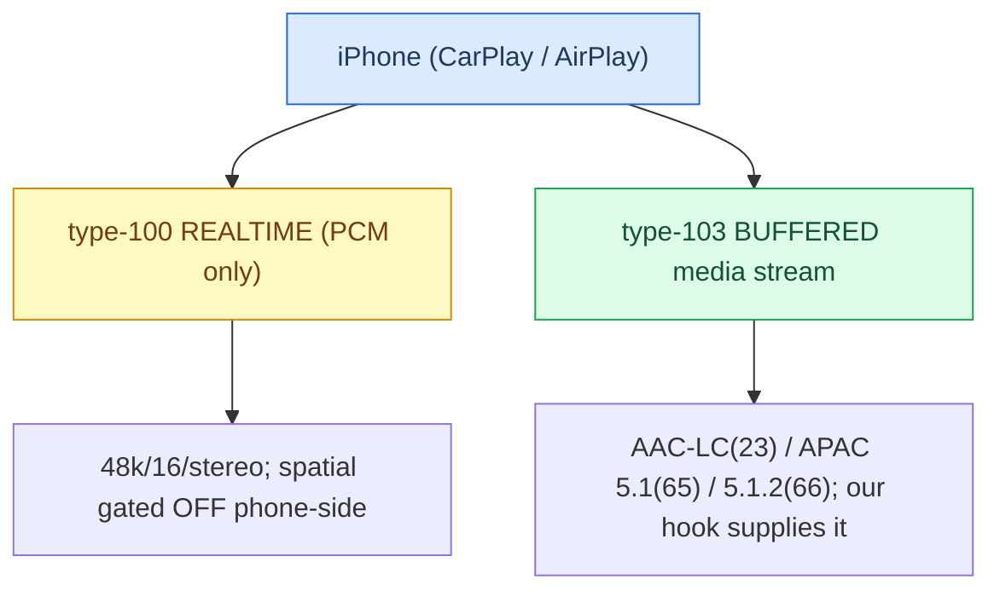
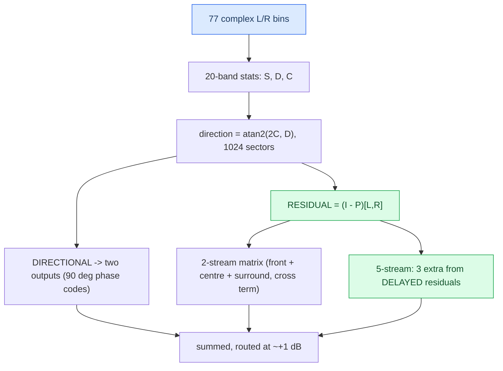

# Dolby Atmos

*What "Dolby Atmos" actually is on the CarPlay wire, why phone-side realtime spatial is blocked, and what HSSR borrowed from Dolby's own spatial DSP — and where it deliberately diverges.*

---

## 🎯 The two questions

"Dolby Atmos on CarPlay" is **not a wire codec**. It is a *content tier*: the phone picks the Atmos rendition of a track and renders it **on-device** into an **AAC 5.1.2** transport (format bit 42), carried on a **buffered media stream (type 103)**. Dolby EC3/DDPLUS never crosses the CarPlay link, and raw multichannel PCM is never offered on the realtime stream.

Two very different "Dolby" questions live here — keep them separate:

1. **The transport question** — what Atmos *is* on the wire, and why the phone won't send it to us in real time.
2. **The DSP question** — how Dolby distributes objects to a surround field, and what principles [[HSSR Model|HSSR]] borrowed.

> **Scope & honesty.** This is analysis, **not** a redistribution of anything Dolby. **The Dolby binary, Dolby's own PDF, and our raw RE dumps have been removed from the repo** — Dolby-proprietary material is not kept here; this analysis is the only retained Dolby artifact. Numbers below are results of our *own* reverse-engineering (static disassembly + Unicorn emulation of extracted kernels). Provenance: `docs/research/DOLBY_ATMOS_TEARDOWN.md`.

## ⚙️ Two CarPlay audio streams

The realtime stream is PCM passthrough only — stock 210 libairplay never decodes AAC (`AudioConverterNew_compat` is a dead stub). **[car]:** realtime CarPlay = `'lpcm'` 48 kHz/16/stereo on `mpl5_dio_ent`. See [[Stereo to 5.1 Upmix]] for how both streams feed the pipeline.

## 🔍 What "Dolby Atmos" is on the transport

It is a content tier the phone renders into AAC multichannel; the "Dolby" flag switches **content, not transport** (**[model]**, static RE of the iOS 27 shared cache, high confidence):

- The iOS 27 screen-receiver format mask is `0x1440800` (non-spatial) vs `0x40001440800` (spatial-allowed). The delta is **exactly one bit — 42**.
- The 48 kHz multichannel bits are all **AAC/ALAC**: bit 39 = AAC-LC 5.1, bit 40 = AAC-LC 5.1.2, bit 41 = AAC-ELD 5.1, **bit 42 = AAC-ELD 5.1.2 (the spatial bit)**. The realtime selector's entire vocabulary is bits {21,22,23,39,40,41,42} — **no PCM bit and no EC3/DDPLUS bit can ever be selected.** Dolby DDPLUS (bit 50) is absent from the mask entirely.
- The **`DCXEnabled`** accessory flag maps to `dolbyAtmosAudioSupported`; when set, the phone fetches the **Atmos rendition** of the track, renders that master **on-device**, and ships **AAC 5.1.2** on the screen branch. So: **Dolby = the source tier; AAC 5.1.2 = the wire.**

External corroboration: Volvo's CarPlay "Spatial Audio, powered by Dolby Atmos" ships as a *car-side* software update, consistent with a car-side buffered implementation rather than a bit flip.

## 📦 How Atmos content reaches us — the buffered path

Since spatial rides the buffered stream and the stock stack never opens it, **our hook supplies the type-103 buffered stream itself**: APAP BE32 framing + ChaCha20-Poly1305 auth + TLV/cookie extraction, then decode via `libcarplay_apac.so` (APAC) or Cinemo `libNmeSDK.so` (AAC-LC index 23). The **inline magic cookie is the decoder authority** — not the APAP TLV index hint. Full path in [[Discrete 5.1 Routing]].

Channel handling: the APAC decoder emits native order **C L R Ls Rs LFE**, permuted to CarPlay order **L R C LFE Ls Rs** — exactly what `deva` wants. For 5.1.2 (index 66) an **8→6 fold** applies (L/R/C unchanged, LFE −6 dB, each height folded into its matching surround at −6 dB); the index-66 native order is **[open]**. **[car]** for the 5.1 case end to end.

## ⚠️ Why phone-side spatial over the realtime stream is blocked

The cheap lever — "advertise a multichannel bit on the realtime stream" — is **exhausted; the gap is entirely phone-side** **[car]**:

| tuned bit | offered realtime mask | phone selected |
|---|---|---|
| 44 `PCM/48000/16/5.1` | `0x100000008010` | `0x8000` = **stereo** |
| 42 `AAC-ELD/48000/5.1.2` (iOS's own spatial bit) | `0x40000008010` | `0x8000` = **stereo** |

- **The hook first aimed at the wrong bit** — bit 44 (`PCM/48000/16/5.1`) is a buffered/HomePod-class format not present in the screen-receiver mask at all.
- **Both bits were offered live and refused.** Interposition provably reached negotiation; advertising is not sufficient.
- **The named gate:** `APAudioFormatIsScreenSpatialAudioReceiver` returns 0 unless the phone-side feature flag `ScreenSpatialAudioReceiver` is enabled — an argument-less gate upstream of anything the accessory advertises, plus a device-model check. The handset was an iPhone 17 Pro Max on iOS 27 beta 6, so "device too old" is ruled out. Nothing in `/info` can flip that flag.

So multichannel on CarPlay lives only on the **buffered** stream; the realtime lever cannot touch it. And **5.1.2 height is impossible on this amp** anyway (no 8-channel route in deva; input positions 7/8 = BCL/BCR with no height codes) — the 8→6 fold discards exactly the layer the amp could not render discretely, a phone-side cost, not a musical loss. See [[Virtual Cabin and Amp RE]].

## 📊 The Dolby DSP teardown

We reversed Dolby's **desktop** spatial component `DolbyAudioProcessing.dll` to learn its distribution math, running the surround-decoder kernels in Unicorn on controlled complex inputs. The Windows component was never run end-to-end, so individual-kernel math is verified but the active profile / full PCM path / channel names / LFE path are not.

Key reconstructed facts (**our RE, verified by emulation**):

- **Residual, not rear-only.** The residual is mixed into *five* outputs including front and centre; the surround pair carries a **negative cross term ≈ −0.18** (the decorrelation seed we borrowed). The directional signal is phase-rotated *before* the residual is added, so "surround = a 90° shift" is explicitly wrong.
- **Decorrelation by per-bin delay** (5-stream mode): three streams built from residuals delayed by frequency-dependent taps (larger at low frequency). **The kernel call period is unknown**, so these taps cannot be converted to milliseconds — the single biggest open number.
- **Attack/transient detector:** slow energy history `H ← βH + (1−β)E`; transient weight `clamp(0.5017·log2(0.5012·E/H), 0, 1)` (0 at +4 dB → 1 at +9 dB), `β ≈ 0.98169` at 48 kHz. On a transient, front coefficients rise and surround coefficients fall — Dolby pulls the transient toward the front to reduce spatial smear. The two matrices crossfade with a power-normalizing form `M = (w·M_transient + b·M_steady)/sqrt(1+2ρwb)`, `b = sqrt(1−w²)` — the same energy-conservation form HSSR reuses as `r* = sqrt(1−b²)`.

## 💡 What HSSR borrowed

All three are implemented behind default-off flags and bit-exact when off:

| Principle | How HSSR uses it |
|---|---|
| **Energy-conservation ceiling** on object transfer | front keeps `r`, rear gets `b`; conserving point `r* = sqrt(1−b²)`. At `b = 0.40`, `r* = 0.917` (−0.75 dB). **`r*` is an upper bound, not a target** — at `r*` the object localizes back in front |
| **Per-frequency bed delays + delayed cross term** (`AUDIO_HSSR_BED_DELAYS`) | only the *bed* is delayed via a 16-hop per-bin ring; `rearL += bedL[t−dL] − 0.18·bedR[t−dR]`, scaled `1/sqrt(1+0.18²)`; the object stays coherent |
| **Attack "collapse to one point"** (`AUDIO_HSSR_BED_ATTACK`) | Dolby's detector ported verbatim (`clamp(0.5017·log2(0.5012·E/H),0,1)`, `β = 0.9637` per hop) |

Plus a **bonus fix**: retention 0.5 was raising the front broadband (+1.3 dB across 0.5–8 kHz) because the front half of an object drags its own treble forward. The fix — a frequency-dependent retention taper (default `1000:2500 Hz`) — is the analogue of Dolby's front-vs-surround voicing and is what ships today. See [[HSSR Model]].

## ❌ Where HSSR deliberately differs

- **The "second scene" — the dominant object is sent to the REAR.** Dolby never moves the dominant object backward; only the residual goes back. HSSR intentionally sends whole masked objects to the rear at ×0.40 with a **12 ms precedence delay**. This is the fundamental divergence.
- **Attack direction is owner-conditional, not always-forward.** Dolby collapses the ownerless residual forward every time; HSSR collapses toward the *band owner* — rearward for a second-scene object, forward when unowned.
- **Object stays coherent; only the bed is decorrelated/delayed.**
- **Centre/front residual not copied** — HSSR keeps digital C = 0 (the Audi amp forms the centre) and offers an independent `front_retention` instead.
- **32 control bands vs Dolby's 20, and learned protection masks** — no semantic vocal/bass protection was found in the Dolby kernel; HSSR's differentiator is trained protection masks.

## ⚠️ Established vs hypothesis

**Established (verified by emulation):** the `(I−P)` residual extraction; direction `= atan2(2C,D)` over 1024 sectors; the two-stream residual matrix incl. the ≈ −0.18 cross term; the five-stream delayed structure; the attack detector constants; the power-normalized crossfade; the ≈ +1 dB output gain.

**Hypothesis / open [open]:**

- **Kernel call period** — the unit of every Dolby delay. 64 samples → ~32–43 ms (decorrelation); 1024 samples → 64–660 ms (not decorrelation, would invalidate our borrowed table). Unresolved.
- Which distribution mode (2- vs 5-stream) is active; the 20-band boundaries in Hz; channel names, output order, and the LFE path.
- Whether the Dolby chain is even active for ordinary stereo, and whether the DLL can emit plain multichannel PCM — only diagnostic string names exist.
- **That Dolby is better than HSSR** — no listening comparison was done; superiority and gain magnitude are explicitly **not** established.

**Bottom line.** On the wire, "Dolby Atmos on CarPlay" is Atmos-tier *content* the phone renders on-device into **AAC 5.1.2** (bit 42) over a **buffered type-103** stream — never EC3/DDPLUS, never realtime multichannel PCM — and phone-side realtime spatial is blocked by an accessory-invisible feature flag. As a *design source*, Dolby taught us residual distribution, decorrelation-by-delay, energy conservation and transient collapse; but HSSR's second-scene rear routing is a deliberate departure, and we have never demonstrated Dolby is the better renderer. Traps in [[Landmines]].
