# Internal Amp Path

*What happens to CarPlay media on an Audi coded for the internal (non-B&O) amplifier: the RCC MIBRoot route decision, the AudioProcess sink maps, the Jacinto C674x DSP, and the four-site RCC patch plan that would give it discrete 5.1. All static RE from 2026-09-19; nothing here has run on an internal-amp car.*

---

## 📋 The answer first

On an internal-amp car there is **no stock six-channel CarPlay route**. MIBRoot picks the stereo pair `eSRC_ENT_AMP_DIO_MEDIA (0x46e) → eSNK_SPEAKERS`, which allocates a 4-byte (2 × 16-bit) MOST source. The MMX still packs six TDM slots and the hook still writes PCM6, so C/LFE/Ls/Rs are simply not transported: expect front L/R only — worse than stock, because the HSSR upmix moves energy out of the fronts `[decompile]`.

The policy is therefore `AUDIO_SPATIAL=0` unless the RCC coding byte says external (`02`). The checked-in startup hardcodes `AUDIO_SPATIAL=1` for this B&O unit and assigns the gate to "the installer" (`deploy/smartphone_integrator/carplay_startup.sh:56-60`); no installer code reads the byte yet `[open]`. `AUDIO_STEREO_UPMIX=off` alone is not enough — it still writes PCM6 `L R 0 0 0 0`.

A real internal 5.1 path is **feasible with no hard wall**, but needs RCC-only edits in two binaries (MIBRoot and the DSP image) and a car with the internal amp to test on.

## ⚙️ Where the decision lives

`MIBRoot` (the audio-policy owner: `CAudioManagementPresCtrl`, `AudioPersistence`, `Amp.Amplifier`) runs on the **RCC** (TI Jacinto 5 DRA6xx), not the MMX. `rootifs_out/usr/apps/MIBRoot == MIBRoot_RCC` (16,468,409 B). The MMX audio stack is amplifier-agnostic: `VARIANT=G22` is hardcoded in MMX `startup.sh` (l.426), `io-audio ... platform_id=mib2` and `audio_service` start unconditionally (l.618–655), and no PPS object mirrors the coding.

```mermaid
flowchart LR
  accTitle: Connection 162 route decision on the RCC
  accDescr: E2P record 0xF1 byte 11 is read by AudioPersistence, published as ExternalAmplifierCoded, cached in one byte that the MIBRoot mapper reads to pick the internal stereo pair or the external multichannel pair, which AudioProcess turns into a DSP crossbar input or a MOST Connect.
  e2p_byte["E2P 0xF1 byte 11, Sound_System"]
  persistence["AudioPersistence 0x1e03e8"]
  ext_prop["Amp.Amplifier ExternalAmplifierCoded"]
  route_byte["MIBRoot byte 0x10bc0e8"]
  mapper["mapper 0x1e2a18, resource 0x78"]
  int_pair["0x46e to eSNK_SPEAKERS, 4 bytes"]
  ext_pair["0x46f to eSNK_DTCP51, 26 bytes"]
  crossbar["AudioProcess SPC crossbar, internal DSP"]
  most_connect["MOST Connect, external amp"]
  e2p_byte --> persistence --> ext_prop --> route_byte --> mapper
  mapper -->|"byte == 0"| int_pair --> crossbar
  mapper -->|"byte != 0"| ext_pair --> most_connect
  classDef primary fill:#dbeafe,stroke:#2563eb,stroke-width:2px,color:#1e3a5f
  classDef warning fill:#fef9c3,stroke:#ca8a04,stroke-width:2px,color:#713f12
  classDef success fill:#dcfce7,stroke:#16a34a,stroke-width:2px,color:#14532d
  class e2p_byte,route_byte primary
  class int_pair warning
  class ext_pair success
```



### The mapper and the one byte

`sub_1E2A18(conn, term, &src, &snk)` (called from `requestRequestConnection 0x1f1790` at `0x1f1900`) scans the connection table at `0xDDEFB8` (143 × 20 B `{connection, terminal, flags, resource, property}`), then the resource table at `0xDDFC1C` (143 × 20 B `{resource, int_src, int_snk, ext_src, ext_snk}`), and selects columns by `LDRB` of `g_externalAmplifierCoded @0x10BC0E8` (`0x1e2ab8` src, `0x1e2ae8` snk). The only writer is `onExternalAmplifierCodedUpdate` (`0x1e6a3c`, store `0x1e6a64`); the reverse mapper `0x1e2b18` reads the same byte. Selected pairs leave MIBRoot as a `DMMAudioManagement` proxy call (`sub_1D6CB4` → `0x755a58`, method `0x80000002`, src at msg `+0x50`, snk `+0x54`).

Connection 162 record `@0xDDF6E8`: `a2 00 00 00 | 01 00 00 00 | 00 00 00 00 | 78 00 00 00 | 01 00 00 00` (`CL_ENT_AMP_DIO_MEDIA`, `FRONT_DRIVER`). Resource `0x78 @0xDE05A4`: `78 00 00 00 | 6e 04 00 00 | 01 00 00 00 | 6f 04 00 00 | 02 00 00 00`.

The request itself (`DSIAudioManagement.requestConnection(connection, terminal, group)`) and the whole `org.dsi.ifc.carplay` API carry **no channel count**; QSA's six-voice negotiation never feeds this decision. The unrelated `org.dsi.ifc.media.AudioStream.numChannels` is DVD/media-player UI only.

### CarPlay-related resource records

| Resource | Internal pair | External pair |
|---|---|---|
| `0x78` DIO media (conn 162) | `0x46e` → SPEAKERS | `0x46f` `_MC` → DTCP51 |
| `0x79` DIO phone (conn 151) | `0x470` → SPEAKERS | same |
| `0x7b` DIO Siri (conn 152) | `0x471` → SPEAKERS | same |
| `0x7d` / `0x7e` DIO announcement / lowering | → SPEAKERS | same |
| `0x7f` DIO ringtone (conn 165) | `0x484` → SPEAKERS | `0x491` `_MC` → DTCP51 |
| `0x7a`, `0x7c` DIO phone / Siri speech input | → `eSNK_MU_REF` | same |
| `0x80` GAL media (conn 156), `0x88` BCL media (conn 167) | → SPEAKERS | `_MC` → DTCP51 |

Across all 143 records: sink 31 `eSNK_SPEAKERS_MC` and sink 3 `eSNK_DTCP20` never occur; every `_MC` source appears only in the external column paired with DTCP51; 45 records differ between columns (SPEAKERS→DTCP51, MUHP `_21`→`_2A`, and ICC↔SPEAKERS for resources `0x5f`/`0x61`). Resource `0x11` is referenced by connection `0x66` but missing ("Could not map"). Internal DVD 5.1, BT, MFP, CLOUD, GAL, A2LS and DIO media all end in `eSNK_SPEAKERS`.

<details>
<summary>Enum and table details</summary>

- Sink enum (name array `0xDDCF5C`, lookup `0x1e11ec`): 1 SPEAKERS, 2 DTCP51, 3 DTCP20, 4 SDS, 5 MIC, 6 MU_REF, 7/8 MIC1/2, 9 TEL, 10–13 MUIN01/01DTCP/02/02DTCP, 14 MUDELAY20, 15 MUHP, 16–19 RUHP1/2 RSEHP1/2, 20 BB, 21/22 MUBTHS1/2, 23/24 RSEIN01/02, 25 TPMEMO, 26 MUTVSD, 27/28 MUDVDCSD/HD, 29 DCIMAPSD, 30 TLAM, **31 SPEAKERS_MC**, 32 ICC.
- Source values: compare tree at `0x1e120c` (IDA-undefined, emulated): `0x46e` DIO_MEDIA, `0x46f` DIO_MEDIA_MC, `0x470` DIO_PHONE, `0x471` DIO_SIRI, `0x473` DIO_ANNOUNCEMENT, `0x474` DIO_LOWERING, `0x484` DIO_RINGTONE, `0x491` DIO_RINGTONE_MC, −3 FOREGROUND, −1 ALL; four names inferred by string-blob order (`0x415`, `0x417`, `0x477`, `0x479`).
- Terminals (`0xDE077C`): 0 SINGLE_USER_DEFAULT, 1 FRONT_DRIVER, 2 FRONT_PASSENGER, 3/4 RSE_LEFT/RIGHT. Connection names `0xDE07A4`, conn ≤ `0x135`.
- Side tables `0xDDFAE4` (78 × u32) and `0xDDEE74` (81 × u32) hold classes 0..10 per resource; identical for 2ch and `_MC` resources — not channel counts.
- The analysed `RE/MIBRoot/MIBRoot` copy differs from shipped RCC MIBRoot by 35 experiment bytes (NOPs in `sub_1E7138`, edits `0x7b2974..0x7b8e17`), none in the mapper or tables.

</details>

---

Sources: [[Sources/INTERNAL_AMP_MIBROOT_ROUTING|INTERNAL_AMP_MIBROOT_ROUTING]], [[Sources/MC_SELECTION_AUDIT|MC_SELECTION_AUDIT]], [[Sources/CODEX_PROMPT_MC_SELECTION|CODEX_PROMPT_MC_SELECTION]]

## 💾 Coding bytes and how to read them

| E2P address | Byte | Meaning | Consumer |
|---|---|---|---|
| `0xF1` | +11 (flat `0xFC`) | **Sound_System**: 1 internal, 2 external; `0xFF` → warn "invalid sound system ==> set SoundSystem = INTERN" | the router (via `g_externalAmplifierCoded`) |
| `0x3E4` | +0 | SignalFlowId (dataset) | diagnostics |
| `0x3E5` | +0 | **ChannelNo**: 2 → `INT_AMP_2CH`, 4 → `INT_AMP_4CH`, anything else → `INT_AMP_6CH` | loudspeaker diagnosis only |

`sub_1DEFE4` builds `speakerCoding` (u16 at `AudioDiagPresCtrl+706`) only for `startLoudspeakerDiagnosis` (`sub_1DB4B0`) and the test-sound channel bound (`sub_1D0B0C`); it is not a property, not sent to deva, and not read by the mapper. The AudioDiag `CodedAmplifier` value (`0x20a2f4`, "please check Byte 11 ;-)") is the same byte-11 value. The `DEVICETYPE_*` enum (parser `0x1f81cc`: "120" BASIC_2CH, "121" BASIC_4CH, **"122" STANDARD_6CH = the internal 6-channel amp**, "140" ALPINE_BO_AUDI, "160"/"161" Bose, "181" ADVANCED_BO_AUDI = this car, …) comes from the DMM `AmplifierInfo` string and only drives HMI sound-setting capabilities. For the external branch nothing remaps by device type, so a **Bose** car (`Sound_System=2`) takes the same `DTCP51` route — its sink profile is unaudited `[open]`.

This car's dump `MU1316-EEProm.bin @0xF1`: `01 94 53 02 00 00 00 00 13 22 00 [02] 04 1a 00 10 2f 00 12 e5 01 70 09 04 be` — byte 11 = `02`, external `[car]` (matches `MU1316-LOG.txt` `Coding: 0194530200…`). Engineering scripts write it with `on -f rcc /ffs/extbin/apps/bin/VIPCmd ee bc Sound_System 1|2`.

Ranked ways to read it from an MMX shell at CarPlay start:

| Rank | Method | Caveat |
|---:|---|---|
| 1 | `on -f rcc /usr/apps/modifyE2P r fc 1` (or `r f1 19`, take byte 12) | blocks until RCC `DSIE2PAccess` is up; wrap in background+kill (QNX 6.5 has no `timeout`); `02` external, `01` internal, `ff` → internal; output format unconfirmed live |
| 2 | `cat /net/rcc/HBpersistence/etc/AmplifierCoding` / `useExternalAmplifier` | consulted by AudioProcess only when `--amptype` is absent; likely absent on production units |
| 3 | Java: `DSISound.ATTR_ACTIVEAMPLIFIERCAPABILITIES=35` → full amp id → `/tmp/carplay_amp_type` | the only way to tell Bose apart; boot ordering vs `carplay_startup.sh` unproven |
| 4 | `on -f rcc sloginfo`, grep for `Amptype from EEPROM` and `speakerCoding =` | trace-scope dependent |

Proposed gate (not in the repo yet):

```sh
# ponytail: one E2P byte decides the whole policy; fall back to stereo on any doubt
SS=$(on -f rcc /usr/apps/modifyE2P r fc 1 2>/dev/null | awk '/^0x/{print $2}')
case "$SS" in 02) export AUDIO_SPATIAL=1 ;; *) export AUDIO_SPATIAL=0 ;; esac
```

Sources: [[Sources/INTERNAL_AMP_PATH_KNOWLEDGE|INTERNAL_AMP_PATH_KNOWLEDGE]], [[Sources/INTERNAL_AMP_MIBROOT_ROUTING|INTERNAL_AMP_MIBROOT_ROUTING]], [[Sources/MC_SELECTION_AUDIT|MC_SELECTION_AUDIT]]

## 🔍 AudioProcess: logical sink to physical input

AudioProcess (`rcc ifs3 /bin/AudioProcess`, SHA `3d591ef3…`) resolves MIBRoot's `(src, snk)` against the G22 audio table's `<conn>` list. The table is `/etc/MIB_AudioTable_AU_G22.xml`, **gzip-compressed**; loader `sub_18B2A8` uses `gzopen` + libxml2 with DTD validation that only warns (the DTD is not shipped) but rejects non-well-formed XML. The start line comes from `collectConfigData` → `/tmp/startArgs_AudioProcess` (`--audiotable=/etc/MIB_AudioTable_AU_G22.xml`, `--amptype=EXT|120|121|122`), started by `srv-starter.cfg:573`.

`<snk amid nr>` → AM sink id (`sub_18E048`), then `CMainAmp` maps AM sink → amplifier sink by **area**: 51 = internal (`sub_146B78`), 42 = MOST (`sub_146A1C`); the wrong area is ignored with a log line.

| XML sink | AM id | Internal amp (area 51) | External MOST amp (area 42) |
|---|---:|---|---|
| `SPEAKERS` (`eSNK_SPEAKERS` nr 1) | 0 ENT1_STEREO | DSI sink **1**, width 4 | `0x21`, BW 4 |
| `MULTICHANNEL` (`eSNK_DTCP51` nr 1) | 10 ENT1_OLD_DTCP51 | DSI sink **6** "Entertainment Multichannel", width 26 | **`0x32`**, BW 26 |
| (ENT1_DTCP51) | 2 | sink 6 | `0x26`, BW 14 |
| `SPEAKERS_MC` (`eSNK_SPEAKERS_MC`) | 13 | **sink 1 — alias of stereo** | absent → "not supported" |
| ANN1..3 | 4..6 | 2..4 | `0x22..0x24` |
| `HEADPHONE1` | 7 | 9 | 9 |

G22 XML: `SPEAKERS` used by 53 connections, `MULTICHANNEL` by 35, `SPEAKERS_MC` by **zero**; `LC_ENT_AMP_DIO_MEDIA.MULTICHANNEL` (`src="LS_ENT_AMP_DIO_MEDIA.MC"`) already exists. `CDSIAudioManagement` sinks (`0x2d4140`): `1:4 2:2 3:2 4:2 5:4 6:26 7:26 8:4 9:4 10:4 11:2`. IoAmp addressing puts sink 6 on **the same DSP zone 0 / sink 0** as stereo sink 1. FBlock `0x22` sinks known to the HU: `0x21:4 0x22..0x24:2 0x25:12 0x26:14 0x27:6 0x28:16 0x29:18 0x2a:9 0x2b:18 0x2c:21 0x32:26`.

Internal sinks are `DEVICE_INTERNAL` (netID 1): `CConnectionPending::SinkInit` (`sub_1235D0`) sends `CrossbarConnect.SetGet` to `/dev/spc` (`dev_signalpath_configurator` → `/dev/io-amp/routing` → dspipc). `libSPC_configuration.so` `sourceMapping @0x2a98` maps MOST srcIDs to DSP crossbar inputs: **srcID `0x34` (source 7, 26 B) → input 9; `0x3a` (source 1, 4 B) → input 10**; Mmx/5,4,3,6 → 11,12,14,15. Device `0xD001`, 26 local sources, 5 zones. The SPC's "number of channels does not match for device %s" check compares runtime-filled `.bss` values — not decidable statically. The A2I/dspipc WavePlayer (`uNumChannels` 1–2 only) is the chime player, not the entertainment path.

> ⚠️ **Hard wall:** coding an internal-amp car as external (`Sound_System=2`) makes `collectConfigData` pass `--amptype=EXT`; `CMainAmp` then ignores internal area 51 and waits for a MOST amp that does not exist — **no audio at all**.

> ⚠️ **Contradiction with the B&O audits:** this map sends `MULTICHANNEL` to external sink `0x32`, not `0x26`. See [[QNX Audio Topology]] — `[open]` until a live `raiseConnSR` trace.

Sources: [[Sources/INTERNAL_AMP_AUDIOPROCESS_SINKS|INTERNAL_AMP_AUDIOPROCESS_SINKS]]

## 🔍 The internal amp's DSP

The internal amp DSP is the Jacinto's C674x, loaded by the IPL (dev-dspipc runs with `suppress`, so it does not download). Image in RCC NOR at `0x3D00000` (813,348 B), a **Harman "BGZ boot table"**: magic `0xC6000ABC`, `word[1]` = exact file size (also the NOR scan step), entry `0x87629000` at `+0x20`, records `{tag, size, dst, data}` with tag `0xC6C6C601` = LZO1X, `0xC6C6C600` = raw, size-0 terminator. 38 records; `.text` at `0x87500180`, `.const` `0x875E7DC0`, `.cinit` `0x87612900` (795 records), version block `DRX6XX_DSPBIOS-RELEASE.A024_MIB2.DSPDUMP.No_Audio_Decoder.1`. The loader stub (`0xE00544..0xE006F0`) does **no CRC and no signature**; the IPL's BG CRC32 is used only for its own self-checks and verbose dumps `[decompile]`.

| McASP | AFSRCTL | RTDM | Slots | Role |
|---|---:|---:|---|---|
| 0 | `0x113` | `0x3` | 2 (I2S) | — |
| 1 | `0x413` | `0xFF` | 8 (TDM) | inferred DAC → internal amp |
| 2 | `0x111` | `0x3` | 2 | — |
| 3 "nvidia" (head `0x8760CF68`) | `0x412` | `0xFF` | 8 (TDM) | link from the front-end SoC |
| 3 "QC" (head `0x8760D0E8`) | `0x113` | `0x3` | **2 (I2S)** | **selected on MHI2Q** |

RFMT `0x180F0` everywhere (32-bit slots). The selector (`0x875334AC..0x87533560`) branches on bit 31 of a config value and logs "Frontground chip is nvidia/QC". `arcInputDev_ReaderSettings` stores constant 2 as the input channel count. The processing chain (`MIB2_AudioProcessingChain_create`) runs `hPreDownMixer` → Zone0 MainMix → delay, dyn-comp, EQ, limiter, gain boost, Gala, TCL/TLAM → mixer → MOST-mute → writers. The zone-0 mixer (`SetupZone0Mixers 0x8755a050`) is a real N×M matrix with an output bus already ~6 wide (FL FR C LFE Ls Rs, C/LFE at −6 dB).

The **A2I** ARM→DSP stream library (`liba2itodspipc.so.1`) accepts ≤10 channels but opens only 16-bit, 8–48 kHz; packages are a 32-byte header (`00 00 01 BA 80 00 | size BE | … | nch | bits | rate BE`) + PCM. It serves WAVPlayer1..3 only.

Sources: [[Sources/INTERNAL_AMP_RCC_DSP|INTERNAL_AMP_RCC_DSP]]

## 🌐 The MMX to RCC link is MOST

`TDM_OUT_MPL` does not wire directly to the RCC. The AFE frame uses header type 2 `ENTERTAINMENT_MOST`, the path carries a MOST Connect/BlockWidth handshake, and the SPC maps MOST srcIDs to DSP inputs — so the topology is **MMX AFE → MMX INIC → MOST150 ring → RCC INIC → McASP3 → C674x**. The MMX's 6 × 24-bit slots and the RCC's 2/8 × 32-bit McASP3 frame sit on opposite sides of two INICs and never have to agree; only the BlockWidth crosses the ring. On an internal-amp car the MMX sends exactly what it sends on this B&O car (six slots, ASAD mask); the width reduction happens on the RCC by allocating the 4-byte source. **No MMX patch is needed for either amp.** Whether the INIC forwards all six active slots for a 26-byte BlockWidth is a live-capture question only `[open]`.

Sources: [[Sources/INTERNAL_AMP_MMX_LINK|INTERNAL_AMP_MMX_LINK]], [[Sources/INTERNAL_AMP_PATH_KNOWLEDGE|INTERNAL_AMP_PATH_KNOWLEDGE]]

## 🔧 The internal 5.1 patch plan

Verdict: **feasible, no hard wall** — four RCC edit sites, one of them code. Planned, not built; validation needs a `Sound_System=1` car.

| Site | Binary | Edit | Kind |
|---|---|---|---|
| 1 | MIBRoot | resource `0x78` internal pair (file `0xCE05A8`/`0xCE05AC`, VA `0xDE05A8`/`AC`): src `6e 04 00 00` → `6f 04 00 00` (`0x46f`), snk `01 00 00 00` → `02 00 00 00` (`eSNK_DTCP51`) — **not** `SPEAKERS_MC` (31) | data, 8 bytes |
| 2 | DSP image | McASP3 QC rx block (file `0x876153A0`, run `0x8760D098`): AFSRCTL `0x113→0x412`, RTDM `0x3→0xFF`; descriptor channel word `2→8` | data |
| 3 | DSP image | McASP3 ARC reader `MVK 2` → 6 (`0x87532a2c..0x87532a78`, in setup `0x87532d30..0x87533730`) | **code** |
| 4 | DSP image | MainMix source map `0x8760c108`, channel map `0x8760c238` (and variants) to identity; PreDownMixer offsets `0x876225a0` to identity | data, needs mixer semantics |
| 5 | MMX | none | — |

Keep `Sound_System=1` and `--amptype=122`. Alternative for site 2: NOP the `[B0]` predicate at `0x875334E4` to always take the nvidia TDM8 head. File offsets must be resolved per record from `bgz_unpack.py`'s section map (no fixed run→file delta).

**Build and flash** reuse the M.I.B. (More Incredible Bash) RCC pipeline: the RCC is qnet node `/net/rcc`, NOR at `/net/rcc/dev/fs0`, DSP region at `0x3D00000` (`AUDI_MIB_DSP.bin.bgz`), stage-2 IFS with MIBRoot at `0x00BA0000`. MIBRoot's bytes sit inside an LZO-compressed imagefs (stored `0xF405C0` vs `0x2A94A1C` uncompressed; 44.6 MB will not fit the ~16 MB region), so the minimal path is surgical: recompress the one LZO block and fix its length prefix, `stored_size` and the imagefs checksum. The DSP image repacks with `bgz_pack.py` (round-trip verified). No per-region signature was found; FEC (`FecContainer.fec`) is feature licensing and untouched. Watch at bring-up: SPC "number of channels does not match", router trace `CConnectionPending.SinkInit - DEVICE_INTERNAL sinkNr=0x6`, `CSPCClient.requestSpcConnect(source=0x34 …)`.

Sources: [[Sources/INTERNAL_AMP_6CH_PATCH_PLAN|INTERNAL_AMP_6CH_PATCH_PLAN]], [[Sources/INTERNAL_AMP_AUDIOPROCESS_SINKS|INTERNAL_AMP_AUDIOPROCESS_SINKS]], [[Sources/INTERNAL_AMP_RCC_DSP|INTERNAL_AMP_RCC_DSP]]

## ⚠️ Still unknown

1. Live behaviour of PCM6 + `ASAD=0xfc` on the internal BW-4 route: clean L/R, SPC rejection, or a level change.
2. Whether the `AU_6CH` C6000 application accepts SPC input 9 with six channels on zone 0, and the 26-byte layout inside it.
3. Bose external amps (`0x160`/`0x161`): sink profile, width acceptance and matrix unaudited — PCM6 unvalidated there.
4. Which E2P bytes carry the detailed `CodedAmplifier` id.
5. Exact `modifyE2P` stdout for a 1-byte read (confirm once on a unit).

Sources: [[Sources/INTERNAL_AMP_PATH_KNOWLEDGE|INTERNAL_AMP_PATH_KNOWLEDGE]] §2

## 📚 Sources

- [[Sources/INTERNAL_AMP_PATH_KNOWLEDGE|INTERNAL_AMP_PATH_KNOWLEDGE]] — ground truth for this car's coding, ranked read methods, file inventory.
- [[Sources/INTERNAL_AMP_MIBROOT_ROUTING|INTERNAL_AMP_MIBROOT_ROUTING]] — MIBRoot mapper, full resource/connection tables, enums, speakerCoding, DEVICETYPE.
- [[Sources/INTERNAL_AMP_AUDIOPROCESS_SINKS|INTERNAL_AMP_AUDIOPROCESS_SINKS]] — AM sink ids, `CMainAmp` maps, SPC source mapping, audio-table loader.
- [[Sources/INTERNAL_AMP_RCC_DSP|INTERNAL_AMP_RCC_DSP]] — BGZ container, boot chain without integrity checks, McASP configs, processing chain.
- [[Sources/INTERNAL_AMP_MMX_LINK|INTERNAL_AMP_MMX_LINK]] — site 5: the link is MOST, no MMX patch.
- [[Sources/INTERNAL_AMP_6CH_PATCH_PLAN|INTERNAL_AMP_6CH_PATCH_PLAN]] — the four RCC edit sites and the flash mechanics.
- [[Sources/MC_SELECTION_AUDIT|MC_SELECTION_AUDIT]] — the external-amp branch is unconditional; one-hot L/R-only result that preceded the SAD fix.
- [[Sources/CODEX_PROMPT_MC_SELECTION|CODEX_PROMPT_MC_SELECTION]] — the brief behind the MC-selection audit.
- [[Research/VIRTUAL_CABIN|VIRTUAL_CABIN]] — the B&O side for comparison; see also [[Virtual Cabin and Amp RE]].
