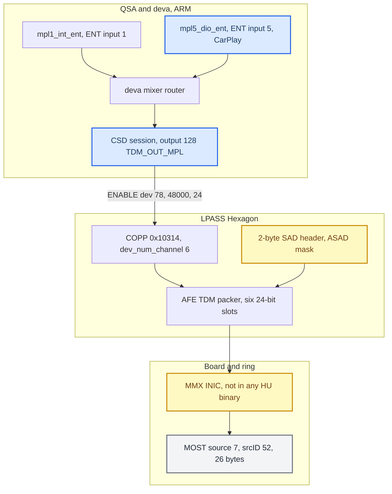

# QNX Audio Topology

*How a PCM frame written to `/dev/snd/mpl5_dio_ent` on the MMX (APQ8064) becomes MOST synchronous bytes: deva timers and the mixer router, CSD device 78, ACDB, the LPASS COPP graph, AFE/TDM slot packing, the SAD header, and the MOST source allocation. Every layer here was audited for a hidden stereo cap during the 5.1 hunt (2026-09-02); the results are the canonical reference.*

---

## 📋 The chain in one picture

The MMX audio stack is amplifier-agnostic: it always packs six slots for the entertainment output. What differs per car (internal vs external amp) is decided on the RCC — see [[Internal Amp Path]]. What the fix history looks like is in [[Discrete 5.1 Routing]].

Two independent width declarations travel on this path and both once said "stereo" while six slots were populated: the CSD session width (fixed in the deva driver) and the SAD `ASAD` mask (fixed in the hook). Everything else was measured six-wide.

## 🔗 Device names and id namespaces

Four number spaces appear in logs and code; mixing them produced a false contradiction in the original topology hypothesis `[decompile]`.

| Meaning | `mpl1_int_ent` | `mpl5_dio_ent` | Evidence |
|---|---:|---:|---|
| QSA playback index (zero-based) | 0 | 3 | `qsa_probe` enumeration |
| User-facing ordinal | 1 | 4 | device names |
| ENT mixer-router input id | 1 | 5 | endpoint lookup `0x50c74` |
| DEVA timer id in slog | 1 | 4 | `deva_release` / `deva_trigger` |
| Mixer-router output id | 128 | 128 | same lookup |
| CSD OEM device id | `0x4e` (78) | `0x4e` (78) | shared output session |

CarPlay's stock device map (`libairplay.so` `get_audio_path @0x49398`): media → `mpl5_dio_ent`, telephony (3) → `tel2_dio_phone`, speech (4) → `ann4_dio_voice`, prompts `ann3_dio_ann`, microphone `mic2_dio`. The hook's sink name is `SPA_PCM_SINK_NAME "mpl5_dio_ent"` (`hook/audio/audio_hook.c:3753`). Call/Siri ownership of these devices is in [[Call and Siri Routing]].

deva node inventory: `mono_speakerp`, `stereo_speakerp`, `six_channel_speakerp`, `stereo_to_all_speakersp`. deva has exactly one entertainment output, `PCM_PLAY_MPL_1 -> TDM_OUT_MPL`; the others are `TDM_OUT_ANN_1_{16,24,48}KHZ`, `TDM_OUT_ANN_2`, `TDM_OUT_TEL`; `TDM_OUT_MPL2_ID` is "not supported". deva contains zero `MOST`/`INIC`/`MLB`/`McASP`/`SLIMBUS` strings — its world ends at the AFE port.

**Why CarPlay cannot just use `mpl1_int_ent`:** each source owns a virtual channel with its own amp connection id (CarPlay media `DIO_MEDIA=162`, `GAL_MEDIA=156`, `ENT_MEDIA_MFP=20`) and becomes audible only after taking focus through `dsi.audio.DSIAudioManagement`. Writing CarPlay PCM into the internal-media channel lands it ducked or unrouted; impersonating the media source breaks ducking, volume and announcements; and `mpl1` has `min_voices == max_voices == 6`. A GOT substitution of the name returned by `get_audio_path` was kept only as plan B. `mpl1_int_ent` reports `voices 0..0 formats 0` while focus sits elsewhere `[car]`.

Sources: [[Sources/DEVICE_TOPOLOGY_AUDIT|DEVICE_TOPOLOGY_AUDIT]], [[Sources/reference/HU_AUDIO_CEILING|HU_AUDIO_CEILING]], [[Sources/AUDIO_CALL_ROUTING|AUDIO_CALL_ROUTING]], [[Sources/AUDIO_5_1_STATE|AUDIO_5_1_STATE]] §7

## ⚙️ deva timers, the mixer router and route attach

### The caps table

For platform id 2, `deva_mib_get_session_handles_from_platform_id @0x545a4` returns a 31-record table at VA `0xa7d44` (file `0xa6d44`), 48 bytes per record. `deva_mib2_capabilities @0x55494` publishes `+0x14 min_voices`, `+0x18 max_voices`, `+0x1c min_fragsize`, `+0x20 max_fragsize` (`0x5593c..0x55954`). In `.data`, VA = file offset + `0x1000`.

| Field | Offset | MPL1 (VA `0xa7d74`) | MPL5 stock (VA `0xa7e04`) | MPL5 shipped |
|---|---:|---:|---:|---:|
| flags | `+0x00` | `0x2b3` | `0x2b3` | `0x2b3` |
| format | `+0x04` | `0x0c` S32_LE | `0x0c` | `0x0c` |
| rate mask / min / max | `+0x08..+0x10` | `0x80` / 48000 / 48000 | same | same |
| **min voices** | `+0x14` | **6** | **2** | **6** |
| max voices | `+0x18` | 6 | 2 | 6 |
| **min fragment** | `+0x1c` | **`0x4800`** | **`0x1800`** | **`0x4800`** |
| max fragment | `+0x20` | `0x4800` | `0x1800` | `0x4800` |
| max buffer | `+0x24` | `0x2d000` | `0xF000` | `0x2d000` |
| max fragments | `+0x28` | 10 | 10 | 10 |
| bits/sample | `+0x2c` | 24 | 24 | 24 |

The shipped column is enforced by `deploy/deva-ctrl-qc/patch_deva_mirror_mpl1.sh:35-49` (asserts the MPL5 record equals MPL1 after the write) **[code]**.

### The router and stream types

`deva_mixer_router_init @0x53b80` installs endpoint lookup `0x50c74` (accepts ENT inputs 1, 3, 4, 5, 6, 7; output 128 resolves to one TDM-out CSD session). The default route **input 1 → output 128** is installed at `0x53d4c..0x53d58`; there is **no default input-5 route** — Audioman attaches it at runtime. `deva_mixer_router_set_switch_routing @0x527f8` → worker `deva_mixer_router_configure_switch_routing @0x51b94` → `session_csd_setup @0x6bbdc` (`0x51d68`) and `session_csd_attach_device @0x6dbd8` (`0x51ddc`) → `session_deva_timer_attach_stream @0x6cf3c` type 2; detach `@0x6c2f8` restores type 1.

| `stream_type` | Consumer (`session_deva_timer_thread @0x6e2d0`) |
|---:|---|
| 1 | `session_void_stream_buffer @0x64da4` — discards the fragment |
| 2 | `session_csd_stream_buffer` — CSD-backed |
| 4 | loopback |

This is why a bare `mpl5` open under QEMU (no Audioman) produces zero CSD traffic and stays `stream_type=1`, while `mpl1` produces CONFIGURE/ENABLE/start cycles.

### Where the active width comes from

`deva_update_session_info_from_list @0x54848` indexes `table + 48 * timer->device_id` (`0x549f4..0x54a00`) and copies:

| Instruction | Record | Session | Meaning |
|---|---:|---:|---|
| `0x54a04 → 0x54a08` | `+0x0c` | `+0x80` | active rate |
| **`0x54a14 → 0x54a18`** | **`+0x14` min_voices** | **`+0x84`** | **active CSD channels** |
| `0x54a1c → 0x54a24` | `+0x2c` | `+0x86` | active bit depth |
| **`0x54a20 → 0x54a28`** | **`+0x1c` min_fragsize** | **`+0x6c`** | **active CSD buffer bytes** |

`session_csd_setup_playback @0x6aba0` branches on `+0x84`: ≤2 → `setStreamFormat2 @0x6b060`; >2 → `openAudioStreamV2 @0x6ae20`, literal-six `setStreamFormatPcmMultichannel @0x6aec0` and `setStreamMultichannel @0x6af38`, multichannel context at `0x6b280`. `allocateCsdBufferPool @0x6b158` and `session_csd_stream_playback @0x69084` (reload `0x6919c`, copy `0x691b8`/`0x6926c`, `csd_write @0x69318`) use `+0x6c` bytes. No PCM `acquire` (`@0x56060`), `prepare` (`@0x55394`, a logging no-op) or `trigger` (`@0x5598c`) re-provisions an attached session.

**Consequence (the tick bug):** with stock minima, a six-voice open widened the DMA fragment to `0x4800` (18432 B = 768 frames × 6 × 4 B) while CSD still copied `0x1800` (6144 B) as 768 *stereo* frames. Per 16 ms tick: one third copied, 512 frames skipped, each correlated source sample repeated three times — low pitch plus a 62.5 Hz discontinuity at a correct wall clock. Same-device A/B `[car]`: MPL5 2 voices 48,107 frames/s excellent; 6 voices 48,129 frames/s broken. Fix history and the three-step build are in [[Discrete 5.1 Routing]].

Route-scoped slog prints the active format in `session_csd_setup` (`0x6c004..0x6c04c`): `pcm format => sample_rate=48000, channels=6, bit_per_sample=24` is the fixed state `[car]`.

### Why a late rebuild was not built

The CSD-reprovision brief asked for an in-place rebuild when a six-voice channel attaches to an already-running route. The unit showed the route attached and the timer started ~14 s before the PCM channel existed (`00:00:38 ... channels=2`, `00:00:52 setup actual=6ch`). A rebuild needs `session_csd_teardown(session)` then `session_csd_setup(session, timer)`, and both pointers live in the router worker's stack frame — unreachable from the PCM path. Mirroring the minima made attach-time geometry right, so no rebuild is needed. Code caves used by the earlier helpers: `0x8f2c8` (fragment helper, step 1) and `0x8d090..0x8d0df` (live-channel helper, step 2), both in truncated `__FILE__` strings (`.rodata` shares the R+E segment) `[decompile]`.

### The device enable carries no width

`enableDevice @0x2dec4` writes only `{1, dev_id, sample_rate, bits}` into a 100-byte request, CSD ioctl `0x11c01` at `0x2df14`. On start, `session_csd_start_playback @0x69fa8` first sends the TDM SAD header (`set_device_tdm_sad_header @0x29d70`, `CSD_DEV_CMD_CONFIGURE 0x11c0a`) then `enableDevice` (`0x6a0e4`). Stop sends stream stop and `CSD_DEV_CMD_DISABLE 0x11c02`. Channel geometry is set on the stream and context only.

QEMU harness payloads for the default MPL1 route

Handles 256/257/258 = device/stream/context. Stream open: `format=0x1c, rate=48000, channels=6, bits=24, signed, interleaved, map 01 02 03 06 08 09, 7 buffers × 18432 B`. Context open: `direction=1, dev_id=78, rate=48000, bits=24` (no channel field), then `setContextMultichannel channels=6`. First CONFIGURE (`seq=196, len=324`) carries `fc` (ASAD) at `+0x1c` and `18` (24-bit) at `+0x28`; ENABLE (`seq=197, len=100`) = `01 00 00 00 4e 00 00 00 80 bb 00 00 18 00 00 00`. Post-marker counts: MPL1 30× each of CONFIGURE/ENABLE/start/stop/DISABLE (probe recovery loops), MPL5 0×. Build: `QSA_DEVICE_TOPOLOGY=1 QSA_PROBE_DEVICE=0|3 QSA_PROBE_VOICES=6 ./tools/qsa-emu/build_ifs.sh`. Artifact hashes are in the source audit.

---

Sources: [[Sources/ROUTER_INPUT_WIDTH_AUDIT|ROUTER_INPUT_WIDTH_AUDIT]], [[Sources/DEVICE_TOPOLOGY_AUDIT|DEVICE_TOPOLOGY_AUDIT]], [[Sources/CODEX_PROMPT_ROUTER_INPUT_WIDTH|CODEX_PROMPT_ROUTER_INPUT_WIDTH]], [[Sources/CODEX_PROMPT_CSD_REPROVISION|CODEX_PROMPT_CSD_REPROVISION]], [[Sources/CODEX_PROMPT_DEVICE_TOPOLOGY|CODEX_PROMPT_DEVICE_TOPOLOGY]]

## 🔍 CSD and ACDB: no numeric stereo cap

Endpoint: CSD device 78, `78_TDM_ENTERTAINMENT1_RX`, Qualcomm output 128 `TDM_OUT_MPL` `[decompile]`.

| Layer | Dev-78 value | Where |
|---|---:|---|
| `libcsdIpcClient.so` multichannel request | caller's count unchanged | `csd_ioctl @0x1cf8`, cmd `0x11809`, branch `0x1f04`; IOV len at `0x2138` |
| `audio_service` ceiling | 8 | `csd_ac_handle_multi_channel_cfg @0x143bb0` (`CMP R3,#8`) |
| OEM platform shim | none | `libcsd_oem_lib-mmx2_8064.so`: init/count return 0, 16-entry switch, PMIC stubs |
| ACDB `ChannelConfig` | 6 | property `0x113b7`, dword 8; `AfePortId` = 6 |
| ACDB channel map | `01 02 03 06 08 09` = FL FR FC LFE LS RS | property `0x12a4b` |
| ACDB slot-I2S | 6 × 24-bit, offsets 2,5,8,11,14,17 | property `0x1319f` @ file `0x7925` |
| ADM COPP-open `dev_num_channel` | 6 | v2 `@0x147010` (op `0x10333`), v1 `@0x147354` (op `0x10310`) |
| COPP topology | `0x10314` for all four app modes | property `0x113ad` |

`csd_acdb_get_copp_topology_info @0x141ba8` maps modes 1..4 to applications `0x11130/0x11132/0x11131/0x11133` and queries ACDB `0x1122d`; all four resolve to `0x10314` (file offsets `0x78a9/0x78b1/0x78b9/0x78c1`). `Speaker_cal.acdb` layout: `DPROPLUT` at `0xbf` (120 entries), `DATAPOOL` at `0x767d`. Other dev-78 properties: voice topology `0x10f70`, AFE topology `0x112fc`, grouped-I2S `0x130f6`, frame sync `0x131a0`. `Global_cal.acdb` has no dev-78 record; `w.qwsp` is only the schema. The legacy `slot_channel_allocation` scalar belongs to property `0x130f7`, which dev 78 does not use.

Sources: [[Sources/CSD_ACDB_CHANNEL_AUDIT|CSD_ACDB_CHANNEL_AUDIT]]

## 🔍 LPASS COPP graph: stereo name, six-channel behaviour

`0x10314` is publicly named `SPEAKER_STEREO_AUDIO_COPP` (also the default COPP), but in this signed Hexagon image it does not narrow six channels `[decompile]`. Disassembly used Homebrew LLVM 22 `llvm-objdump` (IDA 9.3 has no Hexagon module; radare2 has no Hexagon disassembler — reading its output as ARM gives false instructions).

| Registry offset | ID | RX descriptor | Graph |
|---:|---:|---:|---|
| `0x4ecc8c` | `0x10be3` | `0xc04e981c` | same 11-module graph as `0x10314` — **no-op A/B** |
| `0x4ecca0` | `0x10312` | `0xc04e9804` | resampler, SoftVolume, Sample Slip (NULL/NONE COPP) |
| `0x4eccdc` | `0x10314` | `0xc04e981c` | 11 modules, stock |
| `0x4ece1c` | `0x1031b` | `0xc04e9738` | resampler, Peak Meter, SoftVolume (`SPEAKER_MCH_PEAK_VOL`) |

The stock 11-module RX graph and how each module treats six channels:

| # | Module | Six channels |
|---:|---|---|
| 0–3 | resampler `0x10719`, delay `0x10772`, SoftVolume `0x10bfe`, ComboPP | accept up to 8 |
| 4 | PBE `0x10c2a` | stereo-only; ACDB-disabled; GenTopo disables on 6ch |
| 5 | channel IIR `0x10c02` | ACDB-disabled |
| 6 | MBDRC `0x10c06` | ACDB-disabled |
| 7 | QEnsemble `0x10c59` | 1/2 only; no dev-78 cal; disabled on 6ch |
| 8 | SPA `0x10c39` | exactly 2; no dev-78 cal; disabled on 6ch |
| 9–10 | RX codec gain `0x10c37` (unity `0x2000`), Sample Slip | accept up to 8 |

GenTopo (`audproc_appi_topo.cpp`, `0xc01892c0..0xc0189408`) handles a module whose reinit fails by logging `failed to reinit. Disabling it`, zeroing its active byte `+0xfa` and continuing — it never narrows the graph. `audproc_svc` (`0xc018e9f0`) copies the requested output count and all eight map bytes; the compiled downmixer bypasses `5.1 -> 5.1`. Stock `Speaker_cal.acdb` uses `0x10312` only on devices ≤3 channels (9, 11, 14, 15, 35, 40, 65, 66, 80). A prepared variant-2 ACDB (`0x10312` at all four offsets) exists at `[[Sources/acdb/Speaker_cal.acdb|Speaker_cal.acdb]]`; it was never needed and remains an experiment — `0x1031b` is the stronger diagnostic if a topology A/B is ever wanted.

Sources: [[Sources/LPASS_COPP_TOPOLOGY_AUDIT|LPASS_COPP_TOPOLOGY_AUDIT]], [[Sources/CSD_ACDB_CHANNEL_AUDIT|CSD_ACDB_CHANNEL_AUDIT]]

## 📊 AFE/TDM slots and the 32-byte frame

Dev 78's slot record is Qualcomm's `AFE_PARAM_ID_PORT_SLOT_MAPPING_CONFIG 0x10297` (module `AFE_MODULE_TDM 0x1028a`); the offsets are **byte offsets in one TDM frame** `[decompile]`. `audio_service` copies it unchanged (`afe_dev_tgt_afe_tdm_slot_config_v2 @0x16a0f4`); LPASS validates it in `FUN_c01761c0` (version 1, 1..8 channels, widths 16/24/32, overlap checks).

The grouped-I2S property `0x130f6` (group `0x0106`, channel mode 3 = two lanes, 192 kHz group rate, member ports 6/14/16/18, 24-bit) yields `4 container bytes × 2 lanes × 4 time slots = 32 bytes` per 48 kHz frame:

| Bytes | Content |
|---|---|
| 0..1 | custom TDM/SAD header (type 2 `ENTERTAINMENT_MOST`) |
| 2..19 | dev 78: six 24-bit media slots at 2,5,8,11,14,17 |
| 20..25 | two further 24-bit positions (20, 23), unused by stock dev 78 |
| 26..27 | telephone RX, 16-bit |
| 28..29 | ANN1, 16-bit |
| 30..31 | ANN2, 16-bit |

Qualcomm's public `apq8096-auto.c` MMXF row `{2,5,8,11,14,17,20,23}` then `{26}`, `{28}`, `{30}` matches exactly.

**Packing.** TX packer `FUN_c0174970` loops over the configured six channels; for a 3-byte slot it arithmetic-shifts the internal S32 right by 8 (`0xc01749e0`/`0xc0174b8c`) and writes three bytes. QSA left-aligns S16 in bits 31..16, so each slot carries the original S16 in its high 16 bits plus one zero byte — a deliberate 16-in-24 representation, not low-24 extraction or a 256× gain error. `FUN_c0175f00` is the header inserter, not the packer.

### Width numbers reconciled

| Width | Meaning |
|---:|---|
| 32 bits/sample | deva/CSD internal container |
| 24 bits/sample | physical AFE slot for dev 78 |
| 16 useful bits | SAD `sample_width` from stock AirPlay; high 16 bits of each slot |
| 32 bytes | whole grouped TDM frame |
| 26 bytes | HU MOST source 7 allocation = `2 + 8×3` (the old `2 + 6×4` reading is **superseded**) |
| 20 bytes | header plus six dev-78 slots, `2 + 6×3` |
| 14 bytes | amp sink `0x26` advertised profile: 2 + six 16-bit samples |

Binding MOST source 7 to exactly these 26 bytes remains an inference `[open]`.

Sources: [[Sources/AFE_TDM_MOST_SLOT_AUDIT|AFE_TDM_MOST_SLOT_AUDIT]], [[Sources/CONNECT_BLOCKWIDTH_VALIDATION_AUDIT|CONNECT_BLOCKWIDTH_VALIDATION_AUDIT]]

## 📌 The SAD header and ASAD mask

The two-byte custom header repeats over eight frames and carries `sample_width` and **ASAD**, the active-speaker bit mask. `csd_acdb_set_dev_info_tdm_sad @0x1607bc` builds eight words; word 2 is `0xb200 | sample_width`. LPASS (`0x10298` branch) stores payload byte `+2` as `bit_width_from_header`, `+6` as `asad_from_header`, and its popcount as `num_chan_from_header` — **but does not shorten the six-slot copy loop**; the header is metadata for the next component (the INIC/amp).

The shared MPL session (initialised once in `deva_init_platform_mib @0x57af0`, stores `0x5a734..0x5a7d0`):

| Session offset | Field | Clean-boot default |
|---:|---|---|
| `+0x8c` | header enabled | 1 |
| `+0x90` | CGMS | 0 |
| `+0x91` | media type | 0 |
| `+0x92` | **ASAD** | **`0xfc`** (six set bits) |
| `+0x94` | codec type | 0 |
| `+0x95` | source sample width | 24 |
| `+0x98` | source rate | 48000 |
| `+0x9c` / `+0xa0` | destination width / rate | 24 / 48000 |
| `+0xa4` | bitrate | 0 |

`pcm_devctl @0x3f0a0` get/set branches handle `DCMD_PCM_SET_SAD_METADATA` (full devctl `0x8018fa01`); the set branch (`0x3f8a8..0x3f908`) overwrites these persistent fields **without consulting the PCM voice count**. `convert_sad_header_to_csd @0x618e4` reads them and `session_csd_start_playback` re-sends them on every start (`0x6a030`/`0x6a048`/`0x6a058`) — faithful, never recomputed from the stream.

| Writer | Slog `convert_sad_header_to_csd` | TDM SAD payload |
|---|---|---|
| RetroArch → `mpl1_int_ent` (clean 5.1) | `asad=0xfc, sample_width=0x18, emi=0x3` | `0x3c00, 0xb218, 0x6000, 0xfc, 0x7, 0x0, 0x0, 0x0` |
| stock AirPlay `createMetadata(2ch/16bit)` | `asad=0xc0, sample_width=0x10, codec_type=0x1, bitrate=0x177000` | `0x3c01, 0xb210, 0x0, 0xc0, 0x7, 0x0, 0x70, 0x0` |

`tools/qsa_play.c` never issues the SAD devctl, so it inherits the boot default or the last writer's mask — the root of the two-day misreading (see [[Landmines]]). The hook now interposes both `dio::CQNXSoundIF::createMetadata` template instantiations and forwards the requested output width (6) and 24 bits so deva emits `asad=0xfc` **[code]** (`hook/audio/audio_hook.c:5123-5198`; `AUDIO_SAD_CHANNELS` / `AUDIO_SAD_BITS` override, 0 disables).

Sources: [[Sources/AFE_TDM_MOST_SLOT_AUDIT|AFE_TDM_MOST_SLOT_AUDIT]], [[Sources/AUDIO_5_1_STATE|AUDIO_5_1_STATE]] §18–19

## 🌐 MOST source allocation and the amp Connect

On the external-amp branch connection 162 resolves to logical source `eSRC_ENT_AMP_DIO_MEDIA_MC (0x46f)` → `DSI:MmxSourcePresCtrl/7` (formatter `DSI:%s/%u` at AudioProcess `0x2637f0`; MIBRoot mapping `0x2054f8..0x205644`; global string built by static initialiser `0x2046b4` into zero-filled storage, so it looks absent until you follow the constructor) `[decompile]`.

| Source # | srcID | BlockWidth |
|---:|---:|---:|
| 1 (`0x46e`, internal DIO media) | 58 (`0x3a`) | 4 |
| 2 | 42 | 26 |
| 3 / 4 / 5 / 6 | 67 / 69 / 66 / 68 | 2 |
| **7 (`0x46f`, DIO media MC)** | **52 (`0x34`)** | **26** |

The value is static configuration in two places: MIBRoot `sub_207DD4` loads `mov r8,#0x1a` once at `0x207e0c` (file `0x107e0c`, shared by sources 2 and 7) and AudioProcess table `0x2d3f80` row `07 00 1a` (width byte at file `0x1d3f94`). The width propagates `CGGenDSISrcDevCtrl::respAlloc 0x2848f0` → `CGSyncSrcSRM::handleExtAllocRes 0x27cacc` → `CGSyncSinkSRM::alloc 0x280850` → `CGGenMOSTSnkDevCtrl::sendConnSR 0x28d8e4` → `raiseConnSR 0x28cf80`, serialised high byte first (`0x28d078..0x28d094`). The stock trace calls it "channels" — it is BlockWidth, not a channel count. Lower `car` NAL resources 33 and 100 also have bandwidth 26; the binding to source 7 is unproved.

**Amp side** (V850 `FUN_000C4B30`, FktID `0x0112`; body `0x0c4b34..0x0c4e54` behind a split-prologue thunk): payload must be 7 bytes, SinkNr must be in list `21 22 23 24 26 2a 32` (`0x96e2c`), BlockWidth (big-endian payload[3..4]) must be `1..372`; it is stored per sink (`gp-0xe06`) and **never compared with the advertised profile width**. So Connect `0x26/0x001a` (payload bytes 2..4 `26 00 1a`) is accepted although sink `0x26` advertises 14.

A one-byte AudioProcess edit (`0x1d3f94` `1a→0e`) would change only the Connect-side value; MIBRoot's shared literal and the NAL resources would still say 26 — not a consistent patch, and not needed.

> ⚠️ **Open contradiction on the sink number.** The HU-side audit derived `SinkNr 0x26` for connection 162, but the later AudioProcess RE shows the G22 XML sink `MULTICHANNEL` = `eSNK_DTCP51 nr 1` → AM sink 10 `ENT1_OLD_DTCP51` → **external MOST sink `0x32`** (7.1_SAD, BlockWidth 26 — which would also explain the 26-byte source), while AM sink 2 `ENT1_DTCP51` → `0x26`. Neither was traced live. The existing `CGGenMOSTSnkDevCtrl::raiseConnSR` trace (`SnkNr`, `BW`) settles it in one connect `[open]`. Details in [[Internal Amp Path]].

Sources: [[Sources/MOST_SOURCE_BLOCKWIDTH_AUDIT|MOST_SOURCE_BLOCKWIDTH_AUDIT]], [[Sources/CONNECT_BLOCKWIDTH_VALIDATION_AUDIT|CONNECT_BLOCKWIDTH_VALIDATION_AUDIT]], [[Sources/INTERNAL_AMP_AUDIOPROCESS_SINKS|INTERNAL_AMP_AUDIOPROCESS_SINKS]]

## 🎯 The platform ceiling

| Axis | Ceiling | Why |
|---|---|---|
| Rate | 48 kHz | fixed TDM media bus; `deva_srf_rate_match` hardware SRC resamples everything (prompts ride 24 kHz slots); no 96/192 kHz path |
| Depth | 24-bit slot (32-bit container); the amp's 5.1 sink `0x26` is 6 × 16-bit | QSA negotiates S16/S32; DAC ~24-bit effective |
| Channels | 6 | deva channel map switch {1,2,3,6}; `deva_csd_start_csd_session_playback` hardcodes 6; no 8-channel node |
| Codecs on HU | FLAC decodes (`libflac.so`, Cinemo `libNmeAudioFLAC.so`) | output still resampled to 48 kHz |

The source's 2026-early conclusion "5.1 CarPlay is not reachable on this stack" is **superseded**: discrete 5.1 now arrives through the hook's own buffered type-103 receive and APAC decoder, not through libairplay's stereo-only format list — see [[Discrete 5.1 Routing]] and [[iOS CarPlay Spatial Wireformat]]. The other levers it named (mixable prompts, `ALL_OUT_LATENCY`/`ALL_IN_LATENCY`) stay valid.

Sources: [[Sources/reference/HU_AUDIO_CEILING|HU_AUDIO_CEILING]]

## 🔧 Diagnostics that work

- **Stock PCM dump:** `deva-ctrl-qc.so` accepts `data_dump_path=<path>` (files `<path><name>_<n>.bin`); `deva_mixer_switch_data_dump_set` → `deva_data_dump_ctrl @0x30c88` makes it a runtime mixer switch (no `io-audio` restart). `deva_timer_data_dumps` = what the timer consumes; `csd_data_dumps` / `csd_sad_dumps` at the CSD boundary (`0x694c4`). Init `deva_data_dump_init @0x2fd0c`.
- **QEMU harness** `tools/qsa-emu/`: real `io-audio` + real deva with eight CSD symbols stubbed (`csd_stub.c` traces every ioctl). Limits: nothing below `csd_write` is observable, MPL5 routes never attach without Audioman, and `snd_pcm_write_internal` returns `-EIO` after the first fragment because the stubbed DSP never advances the timer (a harness artefact).
- **`qsa_play`** (`tools/qsa_play.c`): plays raw PCM into any QSA node and measures frames/s. Must call `snd_pcm_plugin_set_disable(pcm, PLUGIN_DISABLE_MMAP)` before `snd_pcm_plugin_params` (else ENOENT), and the device only provisions while its source holds amp focus (pause CarPlay to keep `DIO_MEDIA` focus). It sets **no SAD** — use it for geometry/clock, never for channel-delivery verdicts.
- **Headless helpers:** `tools/qsa-emu/ghidra/ExportTdmXrefs.java`, `ExportScalarUses.java`.

Sources: [[Sources/AUDIO_5_1_STATE|AUDIO_5_1_STATE]] §6, §9, §11, [[Sources/DEVICE_TOPOLOGY_AUDIT|DEVICE_TOPOLOGY_AUDIT]]

## 📚 Sources

- [[Sources/ROUTER_INPUT_WIDTH_AUDIT|ROUTER_INPUT_WIDTH_AUDIT]] — the `min_voices`/`min_fragsize` route-attach root cause, call chain, symptom arithmetic.
- [[Sources/DEVICE_TOPOLOGY_AUDIT|DEVICE_TOPOLOGY_AUDIT]] — MPL1/MPL5 share dev 78; namespaces; QEMU CSD traffic diff.
- [[Sources/CSD_ACDB_CHANNEL_AUDIT|CSD_ACDB_CHANNEL_AUDIT]] — IPC client, `audio_service`, ACDB dev-78 records, COPP selection.
- [[Sources/LPASS_COPP_TOPOLOGY_AUDIT|LPASS_COPP_TOPOLOGY_AUDIT]] — Hexagon topology registry, module validators, GenTopo.
- [[Sources/AFE_TDM_MOST_SLOT_AUDIT|AFE_TDM_MOST_SLOT_AUDIT]] — slot bytes, 32-byte frame, packer, SAD/ASAD session fields.
- [[Sources/MOST_SOURCE_BLOCKWIDTH_AUDIT|MOST_SOURCE_BLOCKWIDTH_AUDIT]] — source 7 = 26 bytes, propagation into Connect.
- [[Sources/CONNECT_BLOCKWIDTH_VALIDATION_AUDIT|CONNECT_BLOCKWIDTH_VALIDATION_AUDIT]] — V850 Connect handler, HU constant sites, 14/20/26/32.
- [[Sources/reference/HU_AUDIO_CEILING|HU_AUDIO_CEILING]] — 48 kHz / 24-bit / 6-channel platform ceiling (its "no 5.1 CarPlay" verdict superseded).
- [[Sources/CODEX_PROMPT_ROUTER_INPUT_WIDTH|CODEX_PROMPT_ROUTER_INPUT_WIDTH]], [[Sources/CODEX_PROMPT_DEVICE_TOPOLOGY|CODEX_PROMPT_DEVICE_TOPOLOGY]], [[Sources/CODEX_PROMPT_CSD_REPROVISION|CODEX_PROMPT_CSD_REPROVISION]] — the briefs that drove these audits; the reprovision one records the 14 s route-before-open slog.
- [[Research/VIRTUAL_CABIN|VIRTUAL_CABIN]] — the amp-side companion paper.
