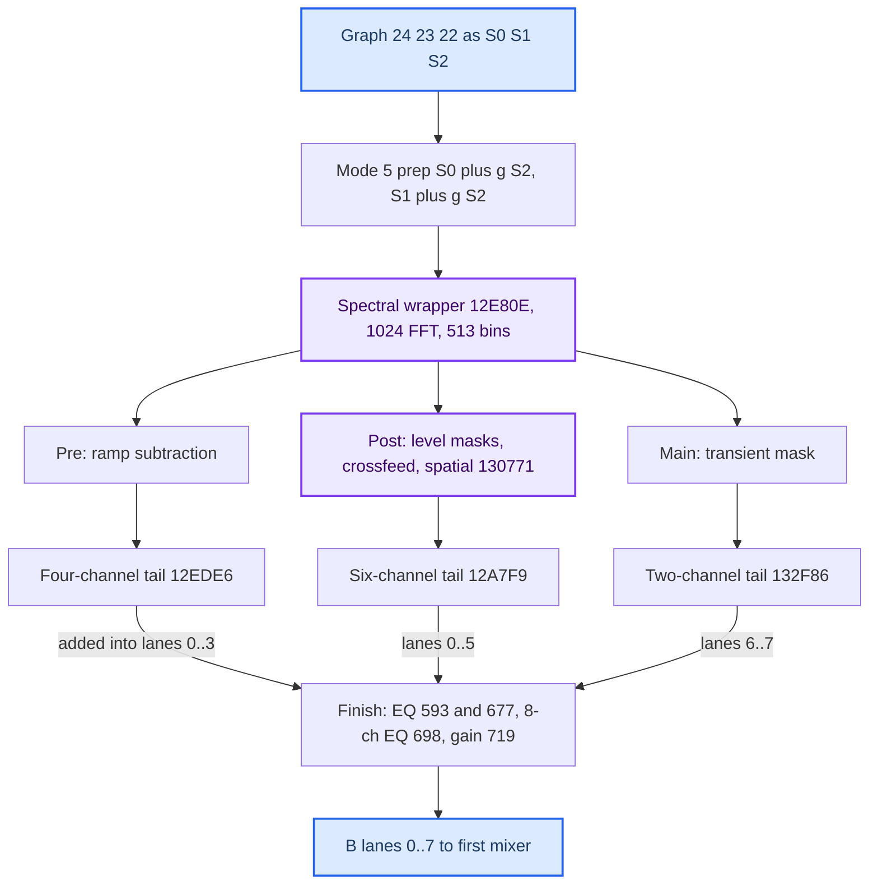

# SHARC B Processors

*The two "B" processors inside the J525 SHARC program: the spectral first B (the amp's own spatial/upmix library, fed from the front of the graph) and the auxiliary-fed second B. What they compute, how the V850 configures them, and why the model's default B = 0 is a hypothesis, not a finding.*

---

## 📋 What the two B processors are

The J525 graph has two pair mixers, and each has an "A" half (the matrix path) and a "B" half. Each B half is fed by its own processor. See [[SHARC DSP Blocks]] for the graph, kernels and control plane, and [[Virtual Cabin and Amp RE]] for the amp overview.

| | First B | Second B |
|---|---|---|
| Wrapper / path | `C4AD9`, process `124DF3`, library callback `124F56` | schedule 21..50, `C4B70 … C4CF9` |
| Inputs | graph `24,23,22` (upstream lanes, after the common EQ) + two unused `97` | auxiliary graph inputs **8/9/10** only — no edge from music inputs 0..7 |
| Injected at | first pair mixer `C4B4F` B slots 0,1,4,5,6,7,8,9 (centre/LFE slots 2/3 get nothing) | second pair mixer `C4DFB` input slots 16..31 |
| Character | 1024-point spectral processor: transient/level masks, crossfeed, coherence-based spatial separator, decorrelating all-pass tails | filters, gain fan-outs, 3-input matrices, post-EQ, delays |
| Model | `amp_b_*.py`, opt-in `first_b_scenario` (v8) | `amp_second_b.py`, opt-in `second_b_scenario` (v9) |

**B = 0 is only the default model hypothesis.** Static evidence is compatible with an active first B: loader `BC9EC = 0` lets the callback call the library, the bank-1 refresh requests library mode 5, and the bulk initializer queues bypass first and process later. Nothing proves silence. `[model]`

Sources: [[Sources/SHARC_REMAINING_BLOCKS_2026-09-19|SHARC_REMAINING_BLOCKS]], [[Sources/SHARC_COMPLEX_TIMING_CLOSURE_2026-09-20|SHARC_COMPLEX_TIMING_CLOSURE]], [[Sources/SOUNDAMP_FULL_DSP_MODEL|SOUNDAMP_FULL_DSP_MODEL]]

## ⚙️ First B wrapper, timing and lifecycle

**Double buffering.** `124DF3` copies five 512-frame input lanes into bank `s` (`B95EA + 2560·s + 512·j + o`), then reads output from the same bank (`BA9EA + 4096·s + 512·k + o`), then checks completion; at 512 frames it publishes bases to `BC9EA/BC9EB`, toggles `s`, and schedules callback `124F56` via event `0x29`. With on-time successful callbacks the wrapper adds **1024 samples = 21.33 ms**; the spectral library adds one 512-sample hop, so a neutral spectral path is **1536 samples = 32 ms** before other delays. Late/missing callbacks or transitions break that fixed-delay picture.

**Callback state machine `124F56`.** Words `B95E2` state, `B95E3` busy, `B95E4` error. "Fails" means the return word is exactly `0x4000` or `0x8000` (BTGL + zero test, not an error-bit test).

```mermaid
stateDiagram-v2
  accTitle: First B callback state machine
  accDescr: State one initializes the library and its parameters and moves to state three on success; state three either clears the published bank when BC9EC equals one or calls the library process; any other state just clears the bank.
  [*] --> state_one
  state_one --> state_one: init or parameter call fails, bank cleared
  state_one --> state_three: init and parameters succeed
  state_three --> state_three: BC9EC is 1, bank cleared, no library call
  state_three --> state_three: BC9EC not 1, library process 12DE3B
  state_other --> state_other: clear published 4096-word bank
```

Clearing touches only the currently published bank, so already-copied audio still plays out (a synthetic test shows 512 frames of the old bank, 512 of the other, then zeros). `BC9EC == 3` does **not** inhibit. No direct writer of `BC9EC` was found; host generic word writes could reach it.

**Handler selection is separate from the callback.** Host command `0x20001` selects the process handler, `0x20003` the alternate handler `124D64`, which copies input lanes 0/1 into all four output pairs (graph `24/23 → 20/19, 18/17, 34/35, 40/41`) — **a bypass copy, not a mute**. V850 `AC818` sends `0x20003` for internal event 5 and `0x20001` for event 44; the bulk initializer `C28A8` (reached from `C2658` when `r29 == 1`) enqueues events 0..29, 30..32, 33..53, so bypass is selected first and process later. A traced node's handler may be stored at graph object `+32` instead of descriptor `+4` (`1292D8`), which any readback must honour.

**Library transition mute.** With readiness word `B89BA == 1` and transition `B909B == 1`, each process call increments `B89BF`, clears the five inputs, **still runs the algorithm**, and clears the eight outputs; when the counter equals exactly 10 it clears both. Ten output blocks are muted while the algorithm state keeps advancing. Parameter writers `13246F/1324AE/132540` set this transition.

Sources: [[Sources/SHARC_B_WRAPPER_TIMING_2026-09-20|SHARC_B_WRAPPER_TIMING]], [[Sources/SHARC_B_WRAPPER_CONTROL_2026-09-20|SHARC_B_WRAPPER_CONTROL]], [[Sources/SHARC_REMAINING_BLOCKS_2026-09-19|SHARC_REMAINING_BLOCKS]]

## 🔧 Library modes and the mode 5 dataflow

The library dispatcher `131208` selects the algorithm by a float at object `+1128` (API16, accepted 2/5/6; init writes 2.0). The V850 maps the **matrix bank** to it through table `6EAA0`: bank 0 → 2, banks 1/2 → 5. Sink `0x26` has raw bank 1 for every ASAD, so its normal refresh **requests mode 5**. Selector 2 or 5 runs the six/four-channel processing; mode 6 copies inputs 3/4 to outputs 6/7 and skips the final eight-channel stage; other selectors clear six lanes *before* stateful EQ (history can still leak). Library selector values are not MMI labels.

**Mode 5 preparation** (`1315D3..131629`): `left = S0 + g·S2`, `right = S1 + g·S2` — no half-scale, no limiter. `g` is object `+97` = common source word 43: **0.5 in the loader, 0.5011872053 (≈ −6 dB) in B01** (`CodeFlash 1200B8`, word `3F004DCE`). Normal initialization does not interpolate it (object 97 is below the smoothing base). For coherent S0 = S2, preparation alone gives 1 + g ≈ +3.53 dB. Mode 5 then jumps back into the same spectral path as mode 2.

Execution order is main/two-tail, post/six-tail, pre/four-tail, then finish. Additions are plain sums with no averaging: equal coherent six/four inputs at unity give +6.02 dB in lanes 0..3. B output lanes map to the first mixer as follows (row-1 stored gains):

| B lanes | Graph ports | First-mixer B slots | Stored row-1 gain |
|---|---|---|---|
| 0/1 | 20/19 | 0/1 | 0 / 0 dB |
| 2/3 | 18/17 | 4/5 | 0 / 0 dB |
| 4/5 | 34/35 | 6/7 | 0 / 0 dB |
| 6/7 (two-channel tail) | 40/41 | 8/9 → graph 58/59 | −99 / −99 dB |

So the decorrelating two-channel tail is strongly attenuated at its direct route, while the other six B lanes are not muted by row 1.

Sources: [[Sources/SHARC_REMAINING_BLOCKS_2026-09-19|SHARC_REMAINING_BLOCKS]], [[Sources/SHARC_B_MODE5_SCHEDULE_2026-09-20|SHARC_B_MODE5_SCHEDULE]], [[Sources/SHARC_B_TAIL_BINDING_2026-09-20|SHARC_B_TAIL_BINDING]]

## 📊 Spectral processing

**Transform.** Window `130A1C/130AEB`: 512 values `sin((i+0.5)·π/1024)` mirrored — a sine window whose **squares** overlap-add to 1 (generated window within `4.29e−8` of ideal; squared overlap 0.99999992..1.00000011, no normalization applied). Real FFT `12B588` packs even + j·odd into an N/2 complex FFT, producing **513 bins**; pre-packing scale `1/N` (`2/N` on the quarter bin) and the *same forward* kernel `12EF65` is used for synthesis. Twiddles: 512 `cos θ, −sin θ` pairs at loader PM `E4754` (max error `9.56e−8`). Overlap: `12D49F` assembles hops, `132B2B` adds the previous second half. N = 1024, hop = 512.

**Band map.** `DM[B9097] = B904C`, `DM[B9098] = 74`: 75 nonuniform integer edges over 0..513 — the first 39 bands are single bins, the last band is `[431,513)` (82 bins). Band sums do not divide by width. The coherence mean over bands 9..59 therefore covers bins 9..112 = **421.9–5296.9 Hz** at 48 kHz (the earlier uniform diagnostic map was wrong).

**Branches.** Common source words 0..244 (identical for all four calibration banks) are copied to object 92..298:

| Consumer | Source words | Object words | B01 retained values |
|---|---|---|---|
| Mode 5 third-input gain | 43 | 97 | 0.50119 (loader 0.5) |
| Pre ramp subtraction | 44:50 | 98:104 | enabled, ramp 0.92→0.97 over bins 50..512 (loader from bin 12), negative residual ×0.1 |
| Sum/difference level masks | 50:66 | 104:120 | enabled; p14 max 1, p15 min 0.5 |
| Two 256-bin temporal smoothers | 66:69 | 120:123 | history/input 0.19448626 / 0.80551374 |
| Post transient | 69:157 | 123:211 | enabled, 74 factors ≈0.016..0.251, clamp ≈0.0794..1 |
| Main transient | 157:245 | 211:299 | disabled |

- **Pre `12E1BB`**: subtract a ramp × `0.5·|L+R|` from magnitudes, remodulate original phases.
- **Main `12E30A`**: transient mask `12F250` on original spectra.
- **Post `12E521`**: starts from the saved *original* L/R, unscaled sum/difference → level masks → half-scaled reconstruction → crossfeed → spatial `130771` → 256-bin magnitude smoothing → post transient.
- **Level mask `12F90A`** (≤ 74 bands): `power = p2·E + p3·prev`; `fast = 10·log10(1+power)`; `slow = p4·fast + p5·prev_slow`; `excess = fast − slow − p13`; target = `slow + p12·excess + p13` if excess > 0 else fast; `gain = clamp(10^((target−fast)·0.1), p15, p14)` then asymmetric smoothing p6/p7 vs p8/p9 and frequency smoothing p10/p11. Its constant is `0x3DCCCCCD` = 0.1, unlike C4D17's 0.05 — don't unify the laws.
- **Transient mask `12F103`** (74 bands, 88-word bank): `level = p78·s + p80·l` if `l < s` else `p79·s + p81·l` (note the non-adjacent pairing); `raw = ((p[2+band]·(s−level)+level)/s)²` if `level < s` else 1; smoothing p82/p83 vs p84/p85; clamp p76/p77. Selector 1 uses shared averaged spectra and only the left history.
- **Crossfeed `12E487`**: `Lout = (1−c)L + cR`, `Rout = (1−c)R + cL` — mono passes unchanged, difference scales by 1−2c. `c` comes through pointer cell 1161:

| Retained calibration | Default (config 31) | API16 = 5 last (493) | API20 = 3 last (426) |
|---|---:|---:|---:|
| Loader, all banks | 0.15 | 0 | 0.15 |
| B01 bank 1 | 0.25 | 0.27 | 0.27 |
| B01 bank 2 | 0.25 | 0.27 | 0.28 |
| B01 bank 3 | 0.25 | 0.30 | 0.30 |
| B01 bank 4 | 0.20 | 0 | 0 |

**Spatial separator `130771`.** Per band: summed powers A/B and smoothed complex cross C (p11/p12); coherence `|C|/(sqrt(A·B)+2⁻⁵²)` clamped [0,1] (floor ≈ 1e−5, not zero); a **minimum** over bands smoothed by p13/p14 drives a gate (target 0 if min > 0.99); a mean over bands 9..59 feeds the balance weight. Separator `12FFBA`: with the eigen selector, `λ = (A+B − sqrt((A−B)² + 4·Re(C)²))/2` (**Re(C)², not |C|²**, pinned by `130204..130210`), `s = 1/(λ+ε)`, `d = (A+B)·s − 2 + 10·p9`, `q = r/d`, `M = q·( A·s−1, C·s ; conj(C)·s, B·s−1 )` (2×2, rows separated by `;`); the balance selector weights the diagonals with `t = (A−B)/(A+B)`. Diffuse mask `sqrt(1 − coherence)` smoothed (p19/p20), frequency-smoothed (p15..p18), clamped p21/p22; output `(1−p27)·residual + p27·diffuse`, residual gated by p3 == 1.

| Spatial parameter words (via pointer 1166) | B01 bank 1 default |
|---|---|
| 0..3 enable, eigen, balance, gate selectors | 1, 1, 1, 0 |
| 4..8 ramp start/end, band indices, step | 0.94, 0.98, 0, 73, 0.001 (step not recomputed; ramp runs 0.94…1.012 then 0.98) |
| 9..10 regularization, fallback scale | 0.1, 1 |
| 11..14 power and minimum/mean smoothing | 0.2522/0.7478, 0.0786/0.9214 |
| 19..22 diffuse smoothing and clamp | 0.2959/0.7041, 0.04..0.2 |
| 23..26 gate rise/fall | 0.00592/0.99408, 0.0936/0.9064 |
| 27 diffuse mix | 0.2 |

B01 banks 1..3 share this spatial bank; API20 = 3 switches to ramp 0.96/0.96 and mix 1 (not a bypass); bank 4 uses eigen selector 0 and mix 0.3 (alternate 0.4). A fresh constructor starts histories at zero except the **gate history = 1** and balance constants slope `5.0000005`, offset `−3.5000002` (not 1/0).

Sources: [[Sources/SHARC_B_SPECTRAL_BINDING_2026-09-20|SHARC_B_SPECTRAL_BINDING]], [[Sources/SHARC_B_SPATIAL_BINDING_2026-09-20|SHARC_B_SPATIAL_BINDING]], [[Sources/SHARC_FIRST_B_SPECTRAL_AUDIT_2026-09-20|SHARC_FIRST_B_SPECTRAL_AUDIT]], [[Sources/SHARC_B_LIBRARY_MATH_2026-09-20|SHARC_B_LIBRARY_MATH]], [[Sources/SHARC_REMAINING_BLOCKS_2026-09-19|SHARC_REMAINING_BLOCKS]]

## 🔧 Tails, all-passes and the output finish

Every pair bank is `[delayL, delayR, gain, section_count, coefficients…]`, coefficient records `[b0,b1,b2,−a1,−a2]`, up to 8 sections. Offsets are relative to the effective config at object 299:

| Tail | Bound parameters |
|---|---|
| Four `12EDE6` | common delay 32; pair banks 33/77; final gain via pointer 1156; inline branch gain 122 |
| Six `12A7F9` | pre-gain 123; common delay ptr 1159; nested all-pass ptrs 1167..1170; pair banks 145/196/247; single all-passes 189/192/240/243; pair gains ptrs 1171..1173; final gain ptr 1157; inline gain 293 |
| Two `132F86` | common delay ptr 1160; pair bank 316 (delays 316/317); nested 360/368; single 365/373; final gain ptr 1158; inline gain 377 |
| Finish `12B87B` | six-ch EQ count 294 (records 295..304), two-ch EQ 378 (379..388), eight-ch EQ 399 (400..419), final gain 420 |

- **Single all-pass `12B90B`**: `v = x − g·d; y = d + g·v; ring ← v`. Enable truncates (0.9 disables).
- **Nested all-pass `12D10E`** (not two all-passes in series): `u = x − g2·d2; v = u − g1·d1; w = d1 + g1·v; ring1 ← v; ring2 ← w; y = d2 + g2·u`. Enable rounds (0.9 enables). **An enabled zero delay is a one-sample ring, not a bypass**: B01 bank 4's `[1, 0, 0, 96, −0.3]` has a 97-sample feedback (impulse −0.3 at 0, 0.91 at 97, 0.273 at 194).
- **Filter cascade `12DAA5`**: `v = x + fb1·z1 + fb2·z2; y = b0·v + b1·z1 + b2·z2`; the odd final section switches to first-order when `|fb2| < 1e−5`. Pole check `13163D`: `|a2| < 1 && |a1| < 1 + a2`.

Retained section counts (capacity 8 for pairs): loader pairs 2/1/7/5/6/3, B01 all 8; six/two-channel filters 2/2; eight-channel finish 2 (loader) / 4 (B01). B01 banks 1–3 final scalar 1.12201845646, bank 4 and loader 1.

Sources: [[Sources/SHARC_B_TAIL_BINDING_2026-09-20|SHARC_B_TAIL_BINDING]], [[Sources/SHARC_NESTED_ZERO_DELAY_2026-09-20|SHARC_NESTED_ZERO_DELAY]], [[Sources/SHARC_B_BINDING_2026-09-20|SHARC_B_BINDING]], [[Sources/SHARC_B_FILTER_ALIAS_DOMAINS_2026-09-20|SHARC_B_FILTER_ALIAS_DOMAINS]]

## ⚙️ Configuration banks and control APIs

The library object is 1181 words; its **effective configuration** is 829 words at object 299 (target copy at `B89C0`, source pointer `B95E5 → C3C6A`). The B source (3562 words) holds the 245-word common prefix plus **four 829-word calibration banks** at word `245 + 829·(k−1)` (V850 bank 1 at `1203E0`). A bank is valid only with version word `0x40128F5C` (float 2.29) and a CRC-16 of words 0..827 in word 828 (`1328EA`, table `B915A`, equals `binascii.crc_hqx`).

| Source | Bank 1 CRC | Bank 2 / changed words | Bank 3 / changed | Bank 4 / changed |
|---|---|---|---|---|
| Loader | `90A9` | `3EDF` / 2 | `A888` / 2 | `0250` / 2 |
| B01 | `3104` | `CE33` / 31 | `5BD1` / 53 | `B8EE` / 271 |

Loader banks differ only in bank number and checksum; B01 banks carry real calibration differences. Three identifiers must not be conflated: **input-matrix bank** (0/1/2 = stereo/5.1/7.1), **A07 profile** (from table `100008`), **B calibration bank** (API17 = profile + 1; candidate 0 is rejected, banks 3/4 are never produced by the normal writer).

**API17 bank switch `132346`**: copy the bank to the target buffer, rebase descriptors 44..58 (their nine additive slots are *not* cleared), replay effective controls in the order **19, 18, 22, 21, 23, 24, 25, 27, 29**, publish, and store the selection even if replay errored. Replay passes raw API25, whereas the single-update applier passes `value − object[1090]` (all stored baselines are 0, so no audible difference in these tables).

**Control curves.** Each scalar descriptor is `target = clamp(base + Σ nine slots, lo, hi)`; each API writes one slot from an x/y/shape curve (shape 0 linear, 1 squared, 2 square-root; input 0 forces contribution 0). Branch gains (descriptors 46/50/51 → config 122/293/377, bases 1.0/1.0/1.6) and delays 52/53 (config 316/317, base 96, clamp 0..288):

| API | Nonzero B01 curves (x, y); loader all zero | Example with other slots 0 |
|---|---|---|
| 19 (3D level) | two-branch (−50,−0.3),(100,+0.2); 44/47 same; 48 (−50,−0.9),(100,+0.2); delays 52/53 (−50,+66),(100,−77) | two-gain ≈1.3/1.3/1.6/1.8 at −100/−50/0/100; tail delays 162/96/19 samples at −50/0/+100 (bank 2: 140/96/42) |
| 18 (surround) | four (−9,−1),(0,0); six (−9,−1),(9,+1.5); 47 (0,0),(9,−0.5) | API18 = +9 → six-gain 2.5 |
| 22 | six (−9,−0.5),(9,−0.5); two (−9,−0.4),(9,−0.4) | — |
| 27 | six (120,0),(180,+0.7) | API27 = 180 → six-gain 1.7; with API18 = 9 → 3.2 (banks 1–4: 3.2/3.2/2.5/1.0) |
| 21 | reaches final eight-channel gain 420 | B01 banks 1/2: 0.722 at ±9, 1.122 at 0; bank 3: 0.122 at −9 |
| 25 (level) | all zero | contributes nothing for any −200..200 |

These are **linear** gain contributions, not dB. The four API18/19 EQ rebuilds (descriptors 55..58 → six/two-channel EQ) all have design `[20, 100, 0, 0, 1]` and zero curves, so they stay identity.

**B EQ designer `12AB1F`** (RBJ cookbook; record `[freq Hz, width %, gain dB, type, unused]`, `A = 10^(gain/40)`, w = 2πf/fs): peaking `alpha = s·sinh((ln2/200)·width·w/s)` — **width 100 = one octave**; shelves `beta = s·sqrt((A²+1)/S − (A−1)²)` with S = width/100 (type 1 low, 2 high). Gain 0 exits with identity; stored order `[b0,b1,b2,−a1,−a2]`.

**API16/20 pointer maps.** Helper `12B348` writes 18 pointer cells (object 1156..1173) into the effective config: shared 1156..1165, API20-only 1166..1170, API16-only 1171..1173. **The last applied API wins the shared cells**, so API16 = 5 / API20 = 3 alone doesn't fix the records (four-tail gain 0.631 vs 0.447 in B01 bank 1). API20 = 6 (AUTO) resolves by config 487 (loader 3 → 3, B01 0 → 3). Cells 1162..1165 point to the two-tail delay curves; their consumers remain unresolved, and bounded alias audits (16,093 instructions over `12A7F9..1331AF`) exclude only specific read sites — no dead-field claim.

**Publication and smoothing.** `12FBA5`: flag exactly 1 copies all 829 words; otherwise words whose step is 1.0 copy immediately, others get `step = (target−current)/duration` (duration = config word 2 truncated, 0 → 1; loader 200, B01 1). Only 31 fields ramp: `35,79,122,147,198,249,293,316,317,377,420, 295..304, 379..388`. `12FAF2` advances a coefficient only when a consumer touches it (lower-bound check only, no upper bound). One successful mode-5 invocation makes 313 such calls and touches each of the 31 fields once.

**Extended FIFO `1326C7`** (via `131A65`): `0x14000000+i` writes config/target words 1..842 (830..842 also replay and re-run API20 twice — both helper calls read effective API20); `0x12000000+i` writes object 92+i (i = 5 reaches gain 97); `0x10000000` writes defer word 1178; `0x20000003` copies the effective config into a **SHARC RAM** source bank (not flash). No fixed V850 sender for these was found; they are reachable only through the generic A21 request path.

Sources: [[Sources/SHARC_B_CONFIG_2026-09-20|SHARC_B_CONFIG]], [[Sources/SHARC_B_BINDING_2026-09-20|SHARC_B_BINDING]], [[Sources/SHARC_LEVEL_CONTROL_2026-09-20|SHARC_LEVEL_CONTROL]], [[Sources/SHARC_B_EQ_DESIGN_2026-09-20|SHARC_B_EQ_DESIGN]], [[Sources/SHARC_B_PUBLICATION_2026-09-20|SHARC_B_PUBLICATION]], [[Sources/SHARC_B_MODE5_SCHEDULE_2026-09-20|SHARC_B_MODE5_SCHEDULE]], [[Sources/SHARC_B_SPECTRAL_POINTER_DOMAINS_2026-09-20|SHARC_B_SPECTRAL_POINTER_DOMAINS]], [[Sources/SHARC_B_FILTER_ALIAS_DOMAINS_2026-09-20|SHARC_B_FILTER_ALIAS_DOMAINS]]

## 🔍 Second B — the auxiliary path

Schedule 21..50 turns three auxiliary graph inputs (8/9/10) into the 16 B inputs of the second mixer. Their physical meaning is unknown; nothing in the static graph connects them to music.

| Schedule | Block | What it does |
|---|---|---|
| 21 | `C4B70` / `126559` | one shared biquad on three inputs (fixed record type 0 = bypass in this dump) |
| 22 | `C4B7F` / `12879C` | three input gains; targets `[1,1,1]`, requested **mode 1** with time 4.0 and descriptor scale 0.75 (≈ three-block ramps) |
| 23 | `C4B96` / `126A95` | packed input EQ, 16 non-unity records (design indices 0..11, 16..19), loader counts `[8,4,4]` |
| 24–28 | masters and 16-way fan-outs | master target (tenths dB) = `clamp(10·level[i] + common + trim[i] − 82, −1000, 400)` with trims `[48,−75,−75]` → −3.4/−15.7/−15.7 dB at zero controls; fan-outs use slot→row map `[8,0,8,0,9,1,9,1,4,5,6,7,2,2,3,3]`, row 3 forced to −1000 unless `gp−3E30` bit 0; fan-outs mode 3 with ratios 1.16591/0.85770 |
| 29–31 | side branch | sum, LP biquad (selector 1 → code 5512, 2 → 11025, else bypass), gain −7.0 dB = 0.44668 — writes graph 60, which nothing downstream consumes |
| 33–48 | 16 × `1269BC` | 3-input matrices, all coefficients 1 |
| 49 | `C4CE8` / `126A95` | post-EQ, counts `[0,8,0,7,0,8,0,7,0,0,0,0,1,4,0,0]` = 35 of 48; first record ≈295 Hz HP then peak cuts |
| 50 | `C4CF9` / `124517` | 16 delays `[67,57,0,57,67,57,0,57,96,96,0,0,0,0,0,0]` samples (≤ 2880 allocation) |

Output graph IDs in order: `27 26 25 24 23 22 21 36 37 50 51 52 53 54 55 73` = second-mixer inputs 16..31. **Second-B silence needs silent aux inputs *and* drained internal state; it is not a consequence of 3D OFF.**

Sources: [[Sources/SHARC_SECOND_B_2026-09-20|SHARC_SECOND_B]], [[Sources/SHARC_COMPLEX_TIMING_CLOSURE_2026-09-20|SHARC_COMPLEX_TIMING_CLOSURE]]

## ⚠️ What is still open

- Live state of everything that selects B behaviour: active handler (`C4ADD` + tracing indirection), `B95E2`, `BC9EC`, `B89BA/B89B9/B89BC`, object `+1128/+1176/+1177`, the effective 829-word config, pointer history and learned histories. `[open]`
- The upstream meaning of graph 24/23/22 (authored C = 0 does not prove graph 22 = 0) and of aux 8/9/10.
- Consumers of pointer cells 1162..1165; nested-all-pass ring provenance; error/lifecycle paths; SHARC bit-exact FFT/transcendental rounding.
- Whether B causes any of the reported bass character. Nothing here is a diagnosis; synthetic fixtures (e.g. branch gains pre = 1, post = 0.5, main = 0.25 → `[1.5,1.5,1.5,1.5,0.5,0.5,0.25,0.25]`) only prove routing.

Sources: [[Sources/SHARC_REMAINING_BLOCKS_2026-09-19|SHARC_REMAINING_BLOCKS]], [[Sources/SHARC_B_TAIL_BINDING_2026-09-20|SHARC_B_TAIL_BINDING]]

## 📚 Sources

| File | What it holds |
|---|---|
| [[Sources/SHARC_B_WRAPPER_TIMING_2026-09-20\|SHARC_B_WRAPPER_TIMING]] | double-buffer 1024-sample delay |
| [[Sources/SHARC_B_WRAPPER_CONTROL_2026-09-20\|SHARC_B_WRAPPER_CONTROL]] | callback state machine, bypass copy, transition mute |
| [[Sources/SHARC_B_MODE5_SCHEDULE_2026-09-20\|SHARC_B_MODE5_SCHEDULE]] | ordered coefficient-consumer schedule for one mode-5 call |
| [[Sources/SHARC_B_PUBLICATION_2026-09-20\|SHARC_B_PUBLICATION]] | publication, 31 ramped fields, smoothing |
| [[Sources/SHARC_B_CONFIG_2026-09-20\|SHARC_B_CONFIG]] | four calibration banks, API17, API16/20 pointers, crossfeed, extended FIFO |
| [[Sources/SHARC_B_BINDING_2026-09-20\|SHARC_B_BINDING]] | inline audio bindings, replay, API21/22 final gain |
| [[Sources/SHARC_B_EQ_DESIGN_2026-09-20\|SHARC_B_EQ_DESIGN]] | nonzero RBJ designer `12AB1F` |
| [[Sources/SHARC_B_LIBRARY_MATH_2026-09-20\|SHARC_B_LIBRARY_MATH]] | log/pow library, added opcodes |
| [[Sources/SHARC_B_SPECTRAL_BINDING_2026-09-20\|SHARC_B_SPECTRAL_BINDING]] | common-prefix controls, band map, fresh histories |
| [[Sources/SHARC_B_SPATIAL_BINDING_2026-09-20\|SHARC_B_SPATIAL_BINDING]] | spatial parameter bank and constructor state |
| [[Sources/SHARC_FIRST_B_SPECTRAL_AUDIT_2026-09-20\|SHARC_FIRST_B_SPECTRAL_AUDIT]] | p14/p15 correction, real band semantics, window/twiddles |
| [[Sources/SHARC_B_TAIL_BINDING_2026-09-20\|SHARC_B_TAIL_BINDING]] | tail parameter bindings, all-stage composition test |
| [[Sources/SHARC_NESTED_ZERO_DELAY_2026-09-20\|SHARC_NESTED_ZERO_DELAY]] | zero-delay nested all-pass = one-sample ring |
| [[Sources/SHARC_B_FILTER_ALIAS_DOMAINS_2026-09-20\|SHARC_B_FILTER_ALIAS_DOMAINS]] | heap provenance of filter reads, section counts |
| [[Sources/SHARC_B_SPECTRAL_POINTER_DOMAINS_2026-09-20\|SHARC_B_SPECTRAL_POINTER_DOMAINS]] | three more excluded read sites |
| [[Sources/SHARC_SECOND_B_2026-09-20\|SHARC_SECOND_B]] | second-B numerical path and V850 targets |
