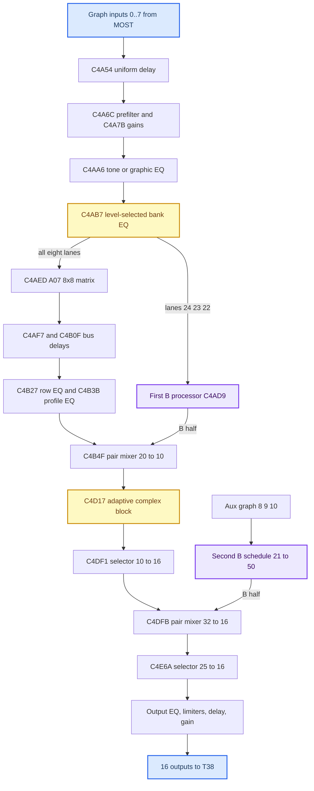
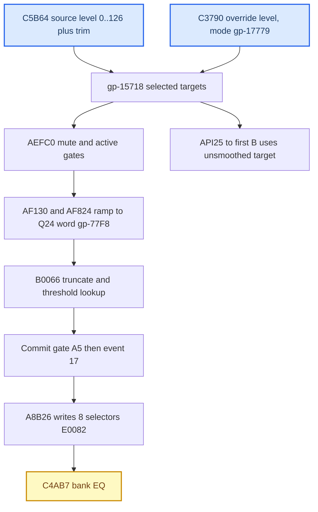

# SHARC DSP Blocks

*The J525 amplifier's SHARC program block by block: where it lives in the V850 flash, the 79-entry processing graph, every recovered kernel, the common input EQ, the adaptive complex block C4D17 and the V850 control plane that drives it. The two "B" processors have their own note, [[SHARC B Processors]].*

---

## 📋 Scope and evidence rules

Everything here is **static reverse-engineering plus mathematical reconstruction** of one amplifier image. No live amp RAM was ever read back, nothing is bit-exact, and no cabin acoustics are modelled. `[model]`/`[decompile]` throughout unless tagged otherwise. The hub for the whole amp story is [[Virtual Cabin and Amp RE]]; wiring and speakers are in [[J525 Wiring and Speakers]].

| Item | Value |
|---|---|
| Amplifier | Audi B&O J525 `8W0035465`, SW `0420`, HW `H11`, `EV_AMPMst16C2Gen2ALPI` |
| CodeFlash | `CodeFlash_24082026_172027.bin`, raw V850 LE32, base 0, `0x180000` bytes, SHA-256 `8776fdb8…41fe4b` (not in this repo) |
| SHARC loader (raw SPI slice, authoritative) | `assets/soundamp/J525_8W0035465_SW0420_SHARC_SPI_raw.ldr.bin`, SHA-256 `659f55e3b57f7cde8ddeb170a5a58e7a985fa4e43ea6898838d4393753e89154` |
| SHARC loader (bit-reversed, used for all disassembly) | `…_SHARC_SPI_bitrev.ldr.bin`, SHA-256 `9169c24f0337c6bfd3646e2538a567bca839b24aa0db5f67b6984943c2286ca7` |
| Address conventions | V850 = byte/file offsets; SHARC PCs = **16-bit short-word** addresses (VISA); DM/PM = 32-bit words |
| Model | `tools/soundamp-virtual-cabin/amp_dsp_chain.py` — default `bank1-known-electronics-v7` (`amp_dsp_chain.py:50`); opt-in `v8-explicit-common-input` (`:314`) and `v9-explicit-second-B` (`:332`) **[code]** |
| Tests at last count | 704 Python tests (121 extraction + 583 model/cabin); 168 bounded SHARC ranges decode with zero UNKNOWN; 43 V850 listings byte-checked |

The bounded VISA decoder is `tools/inspect_amp_visa.py` (227 lines). The MAME ADSP-2106x disassembler kept as [[Sources/reference/sharc_dasm.cpp|sharc_dasm.cpp]] is **not** sufficient: this is an ADSP-2148x running short-word VISA code, and blindly decoding short-word payloads as 48-bit ISA instructions is wrong. Encodings were checked against the ADI manuals ([[Sources/papers/sharc_programming_rev2.4.pdf|programming reference rev 2.4]], chapters 10–12, MODE1 at A-6; [[Sources/papers/sharc_hardware_rev1.1.pdf|hardware reference rev 1.1]], IIR accelerator §7-66 and B-24/B-25). Opcodes added from the manual: `0x30` integer ABS, `0xD9` FIX-with-scale, `0xDA` FLOAT-with-scale, `0xDD` TRUNC-with-scale, `0xC5` RSQRTS (seed + Newton, not exact sqrt). FIX with MODE1.TRUNC=1 rounds toward −∞, unlike the TRUNC instruction; MODE1 `0x2000` is **ALUSAT**, not TRUNC.

Sources: [[Sources/SOUNDAMP_FULL_DSP_MODEL|SOUNDAMP_FULL_DSP_MODEL]], [[Sources/reference/AMP_SHARC_ARTIFACTS|AMP_SHARC_ARTIFACTS]], [[Sources/SHARC_B_LIBRARY_MATH_2026-09-20|SHARC_B_LIBRARY_MATH]], [[Research/VIRTUAL_CABIN|VIRTUAL_CABIN]]

## 📦 Where the SHARC program lives

The V850 CodeFlash **embeds the whole ADSP-2148x SPI slave-boot stream** at file offset `0x041014..0x068777` (length `0x27764` = 161,636 B). This corrected the earlier belief that the DSP program sat in an undumped external flash — no chip-off is needed.

| Region | Offset | What it is |
|---|---|---|
| SHARC boot stream | `0x041014` | the DSP application, sent by `FUN_000A75CA → FUN_000E33AC` in `0x180`-byte chunks via `FUN_000AD156`; boot-kernel delay after the first `0x600` bytes |
| after `0x068778` | — | a separate V850 parameter/pointer table, excluded |
| `AD301A07` | `0x100000` | V850 parameter set: profile selector, 8 config profiles, 8 matrix sets, fixed calibration |
| `AD301B01` | `0x120000` | tuning dataset; 3562 words copied by `0xACFB4` to SHARC `0xC3C6A` (the B library source) |

Loader format: `0x600`-byte boot kernel, then blocks with a three-word header (tag, count, destination). Bytes on the SPI side are **bit-reversed within each byte**; reversing them parses exactly 560 blocks — 1 `FINAL_INIT`, 279 `ZERO_LDATA`, 1 `ZERO_L48`, 37 `INIT_L16`, 240 `INIT_L32`, 2 `INIT_L48` — ending with the `0x600`-byte IVT exactly at `+0x27764`. First headers: `+0x600` `INIT_L48` ×5 → `0x0008C100`; `+0x630` `ZERO_L48` ×0x17 → `0x0008C105`; `+0x63C` `INIT_L48` ×0xC6 → `0x00091090`; terminal `FINAL_INIT` at `+0x27158`. `tools/extract_amp_sharc_app.py` refuses a wrong size/SHA, validates, parses every block and only then writes the two files. The `bitrev` copy is an analysis aid — **never flash it**.

Do not confuse three V850 paths: `FUN_000A334C → A705A → A6FF2 → 0xFFFF0008` is the UDS RequestDownload **reflash** path, not a DSP DMA; runtime audio code reads A07/B01 directly and sends individual parameter groups; the embedded loader goes out through `A75CA → E33AC`.

Sources: [[Sources/SHARC_APPLICATION_EXTRACTION|SHARC_APPLICATION_EXTRACTION]], [[Sources/SHARC_INPUT_OUTPUT_MATRIX|SHARC_INPUT_OUTPUT_MATRIX]]

## ⚙️ The processing graph

The loader holds a **79-entry schedule** of descriptor pointers at `0xC5794` (zero-terminated). Each descriptor carries a class pointer, port-ID arrays and parameter pointers. The root scheduler (`12677D..12682B`) reads root descriptor `C4F92+9 = 64`, so a normal block call is **64 frames**. Buffer IDs are reused along the schedule: trace in schedule order, never join equal IDs globally (e.g. graph 24/23/22 mean different buffers before and after schedule 21).

The **A07 input matrix is downstream of the first B split**, not in front of everything — an earlier description of graph 22 as a post-matrix input was wrong. The matrix receives processed ports `24,23,22,21,50,51,36,37`; B receives `24,23,22` (plus two unused `97` slots).

| Descriptor | Handler | Role (config/parameter address) |
|---|---|---|
| `C4A54` | `124517` | 8-lane transfer/delay state machine, graph `0..7 → 34..41`, target `E000C` |
| `C4A6C` | `12610B` | shared planar biquad, `34..41 → 24,23,22,21,20,19,18,17`; coefficient `E0038`, type 0 (bypass) in this dump |
| `C4A7B` | — | per-channel gains, target `C0090` from table `68B90` (all 1) |
| `C4A92/97/9C/AA1` | — | pack pairs `(34,35)..(40,41) → 42..45` |
| `C4AA6` | `126685→12610B` | shared 5-section tone/graphic EQ on four stereo pairs; current `E004E`, target `E0068` |
| `C4AB7` | `12618C` | 8-lane level-selected 16-bank EQ, selectors `E0082`, gains `C015A`, banks `C016A` |
| `C4ACF/C4AD4` | — | unpack `42 → 24,23`, `43 → 22,21` |
| `C4AD9` | `124DF3` / `124D64` | first B wrapper (process / copy-bypass) |
| `C4AED` | `1269BC` | 8-in/8-out A07 matrix, `0xC022A..0xC0269` |
| `C4AF7`, `C4B0F` | — | 8-bus delays `[1632]×8` and `[87,87,125,204,403,403,367,367]` samples |
| `C4B27` | — | row EQ, 16 records all verified unity |
| `C4B3B` | `126BAE` | 8-channel profile EQ, capacity 80, `0xE0264` (profile 0 uses 55) |
| `C4B4F` | `12694C` | first pair mixer 20→10, gains `0xE0584` |
| `C4B59`, `C4DDA`, `C4EE3` | `12879C` | smoothed gain stages (`C4EE3` = final 16-ch gain `0xC393A`) |
| `C4D11` | `127A4D` | scalar on auxiliary graph 11, loader `0x3FFF64C1` ≈ 1.9952623 = **+6 dB** |
| `C4D17` | `126DB2` | adaptive complex block, see below |
| `C4DF1` | `128910` | selector 10→16, `0xC20D0` |
| `C4DFB` | `12694C` | second pair mixer 32→16, gains `0xE453A` |
| `C4E6A` | `128910` | selector 25→16 incl. auxiliary/diagnostic inputs, `0xC2114` |
| `C4E74` | `1284D6` | packed 16-ch output EQ on the IIR accelerator, capacity 144, `0xC2AB0` |
| `C4E89`, `C4EAA` | `126A95` | packed software EQ, 2 records each on cfg 12..15 only (stored unity) |
| `C4E9A`, `C4ED3` | `12823C` | output-feedback peak limiters |
| `C4EBB` | `124517` | 16-channel output delay, `0xE4674` |

The composed A path in AmpChain: matrix → `C4AF7` → `C4B0F` → `C4B27` → `C4B3B` → first mixer → C4D17 (identity by default) → `C4DF1` → second mixer → normal selector → `C4E74` (143 records) → `C4E89` → `C4E9A` limiter → `C4EAA` → `C4EBB` → `C4ED3` limiter → stored gain. Output is in V850 configuration order. Independent recomposition error of the default path: `7.13e−15`.

Sources: [[Sources/SHARC_OUTPUT_BINDING_AUDIT|SHARC_OUTPUT_BINDING_AUDIT]], [[Sources/SHARC_REMAINING_BLOCKS_2026-09-19|SHARC_REMAINING_BLOCKS]], [[Sources/SHARC_INPUT_PATH_2026-09-20|SHARC_INPUT_PATH]], [[Sources/SOUNDAMP_FULL_DSP_MODEL|SOUNDAMP_FULL_DSP_MODEL]]

## 🔧 Recovered kernels

**Selector `0x128910`.** Descriptor `+5` inputs, `+7` outputs, `+9` selector array. `out[j] = in[sel[j]]` for `0 ≤ sel[j] < inputs`; a negative or too-large index multiplies input 0 by zero (not a literal clear — matters with NaNs). `0xFFFFFFFF` is therefore a mute; diagnostic indices 16/17 on `C4E6A` pick real auxiliary inputs.

**Pair mixer `0x12694C`.** `N = descriptor[7]`, gains at `descriptor[9]`; pointer vector `[A[0..N−1], B[0..N−1], out[0..N−1]]` and `out[j] = g[2j]·A[j] + g[2j+1]·B[j]`, SIMD with no normalization. This rejects the `in[2j]/in[2j+1]` reading. First-mixer ports and profile-0 row-1 gains (before the ASAD correction):

| j | A buffer | B buffer | out | A / B stored dB |
|---:|---:|---:|---:|---|
| 0 | 38 | 20 | 24 | 0 / 0 |
| 1 | 39 | 19 | 23 | 0 / 0 |
| 2 | 52 | 97 | 22 | +9 / −100 |
| 3 | 53 | 97 | 21 | +9 / −100 |
| 4 | 54 | 18 | 36 | +4 / 0 |
| 5 | 55 | 17 | 37 | +4 / 0 |
| 6 | 56 | 34 | 50 | −6 / 0 (profile 1: −4) |
| 7 | 57 | 35 | 51 | −6 / 0 (profile 1: −4) |
| 8 | 97 | 40 | 58 | −100 / −99 |
| 9 | 97 | 41 | 59 | −100 / −99 |

The second mixer (writer `0xA9FF4` → `0xE453A`; A at profile-0 `0x10032C`, polarity `0x10031C`, B at `0x102408`) codes gains in **0.2 dB units** with −128 = mute, unlike the first mixer's 1 dB coding. Its added A gains by output candidate: front mid/treble +3.8 dB, rear doors 0, centre mid +0.2, centre tweeter −8.8, front woofers +9.4, sub windings −0.8. Stored second-B slots that are nonzero: 1,3,5,7,12,13.

**Mute sentinels differ per block.** In the matrix writer, stored −100 dB clamps to −99 dB = `1.1220185e−5` linear (leakage, not a +99 dB boost). In the gain lookup (`0x69398 − 4·tenths`), −100 dB at `0x6A338` is **exact float zero** while −99 dB at `0x6A310` is `0.000011220185115234926`. Never apply one block's sentinel to another.

**Packed output EQ `0x1284D6`.** An IIR-accelerator wrapper (writes `0x5200`/`0x521C`, polls `0x5201` — IIR control, chain pointer, DMA status). Descriptor fields: `+5` = 16 channels, `+12` capacity 144, `+13` stage counts `0xC2124`, `+14` subtask counts `0xC2134`, `+15` TCBs `0xC2144`, `+16` scratch `0xC22B0`, `+17` five-word bank `0xC2AB0`, `+18` 14-word accelerator bank `0xC2D80`, `+19` working bank `0xC3560`. Counts summing above capacity take the bypass path; each count is split into groups of 12 plus remainder (168 words per full group); count 0 builds a one-stage identity task (`0x80000000, 0x3F` = 1.0 in split 40-bit). Converter `0x125D17` maps each V850 record `[−a1,−a2,b0,b1,b2]` (source order 2,3,0,4,1) to the accelerator's `[b0,b1,−a1,b2,−a2,d2,d1]`, 14 words per stage. Counts `[17,17,0,0,4,4,10,10,5,5,12,12,6,17,12,12]` consume records 0..142 sequentially (record 143 unused). Coefficient changes go through a working bank and smoothing helper; transition timing is not emulated.

![[Sources/papers/sharc-iir-registers.png]]

*IIR accelerator registers from the ADI hardware reference; the coefficient storage layout is in [[Sources/papers/sharc-iir-storage.png|sharc-iir-storage.png]].*

**Gain stages `12879C`** (fields `+9` current, `+12` target, `+10` mode, `+22` previous mode; kernel `1288C4`, one gain per channel per 64-frame block). Mode 0 copies target; mode 2 adds a signed step to magnitude; mode 3 multiplies magnitude by an up/down ratio, clamps at target, copies target sign, and floors nonzero-target magnitude at `3727C5AC` (~1e−5) — zero-target decay is asymptotic. Mode 1 (recovered later): on changed |target|, `step = ||target|−|current|| / (time·descriptor[11])` with a nonpositive denominator replaced by 1 (a positive sub-unity denominator is kept); sign-only changes keep the old step. V850 `A7D2C` writes ten targets at `C0414` in tenths of a dB as `10·s8(gp−5E2F) − 82 + table_1028E8[ch][9+s8(gp−3E38)] + table_102A64[ch][9+s8(gp−3E34)]`, channel 3 also `table_102C52[9+s8(gp−3E2F)]` when `gp−3E30` bit 0 is set (else −1000), clamped `[−1000,+400]`. The **−82 is a common −8.2 dB offset**, not a bass boost; all three tables are zero at the neutral index. `A7E2A` writes one `u8(gp−458E)` target to all ten channels at `C203A`.

**Limiters `12823C`** — output-feedback peak limiters, **mode 0 is not bypass**. Independent: `y = x·g`, `rate = attack if |y| > threshold else release`, `g ← clamp(g·rate, min, max)`. Linked mode uses one gain and channel-0 parameters, attacking if any channel exceeds. No look-ahead, no hard clip; the first overload sample passes before gain moves. Loader gain/max = 1, min ≈ 1e−6, so they cannot boost. Thresholds (internal amplitudes, not SPL):

| Config candidates | `C4E9A` static | `C4ED3` calibration basis |
|---|---:|---:|
| cfg 0..11 | 100 | 0.81..0.95 |
| cfg 12/13 front woofers | 1 | 0.59 |
| cfg 14/15 sub windings | 1 | 0.50 |

The second limiter's writers `A8548/A8710` also use `gp−41AA`, `gp−3E2B`, tables `6A3FC/6A37C` and the result of `9B070` (a protection-dependent path), so 0.59/0.50 are not certified live thresholds.

**Delay `124517`** (used by `C4A54`, `C4EBB` and second-B schedule 50). Dispatch `B93D4`: state 0 allocates `8·frames` scratch (→1 or −1); 1 clears scratch/ring and queues a clear DMA (→2); 2 clears outputs while waiting, callback `1244DF` sets 3; 3 copies target to current delays, validates, reinitializes on change; 4 = audio DMA pending, callback `1244FB` restores 3. Entering the scheduler early hits an invalid-state fallback (set −1, copy inputs — not a permanent mute). Global `B93DD` must equal 2. Steady audio is per-channel integer delay via a 13-word delay-line DMA TCB (write N, then read N at the advanced write index plus tap `−max(d,N)`); the `MAX(d,0)` in the delay slot of `12477A` is essential. Validated against an independent 76,864-word ring simulation for delays 0..9600.

Sources: [[Sources/SHARC_VISA_3D_OFF_AUDIT|SHARC_VISA_3D_OFF_AUDIT]], [[Sources/SHARC_REMAINING_BLOCKS_2026-09-19|SHARC_REMAINING_BLOCKS]], [[Sources/SHARC_SECOND_B_2026-09-20|SHARC_SECOND_B]], [[Sources/SHARC_INPUT_PATH_2026-09-20|SHARC_INPUT_PATH]]

## 📊 Input path and the level-selected common EQ

This is the strongest candidate mechanism for "too much bass" found by the RE, and it sits **before the A/B split**, so it applies to both the matrix path and the first B. B=0 in a model does not remove it. `[model]`

**`C4A54` uniform delay.** Event 19 → `A9D80`; request record `gp−3DDC + 4·u8(gp−3D94)` = enable byte + uint16 milliseconds (startup clears both; `C9F28/CA0A6` can change them). `delay = min(9600, max(0, 48·ms − (1719 + 1248)))` written ×8 to `E000C` — i.e. **subtract 2967 samples and clamp 0..9600**: 100 ms → 1833 samples, 62 ms → 9, 61 ms → 0. It is alignment compensation, not a bass amplifier. Ring capacity 76,800 (+64).

**`C4AA6` shared tone/graphic EQ.** `A76C2` dispatches events 0..4 to the tone writer `A8F36` when `gp−3E42 == A5`, else to the graphic writer `A9BDE`.

| Family | Sections |
|---|---|
| Tone | 125 Hz type 26 (low shelf), 650 Hz type 1 (peak), 6 kHz type 27 (high shelf); gain = 19-entry table at `gp−12B64` indexed `9 + tone position (gp−3E28)` plus `gp−3E25`; section 3 = profile template 90 Hz type 26 with gain `gp−3E22`; section 4 bypass |
| Graphic | 63 / 250 / 1000 / 4000 / 16000 Hz, type 1; `A9BDE` zeroes gains when `gp−3DDF == 5A` |

**`C4AB7` level-selected 16-bank EQ.** Three peak templates (CodeFlash `102E28`): **55 Hz q8, 10 kHz q7, 4.5 kHz q8**; 16×3 signed tenths-dB gains at `102E40`. `A8904` builds all banks; each section stores `[−a2/a0, −a1/a0, b2/b0, b1/b0]` and the bank gain is the product of the three `b0/a0` (hence the kernel's implicit b0 = 1). The `12618C` kernel per section: `y = x + z1; z1' = z2 + b1·x + f1·y; z2' = b2·x + f2·y`, lanes independent. Bank 15 requests +20.5/0/+8 dB, bank 7 is flat, **bank 0 (the "disabled" bank) cuts 10 kHz by 3.5 dB and 4.5 kHz by 3 dB** — disabled is not flat.

| Effective bank | 30 Hz | 55 Hz | 120 Hz |
|---:|---:|---:|---:|
| 0 | ≈0 | −0.001 dB | −0.006 dB |
| 7 | 0 | 0 | 0 |
| 8 | +1.085 | +2.000 | +0.799 |
| 10 | +3.885 | +6.001 | +3.073 |
| 13 | +11.039 | +14.003 | +9.705 |
| 15 | +17.400 | +20.505 | +15.971 |

The selector is driven by a **smoothed source-level control** (loudness-compensation-shaped; no UI name recovered), not by PCM and not by the Bass/Sub setting:

- **Request.** `C5B64` takes `[selector, level 0..126]`; selector table `96E2C` = `21,22,23,24,26,2A,32` → source indices `0,1,2,3,5,9,17` (selector 0 updates those seven, not all 18). `normal_target = min(26, raw − 100 + trim)` when the source is active (`A5`), not inhibited, raw > 0 and trim > −13; else −100. Raw 0 is mute-domain, not the neutral Bass position; a stored trim ≤ −13 is treated as mute. Trim writers: `C7870` (−13..13) and `C53A0` (−32..32 plus two −9..9 fields); raw byte `0x80` means "leave unchanged".
- **Override.** Inner dispatcher `A1FB4` ID 375 (`0x177`) enters/exits an override mode (op 3 → `A5`, op 0 → `5A` with a 5000-tick deadline); IDs 379 (level) and 1063 (EQ enable) need it. These are inner IDs, not ready-to-send diagnostic requests.
- **Threshold table** at `102EA0`: `12,9,6,3,−3,−10,−12,−16,−22,−28,−33,−38,−44,−50,−60,−60`; pick the first threshold ≤ level, saturating at 15. Level 0 → bank 4, −20 → 8, −30 → 10, −50 → 13, −60 → 14, below → 15.
- **Enable/commit.** Commit gate `gp−7844 == A5`; enable from `gp−456C` in override mode else `gp−3C2E`; `A8B26` sends the index only when enabled, else **0**. Startup: normal enable `A5`, cached index 0.

Conditional settled examples (active source, trim 0, enabled, settled): raw 50 → level −50 → bank 13 (+14 dB at 55 Hz); raw 70 → −30 → bank 10 (+6 dB); raw 80 → −20 → bank 8 (+2 dB); raw 85 → −15 → bank 7 (0 dB); raw 100 → 0 → bank 4 (0 dB). These are EQ gains, not total amp gain — volume attenuation elsewhere is not included. The historical fixed-PCM "bank 10 vs bank 7" music smoke test showed about +5.9 dB at 20–60 Hz on the candidate woofer/sub groups; that v6 table used the transposed matrix and is superseded by the corrected rerender, but the lesson stands in [[Landmines]].

Sources: [[Sources/SHARC_INPUT_PATH_2026-09-20|SHARC_INPUT_PATH]], [[Sources/SHARC_LEVEL_CONTROL_2026-09-20|SHARC_LEVEL_CONTROL]]

## 🔍 The adaptive complex block C4D17

C4D17 is **scheduled and not proven off**; AmpChain keeps it as identity by default and offers `complex_block='full_mode_reference'` as an opt-in. Its structure — an auxiliary input, an LMS FIR predicting that input from the ten music channels, a residual power detector and five band gains capped at +15 dB — is the shape of an **in-cabin noise-compensation loop**. The physical identity of auxiliary graph 11 is unverified; the only microphone on the amp connector is the roof-module mic R164 on T38/29,37 ([[J525 Wiring and Speakers]]), which makes it the obvious candidate. `[open]`

**Gates and modes.** `126DDE` returns with **no output write** when descriptor `+40` bit 0 is clear (not silence, not bypass); `+5` bit 0 guards one-time pointer binding. Mode word `+39` is tested bit 2 > bit 1 > bit 0:

| Selected bits | Stage mask | Effect |
|---|---|---|
| none of 0..2 | `0x2` | clears the ten music outputs |
| bit 0 only | `0x1` | copies inputs (no 1023-sample delay) |
| bit 1, not bit 2 | `0xF4BA` | calibration/test sequence |
| bit 2, sideband bit 0 clear | `0xFFF7FE5` | full reference path |
| bit 2, sideband bit 0 set | `0xDFF75E5` | full path with stages 9/11/25 skipped |

With the startup flags `A5` (`B64E0` matches signature `AD301A07` at `94C54`, `100000` and `10FFF0`; `B675C/B69E6` store 165 to `gp−3D62`), writers `AA912/AA9B6` select adaptation (`+15 = 1`) and full mask (`+39 = 4`). Graph 97's first word bit 0 sets `+6`, which inhibits adaptation. `D4002` can overwrite `gp−3D62` from a command; `D6EEA` can change the profile. **MOST bank 1 is not profile index 1.**

**Full-mode path.** (1) Stage 5 filters auxiliary graph 11 (taken *after* the `C4D11` +6 dB scalar) through two biquads; (2) stage 6 forms a weighted sum of the ten *input* music channels; (3) stage 8 delays five stereo pairs by **1023 samples = 21.3125 ms** (ring `clamp(req,0,max)+1`, loader req = max = 1023); stage 9 applies five band gains; (4) stage 12 runs eight biquads (`[−a2,−a1,b2,b1]`, b0 = 1, at `E1C2E`) on six packed pairs and **compacts in place at stride 16**, so the four detector frames are samples `[0,16,32,48]` of each 64-frame block (v2 wrongly took `[0,1,2,3]`; fixed in `amp_complex_path.py` v3); (5) helper `125F36` runs a 10×512-tap LMS predicting auxiliary from music references; (6) stage 16 applies five **parallel** detector biquads to (residual, music sum), stage 17 accumulates 4-sample energy, stage 19 takes max block energy over 16 blocks ×0.25 (field 18 bit 0) else sum ×0.015625. One target update per **1024 audio samples**; new ramps start next block and span 1024 samples.

**Five-band kernel.** 24 coefficients at `E07EA`, triples `[a, b1, b0]` with `H = (b0 + b1 z⁻¹)/(1 − a z⁻¹)`; four LP/HP splits at ≈250, 500, 1000, 2000 Hz, each processing the previous HP remainder; LP+HP sums to unity within float32 error, so all-ones gains reconstruct the input. All five stereo pairs share the band gains; interpolation `gain + (i+1)·step`.

**Controller.** Control conversions use `10^(code/20)` — the instructions load `0x3D4CCCCD` = 0.05 and multiply by ln 10 (v3/v4 used `/10`; withdrawn in v5). Helper `12796D`: return 1 if `x ≤ xmin` or `y ≤ ymin`, else `g = max(1, min((1 + (y^p − c)·x^(−p))^q, cap))` with `p = 0.27`, `q = 1.8518518`, `xmin ≈ 1e−10`, `ymin ≈ 1.58489e−9`, `c ≈ 0.0042072665`, `cap ≈ 15.848932`. Endpoint `min(max(adaptive·other, 1), cap)`, cap `10^(field16/20)`. Field 38 **set** links band 3 = (band 2 + 1)/2 and band 4 = 1. Field 34 = 1 skips the common output ramp.

| Calibrated field | Profile 0 | Profile 1 |
|---|---:|---:|
| `+16` cap code | 15 (≈ +15 dB ceiling) | 10 (≈ +10 dB) |
| `+22/+23` adaptive rise/fall per update | 1.01449525 / 0.95361924 | same |
| `+24/+25` other-factor rise/fall | 1.00722158 / 0.99283028 | same |
| `+34` skip common ramp | 1 | 1 |
| `+38` link upper bands | 0 | 0 |
| initial FIR bank nonzero words | 5120 | 10 (all subnormal) |

Synthetic five-second sensitivity runs (v3, 234 target updates; endpoint dB, not output spectrum): profile 0 with zero auxiliary → 4.19, 3.58, 3.43, 2.15, 2.06 dB — **zero auxiliary is not bypass** because the nonzero initial FIR makes a residual from music alone; aux 0.1 → 9.12…0.29 dB; profile 1 zero aux → 0; sideband bit 0 set → 0. These establish sensitivity, not which scenario the car runs.

**Calibration mode (`0xF4BA`).** Stages 1,3,4,5,7,10,12,13,14,15 only: clear outputs, configure (gates, FIR reference weights, clear FIR *history* not coefficients) → wait → measure per channel (`+41` scans 1..512), stored thresholds `+42 = 144000` (3 s) and `+32 = 5760000` (120 s) at 48 kHz; the tenth channel falls through into one more block. Test generator `126CEC..126DB2`: Park–Miller-style core `16807`, `127773`, `2836`, modulus `2³¹−1`, 32-word shuffle; type 1 shapes through two cascaded built-in biquads (`B94F4/B94F9`), type 9 uses descriptor `+14/+15`. The scalar biquad `126092` reads `[−a1,−a2,b0,b1,b2]`. There is no reason to apply the calibration generator to music.

Sources: [[Sources/SHARC_REMAINING_BLOCKS_2026-09-19|SHARC_REMAINING_BLOCKS]], [[Sources/SHARC_COMPLEX_CALIBRATION_2026-09-20|SHARC_COMPLEX_CALIBRATION]], [[Sources/SHARC_COMPLEX_TIMING_CLOSURE_2026-09-20|SHARC_COMPLEX_TIMING_CLOSURE]]

## ⚙️ The V850 control plane

The V850 talks to the SHARC through `AC648` → descriptor `C4AE1` (host API bridge); the SHARC side parses host records at `129533` (kind in header bits 16..30, generic word-write records at `1296B9..1296E2`). The "SHARC control" numbers in the older audits are the **B-library API IDs in hex** — the same writers and tables appear in both sets of notes:

| Control | API | Writer / table | Meaning |
|---|---|---|---|
| `0x10` | 16 | event 48 `AA388`, table `6EAA0` = 2.0/5.0/5.0 | B library mode from the matrix bank (bank 0 → 2, banks 1/2 → 5) |
| `0x11` | 17 | event 46 `AA468` | B calibration bank 1..4 = A07 profile + 1 |
| `0x12` | 18 | events 22/368 `AA886` | surround coordinate `s8(gp−3DE0)`, −9..+9 |
| `0x13` | 19 | event 47 `AA39A`, table `6EA68` = −100/−50/0/+100 | the 3D level (`gp−418F`, 0..3) |
| — | 21/22 | event 49 `AA4CE` | source-adjustment fields |
| — | 23/24 | events 50/51 | `gp−15721` / `gp−15719` |
| — | 25 | event 52 `AA568` | `max(0, selected level target + 100)` |
| — | 27 | event 53 `AA59A` | `min(400, u32(gp−17832)//100)` |
| — | 29 | no dedicated sender found | — |

What each API does inside the B library is in [[SHARC B Processors]]. Working-variable map (gp-relative; note the recurring `A5` = on / `5A` = off byte convention):

| gp offset | Meaning |
|---|---|
| `−0x3D7C` | active sink index (`SinkNr − 0x21`) |
| `−0x3D90` | normalized matrix bank 0/1/2 (also feeds API16) |
| `−0x3E20` | 64-byte matrix RAM |
| `−0x3E21` | saved ASAD byte |
| `−0x3DE0` | clamped surround coordinate −9..+9 (API18 + matrix/pair trims) |
| `−0x418F` | 3D level 0..3 |
| `−0x456A` / `−0x4592` | profile selector state_a / state_b |
| `−0x4568` | processing-enable request |
| `−0x456B` | effective processing gate |
| `−0x455C` | B01-valid gate |

**3D level and gain rows.** Handler `0xCA4B8`: field 3 = enable request, field 4 = level 0..3 (`0xCA684..0xCA6C0`), field 5 = surround adjustment. `A711C`, `AA648` and `AC9C4` agree: row = level + 1 when gate and B01-valid are both `A5`, else row 0. Profile-0 rows at `0x10033C/350/364/378/38C`. Rows 2..4 share mixer gains but differ in API19. Level 0 (row 1) is the strongest candidate for **MMI "3D OFF"**; a later HU audit verified OFF = DSI 1 → HU level 0, but the RCC→MOST→J525 field link is still not observed. Level 0 is not a full processing bypass — row 0 is. The tuning handler `0xD3A38` writes row gains, so it is not a safe read-only probe.

**First-mixer row state machine `AA644`.** Row = level + 1 only if `gp−17771` and `gp−17756` are both `A5`. Five 20-byte rows from `gp−135F8` (profile 0 file `10033C`, profile 1 `1006AC`); current row `gp−16804`, state byte `gp−16784`: `5A` copy target; `AA` move each byte one step toward target (goes to `5A` only on a call where nothing moved); `FF` copy even entries and force odd entries to −100; other values keep the row. Odd entries of rows > 0 with ASAD `C0` get the first coordinate table and clamp `−990..200`, so a zero table still turns −100 dB (exact zero) into −99 dB leakage.

**Outer request path.** Main dispatcher `99774` (block table `401F8`, block `F5`, function directory `965E4`) and alternate dispatcher `D57C8` (reached when `BE16(msg+20) == A018`) both route function **`0xA21`**: operations `D40C8/D4130` stage two raw BE32 words (`gp−15936` command, `gp−15932` value) and queue event 369 → `A782E` → `AC648`, with no whitelist; `D4180/D42DC` send a command with payload 0 and read one word back from SHARC `B95E8`. This is a code path to the extended B commands, **not** evidence of use during playback and not a wire-packet spec. API18's request handler is `CA4B4` (block 22, function `D28`): accepts −12..+12, stores raw at `gp−14973` and clamp(−9..+9) at `gp−15840`.

Sources: [[Sources/SHARC_VISA_3D_OFF_AUDIT|SHARC_VISA_3D_OFF_AUDIT]], [[Sources/SHARC_OUTER_CONTROL_2026-09-20|SHARC_OUTER_CONTROL]], [[Sources/SHARC_MATRIX_CONTROL_2026-09-20|SHARC_MATRIX_CONTROL]], [[Sources/SHARC_LEVEL_CONTROL_2026-09-20|SHARC_LEVEL_CONTROL]], [[Sources/AMP_STEREO_5_1_MATRIX_DIFF|AMP_STEREO_5_1_MATRIX_DIFF]]

## 🔧 Filter design math

**V850 designer** (builder `0xA96C8`, packer `0xABF7C`). Design record `{u16 freq_selector, s16 gain_tenths_dB, u8 Q_code, u8 type, u16 reserved}`; the lookup at `0xAB7F6` equals `K = cot(π·f/48000)` (verified to < 0.001 Hz at 62, 100, 240, 255, 870, 1100, 4500, 6000 Hz); `G = 10^(dB/20)`. Stored words `[−a1, −a2, b0, b1, b2]/a0`; accelerator order `[b0, b1, −a1, b2, −a2]`.

| Type | Formula |
|---|---|
| 0 | explicit bypass; `q = 0` uses P = 10 in nonzero types |
| 1 peak | P = 10/q = 1/Q; boost `b = [K²+GKP+1, 2(1−K²), K²−GKP+1]`, `a = [K²+KP+1, 2(1−K²), K²−KP+1]`; cut uses P in b and P/G in a |
| 2/4/6 LP1 | `b = [1,1,0]`, `a = [K+1, 1−K, 0]` |
| 14/16/18 HP1 | `b = [K,−K,0]`, `a = [K+1, 1−K, 0]` |
| 3 / 15 LP2 / HP2 | P = q/10 = ζ; `a = [K²+2KP+1, 2(1−K²), K²−2KP+1]`, `b = [1,2,1]` or `[K²,−2K²,K²]` (q = 7 → Butterworth) |
| 5,7…13 / 17,19…25 | same 2nd-order forms, P from the firmware ZETA table; HP index = type − 12 |
| 26 low shelf (`AB850`) | G ≥ 1: `b = [K+G, G−K, 0]`, `a = [K+1, 1−K, 0]`; else `b = [K+1, 1−K, 0]`, `a = [K+1/G, 1/G−K, 0]` |
| 27 high shelf | G ≥ 1: `b = [GK+1, 1−GK, 0]`, `a = [K+1, 1−K, 0]`; else `b = [K+1, 1−K, 0]`, `a = [K/G+1, 1−K/G, 0]` |
| 28 all-pass | P = 10/q; numerator reverses denominator |

Unsupported types fail explicitly in the model. The SHARC-internal B designer (`12AB1F`, RBJ cookbook, width in percent where 100 = one octave) is in [[SHARC B Processors]].

Sources: [[Sources/SOUNDAMP_FULL_DSP_MODEL|SOUNDAMP_FULL_DSP_MODEL]], [[Sources/SHARC_OUTPUT_BINDING_AUDIT|SHARC_OUTPUT_BINDING_AUDIT]], [[Sources/SHARC_INPUT_PATH_2026-09-20|SHARC_INPUT_PATH]]

## ⚠️ Corrections log and open boundaries

Corrections that supersede earlier text in the sources (do not re-derive the old version):

| Wrong earlier claim | Correct reading |
|---|---|
| A07/RAM matrix rows are inputs (v5/v6 transposed again) | rows are **outputs**: `RAM[8·out+in] → SHARC[8·in+out]`; AmpChain v7+ fixed |
| C4D17 controls use `10^(code/10)`; ceilings 24/20 dB | `10^(code/20)`; ceilings 15/10 dB |
| C4D17 detector takes original frames 0..3 | stride-16 in-place compaction → samples 0,16,32,48 |
| C4D17 disabled at startup | adaptation and full mask selected with the startup flags |
| graph 22 is a post-matrix input | the matrix is downstream of B; graph 22 is an upstream lane |
| first-B callback: `BC9EC == 1` calls the library | `BC9EC == 1` clears; anything else calls it |
| supplied power buffer bypasses normalization | the pointer is overwritten scratch; option removed |
| B level mask p14 = min, p15 = max | p14 = max, p15 = min |
| V850 profile selector index ≠ matrix bank | the same byte `gp−3D90` selects matrix bank and (mapped) library mode |
| MOST bank 1 = profile 1 | unrelated; profile comes from `100008` |

Still open: live bank/profile/mode/level/limiter/gain readback (no verified external-J525 readback transport exists — RCC `/dev/io-amp` is the internal TI DSP, not the J525); physical MOST lane → graph 0..7 mapping; physical identity of auxiliary graph 11 and graphs 8/9/10; the exact 3D OFF command; hardware rounding (SIMD/40-bit, RECIPS/RSQRTS seeds) and callback timing. `[open]`

Sources: [[Sources/SHARC_MATRIX_CONTROL_2026-09-20|SHARC_MATRIX_CONTROL]], [[Sources/SHARC_COMPLEX_CALIBRATION_2026-09-20|SHARC_COMPLEX_CALIBRATION]], [[Sources/SHARC_FIRST_B_SPECTRAL_AUDIT_2026-09-20|SHARC_FIRST_B_SPECTRAL_AUDIT]]

## 📚 Sources

| File | What it holds |
|---|---|
| [[Sources/SOUNDAMP_FULL_DSP_MODEL\|SOUNDAMP_FULL_DSP_MODEL]] | model versions, implemented chain, second-mixer gains, biquad math, static responses |
| [[Sources/SHARC_APPLICATION_EXTRACTION\|SHARC_APPLICATION_EXTRACTION]] | boot-stream location, loader format and hashes |
| [[Sources/SHARC_OUTPUT_BINDING_AUDIT\|SHARC_OUTPUT_BINDING_AUDIT]] | 79-entry schedule, descriptors, output routing and EQ counts |
| [[Sources/SHARC_VISA_3D_OFF_AUDIT\|SHARC_VISA_3D_OFF_AUDIT]] | selector, pair mixer, IIR EQ kernels; 3D level rows |
| [[Sources/SHARC_REMAINING_BLOCKS_2026-09-19\|SHARC_REMAINING_BLOCKS]] | gains, limiters, C4D17, first-B overview, activation audit |
| [[Sources/SHARC_INPUT_PATH_2026-09-20\|SHARC_INPUT_PATH]] | C4A54 delay, tone/graphic EQ, 16-bank EQ |
| [[Sources/SHARC_LEVEL_CONTROL_2026-09-20\|SHARC_LEVEL_CONTROL]] | level source chain, trims, override, API curves |
| [[Sources/SHARC_OUTER_CONTROL_2026-09-20\|SHARC_OUTER_CONTROL]] | A21 dispatch, API18 sender |
| [[Sources/SHARC_COMPLEX_CALIBRATION_2026-09-20\|SHARC_COMPLEX_CALIBRATION]] | C4D17 v3 detector fix and calibration composition |
| [[Sources/SHARC_COMPLEX_TIMING_CLOSURE_2026-09-20\|SHARC_COMPLEX_TIMING_CLOSURE]] | calibration excitation, timing distinctions |
| [[Sources/reference/AMP_SHARC_ARTIFACTS\|AMP_SHARC_ARTIFACTS]] | index of `assets/soundamp/` |
| [[Sources/reference/sharc_dasm.cpp\|sharc_dasm.cpp]] | MAME ADSP-2106x disassembler (reference only; not VISA-capable) |
| [[Sources/papers/sharc_programming_rev2.4.pdf\|sharc_programming_rev2.4.pdf]] / [[Sources/papers/sharc_programming_rev2.4.txt\|.txt]] | ADI ADSP-2136x/2137x/214xx programming reference rev 2.4 |
| [[Sources/papers/sharc_hardware_rev1.1.pdf\|sharc_hardware_rev1.1.pdf]] / [[Sources/papers/sharc_hardware_rev1.1.txt\|.txt]] | ADI ADSP-214xx hardware reference rev 1.1 (IIR accelerator, DMA TCBs §4-138..141) |
| [[Sources/papers/sharc-iir-registers.png\|sharc-iir-registers.png]], [[Sources/papers/sharc-iir-storage.png\|sharc-iir-storage.png]] | IIR accelerator registers and coefficient storage pages |
| [[Sources/papers/sharc-layout-449.png\|sharc-layout-449]], [[Sources/papers/sharc-layout-450.png\|450]], [[Sources/papers/sharc-layout-451.png\|451]] | hardware-reference layout pages 449–451 |
| [[Sources/papers/sharc-op2.png\|sharc-op2]], [[Sources/papers/sharc-op7.png\|op7]], [[Sources/papers/sharc-op15.png\|op15]], [[Sources/papers/sharc-op16.png\|op16]] | VISA instruction-type encoding diagrams |
| [[Sources/papers/sharc-compute-573.png\|sharc-compute-573]], [[Sources/papers/sharc-compute-574.png\|574]], [[Sources/papers/sharc-compute-581.png\|581]] | compute-opcode tables used for the added opcodes |
