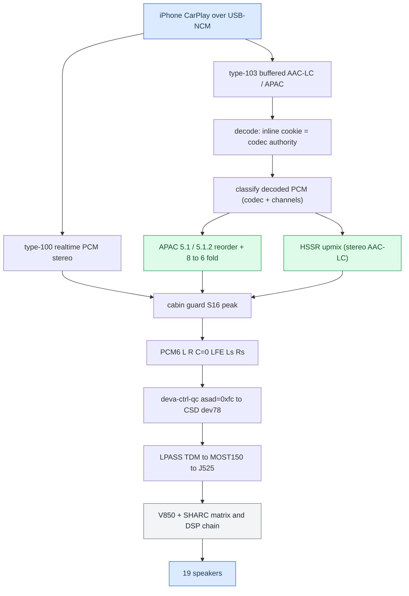
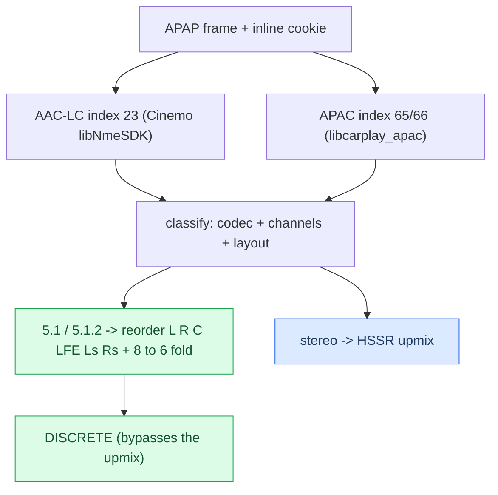
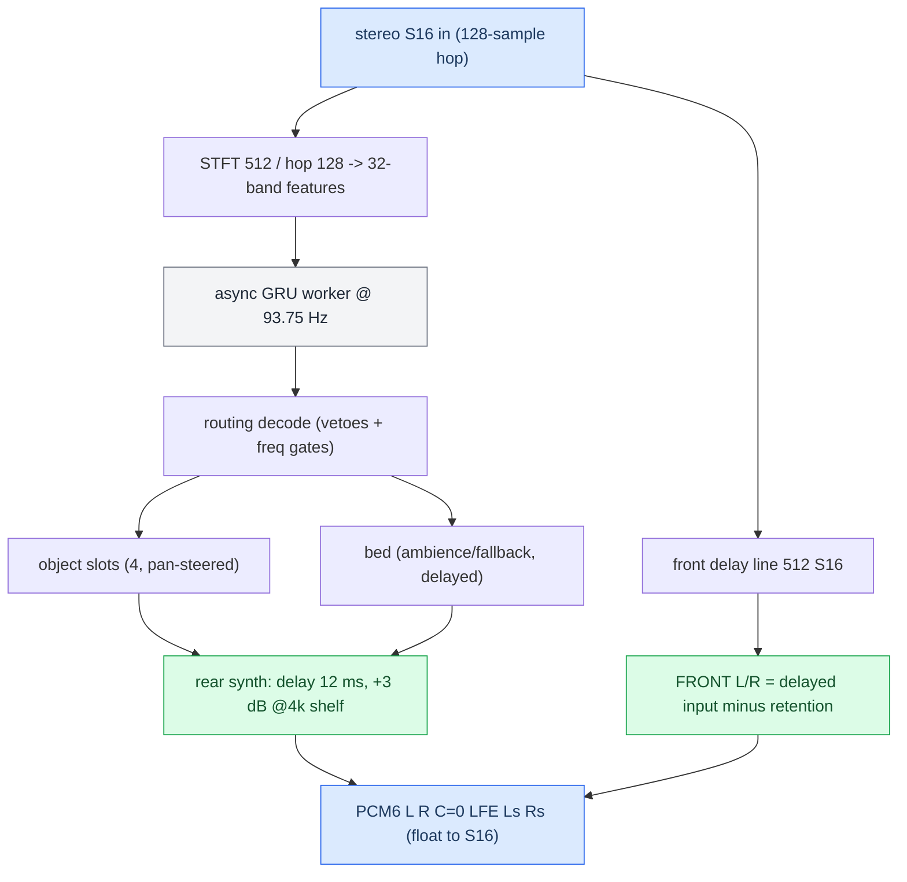

# Stereo to 5.1 Upmix

*The end-to-end pipeline from the phone's audio to the six PCM channels the amp renders — where discrete 5.1 and the HSSR upmix each kick in, and the frozen production calibration.*

---

## 🎯 The big picture

Two things had to be built: **get the right six PCM channels**, and **synthesize them for stereo content**. The amp (J525 B&O) is a complete 5.1 renderer — the [[Virtual Cabin and Amp RE|Virtual Cabin]] — so the head unit only feeds it `L R C LFE Ls Rs` and lets it do the acoustics: it derives the centre, manages the sub, crosses over every driver, and fans out to 19 speakers.

Provenance is `docs/research/UPMIX.md` (master), with the deep detail in [[HSSR Model]], [[Virtual Cabin and Amp RE]], and [[Dolby Atmos]]. Traps are in [[Landmines]].

## ⚙️ Ingest — two CarPlay audio streams

There are **two** CarPlay audio streams (`docs/reference/AUDIO.md §21`), and which one an audio path uses decides everything downstream.

| Stream | Advertised as | Codec | On the car |
|---|---|---|---|
| type-100 realtime | `audioOutputFormats` | PCM only | 48k/16/**stereo** **[car]** |
| type-103 buffered | `audioOutputFormatsExtended` | AAC-LC (23) / APAC 5.1 (65) / 5.1.2 (66) | lossless + spatial; **our hook supplies it** |

The stock realtime stream never carries multichannel, and phone-side spatial over it is blocked by a phone feature flag (`ScreenSpatialAudioReceiver`) — see [[Dolby Atmos]]. So **all multichannel and all upmix input rides the buffered type-103 path.** On that path the frame is APAP (BE32 + ChaCha20-Poly1305); the **33-byte inline magic cookie decides the decoder**, not the APAP index hint — see [[Discrete 5.1 Routing]].

## 🔧 Where upmix vs discrete kicks in

After decode, the PCM is classified by codec, channel count and layout:

iOS may alternate AAC-LC ↔ APAC **inside one session**; the cookie authority makes the switch seamless. iOS never sends ordinary stereo as APAC 5.1, so normal music decodes as stereo and is upmixed on our side. The 5.1 case is **[car]** end to end.

## 📊 The HSSR upmix, one hop

HSSR is a **causal routing controller**, not a separator: 93.75 times a second it decides, per frequency band, how much of the signal belongs behind the listener and where; a deterministic DSP builds the field from that decision. Full detail in [[HSSR Model]].

Three design choices carry the sound:

- **The front is a bit-exact delayed copy of the input** (an S16 delay line), not the STFT output — only the rear is synthesized float.
- **Second scene, by precedence.** The rear is delayed **12 ms** so the louder, earlier front anchors the image (Haas effect) and the rear reads as distinct objects, not an echo. This is the deliberate departure from Dolby, which never sends the dominant object rearward.
- **C = 0 on purpose** — the amp derives the centre from L+R.

Before output, an S16 **cabin guard** predicts each amp bus peak (using a linear copy of the amp's profile-0/bank-1 matrix) so no bus clips. It is a peak-detection model, not acoustics: if `peak · 3.53 ≤ 32275` nothing can clip and it returns early; otherwise it repairs via LFE-only first, then linked-scales all six channels.

## 📌 The frozen calibration knobs

Luka, 2026-09-21: *current calibration is OK — do not tune.* (`docs/research/HSSR_UPMIX_MODEL.md §5`.)

| Parameter | Value | Env flag |
|---|---|---|
| Render path | **S16** | — |
| Rear / surround gain | **0.40** (ceiling 0.50) | `AUDIO_STEREO_SURROUND=0.40` |
| Front bass shelf | **−3 dB** @200 Hz (front L/R) | `AUDIO_STEREO_FRONT_BASS_DB=-3` |
| LFE assist | **0 dB re 4096**, assist mode | `AUDIO_STEREO_LFE_GAIN=0`, `AUDIO_STEREO_LFE=assist` |
| Front retention | **0** (frozen-OK) | `AUDIO_STEREO_FRONT_RETENTION` |
| Retention HF taper | **1000:2500 Hz** | `AUDIO_HSSR_RETENTION_HF=LO:HI` |
| Rear delay | **12 ms** (576 frames) | baked in |
| Models | q6d `96abe57d…` + guard V11 `ab01463e…` | `AUDIO_HSSR_GUARD_MODEL` |
| Object slots | 4 (2/side), 250 ms hold | single path |

A parked (not shipped) "scene-bed distribution" build adds retention 0.5 + `AUDIO_HSSR_BED_DELAYS=on` + `AUDIO_HSSR_BED_ATTACK=owner` + `AUDIO_HSSR_ATTACK_COLLAPSE=0.75`.

## ✅ What ships

Deployed 2026-09-22 (commit `b021ec9`), each verified by read-back **[car]**:

| Path | File |
|---|---|
| Upmix + all interposers | `/mnt/app/root/hooks/libcarplay_hook.so` |
| APAC decoder (dlopen'd) | `/mnt/app/root/hooks/libcarplay_apac.so` |
| Models | `hssr_model.bin` (q6d), `hssr_guard.bin` (V11) |
| Java (needs a unit restart) | `/mnt/app/eso/hmi/lsd/jars/carplay_hook.jar` |
| Firmware | `/mnt/app/eso/bin/apps/smartphone_integrator` |
| 6-voice mirror driver | `/mnt/app/armle/lib/dll/deva-ctrl-qc.so` |

Two gates decide whether any of this runs: **`AUDIO_SPATIAL`** gated on **E2P 0xFC** (only B&O external cars have a 6-channel route — see [[Landmines]]), and realtime-vs-buffered (the shipped path is the buffered stream; realtime type-100 upmix is parked).

## ⚠️ The honest gaps

- **No real on-car realtime distribution** — the type-100 upmix numbers are instruction-count estimates. **[open]**
- **No Krait full-chain loaded trace** — the release-acceptance TARGET gate is unverified. **[open]**
- **No blind listening / cabin acoustic evidence** — all tuning is on a conditional electrical model, never SPL. **[open]**
- **Amp DSP model** — static RE, not bit-exact, bus→speaker binding inferred. **[model]**
- **Known misses** — processed vocal intros read as keys, wide synth-bass read as keys (semantic, not frequency). **[car]**

Runtime code: `hook/audio/{hssr_dsp,hssr_neon,hssr_control_worker,stereo_upmix}.{c,h}`.
