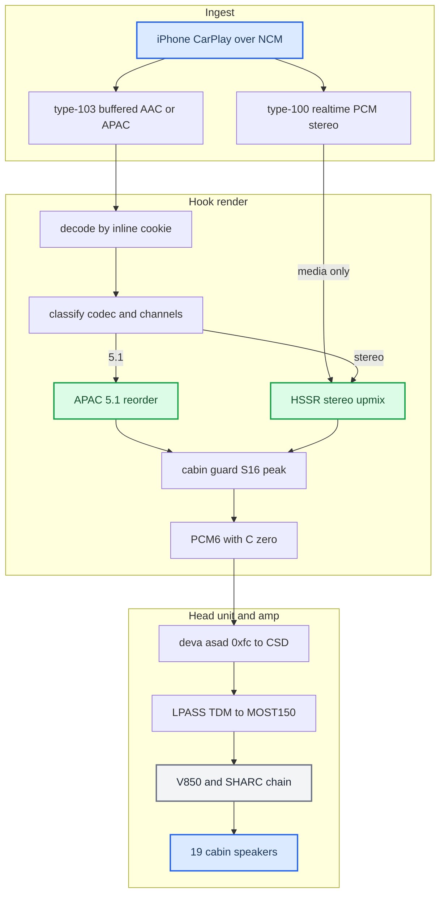
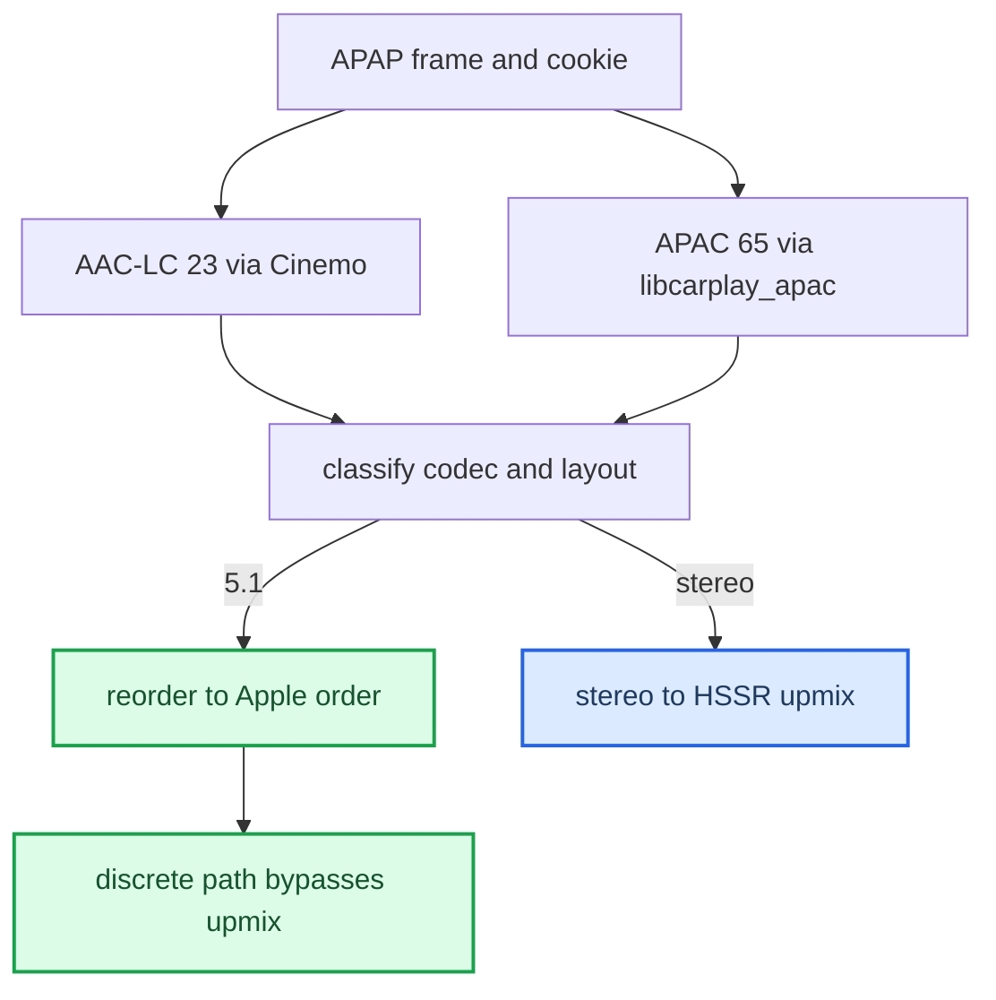
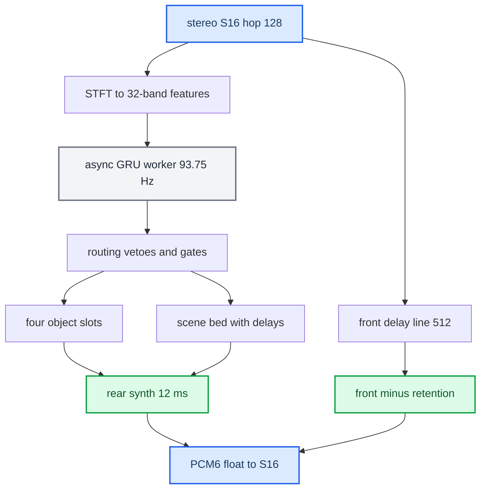

# Stereo to 5.1 Upmix

*The end-to-end pipeline from the phone's audio to the six PCM channels the amp renders — where discrete 5.1 and the HSSR upmix each kick in, and the calibration the startup script ships.*

---

## 🎯 The big picture

Two things had to be built: get the **right six PCM channels**, and **synthesize them** for stereo content. The amp (J525 B&O) is a complete 5.1 renderer — the [[Virtual Cabin and Amp RE|Virtual Cabin]] — so the head unit only feeds it `L R C LFE Ls Rs` and lets it do the acoustics: it derives the centre, manages the sub, crosses over every driver, and fans out to 19 speakers.

Provenance is `docs-obsidian/Research/UPMIX.md` (master), with the deep detail in [[HSSR Model]], [[Virtual Cabin and Amp RE]], and [[Dolby Atmos]]. Traps are in [[Landmines]].

## ⚙️ Ingest — two CarPlay audio streams

There are two CarPlay audio streams (`docs-obsidian/Sources/reference/AUDIO.md §21`), and which one a track uses decides everything downstream.

| Stream | Advertised as | Codec | On the car |
|---|---|---|---|
| type-100 realtime | `audioOutputFormats` | PCM only | 48k/16/stereo `[car]` |
| type-103 buffered | `audioOutputFormatsExtended` | AAC-LC (23) / APAC 5.1 (65) / 5.1.2 (66) | lossless + spatial; our hook supplies it |

The stock realtime stream never carries multichannel, and phone-side spatial over it is blocked by a phone feature flag (`ScreenSpatialAudioReceiver`) — see [[Dolby Atmos]]. So all **multichannel** input rides the buffered type-103 path. On that path the frame is APAP (BE32 + ChaCha20-Poly1305); the **inline magic cookie** decides the decoder, not the APAP index hint — see [[Discrete 5.1 Routing]].

The shipped startup advertises `[65,23]` on type 103: primary APAC 5.1 because `AUDIO_SPATIAL_ATMOS=0` (`hook/audio/audio_hook.c:785-788`, `deploy/smartphone_integrator/carplay_startup.sh:61`), plus AAC-LC stereo via `SPATIAL_103_EXTRA_INDEX=23` (`carplay_startup.sh:92`).

Stereo on the realtime stream is upmixed too. With `AUDIO_REALTIME_UPMIX=on` (`carplay_startup.sh:86`) the same HSSR renderer runs on type-100 media PCM — Spotify and every app without type 103 — on its own DSP state and controller (`hook/audio/audio_hook.c:3885-3893`). It falls back to plain L/R while a phone, Siri or alert stream is tracked or while type 103 owns the rail (`hook/audio/media_route.h:154-156`).

## 🔧 Where upmix vs discrete kicks in

After decode, the PCM is classified by codec, channel count and layout (`hook/audio/spatial_downmix.h:61-79`):

iOS may alternate AAC-LC ↔ APAC inside one session; the cookie authority makes the switch seamless. iOS never sends ordinary stereo as APAC 5.1, so normal music decodes as stereo and is upmixed on our side. The 5.1 case is `[car]` end to end.

Decoded 5.1.2 (index 66) is accepted only when SETUP itself negotiated 66, which the shipped config never advertises; otherwise the decoder is rejected as `unsupported-layout` because the native PCM8 order is unmeasured (`hook/audio/audio_hook.c:3227-3240`).

## 📊 The HSSR upmix, one hop

HSSR is a **causal routing controller**, not a separator: 93.75 times a second it decides, per frequency band, how much of the signal belongs behind the listener and where; a deterministic DSP builds the field from that decision. Full detail in [[HSSR Model]].

Three design choices carry the sound:

- **The front is a delayed copy of the input** (an S16 delay line), not the STFT output — only the rear is synthesized float. The front is that delayed input minus the transferred object share; front retention keeps part of it in front, per band with the HF taper (`hook/audio/hssr_dsp.c:1576-1590`).
- **Second scene, by precedence.** The rear is delayed 12 ms (`SPA_SCENE_REAR_DELAY_FRAMES = 576`, `hook/audio/stereo_upmix.h:31`) so the louder, earlier front anchors the image (Haas effect) and the rear reads as distinct objects, not an echo. This is the deliberate departure from Dolby, which never sends the dominant object rearward.
- **C = 0 on purpose** — the amp derives the centre from L+R.

The rear also passes a −4 dB @ 500 Hz low shelf before the transfer and a +3 dB high shelf with a 4 kHz midpoint before its linked limiter (`hook/audio/stereo_upmix.c:32-50`).

Before output, an S16 cabin guard predicts each amp bus peak (using a linear copy of the amp's profile-0/bank-1 matrix) so no bus clips. It is a peak-detection model, not acoustics: if `peak · 3.53 ≤ 32275` nothing can clip and it returns early; otherwise it repairs via LFE only first, then linked-scales all six channels (`hook/audio/stereo_upmix.c:55-64`, `:340-410`).

## 📌 The shipped calibration

Luka, 2026-09-21 morning: *current calibration is OK — do not tune* (`docs-obsidian/Research/HSSR_UPMIX_MODEL.md §5`), at retention 0. Later that day he chose the scene-bed variant after a headphone A/B, and that is what `carplay_startup.sh` exports now (commit `3676324`, `carplay_startup.sh:71-78`).

| Parameter | Shipped value | Env flag / source |
|---|---|---|
| Render path | S16 (float/cabin/quiet paths removed, commit `9255485`) | — |
| Rear / surround gain | 0.40 (parser accepts 0..0.50, code default 0.18) | `AUDIO_STEREO_SURROUND=0.40` (`carplay_startup.sh:65`, `audio_hook.c:162-178`) |
| Front bass shelf | −3 dB @ 200 Hz, front L/R only | `AUDIO_STEREO_FRONT_BASS_DB=-3` (`carplay_startup.sh:70`, `stereo_upmix.h:37`) |
| LFE assist | 0 dB re 4096, assist mode | `AUDIO_STEREO_LFE_GAIN=0`, `AUDIO_STEREO_LFE=assist` (`carplay_startup.sh:66-68`, `stereo_upmix.h:35`) |
| Front retention | 0.5 (code default 0) | `AUDIO_STEREO_FRONT_RETENTION=0.5` (`carplay_startup.sh:75`) |
| Scene-bed delays | on | `AUDIO_HSSR_BED_DELAYS=on` (`carplay_startup.sh:76`) |
| Bed attack | owner, collapse 0.75 | `AUDIO_HSSR_BED_ATTACK=owner`, `AUDIO_HSSR_ATTACK_COLLAPSE=0.75` (`carplay_startup.sh:77-78`) |
| Retention HF taper | 1000:2500 Hz, library default, not exported | `AUDIO_HSSR_RETENTION_HF=LO:HI` override (`stereo_upmix.h:42-43`) |
| Rear delay | 12 ms (576 frames) | baked in (`stereo_upmix.h:31`) |
| Realtime upmix | on | `AUDIO_REALTIME_UPMIX=on` (`carplay_startup.sh:86`) |
| SoundCheck | on, no fallback, no limiter | `AUDIO_SOUNDCHECK=1` (`carplay_startup.sh:87-89`) |
| Models | q6d `96abe57d…` + guard V11 `ab01463e…` | `AUDIO_HSSR_MODEL`; guard auto-loads `hssr_guard.bin` beside it (`audio_hook.c:1754-1771`) |
| Object slots | 4 (2 per side), 250 ms hold (94 hops) | single path (`hssr_dsp.h:20`, `hssr_dsp.c:940-941`) |

Every scene-bed flag set to `off`/`0` restores the legacy renderer bit-exactly (`carplay_startup.sh:71-74`).

## ✅ What ships

Deployed 2026-09-22, each verified by read-back `[car]`:

| Path | File |
|---|---|
| Upmix + all interposers | `/mnt/app/root/hooks/libcarplay_hook.so` |
| APAC decoder (dlopen'd) | `/mnt/app/root/hooks/libcarplay_apac.so` |
| Models | `hssr_model.bin` (q6d), `hssr_guard.bin` (V11) |
| Java (needs a unit restart) | `/mnt/app/eso/hmi/lsd/jars/carplay_hook.jar` |
| Firmware | `/mnt/app/eso/bin/apps/smartphone_integrator` |
| 6-voice mirror driver | `/mnt/app/armle/lib/dll/deva-ctrl-qc.so` |

Whether any of this runs depends on `AUDIO_SPATIAL`. Only B&O external-amp cars have a 6-channel route, so the intended policy is `AUDIO_SPATIAL=0` unless E2P 0xFC reads `02` — but that gate is assigned to the installer and no installer script implements it yet; the startup script hardcodes `AUDIO_SPATIAL=1` for this unit (`carplay_startup.sh:57-60`). See [[Landmines]].

## ⚠️ The honest gaps

- **No on-car realtime distribution** — the type-100 upmix cost numbers are QEMU estimates; the per-period histogram exists in code (`hook/audio/audio_hook.c:3898`) but no car data has been collected. `[open]`
- **No Krait full-chain loaded trace** — the release-acceptance TARGET gate is unverified. `[open]`
- **No blind listening / cabin acoustic evidence** — all tuning is on a conditional electrical model, never SPL. `[open]`
- **Amp DSP model** — static RE, not bit-exact, bus→speaker binding inferred. `[model]`
- **Known misses** — processed vocal intros read as keys, wide synth-bass read as keys (semantic, not frequency). `[car]`

Runtime code: `hook/audio/{hssr_dsp,hssr_neon,hssr_control_worker,stereo_upmix}.{c,h}`, `hook/audio/rt_upmix_guard.h`.
