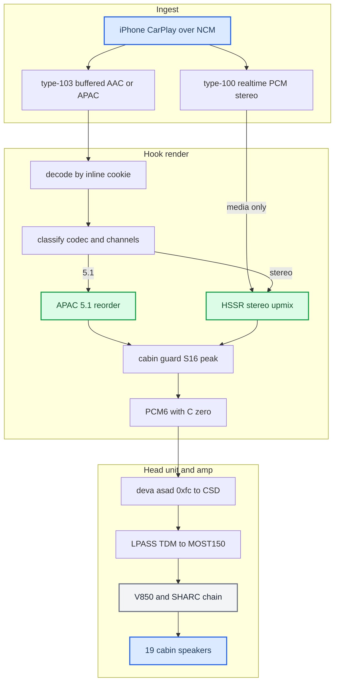
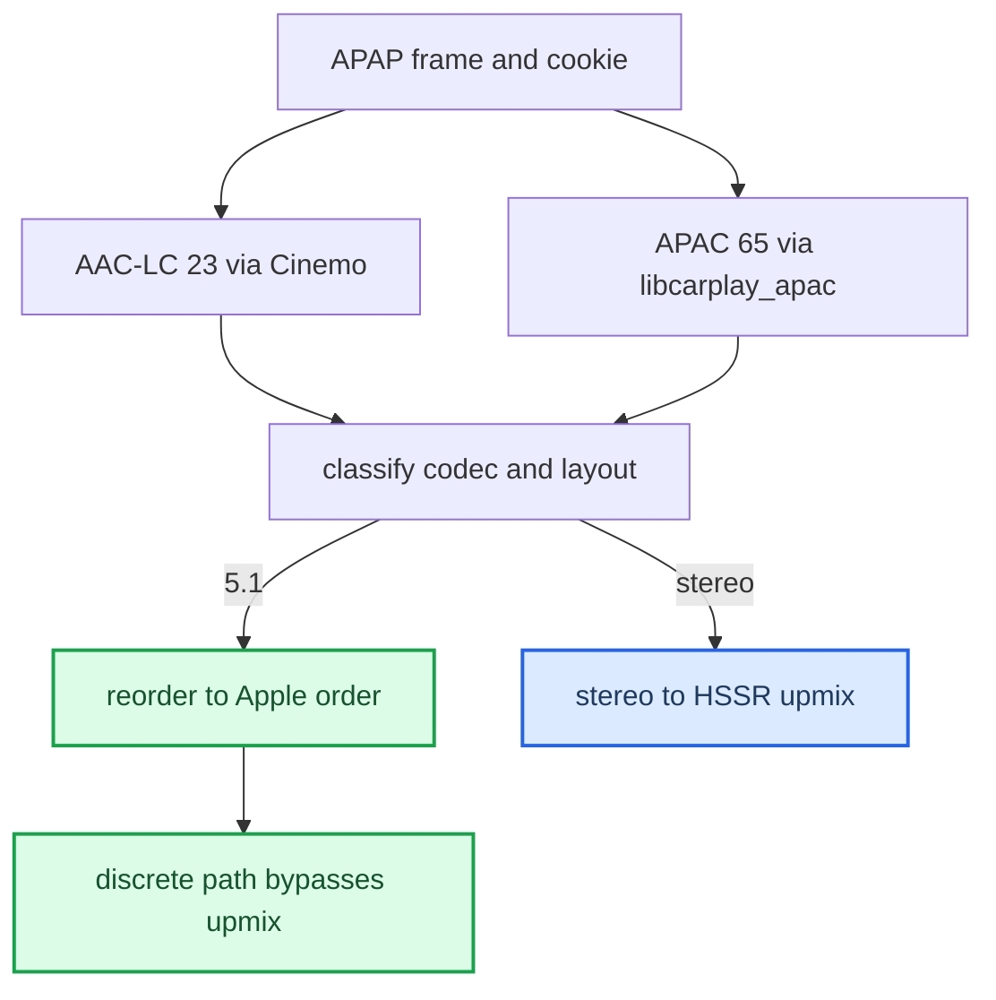
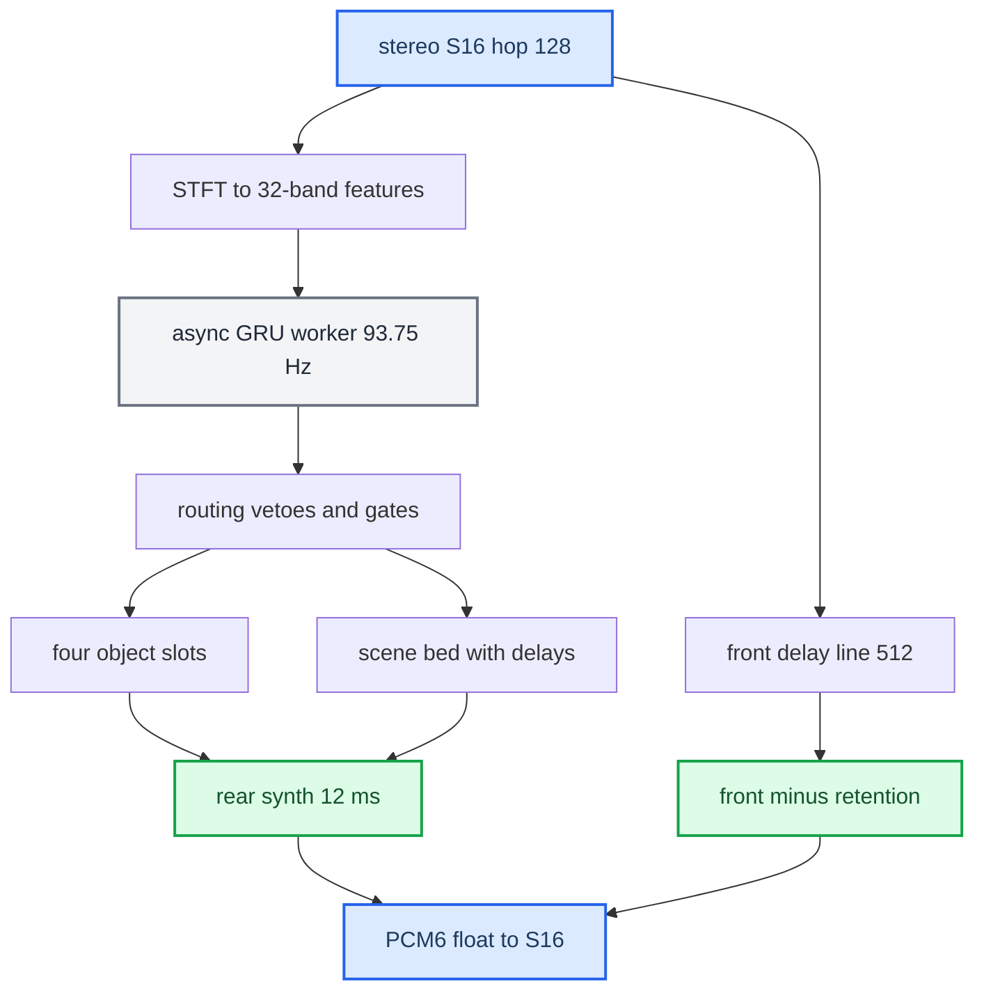
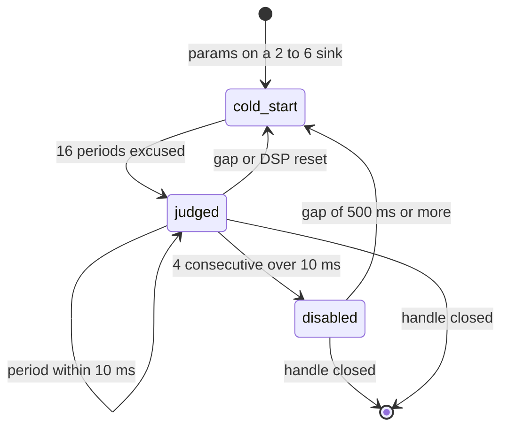

# Stereo to 5.1 Upmix

*The end-to-end pipeline from the phone's audio to the six PCM channels the amp renders — where discrete 5.1 and the HSSR upmix each kick in, and the calibration the startup script ships.*

---

## 🎯 The big picture

Two things had to be built: get the **right six PCM channels**, and **synthesize them** for stereo content. The amp (J525 B&O) is a complete 5.1 renderer — the [[Virtual Cabin and Amp RE|Virtual Cabin]] — so the head unit only feeds it `L R C LFE Ls Rs` and lets it do the acoustics: it derives the centre, manages the sub, crosses over every driver, and fans out to 19 speakers.

Provenance is `docs-obsidian/Research/UPMIX.md` (master), with the deep detail in [[HSSR Model]], [[Virtual Cabin and Amp RE]], and [[Dolby Atmos]]. Traps are in [[Landmines]].



## ⚙️ Ingest — two CarPlay audio streams

There are two CarPlay audio streams (`docs-obsidian/Sources/reference/AUDIO.md §21`), and which one a track uses decides everything downstream.

| Stream | Advertised as | Codec | On the car |
|---|---|---|---|
| type-100 realtime | `audioOutputFormats` | PCM only | 48k/16/stereo `[car]` |
| type-103 buffered | `audioOutputFormatsExtended` | AAC-LC (23) / APAC 5.1 (65) / 5.1.2 (66) | lossless + spatial; our hook supplies it |

The stock realtime stream never carries multichannel, and phone-side spatial over it is blocked by a phone feature flag (`ScreenSpatialAudioReceiver`) — see [[Dolby Atmos]]. So all **multichannel** input rides the buffered type-103 path. On that path the frame is APAP (BE32 + ChaCha20-Poly1305); the **inline magic cookie** decides the decoder, not the APAP index hint — see [[Discrete 5.1 Routing]].

The shipped startup advertises `[65,23]` on type 103: primary APAC 5.1 because `AUDIO_SPATIAL_ATMOS=0` (`hook/audio/audio_hook.c:785-788`, `deploy/smartphone_integrator/carplay_startup.sh:61`), plus AAC-LC stereo via `SPATIAL_103_EXTRA_INDEX=23` (`carplay_startup.sh:92`).

Stereo on the realtime stream is upmixed too. With `AUDIO_REALTIME_UPMIX=on` (`carplay_startup.sh:86`) the same HSSR renderer runs on type-100 media PCM — Spotify and every app without type 103 — on its own DSP state and controller (`hook/audio/audio_hook.c:3885-3893`). It falls back to plain L/R while a phone, Siri or alert stream is tracked or while type 103 owns the rail (`hook/audio/media_route.h:153-167`).

## 🔧 Where upmix vs discrete kicks in

After decode, the PCM is classified by codec, channel count and layout (`hook/audio/spatial_downmix.h:61-79`):



iOS may alternate AAC-LC ↔ APAC inside one session; the cookie authority makes the switch seamless. iOS never sends ordinary stereo as APAC 5.1, so normal music decodes as stereo and is upmixed on our side. The 5.1 case is `[car]` end to end.

Decoded 5.1.2 (index 66) is accepted only when SETUP itself negotiated 66, which the shipped config never advertises; otherwise the decoder is rejected as `unsupported-layout` because the native PCM8 order is unmeasured (`hook/audio/audio_hook.c:3227-3240`).

## 📊 The HSSR upmix, one hop

HSSR is a **causal routing controller**, not a separator: 93.75 times a second it decides, per frequency band, how much of the signal belongs behind the listener and where; a deterministic DSP builds the field from that decision. Full detail in [[HSSR Model]].



Three design choices carry the sound:

- **The front is a delayed copy of the input** (an S16 delay line), not the STFT output — only the rear is synthesized float. The front is that delayed input minus the transferred object share; front retention keeps part of it in front, per band with the HF taper (`hook/audio/hssr_dsp.c:1576-1590`).
- **Second scene, by precedence.** The rear is delayed 12 ms (`SPA_SCENE_REAR_DELAY_FRAMES = 576`, `hook/audio/stereo_upmix.h:31`) so the louder, earlier front anchors the image (Haas effect) and the rear reads as distinct objects, not an echo. This is the deliberate departure from Dolby, which never sends the dominant object rearward.
- **C = 0 on purpose** — the amp derives the centre from L+R.

The rear also passes a −4 dB @ 500 Hz low shelf before the transfer and a +3 dB high shelf with a 4 kHz midpoint before its linked limiter (`hook/audio/stereo_upmix.c:32-50`).

Before output, an S16 cabin guard predicts each amp bus peak (using a linear copy of the amp's profile-0/bank-1 matrix) so no bus clips. It is a peak-detection model, not acoustics: if `peak · 3.53 ≤ 32275` nothing can clip and it returns early; otherwise it repairs via LFE only first, then linked-scales all six channels (`hook/audio/stereo_upmix.c:55-64`, `:340-410`). Until 2026-09-20 this table was the old transposed reading and disagreed with the corrected matrix in 22 of 48 coefficients; it now carries the corrected input-major table shared by every guard (`stereo_upmix.c:57-73`). The same fix stopped the 2.5× transfer intermediate from wrapping in int16 (16384·2.5 = 40960) and the +32768 unity clamp from flipping to −32768 (`stereo_upmix.c:118-119`) — see [[Upmix Calibration and Tuning#The corrected matrix changed the diagnosis]].

### Fail-closed contract

The upmixer never silently picks another renderer `[code]`:

| Condition | Output |
|---|---|
| `AUDIO_STEREO_UPMIX=off` | exactly `L,R,0,0,0,0`, all gain/LFE settings ignored (`audio_hook.c:1985-1989`) |
| model missing, corrupt or wrong size | upmix stays off, `HSSR: model rejected … stereo upmix will stay off` (`audio_hook.c:1746`) |
| guard model missing | no guard, silently; the primary alone runs (`audio_hook.c:1755-1771`) |
| process error at render time | exact L/R widening, one ERROR line (`audio_hook.c:3369-3378`) |
| worker thread cannot start | the synchronous GRU path, logged `hssrController=sync-fallback` |

Every reset (prefix FLUSH, pause/rate teardown, cookie or codec change, SETUP replacement, session stop) advances a nonzero generation; the worker drops stale results. Env values are read once per `dio_manager` process — a change applies at the next CarPlay generation (phone reconnect), a replaced `.so` too; no unit reboot is needed for either.

## 📌 The shipped calibration

Luka, 2026-09-21 morning: *current calibration is OK for now — do not tune; no defaults, env or deploys without my word; any later change only after listening, one lever at a time.* The car then ran S16 / 0.40 / −3 / LFE 0 / retention 0. Later that day he chose the scene-bed variant after a headphone A/B, and that is what `carplay_startup.sh` exports now (`carplay_startup.sh:71-78`). The whole history, the measurements behind each value and the symptom → lever table are in [[Upmix Calibration and Tuning]].

| Parameter | Shipped | Code default | Parser range | Source `[code]` |
|---|---|---|---|---|
| Render path | S16 | S16 only | — | float/cabin/quiet paths removed, commit `9255485` |
| `AUDIO_STEREO_SURROUND` | 0.40 | 0.18 (Q15 5898) | 0..0.50 | `carplay_startup.sh:65`, `audio_hook.c:162-179`, `stereo_upmix.h:27-30` |
| `AUDIO_STEREO_FRONT_BASS_DB` | −3 | 0 | −12..0 | `carplay_startup.sh:70`, `audio_hook.c:258-275`; RBJ shelf 200 Hz (`stereo_upmix.h:37`) |
| `AUDIO_STEREO_LFE` | assist | off | off, assist | `carplay_startup.sh:66`, `audio_hook.c:298-308` |
| `AUDIO_STEREO_LFE_GAIN` | 0 dB re 4096 | 0 dB | −24..+12 dB | `carplay_startup.sh:68`, `audio_hook.c:277-296`; Q15 cap 16384 (`stereo_upmix.h:35-36`) |
| `AUDIO_STEREO_FRONT_RETENTION` | 0.5 | 0 | 0..1 | `carplay_startup.sh:75`, `audio_hook.c:181-195` |
| `AUDIO_HSSR_BED_DELAYS` | on | off | bool | `carplay_startup.sh:76`, `audio_hook.c:349-353` |
| `AUDIO_HSSR_BED_ATTACK` | owner | off | off, owner, front | `carplay_startup.sh:77`, `audio_hook.c:197-208` |
| `AUDIO_HSSR_ATTACK_COLLAPSE` | 0.75 | 1.0 | 0..1 | `carplay_startup.sh:78`, `audio_hook.c:210-225` |
| `AUDIO_HSSR_RETENTION_HF` | not exported → 1000:2500 Hz | 1000:2500 | `LO:HI` Hz ≤ 24000; `HI≤LO` = flat | `audio_hook.c:230-255`, `stereo_upmix.h:42-43` |
| Rear delay | 12 ms (576 frames) | baked in | — | `stereo_upmix.h:31` |
| LFE low-pass | Butterworth LR4 **60 Hz**, mono fold | baked in | — | `stereo_upmix.c:23-31` (coefficients give 60 Hz; the comments at `:20-22` and `stereo_upmix.h:116` still say 48 Hz) |
| `AUDIO_REALTIME_UPMIX` | on | off | bool | `carplay_startup.sh:86`, `audio_hook.c:358-362` |
| `AUDIO_SOUNDCHECK` / `_FALLBACK` / `_LIMITER` | 1 / off / off | on / off / off | bool / off, rms / off, peak | `carplay_startup.sh:87-89`, `audio_hook.c:310-332` |
| `AUDIO_HSSR_MODEL` | `$H/hssr_model.bin` (q6d `96abe57d…`) | `/mnt/app/root/hooks/hssr_model.bin` | path | `audio_hook.h:93`; guard `hssr_guard.bin` (V11 `ab01463e…`) beside it, or `AUDIO_HSSR_GUARD_MODEL` (`audio_hook.c:1755-1771`) |
| Object slots | 4 (2 per side), 250 ms hold (94 hops) | single path | — | `hssr_dsp.h:20`, `hssr_dsp.c:940-941` |

An invalid value never aborts: it logs `audio config: invalid …` at ERROR and falls back to the code default (surround 0.18, retention 0, LFE gain 0 dB, collapse 1, bed attack off).

> ⚠️ **The HF taper is tied to `BED_ATTACK`.** Retention runs per band inside HSSR (where the taper lives) only when `AUDIO_HSSR_BED_ATTACK≠off`; with attack off, retention falls back to the flat time-domain transfer and the taper is ignored (`stereo_upmix.h:93-95`, `hssr_dsp.c:1583-1590`). So turning only `BED_ATTACK` off while keeping retention 0.5 brings the bright-front complaint back. The startup comment "any of the three set to off/0 restores the legacy renderer bit-exactly" (`carplay_startup.sh:73-74`) is only true for all three plus retention 0.

Measured facts about these knobs (60 s grid, conditional amp model `[model]`): front bass is the **only** bass lever and it moves the modelled sub too; retention restores front/centre mid and never touches bass; LFE gain is **not** a monotonic sub-volume knob. Details and numbers: [[Upmix Calibration and Tuning#One lever at a time]].

## ⚙️ SoundCheck and the output order

Per buffered frame the order is fixed `[code]` (`audio_hook.c:3361-3409`):

```text
decoded S16 → reorder (APAC 5.1) or HSSR upmix incl. S16 cabin guard → SoundCheck gain (S16) → optional SoundCheck limiter → PCM ring
```

SoundCheck is a **programme** gain applied after the upmix on purpose: HSSR uses absolute log-energy features, so a −9 dB AAC gain before analysis would change its routing decisions (`audio_hook.c:3402-3405`). SETUP carries `soundCheckMediaKind {"1":-16}`; APAP type 103 carries MainLoudnessParameters (TLV 11) and media kind (TLV 12). The gain is `target − p0`, positive gain capped at `−1 − p2`, rounded Pioneer-style `floor(x+0.5)`, bounded −128..+20 dB (`soundcheck.c:80-92`); first metadata applies immediately, later changes ramp over 20 ms (`soundcheck.c:7`), FLUSH resets history without forcing unity. Observed tuples: AAC `[-6.5,-1,0.96875]` → −9 dB, the retained APAC tuples → +1 dB. The RMS fallback and sample-peak limiter are separate opt-ins, both off in the shipped config. `-16` is the captured protocol value, not a published Apple rule.

> 📌 **Open `[code]`:** the S16 cabin guard runs inside the upmix, *before* SoundCheck, and the SoundCheck limiter is off. A positive SoundCheck gain (APAC +1 dB) is therefore applied after the bus bound was checked. A 2026-09-08 diagnostic proved that any limiter placed after S16 clipping cannot restore channel ratios (`[30000,31000]` at +1 dB → `32767,32767`). No clipped song has been captured.

## ⚡ The realtime path in the car

The stock type-100 media stream (Spotify, every app without buffered 103) is upmixed inside stock's own QSA thread: period 768 frames = 16 ms (`audio_hook.c:1541-1542`), own DSP state and worker, allowed only for realtime periods, 2→6, a tracked media stream and no phone/Siri/alert owner (`media_route.h:158-167`). The deadline guard rules (10 ms budget, 4 consecutive overruns, 16 cold periods excused, revival only after a ≥ 500 ms gap) live in [[HSSR Model#Async execution and the realtime guard]]; the code is `rt_upmix_guard.h:24-100`.



**What the car recorded on the old 8 ms build** (2026-09-21, five sessions) `[car]` — three of five disabled themselves, which was the audible "rears blinking":

| Session | Periods | Upmixed | Worst | Disabled |
|---:|---:|---:|---:|---|
| 1 | 11 625 | 9 463 | 11 079 µs | yes |
| 2 | 575 | 72 | 9 064 µs | yes |
| 3 | 1 662 | 1 662 | 8 057 µs | no |
| 4 | 15 075 | 9 928 | 9 064 µs | yes |
| 5 | 5 902 | 5 902 | 10 071 µs | no |

**Cost work 2026-09-22** — QNX/ARMv7 under QEMU `-icount`, 8 × 1024-frame blocks, the car's config (`--scene`), every step bit-identical (bench checksum `0xe500b91a9b2c337a`) `[model]`:

| Step | Typical block | Loud block |
|---|---:|---:|
| before (`48b9851`) | 8 039 373 | 8 039 373 |
| cabin-guard early-out + drop non-binding divisions | 7 192 336 | |
| inline biquad | 7 074 435 | |
| FFT: trivial first pass, twiddle walk | 6 950 678 | |
| NEON FFT butterflies | 6 220 931 | |
| NEON cabin-guard matrix | 6 024 357 | 6 228 611 |
| NEON analysis window, overlap-add, `mix_bed` | **5 726 857** (−28.8 %) | **5 931 362** (−26.2 %) |

The biggest find: 68 % of the per-sample stage was the cabin guard — two passes over the 8×6 matrix and 16 divisions per frame, 14 of them useless because seven of eight buses have the matrix floor as their LFE coefficient and can never bound an S16 sample. Scaling the five recorded worst periods by −26.2 % *estimates* 8.2 / 7.4 / 6.7 / 6.7 / 5.9 ms against the 10 ms limit — an instruction-count estimate, not a measurement; any part that was preemption does not shrink.

Deliberately **not** done: triggering on real `deviceUnderruns` (it reaches into the QSA write interposer that once crashed dio_manager — see [[Landmines]]), thread CPU time instead of wall time (`CLOCK_THREAD_CPUTIME_ID` exists on QNX 6.5), vectorising the branchy mask/slot loops (≈ 60 % of `run_hop`, and rewriting them has flipped tracker decisions before), and a cheaper intermediate tier instead of "full HSSR or silent rears".

## ✅ What ships

Deployed 2026-09-22, each verified by read-back `[car]`:

| Path | File |
|---|---|
| Upmix + all interposers | `/mnt/app/root/hooks/libcarplay_hook.so` |
| APAC decoder (dlopen'd) | `/mnt/app/root/hooks/libcarplay_apac.so` |
| Models | `hssr_model.bin` (q6d), `hssr_guard.bin` (V11) |
| Java (needs a unit restart) | `/mnt/app/eso/hmi/lsd/jars/carplay_hook.jar` |
| Firmware | `/mnt/app/eso/bin/apps/smartphone_integrator` |
| 6-voice mirror driver | `/mnt/app/armle/lib/dll/deva-ctrl-qc.so` |

The 2026-09-22 set came from `build/release-20260922` (commit `b021ec9`): `libcarplay_hook.so` sha `dbd5da32…`, `libcarplay_apac.so` `1c25799f…` (unchanged content), `carplay_startup.sh` `93e39a67…`, `carplay_hook.jar` `10137756…`; the renderers were not touched. The deploy history and every listening verdict are in [[Upmix Listening and Deploy Log]].

**How to confirm the running config** from `/tmp/carplay_hook.log` at the next phone connect (the log is WARN-only by default, `touch /mnt/app/carplay_verbose` lifts it to INFO):

| Line | Level | Proves | Code |
|---|---|---|---|
| `HSSR: guard model ready path=… crc=…` | WARN | V11 guard loaded beside the model | `audio_hook.c:1777` |
| `audio upmix scene bed: delays=1 attack=1 collapse_q15=24576 (experiment)` | WARN | scene bed on the buffered path | `audio_hook.c:2051-2057` |
| `buffer103: render … stereoUpmix=… rearGainQ15=13107 frontBassDb10=-30 frontRetentionQ15=16384 hssrController=async … lfeGainQ15=4096` | INFO | full buffered config | `audio_hook.c:2026-2050` |
| `audio realtime upmix: armed (… retention_q15=16384 bed_delays=1 bed_attack=1)` | WARN | type-100 path armed | `audio_hook.c:3993-4001` |
| `audio realtime upmix: stop periods=… mean_us=… worst_us=… cold_us=… disables=… revivals=… ms_hist=…` | WARN | the real period-time distribution (9 buckets, last = ≥ 8 ms) | `audio_hook.c:4012-4030` |
| `audio realtime upmix: DISABLED …` / `back after a … ms break` | WARN | guard tripped / revived | `audio_hook.c:4085-4090`, `:4058-4064` |

If `disables > 0`, check whether the overruns fall in loud passages (our cost) or are scattered (scheduler preemption).

Whether any of this runs depends on `AUDIO_SPATIAL`. Only B&O external-amp cars have a 6-channel route, so the intended policy is `AUDIO_SPATIAL=0` unless E2P 0xFC reads `02` — but that gate is assigned to the installer and no installer script implements it yet; the startup script hardcodes `AUDIO_SPATIAL=1` for this unit (`carplay_startup.sh:57-60`). See [[Landmines]].

## ⚠️ The honest gaps

- **No on-car realtime distribution** — the type-100 upmix cost numbers are QEMU estimates; the per-period histogram exists in code (`hook/audio/audio_hook.c:3898-3900`) but the `stop` line from the 2026-09-22 build has not been collected yet. `[open]`
- **SoundCheck after the cabin guard** — a positive programme gain is applied after the bus bound; limiter off (see above). `[open]`
- **J525 state unreadable** — SSH to the head unit is not a J525 memory transport; `/dev/io-amp` on RCC is the internal TI DSP. Active bank/B/EQ selector are hypotheses in every model number. `[open]`
- **No Krait full-chain loaded trace** — the release-acceptance TARGET gate is unverified. `[open]`
- **No blind listening / cabin acoustic evidence** — all tuning is on a conditional electrical model, never SPL. `[open]`
- **Amp DSP model** — static RE, not bit-exact, bus→speaker binding inferred. `[model]`
- **Known misses** — processed vocal intros read as keys, wide synth-bass read as keys (semantic, not frequency). `[car]`

Runtime code: `hook/audio/{hssr_dsp,hssr_neon,hssr_control_worker,stereo_upmix,soundcheck}.{c,h}`, `hook/audio/rt_upmix_guard.h`, `hook/audio/media_route.h`.

## 🔗 Related notes

- [[Upmix Calibration and Tuning]] — how every shipped value was reached, the offline measurement method, the symptom → lever table, the Dolby-principle scene bed.
- [[Upmix Listening and Deploy Log]] — what ran in the car when, file hashes, Luka's verdicts, the live readback.
- [[Upmix Release and Acceptance]] — the frozen acceptance protocol, the runtime audit, and the research candidates (G-series, Q2, cabin-first) that never shipped.
- [[HSSR Model]] (model, training, guard) · [[Virtual Cabin and Amp RE]] (the amp) · [[Dolby Atmos]] · [[Discrete 5.1 Routing]] · [[Landmines]].
- Long-form: [[Research/UPMIX|UPMIX]], [[Research/VIRTUAL_CABIN|VIRTUAL_CABIN]], [[Research/HSSR_UPMIX_MODEL|HSSR_UPMIX_MODEL]], [[Research/DOLBY_ATMOS_TEARDOWN|DOLBY_ATMOS_TEARDOWN]].
- [[Buffered Audio Path]] · [[Call and Siri Routing]] — the type-103 transport the upmix renders into, and what happens when a call or Siri takes the output.
- [[Upmix Training History]] · [[Upmix Compute Budget]] — how the model was trained and what it costs on the Krait.
- [[J525 Wiring and Speakers]] — the rear doors are mid-bass speakers, which bounds what the rear can carry.

## 📚 Sources

- [[Sources/UPMIX_STATUS_2026-09-22|UPMIX_STATUS_2026-09-22]] — 22.09 deploy hashes, HF taper, −28.8 % cost work, realtime deadline policy and the five recorded sessions.
- [[Sources/STEREO_TO_5_1_UPMIX_DESIGN|STEREO_TO_5_1_UPMIX_DESIGN]] — the Universal contract: output order, OFF bypass, fail-closed model load, generation reset, runtime split (its rear 0.25 / V11-only policy is superseded).
- [[Sources/UPMIX_STATIC_READINESS_AND_SOUNDCHECK|UPMIX_STATIC_READINESS_AND_SOUNDCHECK]] — SoundCheck math, order and the reproduced headroom failure.
- [[Sources/UPMIX_GUARD_RETENTION_2026-09-20|UPMIX_GUARD_RETENTION_2026-09-20]] — the corrected guard table and the S16 transfer boundary fixes.
- [[Sources/UPMIX_AGENT_HANDOFF_2026-09-19|UPMIX_AGENT_HANDOFF_2026-09-19]] — env knob list, host renderer recipe, the 21.09 "do not tune" decision.
- [[Sources/UPMIX_DOLBY_DISTRIBUTION_PLAN_2026-09-21|UPMIX_DOLBY_DISTRIBUTION_PLAN_2026-09-21]] — the scene-bed flags and the HF taper knob.
