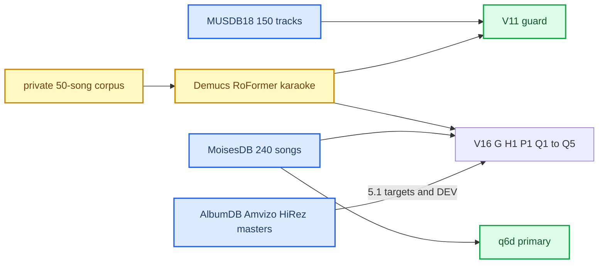

# Upmix Datasets and Teachers

*Every corpus, cache and teacher network used to train or judge the stereo→5.1 upmix: sizes, splits, licences, known defects, and the role-label contract that never got real labels.*

---

## 📋 Overview

Two kinds of supervision exist and must not be confused. **Real stems** (MUSDB18, MoisesDB, AlbumDB) give exact source identity. **Teacher estimates** (Demucs, RoFormer, karaoke) give plausible stems for commercial masters but are not truth. Neither gives *musical role* — whether a part is foreground or support — and that is what the rear speaker actually needs. The shipped models: V11 (guard) learned from MUSDB18 plus teacher supervision; q6d (primary) learned from MoisesDB real stems only ([[HSSR Model]]).



## 💾 MoisesDB, the real-stem backbone

MoisesDB v0.1 (Pereira et al. 2023, Moises.ai): official signed download obtained by Luka 2026-09-11, archive SHA and all 2,825 extracted files verified, ZIP deleted at his direction. Licence CC BY-NC-SA 4.0 — fine for a private car, not for distribution. Lives on the NAS at `external/moisesdb/moisesdb_v0.1` (138.73 GiB).

| Property | Value |
|---|---|
| Songs / WAV sources | 240 / 2,585 |
| Bleed metadata | 2,373 no-bleed, 197 bleed, 15 unknown |
| Songs with clean lead **and** clean backing | 73 (127 before the clean filter) |
| Songs with unequal source lengths | 50 (zero-padded, never truncated) |
| Normalized artists | 43 |
| Split seed | `upmix-v16-moises-artist-split-20260911-v1` |
| Catalog SHA-256 | `ecac5c4d…` |

| Partition | Songs / artists / sources | Status |
|---|---|---|
| TRAIN | 181 / 28 / 1,954 | development-exposed |
| DEV (validation) | 40 / 9 / 400 | reused many times, not a clean test |
| Heldout | 19 / 6 / 231 | never decoded; metadata only |

TRAIN metadata: 187 lead-vocal, 84 backing-vocal, 2 unknown-vocal sources; 45 songs with both clean lead and backing; 339 guitar, 133 other-keyboard, 97 percussion, 32 generic-other tracks; 41 synth leads, 35 pads; 1,781/1,954 declared isolated. Electronic coverage is thin — 6 TRAIN / 8 DEV songs tagged electronic, none heldout, no dubstep label; the four electronic DEV songs in Q2's set were all one artist (Fröst). The official taxonomy separates lead from background vocals and keeps choir and processed vocals apart; the four-stem export would lose that.

### How much of MoisesDB each model actually saw

| Subset | TRAIN | DEV |
|---|---|---|
| All 181 TRAIN, maximum-tail timeline | 39,107 s (10.86 h) | — |
| 572 cached 8 s windows (G8/G12/G17), `[11, 2, 384000]` float32, 18.02 GiB | 4,576 s = 11.70% | — |
| Q2 admitted (every track no-bleed, 12 identity heads) | 81 songs / 25 artists / 813 sources / 4.49 h | 19 / 8 / 178 / 1.17 h |
| Q3 cache (`runtime/q3-cache-a`, 48 kHz float16) | 221 songs total, 86 GB | |
| q6d training caches | 181 songs | 40 songs |

Q2's whole-song bleed exclusion threw away 100/181 TRAIN songs (6.4 of 10.86 h), 52 of them for a single bleeding track. Per head that meant backing vocals on 36 songs / 2.28 h instead of 83 / 5.33 h; keys 57 / 3.14 h instead of 132 / 7.75 h; `other_vocal` and `other_plucked` one TRAIN song each and no DEV positive. Q3 fixed this with per-head bleed masks. Native 44.1 kHz stems are read through a frozen unit-gain 160:147 resampler to 48 kHz; the mix is the unit-gain sum of stems, **not a mastered master** — a train/car domain gap no document before the audit admitted.

Sources: [[Sources/UPMIX_RELEASE_DATA_AUDIT|UPMIX_RELEASE_DATA_AUDIT]], [[Sources/UPMIX_MASTER_PLAN|UPMIX_MASTER_PLAN]], [[Sources/UPMIX_INDEPENDENT_AUDIT_2026-09-17|UPMIX_INDEPENDENT_AUDIT_2026-09-17]], [[Sources/UPMIX_NAS_ATTEMPT_INVENTORY|UPMIX_NAS_ATTEMPT_INVENTORY]], [[Sources/UPMIX_TRAINING_DATA_AND_MODELS|UPMIX_TRAINING_DATA_AND_MODELS]].

## 🎓 MUSDB18 and the private corpus

**MUSDB18** (SigSep): 150 tracks, ~10 h, 100/50 split, stems vocals/bass/drums/other; the compressed `*.stem.mp4` edition was used (HQ avoids its high-frequency bandwidth limit). Research/non-commercial. Trained V11, whose six classes split `other` into three sub-classes by a coherence/flux heuristic — so keys read as vocal and backing = lead, the root of the q6d rework. The local copy was deleted in a cleanup.

**Private corpus** (commercial masters via a Spotify downloader, private use only, `tests/fixtures/private-audio/{training,heldout}`, 277 MB in git): 43 training + 7 heldout MP3s, ~169.84 min of training audio. The V12 pilot used one 10 s crop per song at 35% of its duration — 7 min 10 s, 4.2% of what was available — as 34 train / 9 validation / 7 regression songs × 5 variants × 3 gains (645 caches, 477,360 + 126,360 control frames). The split enforced file identity only, not artist; the "blind" seven became a development regression set once inspected.

### The 50-song FLOAT corpus (V14 → V15)

All 50 songs cut into 587 non-overlapping cores, 194.67 unique minutes (±2 s context):

| Partition | Cores | Minutes |
|---|---:|---:|
| Train | 411 | 137.0 |
| Validation | 100 | 32.8 |
| Heldout | 76 | 24.8 |

V14 decoded to PCM16 without headroom and **clipped** decoder output. The V15 FLOAT rebuild found 44/50 songs and 456/587 cores above integer full scale, peak 1.680:

| Song | Float peak | dBFS | Samples beyond ±1 |
|---|---:|---:|---:|
| Archers | 1.419 | +3.04 | 1.169% |
| Cities In Dust | 1.273 | +2.09 | 0.019% |
| Us V Them | 1.357 | +2.65 | 0.048% |

Every core then got RoFormer, Demucs6 → DrumSep6, karaoke on both all-vocals and the original mix, and AST/CLAP on every stem: status `complete-needs-semantic-review`, 544 cores with retained specialist WAVs (43 early cores kept reports only). The audit raised 136 backing-dominates-lead warnings, 420 quiet-piano warnings and 31 karaoke input-path disagreements.

Sources: [[Sources/HSSR_DATASET_TRAINING_AUDIT|HSSR_DATASET_TRAINING_AUDIT]], [[Sources/UPMIX_FULL_FLOAT_DATASET_V15|UPMIX_FULL_FLOAT_DATASET_V15]], [[Sources/UPMIX_TEACHER_REVIEW_V14|UPMIX_TEACHER_REVIEW_V14]], [[Sources/UPMIX_V15_STREAMING_TRAINING|UPMIX_V15_STREAMING_TRAINING]], [[Sources/UPMIX_TRAINING_DATA_AND_MODELS|UPMIX_TRAINING_DATA_AND_MODELS]].

## 📦 Multichannel masters

**AlbumDB v1.0** (McKenzie, Moliner, Wright; AES Europe 2026 paper 10278; Zenodo 19683001, CC-BY-4.0): ten indie rock/pop/folk songs by one artist, separate stereo and 7.1.4 masters plus stems (272 per variant; 822 WAVs extracted). Stereo was mixed from *Mixed* stems; immersive later from *Mixed-Dry* with its own spatial reverbs and some Haas delays — two author mixes, **not** a sample-exact downmix pair. Immersive RMS is 8 dB below stereo; no +8 dB boost was applied.

The paper's Table 2 fixes the 12-channel file order, which the WAVs (plain PCM, no channel mask) could not:

| File index | Channel | Azimuth / elevation |
|---|---|---|
| 1 / 2 | FL / FR | −30,0 / +30,0 |
| 3 | FC | 0,0 |
| 4 | LFE | — |
| 5 / 6 | SL / SR | −100,0 / +100,0 |
| 7 / 8 | BL / BR | −140,0 / +140,0 |
| 9 / 10 | TFL / TFR | −45,45 / +45,45 |
| 11 / 12 | TBL / TBR | −135,45 / +135,45 |

One real exception to the paper: immersive `06 - Let The Light In.wav` is **PCM24**, the other 19 masters PCM16; all 44.1 kHz. The project's frozen 12→5.1 fold (a research choice, `h = sqrt(0.5)`):

```text
FL5 = FL + h·TFL        FR5 = FR + h·TFR        FC5 = FC
SL5 = h·SL + h·BL + 0.5·TBL
SR5 = h·SR + h·BR + 0.5·TBR                     LFE5 = 0
```

Split by whole song (not artist-disjoint): 01/04/05/06/07/08/09 TRAIN, 02/03 DEV, 10 heldout. Nine derived 48 kHz FLOAT conversions (1.93 GiB, shared gains 0.725–0.977, never a boost), all with `role_admission=false`. The authors put kick/snare/bass/vocals and some lead guitar in FC but also send lead-guitar delays rearward — authored rear is reconstruction supervision, **not lead-free role truth**. Q4 later used AlbumDB's mastered stereo as the mastered-domain DEV for the protection mask.

Other masters: **Amvizo** showcase, 20 commercial-song remixes, 1.37 h, 5.1 FLAC + stereo MP3 (an automatic upmix, not independent ground truth; private research only). **HiRez.one**: Odyssey *Emphasis* in 4.0/5.1/7.1 FLAC and *Singularity* (5.1); decoded-PCM MD5s verified; two native 5.1 imports, `training_ready=false`.

Sources: [[Sources/UPMIX_ALBUMDB_PAPER_AUDIT|UPMIX_ALBUMDB_PAPER_AUDIT]], [[Sources/UPMIX_RETROSPECTIVE_AND_STEREO71|UPMIX_RETROSPECTIVE_AND_STEREO71]], [[Sources/UPMIX_TRAINING_DATA_AND_MODELS|UPMIX_TRAINING_DATA_AND_MODELS]], [[Sources/UPMIX_NAS_ATTEMPT_INVENTORY|UPMIX_NAS_ATTEMPT_INVENTORY]].

## 🔍 Teacher networks and their defects

Teachers only ever labelled data; none ships and none labelled q6d's targets.

| Teacher | Checkpoint | Used for | Caveat |
|---|---|---|---|
| Demucs v4 `htdemucs_6s` | `5c90dfd2-34c22ccb.th` | vocals/drums/bass/guitar/piano/other | piano output is leakage-prone (−47…−62 dB in 5/6 excerpts) |
| BS-RoFormer | `model_bs_roformer_ep_317_sdr_12.9755.ckpt` | all-vocals vs instrumental, V11/V12 teacher | does not split lead from backing |
| Mel-Band RoFormer karaoke | `…aufr33_viperx_sdr_10.1956.ckpt` | lead vs rest of vocals | residual ≠ verified backing; input-sensitive |
| MDX23C DrumSep | `MDX23C-DrumSep-aufr33-jarredou.ckpt` | kick/snare/toms/hh/ride/crash from Demucs drums | V14 review only; errors compound |
| MIT AST (AudioSet), LAION CLAP | revisions `f826b80d…`, `8fa0f1c6…` | content audit only | not purity or role judges |

Run via the `audio-separator` 0.47.0 package (MIT); checkpoint licences unverified.

### Verified teacher-preparation defects (2026-09-08 audit)

- **Independent stem normalization.** The wrapper left the separator's normalization threshold at 0.9, rescaling each stem separately. On 57 pairs, 30 differed by > 0.5 dB between fitted vocal/instrumental gains (max ~3.04 dB). Reconstruction SNR: 14.95 dB raw, 32.14 dB with one common gain, 82.87 dB with separate gains. Fix: one documented mixture gain, float outputs, no per-stem normalization.
- **Wrong sample rate.** The wrapper asked for 48 kHz while the BS-RoFormer checkpoint is 44.1 kHz and the MDXC path never converts. Fix: native 44.1 kHz inference, joint resample to 48 kHz.
- **Weak cache validity.** Reuse checked only readability/rate/length, not input/model/config hashes.
- **Pseudo-classes.** Only vocals/instrumental were real; bass, drums etc. were invented from frequency, flux and pan. 21.96% / 22.30% of train/validation band-time cells had zero class mass (unlabelled, not negative).
- **Dead bands.** FFT512 at 48 kHz = 93.75 Hz bins, so three configured bands (60–90, 125–170, 220–280 Hz) contain no bin and always had zero rear targets.

### V14 content audit and karaoke input ablation

Six 20 s excerpts. Feeding karaoke the original mix instead of the all-vocals stem changed results sharply:

| Excerpt | Lead RMS Δ dB | Residual Δ dB | Lead waveform cosine |
|---|---:|---:|---:|
| Archers | −0.34 | +0.56 | 0.984 |
| Bellingham (Slowed) | +0.14 | −0.04 | 0.964 |
| Block Out The World | +0.74 | −0.65 | 0.936 |
| Cities In Dust | +28.27 | ~0 | ~0 (near silence) |
| Paradise City | −0.62 | +4.13 | 0.940 |
| Us V Them | +11.50 | −5.47 | 0.302 |

*Cities In Dust* at 103 s holds a sustained wordless vocal sample that landed in "backing" — a source identity, not a role. AST sees only up to 8 kHz (some hi-hat stems keep 25–53% of energy above it); CLAP picked "snare" on digital silence. Neither can approve a stem.

Sources: [[Sources/HSSR_DATASET_TRAINING_AUDIT|HSSR_DATASET_TRAINING_AUDIT]], [[Sources/UPMIX_TEACHER_CONTENT_AUDIT_V14|UPMIX_TEACHER_CONTENT_AUDIT_V14]], [[Sources/UPMIX_TEACHER_REVIEW_V14|UPMIX_TEACHER_REVIEW_V14]], [[Sources/UPMIX_RELEASE_DATA_AUDIT|UPMIX_RELEASE_DATA_AUDIT]], [[Sources/UPMIX_TRAINING_DATA_AND_MODELS|UPMIX_TRAINING_DATA_AND_MODELS]].

## 🎯 Role labels: designed, never filled

Interval annotation roles: `lead`, `co_lead`, `lead_double`, `vocal_hook`, `backing`, `vocal_reverb`, `mixed_vocal`, `unknown`, `non_vocal`. The Q2 instance-role compiler (`q2_role_targets.compile_targets`) groups every original stem once into:

- **F, foreground** — confirmed lead / co_lead / lead_double / vocal_hook / primary / foundation with admitted evidence.
- **S, support** — confirmed backing / secondary / support_percussion / background_texture, no policy conflict.
- **U, unknown** — everything else, including any unreviewed or contamination-unknown source.

Dense F/S supervision is allowed only when **every** contributor over the whole loss window (≥ 1,024 samples; 1,792 for a four-hop descriptor) has a high-confidence review with contamination explicitly absent. A conservative front policy vetoes `lead_vocal` and `bass` identities regardless. Twelve authored tests pass; real reviews: **zero**. The first queue (5 TRAIN songs, 59 sources, all UNKNOWN) found 4 digital-zero contexts; the 587-core inventory had zero reviewed backing intervals.

### C2 sustained-source selection rule

C2 references ([[Upmix Training History]]) picked passages by a rule fixed before scanning: over 16 one-second bins (after 2 s pre-roll), a bin is active when its stereo MSE ≥ 1e-5; take the earliest start where the candidate is active ≥ 8/16, lead-only ≥ 4/16 and both together ≥ 4/16.

| Candidate | Starts tested | Qualifying | Chosen, s | Cand / lead / overlap bins |
|---|---:|---:|---|---|
| Enouement backing | 223 | 17 | 168–184 | 8 / 13 / 5 |
| Stolen Car pad | 185 | 26 | 161–177 | 8 / 14 / 6 |
| Lifes Changes guitar | 189 | 64 | 25–41 | 8 / 16 / 8 |
| Lifes Changes pad | 189 | 0 | not selected | max 6 active bins |
| Feel Low aux percussion | 237 | 208 | 5–21 | 8 / 7 / 7 |
| Seattle aux percussion | 239 | 0 | not selected | 0 active |

Failures were kept, never amplified to qualify. Energy overlap with the lead is not role approval.

Sources: [[Sources/UPMIX_Q2_ROLE_TARGETS|UPMIX_Q2_ROLE_TARGETS]], [[Sources/UPMIX_C2_SOURCE_SELECTION|UPMIX_C2_SOURCE_SELECTION]], [[Sources/UPMIX_MASTER_PLAN|UPMIX_MASTER_PLAN]].

## 💾 Where it all lives

NAS private base `…/Audi/upmix-training-2026-09-11` (4-core Ryzen, ~7 TiB free at the 2026-09-15 inventory):

| Scope | Size |
|---|---:|
| Whole project | 349.17 GiB |
| `external/` (datasets) | 195.07 GiB |
| `project/` (caches, teachers, old runs) | 151.78 GiB |
| `runtime/` (owners, checkpoints) | 2.27 GiB |
| `R/v15-complete-audit` | 78.96 GiB |
| AlbumDB stems (`-b`, the complete one) | 29.50 GiB |

1,072 checkpoint files (622 MiB) are copies and replays, not 1,072 models. Traps: `albumdb-stems-19683001-a` is a failed partial extraction; `source-g8-supplement-1024-a` and `p1-front-rate-orchestrator-a` failed, use `-b`; a stale `progress.json` can say `complete=false` for a finished run. Old plans still carry `/Volumes/private/…` Mac paths — relocate readers, never rewrite sealed plans. Shipped model copies are in git: `models/hssr-q6d-moises-a/`, `models/hssr-selection-v11/`.

Sources: [[Sources/UPMIX_NAS_ATTEMPT_INVENTORY|UPMIX_NAS_ATTEMPT_INVENTORY]], [[Sources/UPMIX_TRAINING_DATA_AND_MODELS|UPMIX_TRAINING_DATA_AND_MODELS]].

## 📚 Sources

| Source | What it holds |
|---|---|
| [[Sources/UPMIX_RELEASE_DATA_AUDIT\|UPMIX_RELEASE_DATA_AUDIT]] | MoisesDB split, label counts, eligibility, exposure, teacher inventory |
| [[Sources/UPMIX_TRAINING_DATA_AND_MODELS\|UPMIX_TRAINING_DATA_AND_MODELS]] | Provenance of shipped models, every dataset and teacher |
| [[Sources/UPMIX_NAS_ATTEMPT_INVENTORY\|UPMIX_NAS_ATTEMPT_INVENTORY]] | NAS storage and reusable caches |
| [[Sources/HSSR_DATASET_TRAINING_AUDIT\|HSSR_DATASET_TRAINING_AUDIT]] | Private-corpus coverage and teacher defects |
| [[Sources/UPMIX_FULL_FLOAT_DATASET_V15\|UPMIX_FULL_FLOAT_DATASET_V15]] | 587-core FLOAT rebuild, clipping fix |
| [[Sources/UPMIX_TEACHER_CONTENT_AUDIT_V14\|UPMIX_TEACHER_CONTENT_AUDIT_V14]] | AST/CLAP audit and karaoke input ablation |
| [[Sources/UPMIX_TEACHER_REVIEW_V14\|UPMIX_TEACHER_REVIEW_V14]] | V14 coverage and listening room |
| [[Sources/UPMIX_ALBUMDB_PAPER_AUDIT\|UPMIX_ALBUMDB_PAPER_AUDIT]] | AlbumDB channel order, fold, import |
| [[Sources/UPMIX_Q2_ROLE_TARGETS\|UPMIX_Q2_ROLE_TARGETS]] | F/S/U role-target compiler |
| [[Sources/UPMIX_C2_SOURCE_SELECTION\|UPMIX_C2_SOURCE_SELECTION]] | C2 sustained-passage scan |
| [[Sources/UPMIX_MASTER_PLAN\|UPMIX_MASTER_PLAN]] | MoisesDB acquisition and role policy |
| [[Sources/UPMIX_V15_STREAMING_TRAINING\|UPMIX_V15_STREAMING_TRAINING]] | V15 audit warning counts |
| [[Sources/UPMIX_RETROSPECTIVE_AND_STEREO71\|UPMIX_RETROSPECTIVE_AND_STEREO71]] | AlbumDB header preflight, HiRez/Amvizo |
| [[Sources/UPMIX_INDEPENDENT_AUDIT_2026-09-17\|UPMIX_INDEPENDENT_AUDIT_2026-09-17]] | Bleed-exclusion cost per head |
