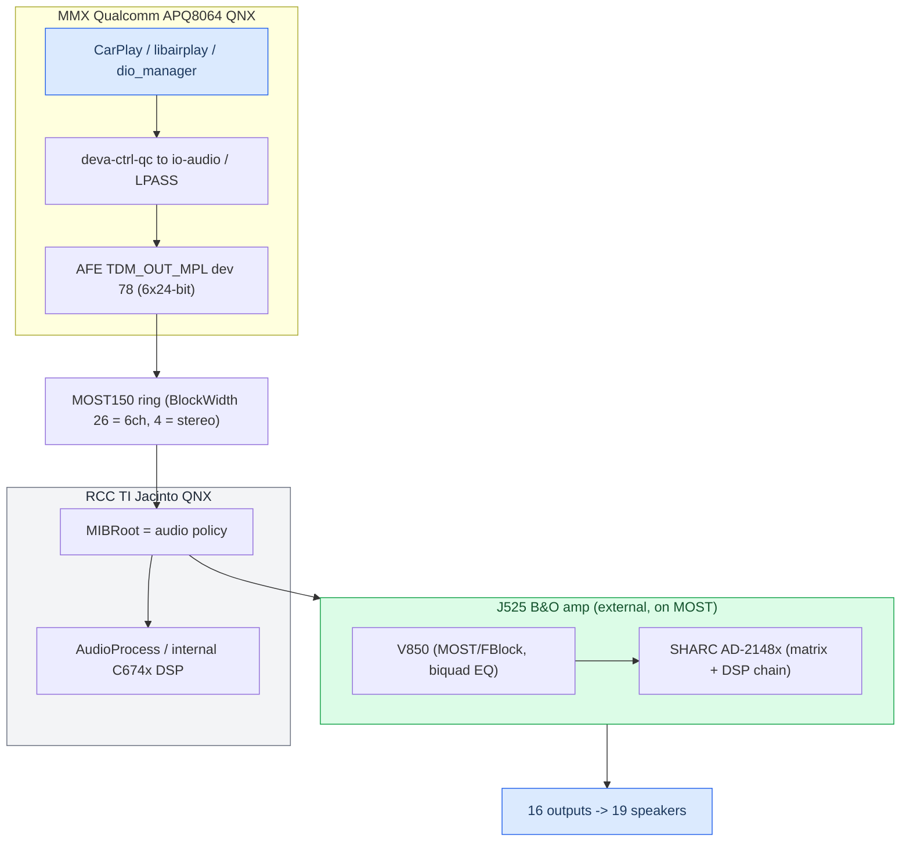
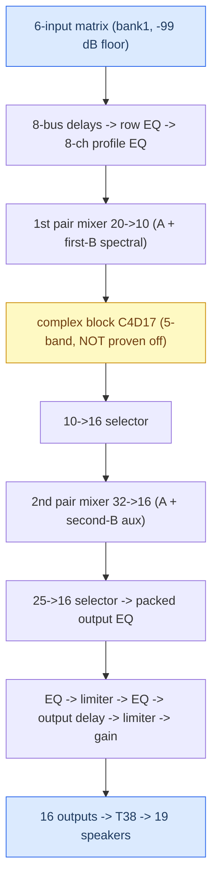

# Virtual Cabin and Amp RE

*Reverse-engineering the Audi B&O J525 amplifier, why getting six discrete channels to it was so hard, the SHARC DSP chain, and what the "Virtual Cabin" actually is.*

---

## 🎯 What the Virtual Cabin is

The Audi B&O amplifier (part `8W0035465`, the "J525") is a **complete 5.1 processor**: it takes six logical inputs `L R C LFE Ls Rs`, runs them through an input matrix and a deep per-driver DSP/EQ/crossover chain, and fans them out to 16 amplified circuits driving 19 speakers. **The "Virtual Cabin" is our decision to let the amp be the renderer** — the hook only delivers the *right six PCM channels* in Apple order and declares them correctly. The amp derives the centre, manages the sub, crosses over every driver, and spatializes. We do not re-implement any of that on the head unit.

For the stereo content that is most of what people play, the [[HSSR Model|HSSR upmix]] synthesizes the six channels the Virtual Cabin then renders. The discrete path is in [[Discrete 5.1 Routing]].

> **Honesty.** The amp DSP model is **[model]** — static RE of one firmware image (`CodeFlash_*.bin`, SHA-256 `8776fdb8…`). No live amp state was read back, no arithmetic is bit-exact, no cabin SPL is modelled. Getting six channels *to* the amp is **[car]**-confirmed. Provenance: `docs/research/VIRTUAL_CABIN.md`.

## ⚙️ The machine — two SoCs and an amp

The head unit is split across two processors, and that split is the root of the whole problem.

- **MMX = Qualcomm APQ8064 (QNX)** — the CarPlay/AirPlay stack, `dio_manager`, `libairplay.so`, `deva-ctrl-qc.so`, `io-audio`, LPASS (Hexagon aDSP). **Amplifier-agnostic**: nothing in MMX boot reads any amp coding.
- **RCC = TI Jacinto (DRA6xx, C674x DSP) (QNX)** — `MIBRoot` (the audio-policy owner), `AudioProcess`, and the *internal* amp's DSP. **All amplifier-specific routing policy lives here.**
- **J525 amp** (external, on the MOST ring) — a **V850** MOST/FBlock control processor + an **ADSP-2148x SHARC** audio DSP. The B&O box.

The two framings ("MMX sends 6×24" vs "the RCC link is 2- or 8-slot") sit on opposite sides of two INICs, which reframe; the only quantity that crosses end-to-end is the MOST synchronous **BlockWidth** (26 bytes for the six-channel source).

## 🔧 The single-byte routing decision

MIBRoot resolves a route through a two-table mapper keyed on **one byte**. CarPlay media = connection 162 (`CL_ENT_AMP_DIO_MEDIA`) → resource `0x78`. The only selector is `g_externalAmplifierCoded`, written from DSI prop `Amp.Amplifier.ExternalAmplifierCoded`, computed from **E2P record 0xF1, byte +0x0B (`Sound_System`)**: `==2` → external, else internal.

| ExternalAmplifierCoded | source | sink | width |
|---|---|---|---|
| 1 (external, B&O/Bose) | `eSRC_ENT_AMP_DIO_MEDIA_MC` (0x46f) | `eSNK_DTCP51` (2) | **26 B = 6ch** |
| 0 (internal amp) | `eSRC_ENT_AMP_DIO_MEDIA` (0x46e) | `eSNK_SPEAKERS` (1) | **4 B = stereo** |

There is no channel-count negotiation and no capability check — one byte picks a static `{source, sink}` pair. Read/flip it from a shell: `on -f rcc /usr/apps/modifyE2P r fc 1` → `02`=external, `01`=internal.

**The finding that shapes the product: the internal (non-B&O) amp has no native 6-channel CarPlay route.** The internal media source is BlockWidth 4 (stereo); `eSNK_SPEAKERS_MC` is a **dead alias** in none of the 143 resource records. So on an internal-amp car a PCM6 stream is **front L/R only**. The safe policy is to gate `AUDIO_SPATIAL` on E2P 0xFC — `AUDIO_STEREO_UPMIX=off` alone is not enough, the bypass still rides the 6-voice path. A real internal 6-channel path is feasible but needs RCC-side flashing — planned, not built. See [[Landmines]].

## 📊 Why six channels was hard — two independent fixes

Getting six channels to the amp took two months because the head unit silently collapsed to stereo through **two independent mechanisms**, each masquerading as a fault downstream. Both are fixed on the Qualcomm side and **[car]**-confirmed.

| # | Layer | The bug | The fix |
|---|---|---|---|
| 1 | Qualcomm CSD | `mpl5` shipped `min_voices=2`; `deva_update_session_info_from_list` copies the record's **minimum** into the active session at route-attach (14 s before the PCM channel exists), so CSD advances `0x4800`/tick while submitting `0x1800` — **tearing at 62.5 Hz** | mirror `mpl5`'s caps record field-for-field to `mpl1` (min/max voices = 6, fragsize `0x4800`); QSA inserts a channel conversion so stereo still opens |
| 2 | libairplay | `createMetadata` wrote a **stereo SAD header** (`asad=0xc0`) beside genuinely six-channel PCM, so the amp kept only L/R | interpose `createMetadata` to announce `asad=0xfc` / 6ch / 24-bit |

The full sequence and the mirror driver live in [[Discrete 5.1 Routing]]. **Ceiling: 6 is the max a byte can reach** (`deva_csd_start_csd_session_playback` hardcodes 6; no 8-channel output node), so CarPlay's 5.1.2 = 8 channels needs a mandatory **8→6 fold** on the hook side. Channel order is Apple canonical `L R C LFE Ls Rs`, no reorder.

## 🔍 Inside the amp — the SHARC DSP chain

> Everything here is **static RE + mathematical reconstruction** of one CodeFlash image. No live amp state; no bit-exact arithmetic; no cabin acoustics. **[model]**

**Extraction.** The V850 CodeFlash *embeds the complete ADSP-2148x SPI slave-boot stream* at file offset `0x041014`, length `0x27764` (161,636 B). `AD301A07`/`AD301B01` are V850-consumed parameter/tuning datasets, not the application. Bytes are bit-reversed on the SPI side; 560 boot blocks parse to exactly `+0x27764`.

**Biquad math.** The V850 filter designer uses an 8-byte design record `{u16 freq_selector, s16 gain_tenths_dB, u8 Q_code, u8 type, u16 reserved}`, with `K = cot(π·f/48000)`, `G = 10^(dB/20)`, and the convention **`Q = q_code/10` for peaks, `ζ = q_code/10` for 2nd-order LP/HP** (q_code 7 = Butterworth). Types include peak (1), LP/HP (2..25), **low shelf (26), high shelf (27)**, all-pass (28). A separate SHARC-internal designer implements RBJ cookbook filters for the "B" processor.

There are **two independent "B" processors**: a spectral **first-B** (74-band, ~1024-sample / 21.3 ms delay) injected at the first mixer, and a **second-B** fed only by aux inputs at the second mixer. Both default to conservative/identity behavior in the shipped banks; the complex block C4D17 is active-scheduled and **not proven off**.

## 📊 The input matrix

> **Correction that supersedes older notes:** the matrix orientation was transposed in earlier readings. The A07 RAM stores **rows = outputs, columns = inputs**. The old per-speaker summaries ("sub = LFE only", "centre no bass", "woofers sum L/Ls/C/LFE", "fb3 = −3 dB woofers") are **withdrawn**. Use the matrix below.

The V850 selects a signed-dB 8×8 table from `AD301A07` (profile 0, bank 1 for the CarPlay/DTCP51 sink) and writes 64 linear coefficients to the SHARC. Profile-0 / bank-1, input → bus, in dB:

| input | busL | busR | busC | busLFE | busLs | busRs | bus6 | bus7 |
|---|---|---|---|---|---|---|---|---|
| L | −2 | · | −6 | · | · | · | −3 (→Ls) | · |
| R | · | −2 | −6 | · | · | · | · | −3 (→Rs) |
| C | −8 | −8 | −3 | −10 | · | · | · | · |
| LFE | −8 | −8 | −10 | +3 | −14 | −14 | · | · |
| Ls | −3 | · | · | · | +6 | · | +9 | · |
| Rs | · | −3 | · | · | · | +6 | · | +9 |

(`·` = −99 dB floor: leakage, deliberately not an exact zero.) Structurally the amp **derives the centre** (C bus fed from L and R at −6 dB), gives **LFE its own +3 dB bus**, and routes Ls/Rs both directly and into dedicated effect buses (6/7). The **bus → physical-speaker binding and every per-driver crossover / EQ / gain / delay are inferred, not recovered.**

**The stereo↔5.1 mode switch.** The matrix bank also writes a float to SHARC control `0x10`: **bank 0 → 2.0, banks 1/2 → 5.0** — the strongest static evidence of a real stereo-vs-multichannel operating mode, but the image gives it no name, so it **cannot honestly be called "Symphoria."** For the CarPlay sink `0x26`, both `asad=0xc0` and `0xfc` map to raw bank 1, so ASAD does *not* switch it stereo↔5.1 there. Adopted policy: one fixed PCM6/48k/S16 stream with `asad=0xfc` for the whole session.

## 🔧 What the amp does for us, and the matrix in our code

"Virtual Cabin" = feed the amp six correct PCM channels and let it be the renderer. The amp handles:

- **Centre**, derived from L+R — so the hook writes **digital C = 0** on purpose.
- **Bass management** — LFE has its own +3 dB bus; the sub is fed from it. A stereo-as-5.1 stream with LFE = 0 gives a silent sub, which is exactly why `AUDIO_STEREO_LFE=assist` is the only sub lever the hook has.
- **Crossovers, per-driver EQ, spatial buses, and the 19-speaker fan-out.**

**The matrix inside the hook is a *guard*, not acoustics.** `hook/audio/stereo_upmix.c` embeds `kInputMatrix[6][8]` — the profile-0/bank-1 matrix converted to linear, transposed so rows are inputs. Its **only** purpose is the S16 cabin guard `spa_upmix_cabin_guard_s16`, which predicts each logical bus peak so no bus exceeds `kCabinSampleLimit = 32275` (0.985 FS). The largest column norm is **3.53**, so the hot-path early-out is: if `peak · 3.53 ≤ limit`, nothing can clip — return before touching the matrix. On overload it repairs via LFE only first, then linked-scales all six channels. The header states it explicitly: **this is a downstream peak-detection model, not an acoustic model or an EQ inverse.**

## 🔐 The speakers and the mode ceiling

PR 9VS "B&O 3D Advanced" = **19 loudspeakers on 16 amplified T38 circuits**, proven from the Audi current-flow diagram + J525 connector page. Some outputs drive two drivers (door treble+bass share a circuit; rear = 6 drivers on 4 outputs); the R211 subwoofer occupies two output pairs. **5.1.2 height is impossible on this amp** (no height codes; input positions 7/8 = BCL/BCR), so the 8→6 fold is mandatory — see [[Dolby Atmos]]. External mic-sweep passbands are amateur observations, **not** Audi filter coefficients, and must not be fit as EQ.

## ⚠️ Where it stands

**CONFIRMED on car:** discrete 5.1 CarPlay end to end (2026-09-06); the two closing fixes (deva caps-mirror, SAD `asad=0xfc`/24-bit) plus restored `updateFeedback` clock reference.

**Blocked / modelled / not done:**

- **Phone-side spatial over realtime CarPlay** — refused live; phone-side gate, lever exhausted. See [[Dolby Atmos]]. **[car]**
- **Non-B&O internal 6ch** — no route exists; feasible via RCC flashing but untested for lack of an internal-amp car. **[open]**
- **The amp DSP model is static RE** — no live bank/profile/mode/limiter/gain readback; the complex block C4D17 is not proven off; bus→speaker binding, per-driver EQ, and "3D OFF = level 0" are inferences; nothing is bit-exact. **[model]**
- **HSSR upmix quality** — a formal stationary-vehicle A/B is still outstanding. **[open]**

Code: `hook/audio/stereo_upmix.{c,h}`. Amp RE: `docs/SOUNDAMP_FULL_DSP_MODEL.md`, `docs/SHARC_INPUT_OUTPUT_MATRIX.md`, `docs/AMP_STEREO_5_1_MATRIX_DIFF.md`.
