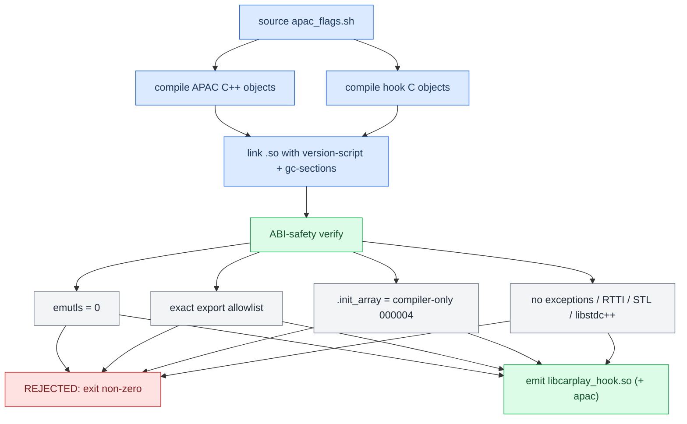

# Build System

*How source becomes shipped binaries: one Docker QNX toolchain, a shared compile+verify core, and a set of ABI-safety asserts that reject a bad `.so` before it can reach a car.*

---

## 🔧 The toolchain

Everything cross-compiles inside one Docker image, **`qnx65-armv7-toolchain`** (from `Tools/qnx-65-sdp-docker`, GCC 4.9.4). It replaces the old VM-over-SSH recipe — no VM is needed. Build it once:

```sh
docker build --platform=linux/amd64 -t qnx65-armv7-toolchain Tools/qnx-65-sdp-docker
```

`QNX_TOOLCHAIN_VARIANT` selects the image tag: `latest` (default), `4.9`, or `8.5` (GCC 8.5). The renderers pin `:latest`; the hook lets the caller choose.

The BSP client libraries (`libscreen`, `libEGL`, `libGLESv2`, `libOmxCore`) export their API **only on the unit** — the generic SDP lacks them. The renderer build synthesizes **import stubs** (correct symbol names, empty bodies, correct SONAME) so the link resolves, and uses `--allow-shlib-undefined` to defer each BSP lib's own transitive deps to the unit at runtime.

## ⚙️ What each script builds

| Script | Input | Output | Notes |
|---|---|---|---|
| `scripts/build_hook.sh` | `hook/`, `apac_decoder/` | `build/unprotected/libcarplay_hook.so` (+ `libcarplay_apac.so`) | Unprotected only. Thin wrapper: sets `OUTDIR_REL=build/unprotected`, calls the shared core. |
| `scripts/build_hook_protected.sh` | same | `build/protected_<VIN>/` (stamped) | Shares the same core; see [[VIN Protection]]. |
| `scripts/build_hook_common.sh` | — | — | The one shared compile+verify core, sourced by both hook scripts. |
| `scripts/build_java.sh` | `java_patch/` + `java_resources/` | `build/carplay_hook.jar` | Foundation 1.1 / target 1.4. |
| `scripts/build_renderers.sh` | `maneuver_render/`, `altscreen_render/` | `build/maneuver_render`, `build/altscreen_render` | `grid` arg = `-DCR_DEBUG_GRID` on the maneuver scene. |
| `scripts/apac_flags.sh` | — | — | Single-source APAC compiler flags, sourced by the hook build and the bench. |

## 🔧 The hook build and its verify

`build_hook_common.sh` holds **one** copy of the compile and the ABI-safety verify on purpose: the protected `.so` must clear the very same gates as the shipping one, so a forked second verify could drift and ship a bricked binary. Protection is a compile-time concern (`#ifdef CARPLAY_PROT`), so it is a shared core, not a wrapper over a finished `.so`.

The APAC decoder ships as an **optional** `libcarplay_apac.so`, `dlopen`'d only for a buffered Spatial stream — the hook has no `DT_NEEDED` edge to it. It is C++ with a C seam, linked with GCC (not G++) so `libstdc++.so.6` never lands in `DT_NEEDED` (that library is not on the unit's image).



### The ABI-safety asserts

Each assert exists because its violation crashes or fails to load on the QNX 6.5 unit. Any failing check aborts the build with `REJECTED:`.

| Assert | Why it matters |
|---|---|
| `emutls = 0` | `__thread` on GCC/QNX 6.5 ARMv7 emits emulated TLS whose resolver crashes host threads created before our `LD_PRELOAD`. See [[Landmines]]. |
| No `__cxa_throw` / `_ZTI` / `_ZTV` | No exceptions or RTTI reached the link. |
| No `_Znw` / `_ZdlPv` / `__cxa_guard` / `_ZSt` | Nothing from the C++ runtime, STL, or static-init guards. |
| No `libstdc++` in `DT_NEEDED` | The unit's image does not carry it. |
| No `libcarplay_apac` in `DT_NEEDED` | The codec must stay `dlopen`-only, not a hard dependency. |
| Exact export allowlist | The `LD_PRELOAD` ABI is an exact interpose set: hidden-by-default compile + a version script, diffed against `carplay_hook.exports.map`. Quiet builds drop the two trace-only HID seams; trace builds must expose them. |
| `.init_array` size `000004` | Compiler-only. Eager module constructors used to reach `pthread_create` under the QNX loader lock, making cold-start depend on scheduler timing — a deadlock hazard. No `*_module_(init\|fini)` symbols allowed. |

<details>
<summary>Build flags (all `env=value` before the command)</summary>

| Flag | Default | Effect |
|---|---|---|
| `HOOK_AUDIO` | `1` | `0` = compile-time removal of the type-103 audio path (no QSA/AirPlay audio interposers, no `probe103`/`mainBuffered`); `libcarplay_apac.so` is not built or shipped. `AUDIO_SPATIAL=0` only disables 103 at runtime; `HOOK_AUDIO=0` takes it out of the binary. |
| `LOG` | `1` | `1` = logging compiled in; `0` = pre-prod, logging + captures + altScreen diagnostics compiled out entirely. |
| `AUDIO_STATE_TRACE` | `0` | `1` = compact lifecycle trace (adds the two trace HID seams; markers verified post-build). |
| `ALTSCREEN_PACE_TRACE` | `0` | `1` = stream-111 pacing trace (markers verified post-build). |
| `LOG_RGD_PACKET_RAW` | `0` | `1` = raw RGD packet logging (requires `LOG=1`). |
| `QNX_TOOLCHAIN_VARIANT` | `latest` | `8.5` selects the GCC 8.5 image. |

Note: the hook log threshold is **WARN** at runtime — `LOG_INFO` never reaches `/tmp/carplay_hook.log` unless you `touch /mnt/app/carplay_verbose`. Any instrumentation you want to read back from the car must be `LOG_WARN`. See [[Landmines]].

</details>

---

## ☕ The Java build

`build_java.sh` compiles `java_patch/` against `MU1316-final.jar` + OSGi with `-source 1.4 -target 1.4`. The runtime is IBM J9 **Foundation Profile 1.1** (~J2SE 1.4, `jclfoun11`), so bytecode is major 48 and there are no generics/enums/enhanced-for/autoboxing. `-target 1.4` matters: `"a"+b` compiles to `StringBuffer`, not `StringBuilder`, which the runtime lacks.

Trap: a 1.4 target against a JDK8 `rt.jar` does **not** limit the API surface — a 1.5 method compiles then throws `NoSuchMethodError` on-unit. The build also injects a reproducible build identity into a generated `CarPlayApp.java` copy (never editing the source tree) and writes a SHA-256 receipt (`carplay_hook-build.json`).

## 🖥️ The renderers

`build_renderers.sh` builds `maneuver_render` and `altscreen_render`. The maneuver scene engine is C++11 compiled `-fno-exceptions -fno-rtti`, verified to pull in no C++ runtime symbols; the top-level binaries are C. Both are verified as ARM ELF with `emutls = 0`. `maneuver_render` needs `GRAPHICS_ROOT=/proc/boot` at runtime (Adreno `libEGL` reads it via `getenv`); `altscreen_render` (OMX + Screen, no EGL) does not. See [[Landmines]].

## ⚡ Determinism note

`apac_flags.sh` is the single definition of how the APAC decoder is compiled, sourced by both the shipping build and the benchmark — a drifted copy would let the bench report headroom for a binary nobody ships. `-fno-threadsafe-statics` avoids `__cxa_guard_acquire` (absent in this libstdc++ config); `-D_NO_CPP_INLINES` keeps the QNX headers from pulling C++ inlines. Floating-point builds elsewhere use `-ffp-contract=off` to keep results reproducible across machines.

Provenance: `scripts/build_hook.sh`, `scripts/build_hook_common.sh`, `scripts/build_java.sh`, `scripts/build_renderers.sh`, `scripts/apac_flags.sh`.
