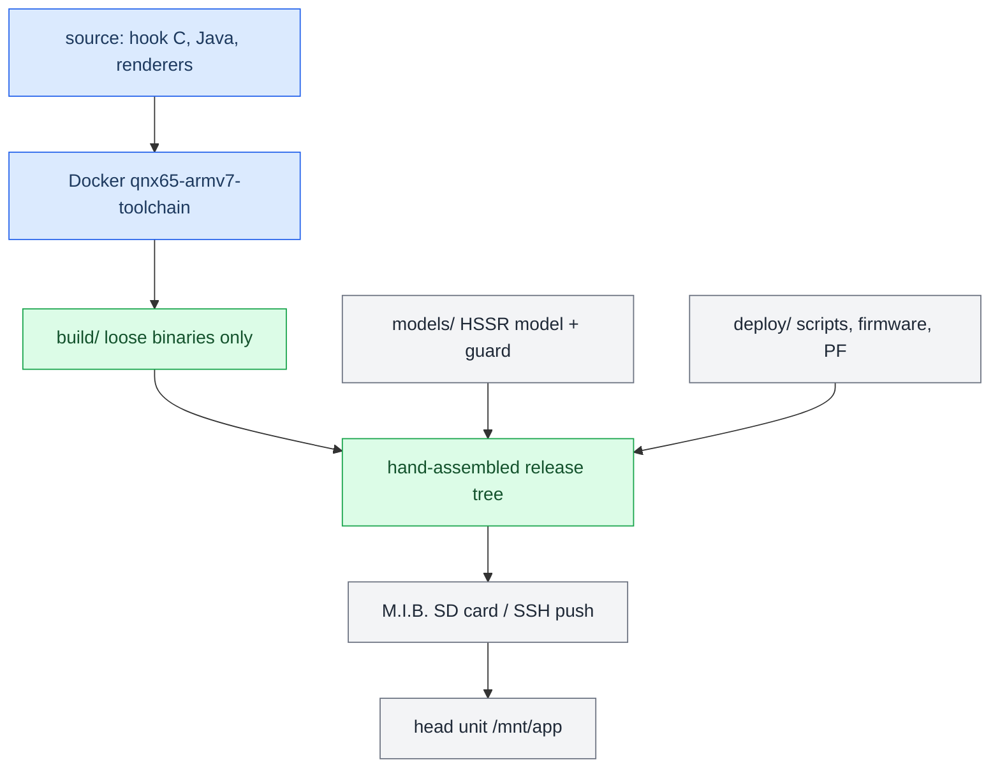

# Build and Deploy MOC

*Map of content for turning source into shipped binaries, assembling a release by hand, VIN-locking it, and getting it onto the head unit without bricking anything.*

---

## 📋 What this section covers

There is **no packaging script**. The build scripts do one job: compile source into loose binaries under `build/`. A release is then assembled **by hand** from three source folders — `build/` (compiled outputs), `models/` (the AI upmix models), and `deploy/` (scripts, patched firmware, PF profiles) — following a fixed source→on-unit map. That staged tree ships on an M.I.B. SD card and is installed by `custom.sh`, or pushed over SSH.

This MOC is the entry point. Start with [[Build System]] for how the Docker QNX toolchain produces the `.so` / renderers / jar, then [[Deploy and Release]] for hand-assembly and getting it onto the car, [[VIN Protection]] for locking a build to one VIN, and [[RE Artifacts]] for where the reverse-engineering assets live. For the hub note and the trap list see [[Home]] and [[Landmines]].

## 📊 Source to unit at a glance

## 🔗 The notes

| Note | What it covers |
|---|---|
| [[Build System]] | The Docker `qnx65-armv7-toolchain`; `build_hook.sh` and the shared compile+verify core; the ABI-safety asserts (emutls, export allowlist, `.init_array`, no libstdc++); Java, renderers, and the single-source APAC flags. |
| [[Deploy and Release]] | Builds emit binaries only; hand-assembling from `build/` + `models/` + `deploy/`; the source→on-unit map; M.I.B. SD install via `custom.sh`; SSH deploy and its traps; never reboot the unit / jar deploy = full reboot. |
| [[VIN Protection]] | The protector: VIN-lock via KDF + blind sentinel, compile-time gate (`#ifdef CARPLAY_PROT`, inert unstamped), the two-step protected build, per-build `PROT_SECRET`, fail-open honest ceiling. |
| [[RE Artifacts]] | Where the reverse-engineering assets now live: `assets/soundamp` (SHARC/amp RE) and `assets/vc-fonts` (VC font extraction) — what each is and its provenance. |

## 💡 The one thing to remember

Deploying files is fine; **restarting the unit is not** — the user is usually in the car, and a jar redeploy takes the whole system down for ~50 s. Copy, report what is staged, and stop. See [[Deploy and Release]] and [[Landmines]].

Provenance lives in `docs/RELEASE_ARTIFACTS.md`, `docs/PROTECTOR.md`, `docs/DEPLOYMENT.md`, and the `scripts/build_*.sh` set.
