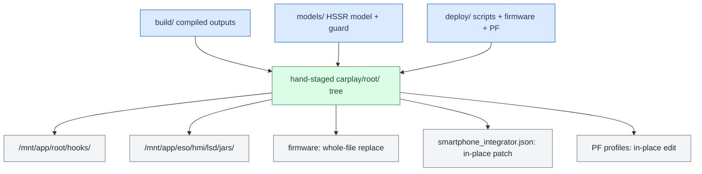

# Deploy and Release

*The build scripts emit loose binaries; a release is assembled by hand from three folders, staged on an M.I.B. card or over SSH, and installed without ever rebooting the car unasked.*

---

## 📦 Builds emit binaries, not releases

There is no packaging script anymore. Each build script drops its outputs into `build/`, and a release is assembled **by hand** from three source folders:

- **`build/`** — the compiled outputs (`libcarplay_hook.so`, `libcarplay_apac.so`, `maneuver_render`, `altscreen_render`, `carplay_hook.jar`).
- **`models/`** — the HSSR AI models (`hssr_model.bin`, `hssr_guard.bin`).
- **`deploy/`** — startup scripts, the patched firmware (`smartphone_integrator`, `deva-ctrl-qc.so`), and the PF profiles.

`custom.sh` installs a manually-staged tree; the source→on-unit map below is what the retired `package_mib.py` used to encode.



## 🔗 The artifact map

The on-unit column is the path under `/` (custom.sh copies `carplay/root/` onto `/`).

| File | Source in the repo | On-unit path |
|---|---|---|
| `libcarplay_hook.so` | `build/unprotected/` (or `build/protected_<VIN>/`, stamped) | `/mnt/app/root/hooks/` |
| `libcarplay_apac.so` | `build/unprotected/` (or `build/protected_<VIN>/`); omitted for a `HOOK_AUDIO=0` build | `/mnt/app/root/hooks/` |
| `maneuver_render` | `build/` (`build_renderers.sh`) | `/mnt/app/root/hooks/` |
| `altscreen_render` | `build/` (`build_renderers.sh`) | `/mnt/app/root/hooks/` |
| `carplay_hook.jar` | `build/` (`build_java.sh`) | `/mnt/app/eso/hmi/lsd/jars/` |
| `hssr_model.bin` | `models/hssr-q6d-moises-a/` (main control model) | `/mnt/app/root/hooks/` |
| `hssr_guard.bin` | `models/hssr-selection-v11/` (V11 vocal guard) | `/mnt/app/root/hooks/` |
| `flag_atlas.rgba` | `maneuver_render/resources/` | `/mnt/app/root/hooks/` |
| `carplay_*.sh` (startup/monitor/processes/cleanup) | `deploy/smartphone_integrator/` | `/mnt/app/root/hooks/` |
| `smartphone_integrator` | `deploy/smartphone_integrator/` | `/mnt/app/eso/bin/apps/` (whole-file replace) |
| `deva-ctrl-qc.so` | `deploy/deva-ctrl-qc/deva-ctrl-qc.so.patched` (renamed) | `/mnt/app/armle/lib/dll/` (whole-file replace) |
| `carplay_child.json` | `deploy/smartphone_integrator/` | installer resource; custom.sh splices only `children.carplay` into the SI JSON |

The firmware whole-file replacements are gated on exact SHA-256 identities (final MU1316 images only); unknown versions stop before writing, and originals are backed up as `*.carplay-stock`. **PF firewall:** no patch file is installed — custom.sh makes its own scoped in-shell edit opening TCP `6030:6032` across all four stock profiles (`pf.conf`, `pf.ecm0.conf`, `pf.mlan0.conf`, `pf.ppp0.conf`), so it needs no `patch`/`sed`/Python on the HU. See [[Landmines]] for the per-interface PF trap.

## 💾 The M.I.B. SD install

Copy the contents of `install_MoreIncredibleBash/` over the M.I.B. SD root, then put the release artifacts in `/build/` on the card:

```text
SD1/
  mod/custom.sh
  build/            the files from the artifact map above
```

Install via **GEM → M.I.B. → Advanced Settings → Run Custom Script** (`mod/custom.sh`) with CarPlay disconnected. It remounts `/mnt/app` + `/mnt/system` rw, lays `carplay/root/` onto `/` (atomic rename per file), patches `smartphone_integrator.json` (replaces the `"carplay"` child) and the PF profiles, then `sync`. **Uninstall:** copy `uninstall_MoreIncredibleBash/` over the card instead — it restores every `*.carplay-stock` and removes the files we own; it needs no build files. Both leave the reboot to the owner.

`carplay_child.json` MUST sit in `mod/carplay/` next to `root/`, or the JSON patch is silently skipped and the hook never loads.

## 🌐 SSH deploy and its traps

`scripts/deploy_over_ssh.sh [root@host] [install|check|uninstall]` selects the matching script and uploads only the necessary files. The unit (`root@10.173.189.1`, or `10.173.189.x` variants) has a bare QNX environment — the naive copy breaks four ways:

| Trap | Fix |
|---|---|
| No remote `scp` binary (QNX has none) | Push via `ssh host 'cat > /path/file.new' < local`, then `chmod` + `mv` + `sync`. `scripts/deploy_unit.sh` works because it uses SFTP-mode plain `scp`. |
| sshd rate-limits repeated password auth | One multiplexed master (`ControlMaster=auto`, short `ControlPath` under 104 bytes), reuse it; first call via `sshpass`, the rest plain `ssh`. |
| `ssh` inside `while read` eats the loop's stdin | Always `ssh -n` (or `< /dev/null`) when looping. |
| zsh does not word-split unquoted `$OPTS` | Put deploy snippets in a `#!/bin/bash` script, not inline. |

The login banner prints on STDOUT even for `ssh host cmd`, so binary read-back must emit a marker (`echo __BEGIN__; cat f`) and strip up to it. There is no `scp`/`tar`/`cksum`/`sha256sum`/`base64` on the unit — the only end-to-end check is reading a file back and `cmp`-ing it locally. `/mnt/app` is read-only until `mount -uw /mnt/app`; `/tmp` maps to `/dev/shmem`, which cannot hold directories.

## ⚠️ Never reboot the unit unasked

This is a hard rule, not a preference — the user is usually sitting in the car.

- **Deploying files is fine; restarting is not.** Copy the artifacts, report what is staged, say plainly it needs a restart to take effect, then **stop and wait**. Approval to deploy is not approval to reboot, and approval once is not approval next time.
- **The C hook** (`libcarplay_hook.so`) only needs `dio_manager` killed — per-fork, invisible to the user.
- **The jar is different.** `carplay_hook.jar` lives on j9's `-Xbootclasspath`, so it does nothing until the JVM restarts. Killing j9 is treated as a critical-process death and **restarts the whole system** (~50 s): SSH drops, the screen goes black mid-drive. Always warn before killing j9. See [[Landmines]].

Installs are atomic per file (same-partition rename), not a transaction across both flash partitions; a manual reboot activates the release. Deep detail: `install_MoreIncredibleBash/README_CARPLAY.md`.

Provenance: `docs/RELEASE_ARTIFACTS.md`, `docs/DEPLOYMENT.md`, `deploy/smartphone_integrator/README.md`.
