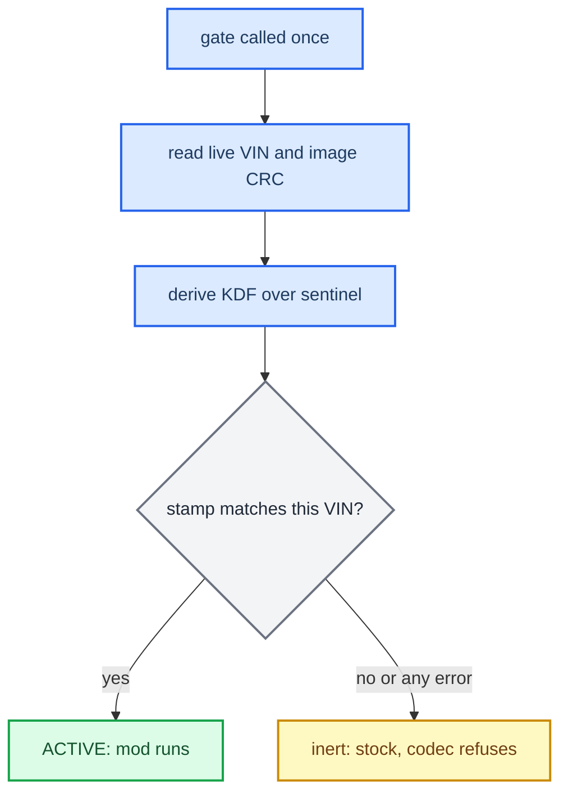

# VIN Protection

*How a CarPlay build is bound to one car. On the target VIN the mod runs; on any other VIN the hook goes inert and the codec fails closed. It uses a compile-time gate plus a post-build stamp, and the ceiling on what it can protect is stated below.*

---

## 🔐 What it does

The protector binds a build to a single VIN. On the target VIN the mod is active. On any other VIN the hook stays **inert**, so stock CarPlay runs, and the APAC codec **fails closed**. The VIN is read live on the unit, the two native `.so` files are stamped at build time, and **no plaintext VIN appears in the artifacts**.

- Both `.so` files (`libcarplay_hook.so`, `libcarplay_apac.so`) carry a small VIN gate and a stamped slot.
- On first use, the gate reads the **live VIN** from the MMX persistence store and checksums the `.so`'s own image on disk. The store is `/mnt/persist/var/fw/persistence.sqlite`, with `/var/fw/persistence.sqlite` as a fallback (`protector/prot_vin.c:89-90`). The gate reads the `/core/vin` and `/core/registeredVin` records; if both are present they must agree (`prot_vin.c:94-96`).
- The stamp is `KDF(secret, VIN, CRC)` over a blind sentinel. It verifies **only** when the unit's live VIN matches the VIN baked in at build time, and only if the `.so` has not been patched.
- **Fail-open:** any error (no VIN, disagreeing VINs, an unreadable image, an unstamped `.so`) leaves the unit inert and stock. It never bricks the unit (`protector/carplay_prot.h:8-12`).

## 🔐 The gate at runtime

The gate is compiled in only with `#ifdef CARPLAY_PROT`, so builds without it carry no gate code. It sits at one choke point in each `.so`:

- In the hook, `init_modules_once()` registers no modules if the gate fails (`hook/framework/hook_framework.c:133-138`).
- In the codec, the API entry refuses with `SPA_APAC_ERR_ARGS` (`hook/audio/apac_bridge.cpp:205-210`).

A `CARPLAY_PROT` `.so` that was never stamped is inert on **every** car.



## 🔧 Building a protected build

You give the VIN before the build starts. The script compiles and then stamps, in two steps.

```bash
./scripts/build_hook_protected.sh <VIN>                      # stamped -> build/protected_<VIN>/
HOOK_AUDIO=0 LOG=0 ./scripts/build_hook_protected.sh <VIN>   # beta: no audio, no logs
PROT_VIN=<VIN> ./scripts/build_hook_protected.sh             # VIN from the environment instead
```

1. **Compile and link.** The shared `build_hook_common.sh` core runs with `PROT_BUILD=1`. It compiles the three protector objects (`prot_rt`, `prot_vin`, `carplay_prot`) as plain C with `-fvisibility=hidden` and no constructor, so there are no new dynamic exports and `.init_array` holds only the compiler's entry. Those objects are linked into both `.so` files, and each file gets its own PROT slot. The hook and APAC sources are built with `-DCARPLAY_PROT` (`build_hook_common.sh:111-122`).
2. **Stamp.** Each compiled `.so` in `build/protected_<VIN>/` is stamped in place with `protector/protect.py --vin <VIN> --mode blind` (`build_hook_protected.sh:46-53`). This step binds the files to the VIN; without it they are inert.

`build_hook_protected.sh` and `build_hook.sh` share one compile+verify core, so the protected `.so` passes exactly the same ABI-safety gates ([[Build System]]) and cannot drift from the shipping one. The protected build writes **binaries only**, to `build/protected_<VIN>/`. You then assemble the install tree by hand from those files plus the runtime assets, following the map in [[Deploy and Release]]; the only difference from an unprotected release is that the two `.so` files come from `build/protected_<VIN>/`.

Default builds (`build_hook.sh`) never define `CARPLAY_PROT`, so protection is opt-in and they carry no gate code. `QNX_TOOLCHAIN_VARIANT=4.9` works here too. `AUDIO_SPATIAL` is not a build flag: it is a runtime variable in `carplay_startup.sh` (currently `1`, `deploy/smartphone_integrator/carplay_startup.sh:60`) that only matters when `HOOK_AUDIO=1`.

A `HOOK_AUDIO=0 … build_hook_protected.sh <VIN>` build yields `libcarplay_hook.so` only; the verify asserts 0 QSA exports. The stamp loop stamps whichever of the two `.so` files exist (`build_hook_protected.sh:48-53`). Superseded: `PROTECTOR.md` tells you to `rm` a stale `libcarplay_apac.so` from the output directory before such a build; the shared core now deletes it itself (`scripts/build_hook_common.sh:279`), so a stale codec can no longer be stamped and shipped. **[code]**

### The two protection inputs

| Input | Default | Effect |
|---|---|---|
| VIN (argument 1, or `PROT_VIN`) | — | The 17-character target VIN. Without it the script prints usage and exits 2; the wrong length exits 1 (`build_hook_protected.sh:22-24`). |
| `PROT_SECRET` | — | Optional. **If it is unset, the script generates a fresh random secret for this build and does not keep it** (`:33-37`). The same value feeds both the runtime and the stamp, so a one-off build is self-consistent. Set it explicitly, and keep it out of the tree, only when you want one stable fleet secret across rebuilds. |

## ⚠️ Honest ceiling

This protects against cloning and casual patching. It is not cryptographic secrecy.

- The secret is compiled into the runtime image, so a rooted attacker who runs a provisioned image once can extract the derived key.
- `/mnt/persist` is writable, so the VIN records can be edited, but editing them only produces inert stock behaviour, never the mod.
- A real barrier needs a secret kept **off the box**, such as TrustZone or secure storage, or a server challenge. The code stays the same; only the source of the secret changes.
- **OPSEC:** never describe the mechanism in files that ship on the SD card. Any marker left on the card should stay neutral: VIN, date and an install hint only. No script writes a `PROTECTED.txt` any more, and the old `.gitignore` entry for it is gone too. **[code]**
- `PROT_SECRET`, when pinned, is a CI or provisioning secret: keep it out of the repo and reuse the same one across a fleet.

## 🔧 Protecting another artifact

The same three pieces bind any other `.so` or binary; `protector/carplay_prot.{c,h}` is the simplest wiring, and `protector/README.md` has the API. At a high level:

1. **One slot per artifact**, defined once with `PROT_DEFINE_SLOT()`, plus a one-call gate like `carplay_prot_active(self_path)` that arms once against the live VIN and the artifact's own image.
2. **Gate one choke point**, falling open to stock: if the gate says no, return before the feature does anything.
3. **Compile the protector objects into the artifact** as plain C with `-fvisibility=hidden` and no constructor, so no new dynamic exports appear and a strict `.init_array` audit stays green.
4. **Stamp the built file** for the VIN with `protector/protect.py --vin <VIN> --mode blind`; for a standalone app `protector/build.sh <VIN> <out>` compiles and stamps in one step. Exact arguments: see `PROTECTOR.md` §5.

Trap: the runtime finds the slot by scanning the file, so nothing references it by symbol, and a `-fdata-sections` / `--gc-sections` link silently drops it. `carplay_prot.c` keeps it alive with a volatile self-read (`protector/carplay_prot.c:15-16`); any new slot owner must do the same. The VIN reader reads the MMX persistence store by default; a `-DPROT_TARGET_RCC` build reads the two RCC FEC copies instead (`protector/prot_vin.c:1-10`, `:68-71`). `protector/selftest.sh` demonstrates active vs inert behaviour on the host. **[code]**

## 🤔 How the design was chosen

Before anything was implemented, a 2026-09-17 handoff fixed the requirements and the threat model. The shipped protector is a simpler answer to it than the compiler-pass design discussed there.

**Owner's requirements then:** build per VIN; the VIN must take part in real computation, not a single `if (vin == expected)`; applied automatically at build time over the whole hook, keeping source formulas readable (transform in a temp dir or a compiler pass); replacing one VIN-read function must not be enough; a VIN-bound release must not run in the owner's QEMU even with substituted VIN and device ids; public constants (such as stream type `103`) may stay open, but knowing them must not reveal other protected values. The deva audio driver patch was explicitly out of scope, and coverage of `libcarplay_apac.so`, the jar and the renderers had to be stated separately, never implied.

**The constraint that must not be lost: a VIN is an identifier, not a secret, and not proof that the car is present.** If every derived value comes from one substitutable VIN source, returning the expected VIN reproduces all of them; inlining, salts and renaming do not change that. A helper copied to the RCC is not a trusted module either, since it can be replaced, and a hash check on it can be patched. So the handoff separated two outcomes: making analysis and patch transfer harder, and a binding that known data cannot satisfy. The second needs a real root of trust (an HSM, secure element, TEE or non-exportable key on RCC/MMX), and **none was confirmed**; strings about component protection or a crypto library are not evidence of one. It also rejected a shared XOR mask outright, because one known plaintext value would reveal the mask for every value using it (details: see source), and required that a wrong VIN never turn into random filter coefficients, sizes, indices or pointers, which is why the shipped gate fails **open to stock** instead of decoding garbage. That reasoning is the "Honest ceiling" above.

**VIN sources that were examined** (static analysis, none read live from the MMX in that study):

| Source | Finding |
|---|---|
| FEC container in three MU1316 dump copies (`FEC/FecContainer.fec`, its backup, the RCC `efs-persist` copy) | 243 bytes, VIN as 17 bytes inside a fixed field; readable from a dump, so it does not attest the current car |
| `/dev/shmem/VIN.txt` on the RCC | written by `MIBRoot` from the bus (path strings and a VIN handler found); freshness, reset on bus loss and publish timing unverified |
| Stock Java `DSICarVehicleStates.ATTR_VINDATA`, `updateVINData(String, int)` | the callback exists; its status semantics and freshness were not reconstructed |
| From the MMX via Qnet: `/net/rcc/dev/shmem/VIN.txt`, `/net/rcc/mnt/efs-persist/FEC/FecContainer.fec` | Qnet forwards messages to the RCC's resource managers (`etc/qnet_hosts` has `rcc.mibhigh.net`, `mmx.mibhigh.net`; `startup.sh:367,378` already use `on -f rcc` and `/net/rcc/…`) |
| RCC CAN endpoints registered by `car` | `/dev/ipc/ipc8` signals (`0x11cec4`), `ipc9` PSD (`0x11ced8`), `ipc10` TP (`0x11cee8`), `ipc11` diagnosis (`0x11cef8`), `ipc12` status (`0x11cf08`); `MIBRoot` assembles the VIN at `0x374a1c` with a callback at `0x374cf0`; `eCPFuncVin` is a string, not a CAN id; subscription format unknown |

The shipped reader chose the MMX persistence store because the RCC FEC partition is not reachable from the MMX process. A validator bug found in a proposed C reader is worth remembering for any VIN parser: `strchr(allowed, 0)` matches the string terminator, so the original check accepted 17 NUL bytes or an embedded NUL; test `p[i] == 0` explicitly. A charset scan alone can also latch onto the `V` byte in front of the field and shift the result by one.

The handoff's QEMU negative scenarios still describe what "cannot run elsewhere" would have to mean: QEMU without the RCC device; QEMU with correct substituted VIN, serial and device paths; replay of a recorded real RCC answer; a replaced VIN reader or helper; removal of a single authorization check. Failing the first proves nothing about the others, and no instruction was found that distinguishes the real RCC/MMX from QEMU. The shipped protector does not claim to pass these; see the ceiling above. **[open]**

<details>
<summary>Verify a stamped .so locally</summary>

---

You can gate the compiled `.so` against a fake store and check three things: the right VIN gives `1`, a wrong VIN gives `0`, and no plaintext VIN leaked (`grep -c <VIN> <the .so>` gives `0`). This needs the same `PROT_SECRET` that the build used, so pin one for a build you intend to verify. The recipe, with `PROT_MMX_STORE` overriding the store path (`prot_vin.c:86-87`), is in `docs-obsidian/Sources/PROTECTOR.md` §6. `docs-obsidian/Sources/PROTECTOR.md` §5 covers adding the protector to a new artifact (slot, gate choke point, compile, stamp); the full API is in `protector/README.md`.

</details>

---

Provenance: `scripts/build_hook_protected.sh`, `scripts/build_hook_common.sh`, `protector/` (`carplay_prot.{c,h}`, `prot_vin.c`, `protect.py`, `build.sh`, `selftest.sh`, `README.md`).

---

## 📚 Sources

- [[Sources/PROTECTOR|PROTECTOR]]: how to build, stamp, install, verify and integrate a VIN-locked build.
- [[Sources/HANDOFF_VIN_PROTECTION|HANDOFF_VIN_PROTECTION]]: the 2026-09-17 requirements, threat model and VIN-source study that preceded the implementation (Russian).
- [[Sources/RELEASE_ARTIFACTS|RELEASE_ARTIFACTS]]: the protected-release staging difference.
