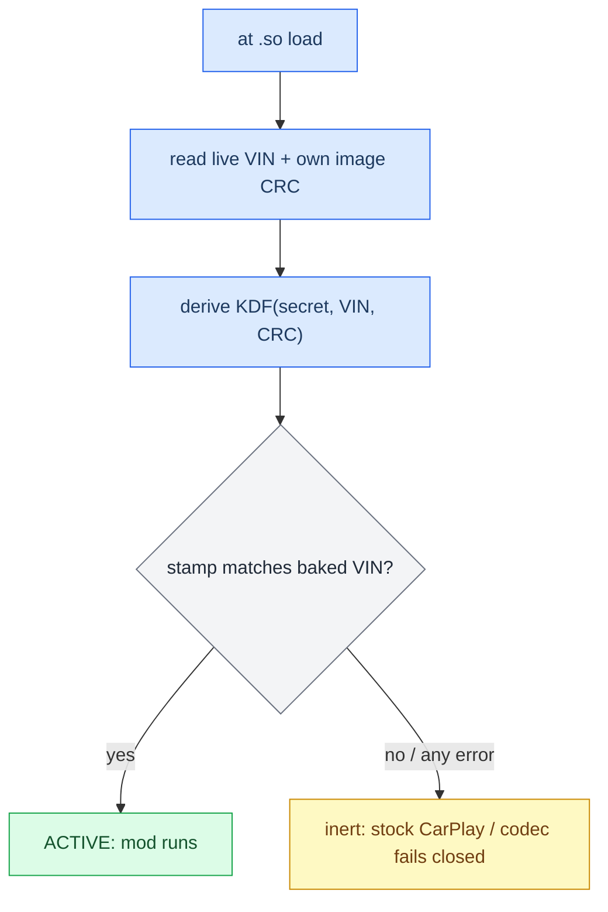

# VIN Protection

*Binding a CarPlay build to one car: on the target VIN the mod runs, on any other VIN the hook goes inert and the codec fails closed — a compile-time gate plus a post-build stamp, with an honest ceiling.*

---

## 🔐 What it does

The protector binds a build to a single VIN. On the target VIN the mod is active; on any other VIN the hook stays **inert** (stock CarPlay) and the APAC codec **fails closed**. The binding is read live on the unit and the two native `.so` are stamped at build time — **no plaintext VIN in the artifacts**.

- Two `.so` (`libcarplay_hook.so`, `libcarplay_apac.so`) each carry a small VIN gate plus a stamped slot.
- At load, the gate reads the **live VIN** from the MMX persistence store (`/var/fw/persistence.sqlite`: `/core/vin` + `/core/registeredVin`, quorum) and checksums the `.so`'s own on-disk image.
- The stamp is `KDF(secret, VIN, CRC)` over a blind sentinel — so it verifies **only** when the unit's live VIN equals the VIN baked at build, and only if the `.so` was not patched.
- **Fail-open:** any error (no or disagreeing VIN, unreadable image, unstamped) falls to inert/stock — never a brick.

## 🔐 The gate at runtime

The gate is a compile-time `#ifdef CARPLAY_PROT`. Default builds (no VIN) are byte-for-byte unchanged — protection is opt-in. An unstamped `CARPLAY_PROT` `.so` is inert on **every** car.



## 🔧 Building a protected build

The VIN is provided pre-build; stamping happens **inside** the build, in two steps.

```sh
./scripts/build_hook_protected.sh WAUZZZF45HA149423          # stamped -> build/protected_<VIN>/
HOOK_AUDIO=0 LOG=0 ./scripts/build_hook_protected.sh <VIN>   # beta: no audio, no logs
```

1. **Compile + link** via the shared `build_hook_common.sh` core (`PROT_BUILD=1`): the three protector objects (`prot_rt`, `prot_vin`, `carplay_prot`) are compiled pure C, `-fvisibility=hidden`, no constructor — so no new dynamic exports and `.init_array` stays compiler-only — and linked into both `.so`, each getting its own PROT slot. The gate TU builds with `-DCARPLAY_PROT`.
2. **Stamp** the compiled `.so` in place with `protector/protect.py --mode blind` — this is what binds them to the VIN. Unstamped, they are inert.

Because `build_hook_protected.sh` and `build_hook.sh` share the one compile+verify core, the protected `.so` clears the exact same ABI-safety gates ([[Build System]]) and can never drift from the shipping one. The protected build produces **binaries only** in `build/protected_<VIN>/`; assemble the install tree by hand from there plus the runtime assets, following the map in [[Deploy and Release]].

### The two protection flags

| Flag | Default | Effect |
|---|---|---|
| `PROT_VIN` (arg 1) | — | The 17-char target VIN. Setting it makes the build protected. Wrong length is rejected. |
| `PROT_SECRET` | — | Optional. **Unset ⇒ a fresh random secret is generated per build and thrown away** (the runtime value and the stamp are threaded from the same value, so a one-off build is self-consistent). Set it explicitly — kept OUT of the tree — only to pin one stable fleet secret across rebuilds. |

## ⚠️ Honest ceiling

This is **anti-clone / anti-casual-patch**, not cryptographic secrecy.

- `PROT_SECRET` is compiled into the runtime image, so a rooted attacker who runs a provisioned image once can extract the derived key.
- `/mnt/persist` is rw, so the VIN records are editable — but editing them yields inert/stock, never premium.
- A real wall needs an **off-box secret** (TrustZone / secure storage, or a server challenge). The code doesn't change, only where `secret` comes from.
- **OPSEC:** never describe the mechanism in files that ship on the SD. The `PROTECTED.txt` marker stays neutral (VIN, date, install hint only).

<details>
<summary>Verify a stamped .so locally</summary>

Gate the compiled `.so` against a fake store to confirm right-VIN → `1`, wrong-VIN → `0`, and that no plaintext VIN leaked (`grep -c <VIN> <the .so>` → `0`). The full recipe (fake `persistence.sqlite`, `PROT_MMX_STORE` override, the `carplay_prot_active()` test harness) is in `docs/PROTECTOR.md` §6. Integrating the protector into a new artifact (slot definition, gate choke point, compile, stamp) is §5; the deep API is `protector/README.md`.

</details>

---

Provenance: `docs/PROTECTOR.md`, `scripts/build_hook_protected.sh`, `scripts/build_hook_common.sh`, `protector/` (`carplay_prot.{c,h}`, `protect.py`, `README.md`).
