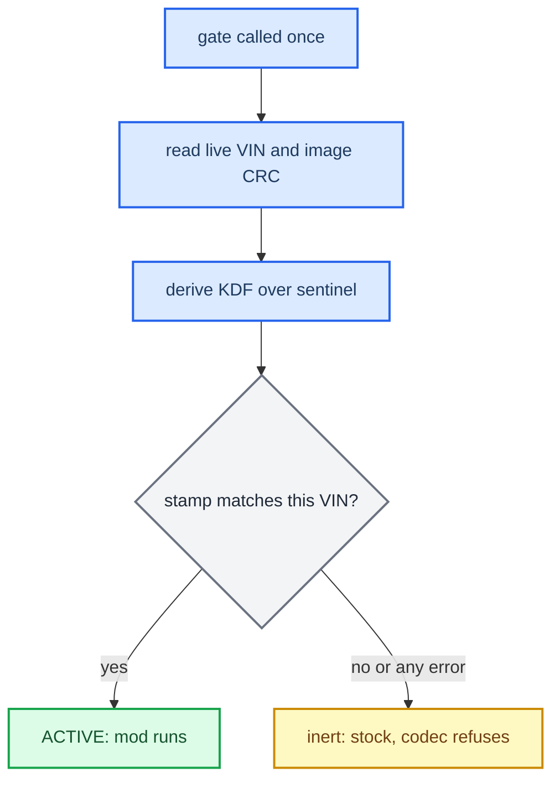

# VIN Protection

*How a CarPlay build is bound to one car. On the target VIN the mod runs; on any other VIN the hook goes inert and the codec fails closed. It uses a compile-time gate plus a post-build stamp, and the ceiling on what it can protect is stated below.*

---

## 🔐 What it does

The protector binds a build to a single VIN. On the target VIN the mod is active. On any other VIN the hook stays **inert**, so stock CarPlay runs, and the APAC codec **fails closed**. The VIN is read live on the unit, the two native `.so` files are stamped at build time, and **no plaintext VIN appears in the artifacts**.

- Both `.so` files (`libcarplay_hook.so`, `libcarplay_apac.so`) carry a small VIN gate and a stamped slot.
- On first use, the gate reads the **live VIN** from the MMX persistence store and checksums the `.so`'s own image on disk. The store is `/mnt/persist/var/fw/persistence.sqlite`, with `/var/fw/persistence.sqlite` as a fallback (`protector/prot_vin.c:89-90`). The gate reads the `/core/vin` and `/core/registeredVin` records; if both are present they must agree (`prot_vin.c:94-96`).
- The stamp is `KDF(secret, VIN, CRC)` over a blind sentinel. It verifies **only** when the unit's live VIN matches the VIN baked in at build time, and only if the `.so` has not been patched.
- **Fail-open:** any error (no VIN, disagreeing VINs, an unreadable image, an unstamped `.so`) leaves the unit inert and stock. It never bricks the unit (`protector/carplay_prot.h:8-12`).

## 🔐 The gate at runtime

The gate is compiled in only with `#ifdef CARPLAY_PROT`, so builds without it carry no gate code. It sits at one choke point in each `.so`:

- In the hook, `init_modules_once()` registers no modules if the gate fails (`hook/framework/hook_framework.c:133-138`).
- In the codec, the API entry refuses with `SPA_APAC_ERR_ARGS` (`hook/audio/apac_bridge.cpp:205-210`).

A `CARPLAY_PROT` `.so` that was never stamped is inert on **every** car.



## 🔧 Building a protected build

You give the VIN before the build starts. The script compiles and then stamps, in two steps.

```bash
./scripts/build_hook_protected.sh <VIN>                      # stamped -> build/protected_<VIN>/
HOOK_AUDIO=0 LOG=0 ./scripts/build_hook_protected.sh <VIN>   # beta: no audio, no logs
PROT_VIN=<VIN> ./scripts/build_hook_protected.sh             # VIN from the environment instead
```

1. **Compile and link.** The shared `build_hook_common.sh` core runs with `PROT_BUILD=1`. It compiles the three protector objects (`prot_rt`, `prot_vin`, `carplay_prot`) as plain C with `-fvisibility=hidden` and no constructor, so there are no new dynamic exports and `.init_array` holds only the compiler's entry. Those objects are linked into both `.so` files, and each file gets its own PROT slot. The hook and APAC sources are built with `-DCARPLAY_PROT` (`build_hook_common.sh:111-122`).
2. **Stamp.** Each compiled `.so` in `build/protected_<VIN>/` is stamped in place with `protector/protect.py --vin <VIN> --mode blind` (`build_hook_protected.sh:46-53`). This step binds the files to the VIN; without it they are inert.

`build_hook_protected.sh` and `build_hook.sh` share one compile+verify core, so the protected `.so` passes exactly the same ABI-safety gates ([[Build System]]) and cannot drift from the shipping one. The protected build writes **binaries only**, to `build/protected_<VIN>/`. You then assemble the install tree by hand from those files plus the runtime assets, following the map in [[Deploy and Release]].

### The two protection inputs

| Input | Default | Effect |
|---|---|---|
| VIN (argument 1, or `PROT_VIN`) | — | The 17-character target VIN. Without it the script prints usage and exits 2; the wrong length exits 1 (`build_hook_protected.sh:22-24`). |
| `PROT_SECRET` | — | Optional. **If it is unset, the script generates a fresh random secret for this build and does not keep it** (`:33-37`). The same value feeds both the runtime and the stamp, so a one-off build is self-consistent. Set it explicitly, and keep it out of the tree, only when you want one stable fleet secret across rebuilds. |

## ⚠️ Honest ceiling

This protects against cloning and casual patching. It is not cryptographic secrecy.

- The secret is compiled into the runtime image, so a rooted attacker who runs a provisioned image once can extract the derived key.
- `/mnt/persist` is writable, so the VIN records can be edited, but editing them only produces inert stock behaviour, never the mod.
- A real barrier needs a secret kept **off the box**, such as TrustZone or secure storage, or a server challenge. The code stays the same; only the source of the secret changes.
- **OPSEC:** never describe the mechanism in files that ship on the SD card. Any marker left on the card should stay neutral: VIN, date and an install hint only.

<details>
<summary>Verify a stamped .so locally</summary>

---

You can gate the compiled `.so` against a fake store and check three things: the right VIN gives `1`, a wrong VIN gives `0`, and no plaintext VIN leaked (`grep -c <VIN> <the .so>` gives `0`). This needs the same `PROT_SECRET` that the build used, so pin one for a build you intend to verify. The recipe, with `PROT_MMX_STORE` overriding the store path (`prot_vin.c:86-87`), is in `docs-obsidian/Sources/PROTECTOR.md` §6. `docs-obsidian/Sources/PROTECTOR.md` §5 covers adding the protector to a new artifact (slot, gate choke point, compile, stamp); the full API is in `protector/README.md`.

</details>

---

Provenance: `docs-obsidian/Sources/PROTECTOR.md`, `scripts/build_hook_protected.sh`, `scripts/build_hook_common.sh`, `protector/` (`carplay_prot.{c,h}`, `prot_vin.c`, `protect.py`, `README.md`).
