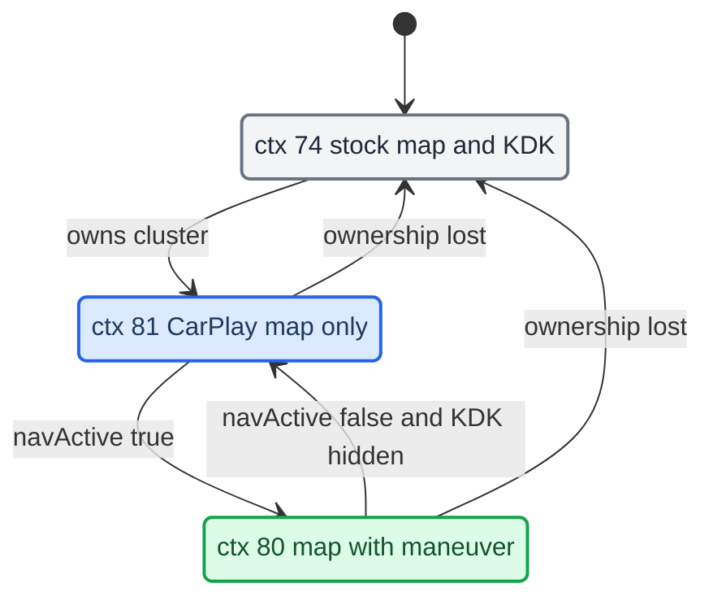

# Cluster Contexts

*How the CarPlay cluster gets its own DisplayManager contexts (74 stock, 80 nav, 81 map), why we reuse stock backings, and the single writer that switches between them.*

---

## 📋 The three contexts

The Audi cluster (LVDS2, terminal 1, 1440×542 visible) composites a set of displayables per DisplayManager context. The stock cluster contexts (72 map, 74 map+KDK, 75 blank) do not carry our CarPlay planes. So we declare our own contexts on every unit whose `kombiType != 4` (G24). `[car]` (on-unit `dmdt gd/gc/gs`), `[code]` (`java_patch/de/audi/tghu/fwhmi/DisplayManagerMIB2High.java:177-182`)

| Context | Displayables (index 0 = front) | Meaning |
|---|---|---|
| `74` | `{20, 102, 101, 33}` | Stock map + KDK maneuver, used when CarPlay does not own the cluster (`DisplayManagerMIB2High.java:156-164`) |
| `80` | `{98, 101, 102, 99}` | CarPlay nav active: our `maneuver_render` (98) over the KDK backings (101/102) over the CarPlay map plane (99) (`:178`) |
| `81` | `{99}` | CarPlay connected, not navigating: the CarPlay map plane only (`:179`) |

Displayables: `98` is our `maneuver_render` window (Software, 328×181), `99` is the `altscreen_render` CarPlay plane, `101`/`102` are the stock 987 KDK Image backings, `20` is the stock KDK maneuver, and `33` is the stock cluster map. `[code]` (`java_patch/com/luka/carplay/cluster/ClusterLayerController.java:8-10`, `maneuver_render/protocol.h:108`)

On G24 (`kombiType == 4`) there is no ctx 80/81. `AltScreenModule.start()` disables itself there. `[code]` (`java_patch/com/luka/carplay/core/AltScreenModule.java:119-122`, `:386-390`)

## ⚠️ Displayable 103 is not creatable, so reuse 101/102

`103` is an unregistered DSI id. `createImageDisplayable(103)` silently does nothing, and only pre-registered ids exist in the DM. So we never invent displayable ids. We reuse the two stock KDK backings `101` and `102`. `[car]`, `[code]` (`DisplayManagerMIB2High.java:174-176`)

Two traps live here:

- **The 101/102 names are inverted vs physical size.** `DISPLAYABLE_KDK_BACKGROUND_SMALL_STAGE = 101` is the larger 328×180 in-tube (sport) panel. `LARGE_STAGE = 102` is the smaller 210×153 popup. "Stage" means map-scene size, not backing size. `[code]` (`java_patch/de/esolutions/hmi/widgets/audi/evo/high/widgets/CombiMapController.java:33-36`)
- **The backings exist only when `sysConst(541) == 2`.** `configureDM()` creates 101/102 only then (`DisplayManagerMIB2High.java:231-235`). Our A5 FPK car reports `541 == 2`. The same condition gates the call from `CombiMapController` into `ClusterLayerController.apply` (`CombiMapController.java:197-202`). `[car]`, `[code]`

Plane geometry (read from the stock Layout by `ClusterLayerController`)

`ClusterLayerController` owns the CarPlay plane geometry. The stock `CombiMapController` only forwards to it. `[code]`

- **Geometry is not hardcoded.** It is read from the terminal's active stock `Layout` constants (slots 58-61 and 118-125). Classic and Sport on B9 use different in-tube anchors, and the skin switch changes the `Layout` at runtime (`ClusterLayerController.java:17-20`, `:37-43`, `:130-148`).
- **Fallback before the first Layout** (`:57-62`): in-tube crop `0,0,328,180` at `(984,139)`, popup crop `59,27,210,153` at `(1091,110)`.
- **Stage** is taken from VC FctID 54 (`onVcPresentation`, `:220-236`). Before FctID 54 arrives, the stock hint bit `BITFIELD_KDK_POSITION_IN_TUBE` is used (`CombiMapController.java:187-189`).
- **Visibility** is taken from VC FctID 44 (`onVcVisibility`, `:209-217`). The requested View mode never reveals a layer (`:12-13`).
- **One composition path**: `setCropping(98, crop…, dst…)`, `setPosition(backing, dst)`, and the other backing gets opacity 0 (`:318-331`). The crop destination equals the backing position.
- **Nav-off or disconnect**: planes `98/101/102` get opacity 0 while CarPlay owns the cluster and nav is off (`:312-316`). On release, the last stock backing state is restored (`:293-310`).
- The layout's small-stage offset (slots 80/81) is logged but never applied. Applying it broke Sport singlescreen on the car (`:283-288`). `[car]`

---

## ⚙️ The single-writer state machine

`AltScreenModule` has one persistent worker thread. It is the only caller of `DisplayManager.switchContext` and `setUpdateRate` for terminal 1. `republish()` recomputes `desiredCtx`, and the worker converges `currentCtx` to it. `[code]` (`AltScreenModule.java:18-21`, `:125-132`, `:301-316`) Two writers of the cluster context were the original cause of the black cluster, the 30 s hang, and the View button reverting to stock. `[car]`

Stock writes are also blocked at the DM. While CarPlay owns terminal 1, `DisplayManagerMIB2High.switchContext` drops any cluster write that does not come from the worker thread. `[code]` (`DisplayManagerMIB2High.java:300-316`)

The inputs:

- `connected` comes from `AltScreenModule.start/stop`, driven by `CarPlayApp` activation. Cluster ownership is `connected || videoAvailable`. `videoAvailable` comes from the renderer's `VIDEO_ON`/`VIDEO_OFF` and bridges short TMDev bounces. `[code]` (`AltScreenModule.java:133-138`, `:306-307`, `:333-344`; `AltscreenControlServer.java:207-231`)
- `navActive` comes from `RouteGuidance.rgActive` (the BAP nav-active moment) via `setNavActive()`. It is not the stock KDK-visible bit. `[code]` (`RouteGuidance.java:543`, `:786`; `CombiMapController.java:214-217`)
- Nav-off is delayed. On `setNavActive(false)`, if the VC still shows the KDK, `navHidePending` keeps ctx 80 until VC FctID 44 withdraws visibility. There is no timer. `[code]` (`AltScreenModule.java:356-378`, `ClusterLayerController.java:216`)
- The worker also waits for `rendererReady` (first posted frame) before it takes over. `[code]` (`AltScreenModule.java:502`, `:575`)

Ctx 81 (map via plane 99) is drawn even when not navigating. The CarPlay cluster map is always on while CarPlay owns the cluster. `[car]`, `[code]` (`AltScreenModule.java:428`)

## 🔧 Entering ctx 80/81: direct switch, guarded by `ctx < 80`

The worker enters ctx 80/81 by a direct `switchContext`, not through the stock view-mode chain. On this unit the view-mode chain does nothing: the cluster map is FPK, so `ClusterViewMode.refreshViewMode` returns early. `[car]`, `[code]` (comment at `java_patch/com/luka/carplay/rgd/BAPBridge.java:2276`)

- Coming from a non-CarPlay context, the worker first bounces through ctx 72, waits 180 ms, and then switches. Between 80 and 81 it switches directly, without the bounce. After the switch it sets the terminal to 30 fps. `[code]` (`AltScreenModule.java:47-50`, `:560-584`)
- On disconnect the worker sets 0 fps, switches to 74, and restores 30 fps. `[code]` (`AltScreenModule.java:585-599`)
- `DisplayManagerMIB2High.switchContext` normally remaps a stock context to its KDK twin (`addKDKToContext`) while `visibleKDKs[term] == 20`. Our contexts skip that remap (`ctx < FIRST_CARPLAY_CONTEXT`). Otherwise `switchContext(80)` would fall through to 73. `getMappedInternalContext` is identity. `[code]` (`DisplayManagerMIB2High.java:36`, `:53-55`, `:318-325`)
- View-button pin: `CombiMapController.switchToTargetContext` returns early while `AltScreenModule.isConnected()`. `[code]` (`CombiMapController.java:345-356`)

## ⚠️ The altScreen advert is on in production

Earlier notes said the altScreen advertisement must stay off. That is stale. The ctx 80/81 design draws the phone's type-111 stream on plane 99, so production startup enables the advert. `[code]` (`deploy/smartphone_integrator/carplay_startup.sh:52-54`: `ALTSCREEN_HANDLE_ALT=1`, `ALTSCREEN_ADVERT_DISPLAYS=1`; gates at `hook/altscreen/altscreen_hook.c:721`, `:792`)

The old 80↔74 flapping came from two context writers, which the single writer and the DM block above now prevent. The env gates are value-checked (`env_on`); see `memory/hook_getenv_presence_check_trap.md` and [[Landmines]].

## 🔗 Related

- [[RGI and BAP Bridge]]: what sets `rgActive` and `navActive`.
- [[HUD Renderer]]: what fills plane 98.
- [[AltScreen Cluster Video]]: the CarPlay video on plane 99.
- [[Reconnect and Lifecycle]]: `CarPlayApp` activation and the deactivate debounce.

Provenance: `MEMORY.md` (Cluster CarPlay contexts), `memory/carplay_cluster_context_architecture.md`, `memory/cluster_carplay_viewmode_design.md` (its "rides the stock view-mode chain" claim is superseded by the direct switch); source `java_patch/com/luka/carplay/cluster/ClusterLayerController.java`, `java_patch/com/luka/carplay/core/AltScreenModule.java`, `java_patch/de/audi/tghu/fwhmi/DisplayManagerMIB2High.java`, `java_patch/de/esolutions/hmi/widgets/audi/evo/high/widgets/CombiMapController.java`.
