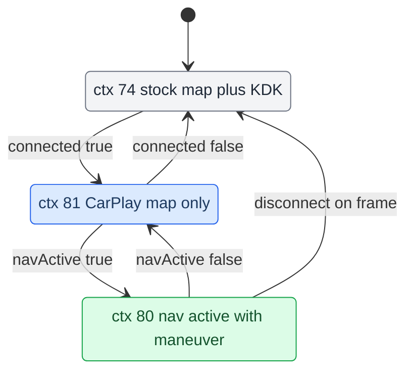

# Cluster Contexts

*How the CarPlay cluster gets its own DisplayManager contexts (74 stock, 80 nav, 81 map), why we reuse stock backings, and the single writer that switches between them.*

---

## 📋 The three contexts

The Audi cluster (LVDS2, **1440×542** visible) composites a set of *displayables* per DisplayManager *context*. Stock cluster contexts (72 map, 74 map+KDK, 75 blank) do not carry our CarPlay planes, so we define our own on units where `kombiType != 4`. **[car]** (verified on-unit with `dmdt gd/gc/gs`).

| Context | Displayables (index 0 = top) | Meaning |
|---|---|---|
| `74` | `{20, 102, 101, 33}` | Stock map + KDK maneuver — used when CarPlay is not connected |
| `80` | `{98, 101, 102, 99}` | CarPlay **nav active**: our maneuver_render (98) over KDK backings (101/102) over the CarPlay base plane (99) |
| `81` | `{99}` | CarPlay connected, **not** navigating: the always-on cluster map plane only |

Displayables: `98` = our `maneuver_render` EGL window (Software 328×181), `99` = `altscreen_render` CarPlay plane, `101`/`102` = stock 987 KDK Image backings, `20` = stock KDK maneuver, `33` = stock cluster map. **[car]**

## ⚠️ Displayable 103 is not creatable — reuse 101/102

`103` is an **unregistered DSI id**: `createImageDisplayable(103)` silently no-ops. Only pre-registered ids exist in the DM. So we never invent new displayable ids — we reuse the two stock KDK backings **101** and **102**. **[car]**

Two traps live here:

- **The 101/102 names are inverted vs physical size.** `DISPLAYABLE_KDK_BACKGROUND_SMALL_STAGE = 101` is actually the *larger* 328×180 sport panel; `LARGE_STAGE = 102` is the *smaller* 210×153 popup. "Stage" = map-scene size, not backing size (big map → small popup maneuver). **[car]**
- **The backings exist only when `sysConst(541) == 2`.** On our A5 FPK car `541 == 2` (proven: `configureDM()` creates 101/102 only then, and `dmdt gd` shows them). That same path makes `CombiMapController.handleKDK()` run, which is what invokes our geometry. **[car]**

Per-mode geometry (hardcoded in `ClusterLayerController.apply`)

Geometry is hardcoded per stage, extracted out of stock `CombiMapController` into `com.luka.carplay.cluster.ClusterLayerController.apply(dm, term, popup)`. The `/tmp` live-tune path (`ClusterPlaneConfig`) was removed; values are final. **[car]**

- **popup** (`hint&8 == 0`): `setCropping(98, 59,27,210,153, 1091,110,210,153)`, backing `102` at `(1091,110)`, hide `101`.
- **sport** (`hint&8 != 0`): `setCropping(98, 0,0,328,181, 984,139,328,181)`, backing `101` at `(984,139)`, hide `102`.
- **nav-off** (RGI off / disconnect / `kdk != 20`): set `98/101/102` opacity 0 — belt-and-suspenders with the ctx 80→81 switch, so a stale panel never lingers.
- `setCropping` dst anchor ≠ `setPosition`: crop dst = position + crop src offset (e.g. pos `1032,83` ⇒ crop dst `1091,110` = +59,+27).

---

## ⚙️ The single-writer state machine

`AltScreenModule.republish()` is the **only** cluster-context writer (a worker with `desiredCtx`/`currentCtx`, race-free). Two writers of the cluster context were the original cause of the black cluster / 30 s hang / View-button reverting to stock. **[car]**

Two inputs drive it:

- `connected` ← `AltScreenModule.start/stop`, fired from `CarPlayApp.onActivate/onDeactivate`.
- `navActive` ← **authoritative from `RouteGuidance.rgActive`** (the moment we tell VC nav is active over BAP), via `setNavActive()` — **not** the stock KDK-visible bit `kdk == 20` (that only means "stock drew a KDK panel"). Fired at rgActive activate/deactivate, the `onFrame` disconnect branch, and `RouteGuidance.stop()`. **[car]**

Note that ctx 81 (map via plane 99) is drawn even when **not** navigating — the CarPlay cluster map is always-on while connected, by design. **[car]**

## 🔧 Entering ctx 80: direct switch, guarded by `i < 80`

We enter ctx 80/81 by **direct `switchContext`** from `AltScreenModule`, not through the stock view-mode chain. On this unit the view-mode chain is **dead**: the cluster map is FPK (`isClusterMapFPK == true`), so `ClusterViewMode.refreshViewMode` hits its `if (!FPK && !MMI)` guard and skips the whole body. Forcing `setFavoredViewMode(MAP)` did nothing on-unit; direct `switchContext(80)` logged `final=80`. **[car]**

The `i < 80` guard is what makes direct entry safe. `DisplayManagerMIB2High.switchContext` normally remaps a requested context (72→74, etc.) via `addKDKToContext` when `visibleKDKs[term] == 20`, to auto-add the stock KDK onto map contexts. Our self-composed 80/81 must skip that remap, or `switchContext(80)` would fall through to 73 and hijack our switch. `getMappedInternalContext` is identity, so 80 lands on `dc[80]`. **[car]**

## ⚠️ altScreen advert must stay off

The CarPlay altScreen advertisement must stay **off** (`carplay_launch.sh` `HANDLE_ALT=0` / `ADVERT=0`) or the projection flaps ACTIVE→INVALID and the cluster ping-pongs ctx 80↔74, so the backing only flickers. See `memory/hook_getenv_presence_check_trap.md` and [[Landmines]]. Editing `/mnt/app/...` needs `mount -uw /mnt/app` first. **[car]**

## 🔗 Related

- [[RGI and BAP Bridge]] — what sets `rgActive` / `navActive` in the first place.
- [[HUD Renderer]] — what fills plane 98 and the LVDS map behind plane 99.
- [[AltScreen Cluster Video]] — the CarPlay video plane on the cluster.

Provenance: `MEMORY.md` (Cluster CarPlay contexts), memory `carplay_cluster_context_architecture.md`, `cluster_carplay_viewmode_design.md`; source `com/luka/carplay/cluster/ClusterLayerController.java`, `AltScreenModule`, `DisplayManagerMIB2High.java`, `ClusterService.java`.
