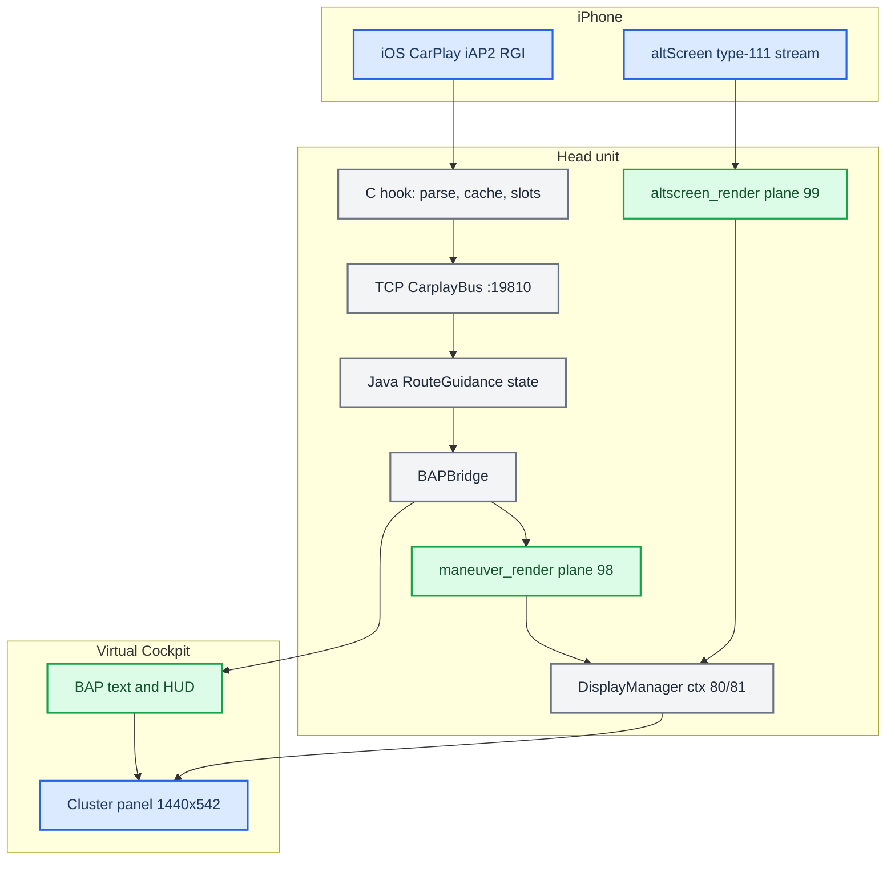

# Cluster and RGI MOC

*Map of content for CarPlay route guidance in the Audi Virtual Cockpit: the iAP2 wire, the C hook and TCP bus, BAP text and HUD, our maneuver renderer, the CarPlay cluster map plane, and the custom DisplayManager contexts.*

---

## 📋 What this section covers

CarPlay never draws the cluster maneuver itself. iOS sends semantic route guidance (a maneuver type, junction angles, a distance, a string). The head unit turns that into everything the driver sees: BAP text and HUD icons, a procedural 3D arrow, and the cluster planes.

The path is `iAP2 RGI TLVs → C hook (parse, cache, slot-remap) → TCP bus :19810 → Java RouteGuidance → BAPBridge`. `BAPBridge` has two outputs. BAP (`AppConnectorNavi`) feeds VC text and the HUD. TCP `:19800` feeds `maneuver_render` (plane 98). The map on the cluster is the phone's own type-111 altScreen stream, drawn by `altscreen_render` on plane 99. A DisplayManager context state machine (`AltScreenModule`) composes these planes on the 1440×542 cluster terminal.

Earlier versions of these notes described a KOMO/LVDS video-map output from `BAPBridge`. The current code does not feed KOMO route info (see [[HUD Renderer]]).

Start here, then open the note you need. For the hub and the trap list see [[Home]] and [[Landmines]]. The CarPlay video plane on the cluster is [[AltScreen Cluster Video]]. The bus is [[Hook to Java Bus]].

## 📊 The whole pipeline

## 🔗 The notes

| Note | What it covers |
|---|---|
| [[Cluster Contexts]] | The DisplayManager context state machine (74 stock / 80 nav / 81 map), why displayable 103 is not creatable, and the single writer `AltScreenModule`. |
| [[RGI and BAP Bridge]] | The route-guidance path: `BAPBridge` outputs, FSG sync and ExitView, FctID 18/37, slot mapping and LRU, `visible_in_app` vs route-active. |
| [[HUD Renderer]] | The three renderers, the procedural arrow, the stock KOMO map pipeline (unused by CarPlay code), and the VC FPK state machine. |
| [[Third-party Nav Apps]] | Why Waze and AMap send no usable RGI, `updateViewArea`, `CMD_ALT_ZOOM`, and the cluster scene URL. |
| [[Phone Tab Gating]] | The removed cluster telephone-tab gate (HFP && !CarPlay), its traps, and what stays unproven. |

## 💡 Truth levels

Claims are tagged:

- `[car]`: confirmed on the unit.
- `[code]`: verified in the current source tree (cited `path:line`).
- `[decompile]`: from reverse engineering.
- `[open]`: not verified.

Status in short: BAP text and HUD and the ctx 80/81 machine are `[car]` and `[code]`. The third-party-app analysis is `[decompile]`. The phone-tab gate was removed from the code in `63e7f35`, and its existence-gate question is still `[open]`.

Provenance: `docs/RGI_HUD_RENDERER_KNOWLEDGE.md`, `docs/reference/RGI_THIRD_PARTY_NAV_APPS.md`, `docs/reference/DISTANCE_BARGRAPH_CHAIN.md`, the project `MEMORY.md`, and `memory/production_full_audit_9295b04.md`. The only Java tree is `java_patch/` (built by `scripts/build_java.sh:25`).
