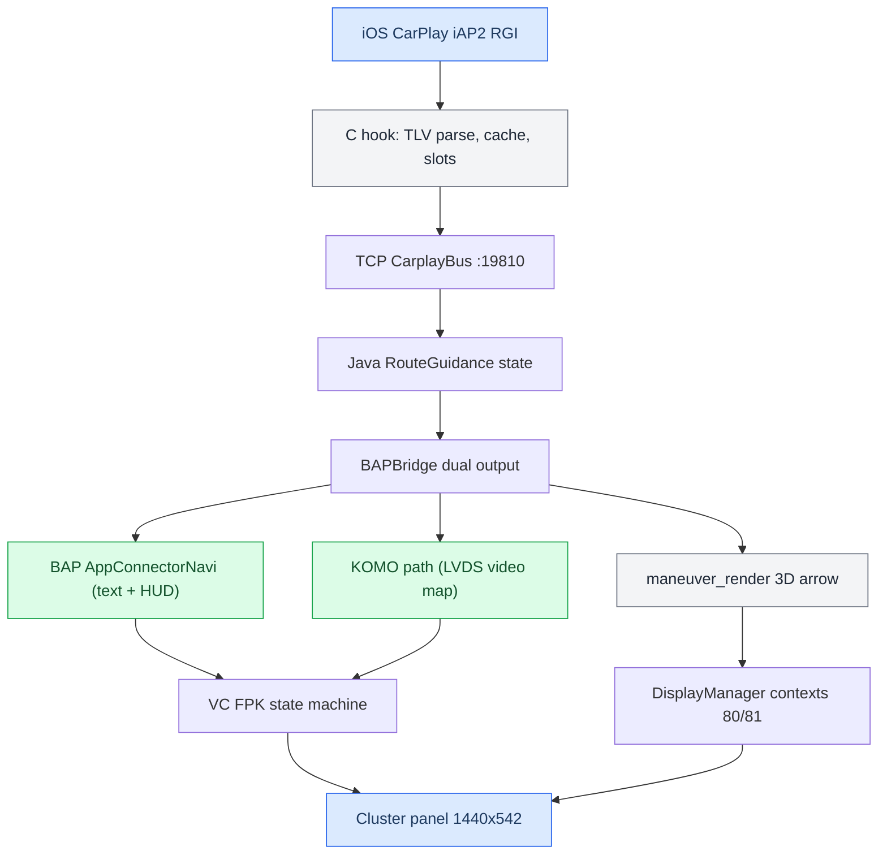

# Cluster and RGI MOC

*Map of content for CarPlay route guidance in the Audi Virtual Cockpit — from the iAP2 wire, through the C hook and TCP bus, to BAP text, the KOMO/LVDS video map, and the custom DisplayManager contexts.*

---

## 📋 What this section covers

CarPlay never draws the instrument cluster itself. iOS ships **semantic** route guidance — a maneuver type, junction angles, a distance, a string — and the head unit turns that into everything the driver sees: BAP text and HUD icons, a procedural 3D arrow, and the cluster map plane. This section documents that whole chain.

The path is: **iAP2 RGI TLVs → C hook (parse, cache, slot-remap) → TCP bus :19810 → Java `RouteGuidance` → `BAPBridge` → two outputs** (BAP/AppConnectorNavi for text+HUD, KOMO for the LVDS video map) → the VC's own FPK state machine → the cluster panel. In parallel a **DisplayManager context state machine** places our own renderer planes (98/101/102/99) on the 1440×542 cluster.

Start here, then branch into the note you need. For the hub and the trap list see [[Home]] and [[Landmines]]. The CarPlay video plane on the cluster is [[AltScreen Cluster Video]].

## 📊 The whole pipeline

## 🔗 The notes

| Note | What it covers |
|---|---|
| [[Cluster Contexts]] | The DisplayManager context state machine (74 stock / 80 nav / 81 map), why displayable 103 is not creatable, the single-writer `AltScreenModule.republish` rule. |
| [[RGI and BAP Bridge]] | The route-guidance path: `BAPBridge` dual output, FSG sync and ExitView, FctID18/37, slot mapping/LRU, `visible_in_app` vs route-active. |
| [[HUD Renderer]] | The maneuver/HUD renderer knowledge, the KOMO/LVDS map pipeline, the VC FPK state machine, and the LVDS video link. |
| [[Third-party Nav Apps]] | Why Waze and AMap send no usable cluster RGI, `updateViewArea` cluster zoom, and `CMD_ALT_ZOOM`. |
| [[Phone Tab Gating]] | The cluster telephone-tab gating attempt (HFP && !CarPlay), its traps, and what stays unproven. |

## 💡 Truth levels

Claims are tagged **[car]** confirmed on the unit, **[decompile]** from reverse engineering, **[open]** unverified. The honest headline: BAP text/HUD and the ctx 80/81 machine are **[car]**; the third-party-app analysis is **[decompile]**; the phone-tab existence-gate is **[open]** and was refuted on the unit.

Provenance lives in `docs/RGI_HUD_RENDERER_KNOWLEDGE.md`, `docs/reference/RGI_THIRD_PARTY_NAV_APPS.md`, the project `MEMORY.md`, and the audit note `production_full_audit_9295b04.md`.
