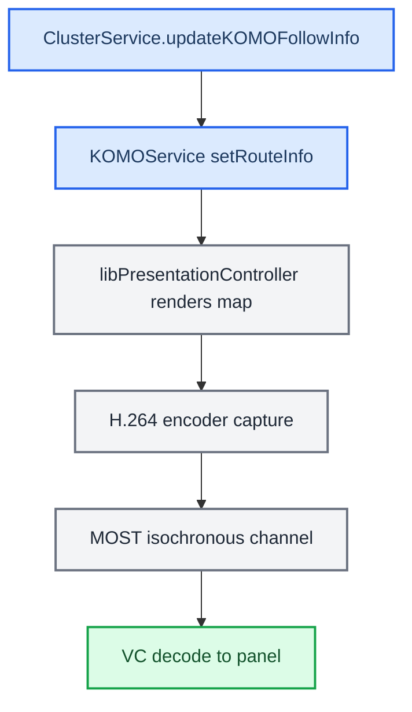
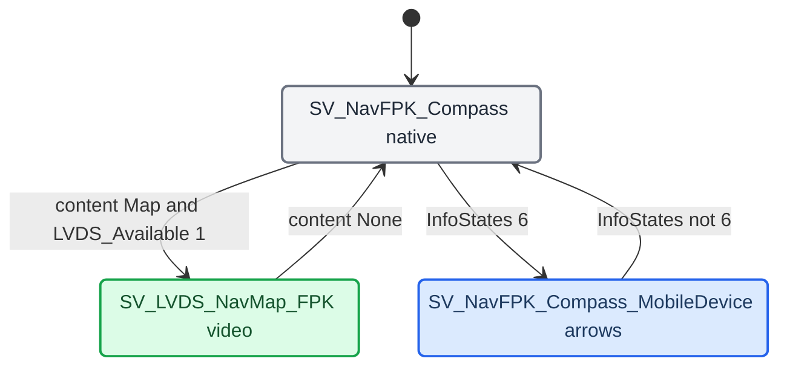

# HUD Renderer

*What actually draws the turn: the windshield HUD firmware, our procedural 3D arrow in the cluster, the stock KOMO video-map pipeline that CarPlay no longer feeds, and the VC FPK state machine.*

---

## 📋 Three things called "the renderer"

These are three different processes with three different jobs. `[car]`, `[code]`

| Name | What it is | How it is fed |
|---|---|---|
| HUD | The windshield head-up display. Its own firmware draws the icon and bargraph | BAP via the stock `AppConnectorNavi`; no pixels from us |
| `maneuver_render` | Our procedural 3D arrow on displayable 98 in the cluster (EGL, 328×181) | Java commands over TCP `:19800` (Java is the server); it builds geometry, materials and animation itself |
| `altscreen_render` | The CarPlay map plane on the cluster (displayable 99) | The type-111 stream; see [[AltScreen Cluster Video]] |

`maneuver_render` does not push pixels to the HUD. `altscreen_render` is neither a BAP sender nor a maneuver engine. The maneuver displayable is 98, not the stock 20 (`maneuver_render/protocol.h:92-108`). Some older comments in `BAPBridge.java:712-721` and `maneuver_render/main.c:897` still say "ID 20". Both renderers belong to the CarPlay supervisor, and Java never spawns one per maneuver (`java_patch/com/luka/carplay/rgd/BAPBridge.java:1987`). `[code]`

## 🔧 The procedural arrow

The target is a close match to the HUD icon shape and action, not a pixel copy. The renderer keeps the exact turn angle, including sharp turns over 100° and full roundabout rings. It draws lane data as a separate bottom strip and animates fill and blink toward a shared target. `[car]`

Blink phase has one Java source: a 600 ms high/low worker whose output goes to both BAP and the renderer. The renderer only smooths toward the received phase and has no phase generator of its own. `[code]` (`BAPBridge.java:58`, `:286-310`)

Sentinels that must survive "simplification": `[decompile]`, `[car]`

- `+1000` = unknown angle. Our C parser sets it for an indexed maneuver with no exit-angle TLV.
- `-1000` = a defensive case. Do not read the sign as a direction.
- `0` = real straight.

`mTurnAnglePresent` separates a real −1° from a legacy default. The full mapping is in `docs/RGI_HUD_RENDERER_KNOWLEDGE.md`.

## ⚙️ KOMO / LVDS map pipeline (stock navigation)

On a MOST-map cluster, the stock navigator's cluster map is a video that the HU renders and streams to the VC. Java assembles `[followInfoRIE, nextManeuverRIE]` and hands it to KOMO. Native code renders, captures, H.264-encodes, and sends it over MOST. The VC decodes it to its panel. `[decompile]`

CarPlay code does not use this path. `BAPBridge` never calls `updateNextManeuver`/`setRouteInfo`. `ClusterService.updateKOMOFollowInfo` is the stock-nav caller. On FPK, `setKOMODataRate` and `forceGfxAvailable` return early. `[code]` (`java_patch/de/audi/tghu/navi/app/cluster/ClusterService.java:717-720`, `:779-797`; `BAPBridge.java:2268-2276`)

The stock control path: `setKOMODataRate(2)` → hint 2 on `ChoiceModel(1,168)` → `CombiMapController` → `switchContext` + `DisplayManager.setUpdateRate`. Three DSI services carry it: `dsi.komoview` (route info), `dsi.komonavinfo` (text), and `dsi.komogfxstreamsink` (fade plus the `updateGfxState`/`updateDataRate` callbacks). `[decompile]`

During CarPlay, the cluster terminal rate is set by `AltScreenModule` instead: `setUpdateRate(1, 30)` after each switch into ctx 80/81. The old "10 fps" figure applies to the stock path only. `[code]` (`java_patch/com/luka/carplay/core/AltScreenModule.java:50`, `:583`, `:585-599`)

Stock KOMO start and stop sequences

- **Start:** `enableKomoView(true)` + `notifyVisibility(true)` + `setKDKVisibility(true)` + `updateRgActive(true)` + `setKOMODataRate(2)`.
- **Stop:** `setKOMODataRate(0)` → `setKDKVisibility(false)` → `updateRgActive(false)` → `updateNextManeuver(empty)` → `enableKomoView(false)`.

`updateGfxState(1,1)` → `setGFXAvailable(true)`; `updateDataRate(2,1)` confirms full bandwidth. `[decompile]`

---

## ⚙️ VC FPK state machine

The VC runs a compiled EB GUIDE model (in the `fds` binary). BAP arrives over MOST (LSG 50) via `gssipc-kbd`, which writes dp items. The cluster nav sub-tree has two display targets that matter to CarPlay. `[decompile]`

The VC shows the LVDS map when `INTERN_Active_NavFPK_Content = Map(1)` and `LVDS_Available = 1`. This needs no `InfoStates = 6` and no KSS patch. The VC has no dp item for rgType. It switches on content and InfoStates. `[decompile]` During CarPlay, the HU picture on that link is the terminal-1 composition of ctx 80/81 (planes 98/99/101/102). See [[Cluster Contexts]]. `[code]`

InfoStates=6 rejection and the KSS patch (AIO-arrow variant only)

The AIO-arrow view (`SV_NavFPK_Compass_MobileDevice`) needs `BAP_NavSD_InfoStates_States = 6`. `KSSApplication.bin` `sub_108F42C` validates InfoStates from MOST 0x515 with `a1 <= 0xF && (a1 & 5) != 4 && (a1 & 0xA) != 8`. That rejects 6, because `(6 & 5) == 4`. The dp item is never set and the arrows never render. `[decompile]`

Fix, only for the AIO-arrow path: patch `sub_108F42C` at `0x108F42C` (file offset `0x8F42C`) and replace `0F 28 07 D8` with `01 20 70 47` (`MOVS R0,#1; BX LR`, always true). UDS: `3D 14 01 08 F4 2C 04 01 20 70 47`. The script path `archive/infostates6_patch.py` no longer exists in the repo `[open]`. Production does not need this patch.

---

## ⚙️ LVDS video link

LVDS is the physical wire from the HU cluster terminal to the VC panel path. The VC switches to `SV_LVDS_NavMap_FPK` when `INTERN_Active_NavFPK_Content = 1` and `LVDS_Available = 1`. The content bit is set by the VC's own EB GUIDE model. `[decompile]`

Renderer side, `setActiveDisplayable` fires only on a real context change. The current code handles this in the `AltScreenModule` worker: when entering ctx 80/81 from a non-CarPlay context, it first switches to ctx 72, waits 180 ms, and then switches to the target. `[code]` (`AltScreenModule.java:47-48`, `:560-582`)

Historical notes, not current code:

- The old `switchContext(0)→72→setActiveDisplayable(4,33)` recipe.
- The `BAPBridge.forceGfxAvailable(true)` unblock. On FPK it now returns early (`BAPBridge.java:2276`).

The `libPresentationController` ARM32 patches (keep DSIs alive, force `StartDrawing`, 10 fps) are binary patches outside this tree. Whether they are still deployed is `[open]`.

## 🔗 Related

- [[RGI and BAP Bridge]]: the BAP and renderer outputs that feed this.
- [[Cluster Contexts]]: where displayables 98/99 land on the panel.
- [[Third-party Nav Apps]]: why `ManeuverMapper` gets no maneuverType from some apps.

Provenance: `docs/RGI_HUD_RENDERER_KNOWLEDGE.md`, `MEMORY.md` (VC FPK state machine, LVDS Video Pipeline), `memory/komo_lvds_architecture.md`, `memory/vc_fpk_state_machine.md`, `memory/kss_infostates6_rejection.md`, `memory/bapbridge_architecture.md`, `memory/libpresentationcontroller_patches.md`; source `maneuver_render/`, `java_patch/com/luka/carplay/rgd/{BAPBridge,RendererServer}.java`, `java_patch/de/audi/tghu/navi/app/cluster/ClusterService.java`.
