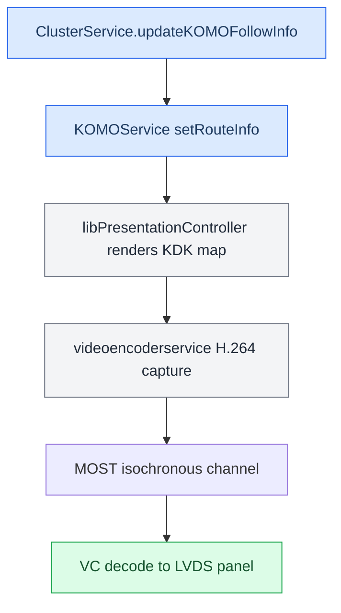
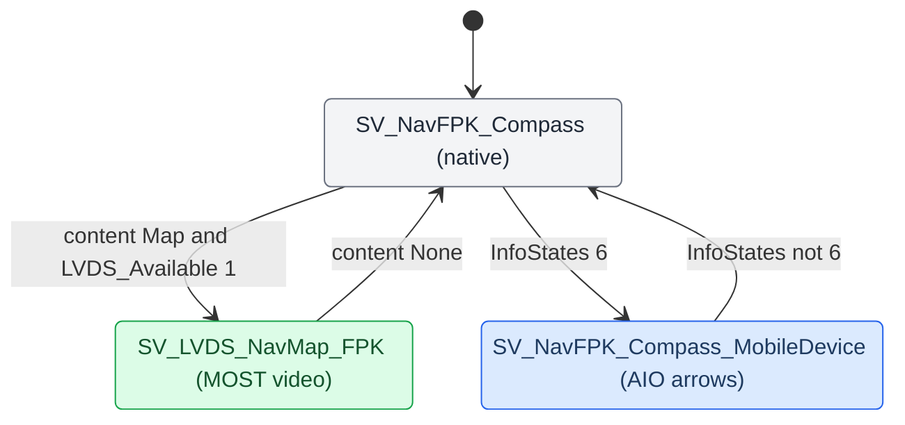

# HUD Renderer

*What actually draws the turn: the windshield HUD firmware, our procedural 3D arrow in the cluster, the KOMO/LVDS video-map pipeline, and the VC FPK state machine that switches between them.*

---

## 📋 Three things called "the renderer"

The words matter — they are three different processes with three different jobs. **[car]**

| Name | What it is | How it is fed |
|---|---|---|
| **HUD** | The windshield head-up display; its own firmware draws the icon and bargraph | We send it **BAP** via the stock `AppConnectorNavi`; no pixels from us |
| **`maneuver_render`** | Our procedural 3D arrow on displayable 98 in the cluster (EGL) | Java commands over TCP `:19800`; it builds geometry/materials/animation itself |
| **`altscreen_render`** | The CarPlay video plane on the cluster (displayable 99) | The type-111 stream; see [[AltScreen Cluster Video]] |

`maneuver_render` does **not** push pixels to the HUD, and `altscreen_render` is neither a BAP sender nor a maneuver engine. The maneuver displayable is **98**, not the old stock 20. Its lifecycle belongs to startup/framework — Java never spawns a renderer per maneuver. **[car]**

## 🔧 The procedural arrow

The user's target is *close* HUD/renderer icon shape and action, not a pixel copy. The renderer keeps the exact valid turn angle (including sharp >100° and roundabout full rings), draws independent lane data as a bottom strip, and animates fill/blink toward a shared target. Blink phase has one Java source (600 ms, high/low) sent to both outputs; the renderer only smooths toward the received phase, it has no phase generator of its own. **[car]**

Sentinels that must survive "simplification": `+1000` = unknown angle (our C parser creates it for an indexed maneuver with no exit-angle TLV), `-1000` = a defensive case (do not read the sign as direction), `0` = real straight. `mTurnAnglePresent` distinguishes a real −1° from a legacy default. **[decompile]/[car]** Full mapping in `docs/RGI_HUD_RENDERER_KNOWLEDGE.md`.

## ⚙️ KOMO / LVDS map pipeline

The cluster map (not the arrow) is a **video** the HU renders and streams to the VC. Java assembles two `RouteInfoElement`s `[followInfoRIE, nextManeuverRIE]` and hands them to KOMO; native renders, captures, H.264-encodes, and sends over MOST; the VC decodes to its LVDS panel. **[decompile]**

The control path that starts the encoder: `setKOMODataRate(2)` → hint 2 on `ChoiceModel(1,168)` → `CombiMapController` → for FPK (`sysConst 541 == 2`) `handleKDK()` → `switchContext` + `DisplayManager.setUpdateRate(1, 10)` → encoder runs at 10 fps. Three DSI services carry it: `dsi.komoview` (route info), `dsi.komonavinfo` (text), `dsi.komogfxstreamsink` (fade + `updateGfxState`/`updateDataRate` callbacks). **[decompile]**

KOMO start/stop sequences

- **Start:** `enableKomoView(true)` + `notifyVisibility(true)` + `setKDKVisibility(true)` + `updateRgActive(true)` + `setKOMODataRate(2)`.
- **Stop:** `setKOMODataRate(0)` → `setKDKVisibility(false)` → `updateRgActive(false)` → `updateNextManeuver(empty)` → `enableKomoView(false)`.

`updateGfxState(1,1)` → `setGFXAvailable(true)`; `updateDataRate(2,1)` confirms full bandwidth. **[decompile]**

---

## ⚙️ VC FPK state machine

The VC is a compiled EB GUIDE model (in the `fds` binary); BAP arrives over MOST (LSG 50) via `gssipc-kbd`, which writes dp items. The cluster nav sub-tree has two display targets that matter to CarPlay. **[decompile]**

**Production uses the LVDS map path**, driven purely by `INTERN_Active_NavFPK_Content = Map(1)` (set when `gfxAvailable = true`) + `LVDS_Available = 1` (set when video is physically flowing). This needs **no** `InfoStates = 6` and **no** KSS patch. The VC has no dp item for rgType at all; it switches on content/InfoStates, not rgType. **[car]/[decompile]**

InfoStates=6 rejection and the KSS patch (AIO-arrow variant only)

The alternative AIO-arrow view (`SV_NavFPK_Compass_MobileDevice`) needs `BAP_NavSD_InfoStates_States = 6`. But `KSSApplication.bin` `sub_108F42C` validates InfoStates from MOST 0x515 with `a1 <= 0xF && (a1 & 5) != 4 && (a1 & 0xA) != 8` — which **rejects 6** because `(6 & 5) == 4`, so the dp item is never set and the arrows never render. **[decompile]**

Fix (only if using the AIO-arrow path): patch `sub_108F42C` at `0x108F42C` (file offset `0x8F42C`), replace `0F 28 07 D8` with `01 20 70 47` (`MOVS R0,#1; BX LR` = always true). UDS: `3D 14 01 08 F4 2C 04 01 20 70 47`. Script `archive/infostates6_patch.py`. The production LVDS-map path does not need this. **[decompile]**

---

## ⚙️ LVDS video link

`LVDS` is the physical wire from the VC's decoder to its LCD panel; the MOST H.264 stream is the transport that feeds it. The VC flips to `SV_LVDS_NavMap_FPK` when `INTERN_Active_NavFPK_Content = 1` and `LVDS_Available = 1` — the `INTERN_Active_NavFPK_Content` bit is set automatically by the VC's own EB GUIDE state machine once `gfxAvailable = true` triggers the MAP view. **[decompile]**

Renderer-side, `setActiveDisplayable` fires **only on a context change** — force `switchContext(0)→72→setActiveDisplayable(4,33)`. `gfxAvailable = false` blocks it, cleared via `BAPBridge.forceGfxAvailable(true)`. Ctx 72's first displayable is 33 (map), ctx 74's first is 20. Related ARM32 patches keep the DSIs alive, force `StartDrawing`, and cap 10 fps (`libPresentationController`). **[car]**

## 🔗 Related

- [[RGI and BAP Bridge]] — the BAP + KOMO outputs that feed this.
- [[Cluster Contexts]] — where displayable 98/99 land on the panel.
- [[Third-party Nav Apps]] — why a starved `ManeuverMapper` gets no maneuverType.

Provenance: `docs/RGI_HUD_RENDERER_KNOWLEDGE.md`, `MEMORY.md` (VC FPK state machine, LVDS Video Pipeline), memory `komo_lvds_architecture.md`, `vc_fpk_state_machine.md`, `kss_infostates6_rejection.md`, `bapbridge_architecture.md`; source `maneuver_render/`, `KOMOService.java`, `libPresentationController.so`.
