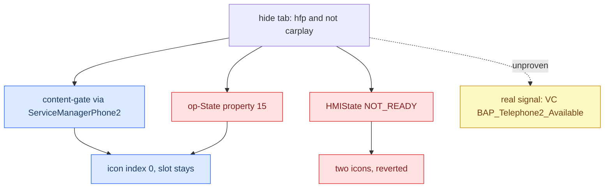

# Phone Tab Gating

*The attempt to hide the cluster telephone tab while CarPlay owns the phone — the verified traps and seams, and why the lever that would make the slot vanish is still unproven and was reverted on the unit.*

---

## 📋 The goal and the rule

While CarPlay owns the phone, hide the stock crossed-out telephone tab in the cluster; restore it only once MMI HFP telephony is really available again. The rule: **[car]**

```text
tabVisible = (mobileConnectionType == HANDS_FREE_PROFILE) && !carPlayActive
```

`mobileConnectionType == 3` is the stock HFP state. The gate is **fail-open** before the first phone update, so a missing callback can never permanently remove the tab. **Status: reverted.** v1 did not hide the tab; v2 produced two telephone icons and was rolled back. The gate is disabled pending a correct availability lever. **[car]**

## ⚠️ The signal traps

Every "obvious" source for the two inputs is the wrong one. These are the verified traps: **[decompile]/[car]**

| Signal | Trap | The real source |
|---|---|---|
| `hfpActive` | `getTelMode()` returns the **raw DSI** code (`TELMODE_HFP = 3`), not the app-model `TEL_MODE_HFP = 0` | `callLeadingDevice.getTelMode() == 3 && telActivationState ∈ {2,5}`, published phone-side (`BAPPropertyTelFSGSetup`) |
| "BT phone present" | `moduleState` (property 23) is the embedded **NAD modem** state (`getNadInstanceState()`), not the BT/HFP handset | do not gate on it |
| `carplayActive` | — | `CarPlayApp.isActive()` (conservative), or stricter `terminalModeDevice.isActive() && getConnectionMethod() == 1` |

## 🔧 Verified vs unproven seams

| Seam | Status | Notes |
|---|---|---|
| Content-gate: wrap `CombiBAPServicePhone2` at `ServiceManagerPhone2.registerServices` | **[car] verified, safe** | Mirrors `GatedCombiService`; every Tel2 handler resolves via OSGi so the wrapper intercepts; diagnosis path bypasses (test mode intact). Yields icon index 0 (nothing drawn) but the **slot remains** |
| Late-registration replay (`registerResend`) | **[car] verified** | PHONE2 and terminal mode init in different bundles; replay fixes the first race |
| Existence-gate (make the slot **vanish**) | **[open] unproven** | The code turning op-state into slot-present/absent lives in the cluster `hmi_app.elf`, not the HU jar. No per-tab flag found in the jar. Needs on-unit A/B |

## ⚠️ Two levers that were tried and refuted

Both HMI-side levers failed on the unit — do **not** touch HMI-state again: **[car]**

- **op-State** (BAP property 15): can never remove the tab. In `hmi_app.elf`, op-State maps to a separate `OpState` field that only changes the **icon** (index 2/5 "no service"); the slot stays.
- **HMIState = NOT_READY(0)**: on-unit it did **not** remove the slot and produced **two** telephone icons (broke the Telephone↔Telephone2 domain → stock PHONE fell back alongside PHONE2). A source bug made it fire too early (treating the startup value `0` as "hide"). `DSIBAP.setHMIState()` only accepts `0/1/2` — there is no "unavailable" enum.



## 💡 The real target, still open

The visual target is exact: force VC `phoneAvailable = 0`. In `hmi_app.elf`, `App::getTabBarIconIndex` (`0x183378`) returns icon index 0 when `phoneAvailable == 0` (`App+960`), which is set only by `App::setPhoneAvailable` (`0x18836C`) from a separately cached **service-availability** byte (handler `0x17F1B0`) — **not** from op-State or the FSG value. The real signal is VC-side **`BAP_Telephone2_Available = 0 → phoneAvailable = 0`**. **[decompile]**

Next investigation: find the true publisher of `BAP_Telephone2_Available` in MHI Java/BAP and gate **that** on CarPlay, or minimally patch the VC availability consumer. Whether `avail = 0` collapses the ribbon slot or leaves an empty gap is unprovable from `hmi_app.elf` (the ribbon is filled by another component) — **on-unit A/B test only.** Do not re-litigate the CarPlay/HFP source logic; that cannot fix the rejected HMI-state lever. **[open]**

## 🔗 Related

- [[RGI and BAP Bridge]] — `CarPlayApp` activation, the same `GatedCombiService` reuse-guard pattern.
- [[Landmines]] — the DSI/NAD/telMode traps as one-liners.

Provenance: `docs/archive/PHONE_TAB_GATING.md`, `MEMORY.md` (Phone tab gating), memory `phone_tab_gating_findings.md`; source pool `Tools/jxe2jar/out/MU1316-combined-vf/`, VC `hmi_app.elf`. Consolidation commit `d9c6d02`.
