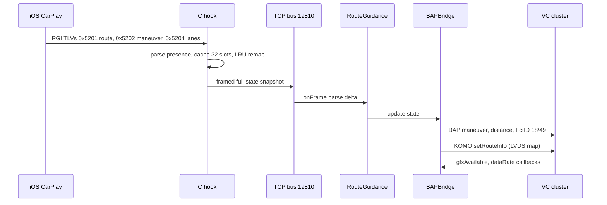
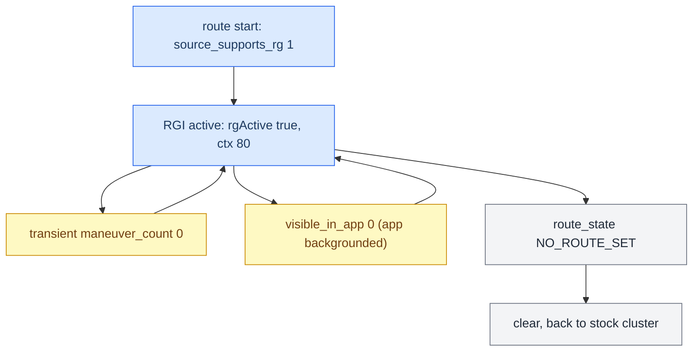

# RGI and BAP Bridge

*The route-guidance path from the iAP2 wire to the cluster: the C hook's slot cache, the dual-output BAPBridge, the FSG/ExitView handshake, and the field-presence rules that decide when guidance really ends.*

---

## 📋 The dual-output bridge

`BAPBridge` feeds two consumers from one `RouteGuidance.State`:

- **BAP path** (`AppConnectorNavi` / `CombiBAPServiceNavi`), `ACTIVE_RGTYPE = 0` (RGI): maneuver descriptor, distance, street name, lane guidance → VC text overlays + HUD icons.
- **KOMO path** (LVDS video map): `updateNextManeuver(rie)` → `updateKOMOFollowInfo()` → `komoService.setRouteInfo([followInfoRIE, nextManeuver])` → PresentationController → H.264 → MOST → the VC LVDS map. Detailed in [[HUD Renderer]].

`forceClusterRouteInfoState(true)` is required on start **even for BAP-only** — it sets `container.rgActive`, `rgiValid = true`, `favoredViewMode = KDK`, so BAP sends are accepted. Concurrency: `RouteGuidance.State` is single-threaded (bus reader thread); the blink thread touches only `blinkDistM`/`actionBlinkFull` under `synchronized(this)`; lock order is `this ≺ distanceToManeuverLock`, never inverted. **[car]**

## 📊 iAP2 to cluster

## 🔧 Slot mapping and LRU

The C hook keeps a bounded cache and remaps iOS's monotonically-growing maneuver indices to local slots; `maneuver_list` carries slot indices, `maneuverOrder[0]` is the current maneuver. **[decompile]**

- `MANEUVER_CACHE_SIZE = 32` (not 8 — the "8 slots" note is stale), `MAX_MANEUVER_LIST = 16`. **[decompile]** (`rgd_tlv.h`)
- **LRU bug (fixed):** `rgd_slot_for_iap_index()` did not refresh the sequence on an existing-slot lookup and had no eviction guard for active slots → icon/turn-text got stuck. Fix: LRU touch on lookup + `rgd_is_active_index()` eviction guard. **[car]**
- Current maneuver must be `maneuverOrder[0]`; if it is not yet valid, do **not** pick the next filled slot — that yields the next arrow paired with the current distance.

## ⚙️ FSG sync and ExitView (FctID 49)

`applyManeuverDescriptor()` sends the triplet `{23, 18, 49}` (descriptor, distance, ExitView). Two hard rules: **[car]**

- **Never use `exitViewNum = 1`** — it overwrites the icon with a highway-exit glyph. Keep `0`.
- **Toggle the ExitView variant EU↔NAR on every send** (`sendExitView()`). An unchanged variant+num means FctID 49 is skipped, so the FSG `sync(1)` never closes and stalls.

## ⚙️ FctID 18 — distance and bargraph are independent

FctID 18 carries both the distance number (model 64) and the bargraph (model 65); they show **together**. The bug was `if (flag && i > 0 && !showBargraph)` gating the distance on the bargraph being off. Fix: drop `!showBargraph`. Re-applied at `ClusterService.java:353`. Bargraph denominator is `mDistance[firstIdx]` (0x5202); if `-1`/`0` then `bargraphOn = false`. **[car]**

## ⚙️ FctID 37 — FunctionSync

Property = FctID 37 on LSG 50, handled in `FunctionSynchronizationNavi`, lifecycle IDLE→STARTING→RUNNING→COMPLETED. Open sequences: **[car]**

| Type | Open payload | Members |
|---|---|---|
| type 0 | `{0:0:97:0:1:0:64:0}` | `{17, 39, 23, 18, 49}` |
| type 1 | `{0:0:33:0:0:0:64:0}` | `{23, 18, 49}` |
| close | all-zero | — |

## ⚠️ `visible_in_app` (TLV 0x0F) is not route-active

iAP2 `RouteGuidanceUpdate` TLV `0x0F` is `RouteGuidanceBeingShownInApp` — whether the nav app's guidance UI is **on screen**, not whether a route is active (verified in accessoryd 23G71 `+[ACCNavigationRouteGuidanceUpdateInfo keyForType:]` case `0xF`). iOS sends `0` for third-party maps and whenever the nav app is backgrounded, **even mid-route**. **[decompile]**

So `visible_in_app == 0` must **not** tear down RGI while State / ManeuverCount / the maneuver list still look active. The real end is `routeState == NO_ROUTE_SET`. Fixed in `RouteGuidance.java` @1d6cafd. Related TLVs: `0x01` State, `0x0E` ManeuverCount, `0x14` SourceSupportsRouteGuidance. **[car]**

## ⚠️ Transient `maneuver_count = 0`

iOS briefly sends `count = 0` at route start. Do **not** clear per-slot Java data on `count = 0` — only on `route_state == 0` or `source_supports_rg == 0`. **[car]**

## 🔧 RGI lifecycle

## 🔗 Related

- [[Cluster Contexts]] — `rgActive` here is what flips ctx 81↔80.
- [[HUD Renderer]] — the maneuver icon mapping and the KOMO/LVDS map fed by the KOMO path.
- [[Third-party Nav Apps]] — why `source_supports_rg` is 0 for Waze.

Provenance: `docs/RGI_HUD_RENDERER_KNOWLEDGE.md`, `MEMORY.md` (BAP Bargraph, Slot Mapping, FSG Sync, BAP FunctionSync, visible_in_app), memory `bapbridge_architecture.md`; source `hook/routeguidance/rgd_hook.c`, `rgd_tlv.h`, `com/luka/carplay/rgd/{BAPBridge,RouteGuidance}.java`, `ClusterService.java`.
