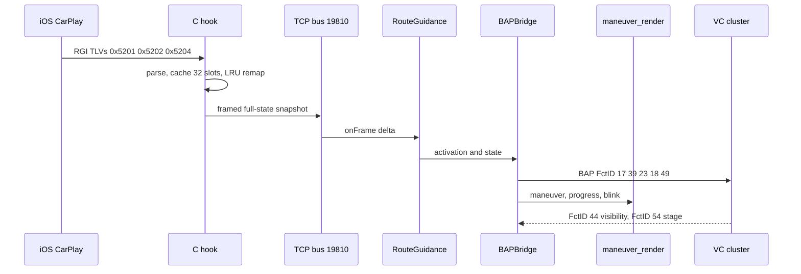
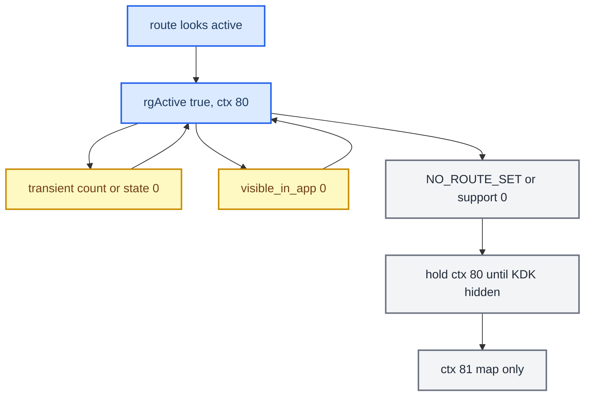

# RGI and BAP Bridge

*The route-guidance path from the iAP2 wire to the cluster: the C hook's slot cache, BAPBridge and its two outputs, the FSG and ExitView handshake, and the field rules that decide when guidance really ends.*

---

## 📋 The bridge and its two outputs

`BAPBridge` feeds two consumers from one `RouteGuidance.State`. `[code]`

- **BAP path** (`AppConnectorNavi`), `ACTIVE_RGTYPE = 0` (RGI): maneuver descriptor, distance and bargraph, street text, lane guidance. The VC uses it for text and the HUD uses it for icons. (`java_patch/com/luka/carplay/rgd/BAPBridge.java:36-39`)
- **Renderer path**: maneuver, progress, and blink commands over TCP `:19800` to `maneuver_render`, which draws plane 98 in ctx 80. Java is the server. The supervisor owns the renderer process, and Java never spawns or kills it. (`java_patch/com/luka/carplay/rgd/RendererServer.java:2-6`, `:44`; `BAPBridge.java:1987`)

`BAPBridge` no longer feeds KOMO route info. There is no `updateNextManeuver`/`setRouteInfo` call from our code. The only KOMO use is `forceGfxAvailable`, which returns early unless the cluster map is MOST, so it does nothing on this FPK car. The cluster map during CarPlay is the phone's altScreen stream on plane 99. `[code]` (`BAPBridge.java:542-546`, `:2268-2290`; `java_patch/de/audi/tghu/navi/app/cluster/ClusterService.java:779-797` is stock-nav only)

`forceClusterRouteInfoState(true)` runs on start. It saves and overrides `container.rgActive`, sets `rgiValid` through `updateRGIString({1})`, and calls `triggerRefreshRGIValid()`. On stop it restores the saved `rgActive`. It does not touch `favoredViewMode`. `[code]` (`BAPBridge.java:558-592`, `:722`)

Concurrency: the blink worker (600 ms) only touches `blinkDistM`/`actionBlinkFull`/the denominator under `synchronized(this)`. Lock order is `this → distanceToManeuverLock → renderer queue`, never inverted. `[code]` (`BAPBridge.java:58`, `:206-212`, `:323`)

## 📊 iAP2 to cluster

## 🔧 Slot mapping and LRU

The C hook keeps a bounded cache and remaps iOS's ever-growing maneuver indices to local slots. `maneuver_list` carries slot indices, and `maneuverOrder[0]` is the current maneuver. `[code]`

- `MANEUVER_CACHE_SIZE = 32`, `MAX_MANEUVER_LIST = 16`. (`hook/routeguidance/rgd_tlv.h:219`, `:230`) The "8 slots" wording is stale, including the in-code comment at `hook/routeguidance/rgd_hook.c:374`.
- **LRU bug (fixed):** `rgd_slot_for_iap_index()` did not refresh the sequence on an existing-slot lookup, and it had no eviction guard for active slots. The icon or turn text got stuck. Current code touches the LRU sequence on lookup and skips active indices when it evicts. `[code]` (`rgd_hook.c:304`, `:339-385`), `[car]`
- The current maneuver is `maneuverOrder[0]` only. If that slot is not valid yet, `BAPBridge` waits and never picks the next filled slot, because that would pair the next arrow with the current distance. `[code]` (`BAPBridge.java:1531`)

## ⚙️ FSG sync and ExitView (FctID 49)

On start, `BAPBridge` sends `RGStatus(1)` (FctID 17), which opens `sync(0)` for `{17, 39, 23, 18, 49}`. It then sends FctID 39, 23, 18 and 49 to close the window. Maneuver updates run `sync(1)` over `{23, 18, 49}`. `[code]` (`BAPBridge.java:725-736`, `:1048`)

Two hard rules: `[car]`, `[code]`

- **Never use `exitViewNum = 1`.** It overwrites the icon with a highway-exit glyph. `sendExitView()` always sends `0`. (`BAPBridge.java:2357-2358`)
- **Toggle the ExitView variant EU↔NAR on every send.** If variant and number are unchanged, `AppConnectorNavi` deduplicates FctID 49, `sync(1)` never closes, and descriptor delivery stalls. (`BAPBridge.java:41-47`, `:2355-2361`)

## ⚙️ FctID 18: distance and bargraph

`BAPBridge` sends distance, `bargraphOn` and percent in one FctID 18 status through `AppConnectorNavi.updateDistanceToNextManeuver`. Our side sets them independently. `[code]` (`BAPBridge.java:317-348`)

- **Denominator:** the step length `mDistance[idx]` (0x5202 TLV 0x0005), capped at 15% of the prepare threshold. If the step length is unknown (`-1`/`0`, as with Google Maps) or longer than the cap, the cap is used. The old rule "unknown ⇒ `bargraphOn = false`" is gone. `[code]` (`BAPBridge.java:56`, `:2495-2513`; commit `4858fc7`)
- **HU model:** `ClusterService` keeps the distance model valid alongside the bargraph while CarPlay owns the cluster: `if (flag && i > 0 && (!showBargraph || AltScreenModule.isConnected()))`. `[code]` (`java_patch/de/audi/tghu/navi/app/cluster/ClusterService.java:377-386`) This is the successor of the old "drop `!showBargraph`" fix that was cited at `:353`.
- **VC display:** whether the VC shows the number and the bar together is not decided by the HU. The audited AU491 `hmi_app.elf` hides the distance on its own when `BargraphOn != 0`. `[decompile]` (`docs/reference/DISTANCE_BARGRAPH_CHAIN.md` §1-2, comment at `ClusterService.java:377-381`) The earlier claim "they show together" is withdrawn. What the installed cluster shows is `[open]`.

## ⚙️ FctID 37: FunctionSync

FunctionSync is property FctID 37 on LSG 50. It is handled by the stock class `FunctionSynchronizationNavi`, which is not in our tree. Its lifecycle is IDLE → STARTING → RUNNING → COMPLETED. `[car]`

| Type | Open payload | Members |
|---|---|---|
| type 0 | `{0:0:97:0:1:0:64:0}` | `{17, 39, 23, 18, 49}` |
| type 1 | `{0:0:33:0:0:0:64:0}` | `{23, 18, 49}` |
| close | all-zero | none |

## ⚠️ `visible_in_app` (TLV 0x0F) is not route-active

iAP2 `RouteGuidanceUpdate` TLV `0x0F` is `RouteGuidanceBeingShownInApp`. It tells whether the nav app's guidance UI is on screen, not whether a route is active (accessoryd 23G71 `+[ACCNavigationRouteGuidanceUpdateInfo keyForType:]` case `0xF`). iOS sends `0` for third-party maps and whenever the nav app is in the background, even mid-route. `[decompile]`

So `visible_in_app == 0` does not tear down RGI while route state, maneuver count or the maneuver list still look active. `route_state == NO_ROUTE_SET` and `source_supports_rg == 0` force deactivation. `[code]` (`java_patch/com/luka/carplay/rgd/RouteGuidance.java:492-521`; fix `1d6cafd`), `[car]`

## ⚠️ Transient `route_state = 0` and `maneuver_count = 0`

iOS briefly sends `count = 0` at route start, and `route_state = 0` during setup and about every 30 s mid-route. These only reset count and order, and they never clear per-slot data. `[code]` (`RouteGuidance.java:911-935`, `:961-990`)

A full per-slot clear happens only on:

- `source_supports_rg == 0` (`RouteGuidance.java:886-905`)
- a disconnect reason (`:458-468`)
- a new `route_generation` from the hook (`:822-838`)

`[code]`

## 🔄 RGI lifecycle

Route end goes back to ctx 81, not to the stock cluster. Ctx 74 returns only when CarPlay stops owning the cluster (see [[Cluster Contexts]]). `[code]` (`RouteGuidance.java:553-560`, `java_patch/com/luka/carplay/core/AltScreenModule.java:356-378`)

## 🔗 Related

- [[Cluster Contexts]]: `rgActive` here flips ctx 81↔80.
- [[HUD Renderer]]: the maneuver arrow and the HUD.
- [[Third-party Nav Apps]]: why `source_supports_rg` is 0 for Waze.
- [[Hook to Java Bus]]: the `:19810` framing.

Provenance: `docs/RGI_HUD_RENDERER_KNOWLEDGE.md`, `docs/reference/DISTANCE_BARGRAPH_CHAIN.md`, `MEMORY.md` (BAP Bargraph, Slot Mapping, FSG Sync, BAP FunctionSync, visible_in_app), `memory/bapbridge_architecture.md` (its KOMO dual path is superseded); source `hook/routeguidance/rgd_hook.c`, `hook/routeguidance/rgd_tlv.h`, `java_patch/com/luka/carplay/rgd/{BAPBridge,RouteGuidance,RendererServer}.java`, `java_patch/de/audi/tghu/navi/app/cluster/ClusterService.java`.
