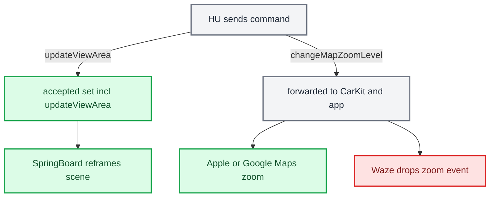

# Third-party Nav Apps

*Why Waze and AMap put little or nothing on the cluster, why Waze ignores steering-wheel zoom, and the one lever (`updateViewArea`) that reshapes any app's cluster scene without its cooperation.*

---

## 📋 Where RGI actually comes from

The app does not produce the iAP2 `RouteGuidanceUpdate`. `CarPlay.framework` produces it from two private model objects (`CPRouteGuidance`, `CPManeuver`) through a generic serializer, then hands it to accessoryd. The wire payload is a fixed `CPAccNavParam` table: 13 params for `CPManeuver` and 22 for `CPRouteGuidance`. Anything not in that table never leaves the phone. `[decompile]` (iOS 26.6 23G71, `CarPlay` image base `0x23d8f1000`)

Neither table has an image property. `symbolImage`, `junctionImage` and `dashboardSymbolImage` are used only on the CarPlay screen. The cluster gets semantics (a type, a junction shape, angles, a distance, a string) and draws its own icon. That is why our `ManeuverMapper` exists (`java_patch/com/luka/carplay/rgd/ManeuverMapper.java`). `[decompile]`

## ⚠️ Waze and AMap fail at different stages

The on/off gate is `CPRouteGuidance.sourceSupportsRouteGuidance` (TLV `0x14`). It comes from `sendsNavigationMetadata`, which depends on whether the map delegate implements `mapTemplateShouldProvideNavigationMetadata:`. The session ivar defaults to NO, and the host is told whatever arrived. `[decompile]`

| App | Metadata gate | maneuverType | What reaches the cluster |
|---|---|---|---|
| Waze | Never implements the selector, so `SourceSupportsRouteGuidance = 0` | never set | Nothing. `RouteGuidance.java` forces deactivation on `source_supports_rg == 0` |
| AMap | Implements it 3× (on while navigating) | never set | Session, ETA and distance flow; maneuvers are typeless |
| Apple/Google Maps | Implements it | set | Full RGI |

`[decompile]` for the app behavior; `[code]` for our reaction (`java_patch/com/luka/carplay/rgd/RouteGuidance.java:517`, `:876-905`)

Waze bakes roundabout exit numbers into a UIImage snapshot (`addTurnSymbolToManeuver:` `0x10005c590`). It has the full turn set (22 icon assets, `_UK` twins for left-hand traffic) and discards it at the CarPlay boundary. It never sets `junctionType`, `trafficSide`, junction angles, `linkedLaneGuidance`, `maneuverState` or `currentRoadNameVariants`. This cannot be fixed from our side. `[decompile]`

## ⚠️ Waze altScreen zoom is dropped inside Waze

This is the video cluster (our altScreen, type-111 stream), separate from BAP RGI. Waze ships the cluster scene and implements `instrumentClusterControllerDidZoomIn/Out:` (`0x1009ade98` / `0x1009adf68`). Each handler only sends a stat and `controlEventSubject.send(.zoom)`. The only subscriber, `CarPlayInstrumentClusterRootCoordinator.startCoordinator` (`0x1009b58b8`), maps the stream to `UIUserInterfaceStyle` with `compactMap`, which turns `.zoom` into `nil`. `[decompile]`

The Waze cluster camera is fixed at `.trackUserLocation(.static(1/8000))` with no `.dynamic` auto-zoom. Its `zoomSubject` is fed only by the main-screen map buttons. So our `changeMapZoomLevel` reaches Waze, is counted as a stat, and is discarded. This is not an HU bug, because Apple and Google Maps act on the same callback. The Waze cluster map itself is gated by Waze config item 1006 (default on, can be overridden from Waze's server). `[decompile]`

## ⚙️ `CMD_ALT_ZOOM` is live

`changeMapZoomLevel` is a semantic command, not HID. `CMD_ALT_ZOOM = 0x0110` is live end to end. `[code]`

- Java: the MFL roller in `AltScreenModule` sends it (`java_patch/com/luka/carplay/core/AltScreenModule.java:95-101`). The constant is at `java_patch/com/luka/carplay/bus/CarplayBus.java:54`.
- Hook: `hook/framework/bus_protocol.h:92`, handler `zoom_on_cmd` (`hook/altscreen/altscreen_hook.c:2465-2491`, registered at `:2635`). It expands a signed step (capped at 8) into `changeMapZoomLevel{uuid, zoomDirection}` commands for the cluster UUID. `ALTSCREEN_ZOOM_INVERT` flips the direction.

`CMD_ALT_HID` and `CMD_KNOB` are not defined in `bus_protocol.h`. The cluster display advertises no `primaryInputDevice` (`altscreen_hook.c:508-510`), so all cluster commands are BAP or semantic. `[code]`

## 🔧 The other lever: `updateViewArea`

The phone accepts a fixed set of HU→phone commands in `carEndpoint_processEventCreatingResponse` (AirPlaySender, iOS 27 24A5418b): `forceKeyFrame, hidSendReport, changeModes, iAPSendMessage, requestSiri, requestUI, updateViewArea, setLimitedUI, setNightMode, setVideoPlaybackAllowed, videoPlayerBackButtonEvent, updateVehicleInformation`. Everything else, including `changeMapZoomLevel`, goes on to CarKit and then to the app's delegate. `[decompile]`

`updateViewArea {uuid, viewAreaIndex, adjacentViewAreas, animationDurationMillis}` is the only command that changes what an app draws without the app's cooperation. It is validated against the whole `/info` `displays[]` (cluster included). It is gated by `"viewAreas"` in the negotiated feature list and by `viewAreas` + `initialViewArea` + `adjacentViewAreas` on the display. On success, CarKit updates `CARScreenInfo.currentViewArea` and SpringBoard re-frames that display's scenes. `[decompile]`

The earlier note gave the endpoint flags as "viewAreas +0x45; altScreen +0x3f". The hook's own RE comment gives `viewAreas+0x3D, altScreen+0x3E, uiContext+0x3F` (`altscreen_hook.c:1833-1835`). This is unresolved `[open]`.

The zoom idea: shrink or grow the cluster window while the map stays at 1:8000 per point, so the visible extent changes. That would give zoom steps by cropping the 111 stream. Scale trap: declare more pixels only with proportionally more physical mm. Otherwise `CRScreenScaleHeuristics` goes @2x and the extent does not change. `[decompile]`

## ⚠️ State in our hook

`viewAreas` and `updateViewArea` are implemented in `hook/altscreen/altscreen_hook.c`, but only for zone switching (fullscreen / sportscreen / classicscreen via `CMD_ALT_ZONE 0x0111`). `[code]` (`altscreen_hook.c:2016-2025`, `:2269-2291`; `hook/framework/bus_protocol.h:95`)

- All three view areas keep the full 1440×542 visible frame and differ only in the nested `safeArea`. Fullscreen safe area: `(270,90) 900×290`. Sport and classic: `360×300` at `x = 90` and `x = 540` (`altscreen_hook.c:280-293`). `[code]`
- A view area whose visible frame was reduced to the safe region got the 111 stream rejected at activation (`altscreen_hook.c:259-262`). Root cause unknown. Candidates are CarKit `minAcceptableViewAreaSize*` / `isViewAreaPixelSizeAcceptable`, or the initial view area having to equal the display. Zoom by view area is blocked on this. `[open]`

Cluster scene URL (`showUI`): itemType and layout

The HU chooses the cluster scene with `showUI{uuid, url}`. DashBoard parses that URL for every app. `[decompile]` (`altscreen_hook.c:2536-2545`)

| URL | itemType |
|---|---|
| `maps:/car/instrumentcluster` | 3 (map + cards) |
| `.../map` | 1 (map only; Waze showed ETA + road name, no turn card) |
| `.../instructioncard` | 2 (card only) |

Query keys are case-sensitive: `showETA`, `maneuverLayout=topAligned|leftAligned|rightAligned` → 1/2/3. iOS 27 also has `showSpeedLimit`/`showCompass`. The CarPlaySupport card platter needs a safe height of about 290 px or more in narrow zones. Otherwise it logs "Undefined layout (0), will not show cluster content" and hides ETA and the turn card. That is why the zones are 360×300 (`altscreen_hook.c:285-293`). `[decompile]`, `[code]`

URLs the hook sends today: `[code]` (`altscreen_hook.c:2560-2561`)

- RGI off: `maps:/car/instrumentcluster?showETA=yes&maneuverLayout=rightAligned&showSpeedLimit=no`
- RGI on: `maps:/car/instrumentcluster/map?showETA=no&maneuverLayout=no&showSpeedLimit=no`

The runtime switch is `CMD_ALT_RGI 0x0116`, sent from `AltScreenModule.republish()` (`AltScreenModule.java:301-330`, `bus_protocol.h:108`). The hook also re-sends `showUI` on the first IDR and after every accepted zone switch. There is no env override; Luka rejected one. `[code]`

---

## 🔗 Related

- [[RGI and BAP Bridge]]: `source_supports_rg == 0` (Waze) clears RGI cleanly.
- [[AltScreen Cluster Video]]: the type-111 stream these commands act on.
- [[Cluster Contexts]]: where the cluster video plane lands.

Provenance: `docs-obsidian/Sources/reference/RGI_THIRD_PARTY_NAV_APPS.md`, `MEMORY.md` (Third-party nav apps, zoom vs HID, updateViewArea), `memory/rgi_third_party_maneuvertype.md`, `memory/carplay_updateviewarea_cluster_zoom.md`, `memory/cluster_scene_url_itemtype_layout.md`; source `hook/altscreen/altscreen_hook.c`, `hook/framework/bus_protocol.h`, `java_patch/com/luka/carplay/bus/CarplayBus.java`, `java_patch/com/luka/carplay/core/AltScreenModule.java`.
