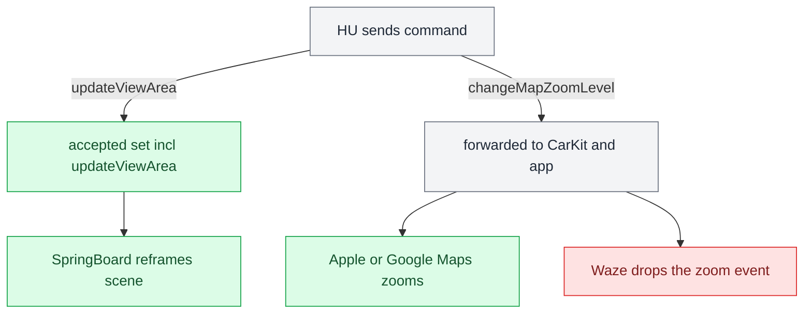

# Third-party Nav Apps

*Why Waze and AMap put nothing useful on the cluster, why Waze ignores steering-wheel zoom, and the one lever (`updateViewArea`) that reshapes any app's cluster scene without its cooperation.*

---

## 📋 Where RGI actually comes from

iAP2 `RouteGuidanceUpdate` is **not** produced by the app — it is produced by **`CarPlay.framework`** from two private model objects (`CPRouteGuidance`, `CPManeuver`) through a generic serializer, then handed to accessoryd. The wire payload is a fixed `CPAccNavParam` table (13 params for `CPManeuver`, 22 for `CPRouteGuidance`). **Anything not in that table never leaves the phone.** **[decompile]** (iOS 26.6 23G71, `CarPlay` image base `0x23d8f1000`.)

**No image property is in either table** — `symbolImage`, `junctionImage`, `dashboardSymbolImage` are CarPlay-screen-only. The cluster gets *semantics* (a type, a junction shape, angles, a distance, a string) and draws its own icon. That is exactly why our `ManeuverMapper` exists. **[decompile]**

## ⚠️ Waze and AMap fail at different stages

The on/off gate is `CPRouteGuidance.sourceSupportsRouteGuidance` (TLV `0x14`) ← `sendsNavigationMetadata` ← whether the map delegate implements `mapTemplateShouldProvideNavigationMetadata:`. The session ivar defaults to **NO**, and the host is told whatever arrived, unconditionally. **[decompile]**

| App | Metadata gate | maneuverType | What reaches the cluster |
|---|---|---|---|
| **Waze** | Never implements the selector → `SourceSupportsRouteGuidance = 0` | never set | **Nothing** — Waze declares no route guidance; our `RouteGuidance.java` correctly stays stock |
| **AMap** | Implements it 3× (on while navigating) | never set | Session, ETA, distance flow; maneuvers are **typeless** |
| **Apple/Google Maps** | Implements it | set | Full RGI |

Waze even bakes roundabout exit **numbers into a UIImage snapshot** (`addTurnSymbolToManeuver:` `0x10005c590`) — it has the full turn taxonomy (22 icon assets, `_UK` twins for left-hand traffic) and discards it at the CarPlay boundary. It also never sets `junctionType`, `trafficSide`, junction angles, `linkedLaneGuidance`, `maneuverState`, or `currentRoadNameVariants`. **Not fixable from our side.** **[decompile]**

## ⚠️ Waze altScreen zoom is dropped inside Waze

This is the *video* cluster (our altScreen / type-111 stream), separate from BAP RGI. Waze ships the cluster scene and implements `instrumentClusterControllerDidZoomIn/Out:` (`0x1009ade98` / `0x1009adf68`), but each handler only sends a stat and `controlEventSubject.send(.zoom)`. The **sole subscriber** (`CarPlayInstrumentClusterRootCoordinator.startCoordinator` `0x1009b58b8`) `compactMap`s the stream to just the `UIUserInterfaceStyle` and maps `.zoom` to `nil`. **[decompile]**

The Waze cluster camera is hard-coded `.trackUserLocation(.static(1/8000))` — no `.dynamic` auto-zoom — and its `zoomSubject` is fed only by main-screen map buttons. So our `changeMapZoomLevel` reaches Waze, is counted as a stat, and is discarded. **Not an HU bug** — Apple/Google Maps act on the same callback. (The Waze cluster map itself is gated by Waze config item 1006, default on, server-overridable.) **[decompile]**

## ⚙️ `CMD_ALT_ZOOM` is live

Correcting an earlier note: `changeMapZoomLevel` is a **semantic command, not HID**, and `CMD_ALT_ZOOM` is **not dropped** — it is live at `0x0110` (`bus_protocol.h:93`, `CarplayBus.java:52`, handler `zoom_on_cmd`). `CMD_ALT_HID`/`CMD_KNOB` do not exist; the cluster has no HID path (its dict advertises no `primaryInputDevice`), so all cluster commands are BAP/semantic. **[car]** The zoom works for Apple/Google Maps and is dropped inside Waze — nothing on our side is broken.

## 🔧 The other lever: `updateViewArea`

The phone accepts a fixed set of HU→phone commands in `carEndpoint_processEventCreatingResponse` (AirPlaySender, iOS 27 24A5418b): `forceKeyFrame, hidSendReport, changeModes, iAPSendMessage, requestSiri, requestUI, updateViewArea, setLimitedUI, setNightMode, setVideoPlaybackAllowed, videoPlayerBackButtonEvent, updateVehicleInformation`. Everything else (including `changeMapZoomLevel`) is forwarded to CarKit → the app's delegate. **[decompile]**

`updateViewArea {uuid, viewAreaIndex, adjacentViewAreas, animationDurationMillis}` is the **only** command that changes what an app draws **without the app's cooperation**. It is validated against the whole `/info` `displays[]` (cluster included), gated by `"viewAreas"` in the setup feature list (flag +0x45; altScreen is +0x3f) and by `viewAreas` + `initialViewArea` + `adjacentViewAreas` on the display. On success CarKit updates `CARScreenInfo.currentViewArea` and SpringBoard re-frames that display's scenes. **[decompile]**

The idea: shrink/grow the cluster window, the map stays 1:8000 per point, so the visible extent changes = zoom steps by cropping the 111 stream. **Scale trap:** declare more pixels only with proportionally more physical mm, or `CRScreenScaleHeuristics` goes @2x and the extent does not change.

## ⚠️ State in our hook

`viewAreas` + `updateViewArea` are already implemented in `hook/altscreen/altscreen_hook.c`, but **only for zone switching** (fullscreen / sportscreen / classicscreen). All three declared view areas keep the full **1440×542** visible frame and differ only in the nested `safeArea`. A view area whose *visible* frame was reduced to the safe region got the 111 stream **rejected at activation** (comment ~L258), root cause unknown (candidates: CarKit `minAcceptableViewAreaSize*` / `isViewAreaPixelSizeAcceptable`, or the initial view area having to equal the display). **Zoom-by-view-area is blocked on that.** **[open]**

Cluster scene URL (`showUI`) — itemType and layout

The HU never sends URLs during activation; the phone fetches them into `/info` under `altScreenURLs`. DashBoard parses the HU's `showUI` URL for **every** app: **[decompile]**

| URL | itemType |
|---|---|
| `maps:/car/instrumentcluster` | 3 (map + cards) |
| `.../map` | 1 (map only — Waze showed ETA + road name, no turn card) |
| `.../instructioncard` | 2 (card only) |

Query keys (case-sensitive): `showETA`, `maneuverLayout=topAligned|leftAligned|rightAligned` → 1/2/3; iOS 27 also `showSpeedLimit`/`showCompass`. The CarPlaySupport card platter needs safe height **≥ ~290 px** in narrow zones or it logs "Undefined layout (0), will not show cluster content" and hides ETA + turn card — so our zones are 360×300. Runtime switch is `CMD_ALT_RGI 0x0116` from `AltScreenModule.republish`; Luka rejected an env override. **[decompile]**

---

## 🔗 Related

- [[RGI and BAP Bridge]] — `source_supports_rg == 0` (Waze) clears RGI cleanly.
- [[AltScreen Cluster Video]] — the type-111 stream these commands act on.
- [[Cluster Contexts]] — where the cluster video plane lands.

Provenance: `docs/reference/RGI_THIRD_PARTY_NAV_APPS.md`, `MEMORY.md` (Third-party nav apps, zoom vs HID, updateViewArea), memory `rgi_third_party_maneuvertype.md`, `carplay_updateviewarea_cluster_zoom.md`, `cluster_scene_url_itemtype_layout.md`; source `hook/altscreen/altscreen_hook.c`, `bus_protocol.h`, `CarplayBus.java`.
