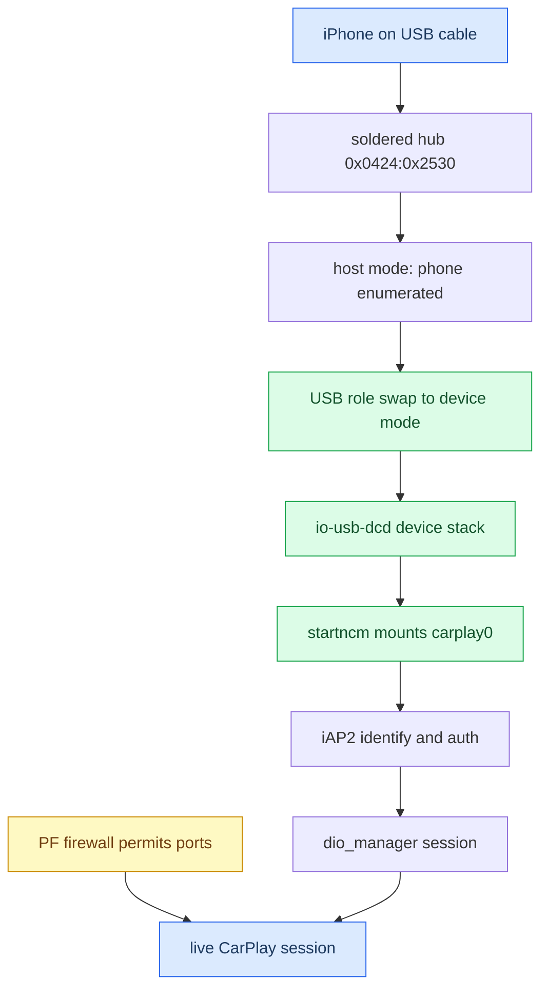

# Connect and USB MOC

*Map of content for how an iPhone gets from a USB plug to a live CarPlay session on MHI2Q — enumeration, role swap, NCM, iAP2, dio, and every way that path wedges.*

---

## 📋 What this section covers

CarPlay on this head unit rides a soldered `0x0424:0x2530` USB hub. The phone plugs in as a host-mode Apple device, the head unit performs a USB role swap so the phone enumerates *us*, then a gadget descriptor brings up an **NCM** network interface (`carplay0`) over which **iAP2** and the CarPlay session run. Every note below covers one segment of that chain or one failure mode of it.

Start with [[USB and NCM Connect]] for the healthy path and its timing. [[USB Replug Recovery]] is the big one — how a single fast replug wedges the whole stack until reboot. [[PF Firewall]] and [[iOS Version Gate]] cover two traps that block a connect for reasons that look nothing like USB. For the hub note and the full trap list see [[Home]] and [[Landmines]].

## 📊 The connect path

## 🔗 The notes

| Note | What it covers |
|---|---|
| [[USB and NCM Connect]] | The healthy stock connect path, the IPv6 DAD ~1 s cost, and the levers proven harmless (`-w 10000`, en-dashes, `connect_poll`). |
| [[USB Replug Recovery]] | The replug-wedge: one fast replug kills `io-usb-dcd`, `carplay0` loses carrier, `TIMEOUT_STARTUP` loops forever. Startup self-heal + the SI stack-restart rule. |
| [[PF Firewall]] | Why patching `pf.conf` does nothing — the live ruleset is per-interface (`pf.ecm0.conf` on LTE). Patch all four; verify with `pfctl -sr`. |
| [[iOS Version Gate]] | iOS 26 vs 27 BonjourHost behaviour — iOS 27 carkitd repairs the advert itself; the HU advertisement is still the broken side. |

## 💡 Truth levels

Claims are tagged **[car]** confirmed on the unit, **[decompile]** from reverse engineering, **[open]** hypothesis. The honest headline: the replug-wedge cause and the stock recovery script are **[car]**; the two recovery *candidates* (NCM generation fence, SI re-arm) are **[decompile]** with no live A/B yet; the IPv6 DAD cost is a strong **[open]** hypothesis, never measured HU-side.

Provenance lives in `docs/USB_REPLUG_RECOVERY_RUNBOOK.md`, `docs/USB_IPHONE_CONNECT_POSTMORTEM.md`, and `docs/reference/NCM_AND_FIREWALL_IDEAL_START.md`.
