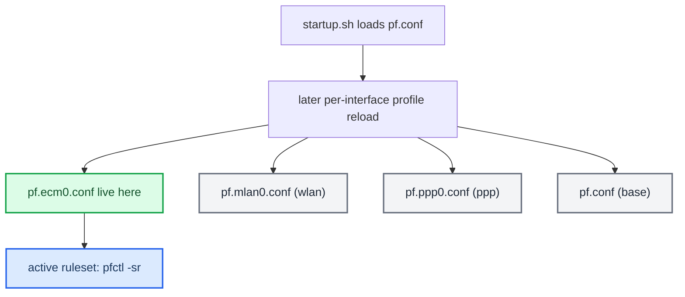

# PF Firewall

*The per-interface PF ruleset trap — the live firewall profile depends on which external interface came up, so patching `pf.conf` alone silently does nothing.*

---

## 🔐 The trap

MHI2Q ships four PF rulesets in `/mnt/system/etc/`: `pf.conf`, `pf.ecm0.conf`, `pf.mlan0.conf`, `pf.ppp0.conf` (stock copies in `deploy/pf/stock/`). The one actually loaded depends on which external interface comes up. On this car (LTE modem present) the live profile is **`pf.ecm0.conf`**. **[car]** verified 2026-08-28: the active ruleset carried 11 `on ecm0` rules and a single `port = 6030`, while the then-patched `pf.conf` had the range `6030:6031`.

The consequence is a silent failure: patching only `pf.conf` does nothing — the extra CarPlay ports stay blocked on the live profile, and nothing logs an error. It also explains a boot-order oddity — CarPlay came up only after the modem finished initialising, because the ruleset is (re)loaded around `ecm0` coming up.



## 🔧 Where the swap happens

Stock `start_network()` in `startup.sh` literally runs `/armle/sbin/pfctl -ef /etc/pf.conf` (`Firmwares/HU/MHI2Q_US_AUG22_P5087_MU1316/extracted/system/etc/boot/startup.sh:1050,1061`), so the profile swap happens later and is **not** done by a shell script — the stock `/etc` scripts only touch `pfctl` for anchors, tables and state kills (`dhcp/dhcp-up`, `ppp/ip-up`, `wpa_action.sh`, `app/eso/telephone/ecm-down`); none loads a `pf.<if>.conf`. Some binary (network/connectivity manager) reloads it around `ecm0` coming up. **[open]** which binary — not chased further.

## ✅ How the installer applies it

**[code]** The only CarPlay change is the `carplay0` inbound TCP rule: stock `port { …, 6030, … }` becomes `6030:6032` — 6031 altScreen, 6032 buffered audio (`deploy/pf/README.md:3-4`).

| Piece | Path | Role |
|---|---|---|
| Installer | `install_MoreIncredibleBash/mod/custom.sh:35,89-110` | `patch_pf()` edits all four live profiles in-shell (no `patch`/sed on the HU); idempotent (`:95` skips `6030:6032`), rewrites exactly one `pass in quick on carplay0 proto tcp … port {` rule, also normalising older `6030:6031`/`6030:6033` widenings (`:97-105`), backs up once as `<profile>.carplay-stock` (`:106`), atomic `mv`; uninstall restores the backups (`:152-156`) |
| Stock profiles | `deploy/pf/stock/` | pristine originals; rule at `pf.ecm0.conf:220`, `pf.conf:206`, `pf.mlan0.conf:215`, `pf.ppp0.conf:210` |
| Reference result | `deploy/pf/patched/` | A/B only — the installer does **not** copy these (`deploy/pf/README.md:9-12`) |
| Recipe | `deploy/pf/patch_pf.sh` | regenerates `patched/` from `stock/` with the same transform, asserting one rule per profile (`patch_pf.sh:23-28`) |

The supervisor wrapper does no firewall work; it assumes the ports are open (`deploy/smartphone_integrator/README.md:58-66`).

## 🔍 How to verify

Verify against the **active** ruleset, never the file:

```sh
pfctl -sr | grep -E "carplay0.*603"   # must show the range 6030:6032, not port = 6030
```

Patching `/mnt/system/etc` takes effect on the next boot (or an explicit `pfctl -f /mnt/system/etc/pf.ecm0.conf`). `pfctl -n -f pf.ppp0.conf` reports `SIOCGIFMTU: No such device or address` on this box — true of the stock file too, not caused by the widening (`deploy/pf/README.md`, "Note on pf.ppp0.conf").

> ⚠️ Reading the file instead of `pfctl -sr` is exactly the mistake that cost a reboot and a confusing "altScreen doesn't load" hunt. The file can say one thing while the live ruleset — a different profile entirely — still says `port = 6030`.

Related: [[USB and NCM Connect]], [[Deploy and Release]], [[Landmines]].
