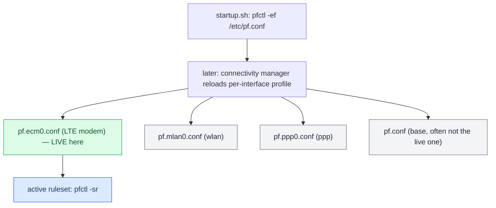

# PF Firewall

*The per-interface PF ruleset trap — the live firewall profile depends on which external interface came up, so patching `pf.conf` alone silently does nothing.*

---

## 🔐 The trap

MHI2Q ships **four** PF rulesets in `/mnt/system/etc/`: `pf.conf`, `pf.ecm0.conf`, `pf.mlan0.conf`, `pf.ppp0.conf`. **The one actually loaded depends on which external interface comes up.** On this car (LTE modem present) the live profile is **`pf.ecm0.conf`**. **[car]** verified 2026-08-28: the active ruleset carried 11 `on ecm0` rules and a single `port = 6030`, while the patched `pf.conf` had the range `6030:6031`.

The consequence is a silent failure: patching only `pf.conf` does **nothing** — the target TCP port (e.g. altScreen's 6031) stays blocked, and nothing logs an error. It also explains a boot-order oddity — CarPlay came up only after the modem finished initialising, because the ruleset is (re)loaded around `ecm0` coming up.



## 🔧 Where the swap happens

`startup.sh:1061` literally says `pfctl -ef /etc/pf.conf`, so the profile swap happens **later** and is **not** done by a shell script — `grep` for `ecm0.conf` across `/etc` scripts finds nothing. Some binary (network/connectivity manager) reloads it around `ecm0` coming up. Not chased further. **[car]**

## ✅ How to apply and verify

`deploy/smartphone_integrator/install_persistent_pf.sh` patches **all four** profiles (idempotent, `.stock` backup each). The rule that must be present opens the CarPlay ports on `carplay0`.

Verify against the **active** ruleset, never the file:

```sh
pfctl -sr | grep -E "carplay0.*603"   # must show a RANGE 6030:6032, not port = 6030
```

Patching the source only takes effect on the next boot (or an explicit `pfctl -f /mnt/system/etc/pf.ecm0.conf`).

> ⚠️ Reading the file instead of `pfctl -sr` is exactly the mistake that cost a reboot and a confusing "altScreen doesn't load" hunt. The file can say `6030:6031` while the live ruleset — a different profile entirely — still says `port = 6030`.

Related: [[USB and NCM Connect]], [[Landmines]].

---
