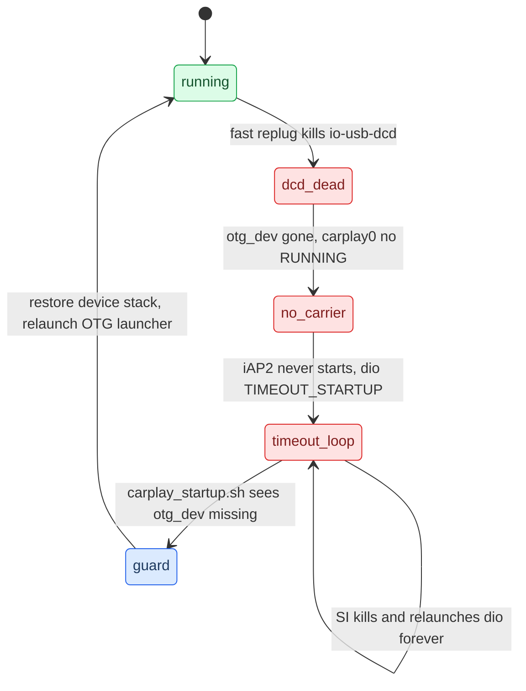

# USB Replug Recovery

*The replug-wedge: one fast unplug/replug kills the USB device stack and CarPlay never returns until a reboot — its cause, the startup self-heal, and the SI stack-restart rule.*

---

## ⚠️ The failure

CarPlay is working. The phone is unplugged and replugged **once, quickly**. It never reconnects — through roughly 500 retry cycles over 45 minutes, until a reboot. Observed 2026-09-03. **[car]** Symptom write-up `docs/USB_IPHONE_CONNECT_POSTMORTEM.md`.

The measured chain **[car]**:

| Observation | How it was read |
|---|---|
| `carplay0` UP but **without `RUNNING`** | `ifconfig carplay0` — no `RUNNING` = no carrier = link/stack problem, not our software |
| ~500 `smartphone_integrator_error_*` dumps, `appState=TIMEOUT_STARTUP` | slog |
| iPhone **was** enumerated (`05ac:12a8`, 4 configs) | `usb` — cable, port and phone are all fine |
| hook log stops after `Captured stock ICinemoIAP`, no `NmeTransport::Recv` | iAP2 never started; the failure is below dio |
| `/dev/io-usb/otg_dev` **missing**, `io-usb-dcd` not running | `ls` — the device-mode stack is gone |

## 🔧 Why it wedges and self-heals

The replug kills **`io-usb-dcd`** (the USB *device*-mode stack) and nothing restarts it. `/etc/usblauncher.lua` starts the OTG launcher **once**, gated on `/tmp/usblauncherFlag_mediaconnector_*`. That flag clears only when the **hub** is removed — and the hub is soldered in. `/tmp` is a RAM disk, so the wedged state survives every replug and clears only on reboot.



The stock platform already carries the recovery — the guard just calls it. **[car]** verified live: with `otg_dev` missing, `start_otg_stack_device_mode.sh` brought `io-usb-dcd` back and recreated the node.

```sh
# deploy/smartphone_integrator/carplay_startup.sh
if ! ls /dev/io-usb/otg_dev >/dev/null 2>&1; then
    /etc/scripts/start_otg_stack_device_mode.sh   # start_stack::device,2 -> PPS usb_ctrl1
fi
```

It lives in **startup**, not `carplay_cleanup.sh`, because startup runs on every launch including each retry of the failure loop — so the system heals on the next attempt. Cleanup may never run when SI kills dio on a startup timeout.

> ⚠️ Restoring the node alone did **not** bring CarPlay back: the OTG `usblauncher` owns the device stack, so poking the PPS object puts the node back *behind the owner's back* and the launcher holds stale state. The guard now also relaunches that launcher (argv from `pidin`, not `/proc` — `/proc/<pid>/cmdline` is empty for it on QNX). Whether node + launcher restart together are sufficient is **[open]** — it needs the failure to recur, which cannot be summoned on demand.

## 🔍 The SI stack-restart rule

A dying dio generation is by design — what matters is **how** it ended. **[decompile]** of stock `smartphone_integrator` (IDA, `smartphone_integrator.i64`); doc `docs/reference/SI_STACK_RESTART_RE.md`.

`CarPlaySupervisor_RunningState_HandleAppState` @0x186b00, on `STOPPED`, dispatches on the previous state:

| Previous state | Action | Stack |
|---|---|---|
| 6/7 `DEINITIALIZING`/`DEINITIALIZED`, 8 `STOPPING` | `cleanup(error=0)` | **spared** (`softPath_noStackRestart`) |
| 13/15 `TIMEOUT_WATCHDOG`/`TIMEOUT_SHUTDOWN` | `cleanup(error=1)` | teardown |
| 11/14/16 `ERROR_SETUP`/`TIMEOUT_STARTUP`/`PREPARING`, 12 `ERROR_RUNTIME` | retries left → `prepare(retry=1)`, else `cleanup(error=1)` | **RestartDeviceStack** |

`RestartDeviceStack` runs `otgStackCleanupScript = /etc/scripts/stopncm.sh` = `ifconfig carplay0 destroy` → phone sees `USB eligible: N (No Network Interface)`. So a clean `DEINITIALIZED` exit spares `carplay0`; an `ERROR_RUNTIME`/`TIMEOUT_*` exit destroys it.

**Decisive diagnostic**: grep HU slog for `[CSIStateRunning]` and read `oldAppState` at the transition into `STOPPED`. `ERROR_RUNTIME`/`TIMEOUT_*` ⇒ SI is restarting the USB stack, and the fix belongs in dio/our hook (exit cleanly), **not** in the USB or firewall layer.

<details>
<summary>The two reversible recovery candidates (not yet live-proven)</summary>

Both live in `deploy/experimental/usb_replug_recovery/`; runbook `docs/USB_REPLUG_RECOVERY_RUNBOOK.md`. **[decompile]** — host tests pass, no live A/B yet.

- **NCM generation fence** — `startncm.sh` + `stopncm.sh` + `usblauncher_otg.lua.patch` take a shared per-interface lock and publish `/tmp/ncm_generation_carplay0 = busno:devno:iface:pid`. Stops the stock one-second delayed teardown from destroying a *new* `carplay0`. Residual risk: assumes QNX assigns a fresh `devno` per enumeration.
- **SI error re-arm** — `patch_si_rearm.py` flips one ARM instruction at VA `0x17FDB4` (`MOV R3,#0` → `AND R3,R9,LR,LSR #6`) so a CarPlay error/final-retry cleanup does `SwitchPort(direction=1)` (activate + `start_stack::device,2`) instead of the terminal stop-only path. Stock size `802798`, SHA `a25dc9…` → patched `606236…`. MHI2Q-only, must not go on MH2p.

Test the NCM fence alone first; only try the SI image if a dead session still remains, stock retained for rollback.

</details>

## 💡 Diagnosis shortcuts

- `ifconfig carplay0` — flags without `RUNNING` = no carrier = stack/link problem, not our code.
- `usb` — iPhone as `05ac:12a8` with 4 configs means cable and USB are fine.
- Hook log stopping after `Captured stock ICinemoIAP` (no `NmeTransport::Recv`) = iAP2 never started.
- `sloginfo`'s ring buffer is flushed in ~2 min by a `devp-iso-mmx[isoTX2]`/videoCore storm (59% of lines) — its **absence proves nothing**. Read `/tmp/carplay_hook.log` instead.
- The only proven full recovery of an already-wedged session is a **reboot**. Do **not** loop `start_otg_stack_device_mode.sh`, kill/relaunch `usblauncher` without a latch, or `switch port` the media connector — the last one moved the phone off the host controller and made things worse.

Related: [[USB and NCM Connect]], [[Landmines]].

---
