# USB Replug Recovery

*The replug-wedge: one fast unplug/replug killed the USB device stack and CarPlay never returned until a reboot — its cause, the SI stack-restart rule, and what the shipping build carries against it.*

---

## ⚠️ The failure

CarPlay is working. The phone is unplugged and replugged once, quickly. It never reconnects — through roughly 500 retry cycles over 45 minutes, until a reboot. Observed 2026-09-03. **[car]** Symptom write-up `docs/USB_IPHONE_CONNECT_POSTMORTEM.md`.

The measured chain **[car]**:

| Observation | How it was read |
|---|---|
| `carplay0` UP but without `RUNNING` | `ifconfig carplay0` — no `RUNNING` = no carrier = link/stack problem, not our software |
| ~500 `smartphone_integrator_error_*` dumps, `appState=TIMEOUT_STARTUP` | slog |
| iPhone was enumerated (`05ac:12a8`, 4 configs) | `usb` — cable, port and phone are all fine |
| hook log stops after `Captured stock ICinemoIAP`, no `NmeTransport::Recv` | iAP2 never started; the failure is below dio |
| `/dev/io-usb/otg_dev` missing, `io-usb-dcd` not running | `ls` — the device-mode stack is gone |

## 🔧 Why it wedges

The replug kills `io-usb-dcd` (the USB *device*-mode stack) and nothing in stock restarts it. `/etc/usblauncher.lua` starts the OTG launcher once, gated on `/tmp/usblauncherFlag_mediaconnector_*`. That flag clears only when the hub is removed — and the hub is soldered in. `/tmp` is a RAM disk, so the wedged state survives every replug and clears only on reboot. **[car]**

```mermaid
stateDiagram-v2
  accTitle: Replug wedge and the shipping recovery path
  accDescr: Healthy running state, a fast replug kills the device stack, carplay0 loses carrier and dio times out in a loop; the shipping SI re-arm patch turns the final error cleanup into a device-stack start instead of a stop.
  [*] --> running
  running --> dcd_dead: fast replug kills io-usb-dcd
  dcd_dead --> no_carrier: otg_dev gone, no RUNNING
  no_carrier --> timeout_loop: dio TIMEOUT_STARTUP
  timeout_loop --> timeout_loop: SI retries dio
  timeout_loop --> si_rearm: retries exhausted, error cleanup
  si_rearm --> running: SwitchPort direction 1
  classDef success fill:#dcfce7,stroke:#16a34a,stroke-width:2px,color:#14532d
  classDef danger fill:#fee2e2,stroke:#dc2626,stroke-width:2px,color:#7f1d1d
  classDef warning fill:#fef9c3,stroke:#ca8a04,stroke-width:2px,color:#713f12
  class running success
  class dcd_dead,no_carrier,timeout_loop danger
  class si_rearm warning
```



The `si_rearm → running` edge is **[decompile]**: the patch is static-verified, but no recorded live A/B has shown it restoring an already-wedged `io-usb-dcd` (see the ownership caveat below).

## 📌 What the current code does

**[code]** Physical USB recovery is deliberately absent from the supervisor scripts.

- `deploy/smartphone_integrator/carplay_startup.sh` is a thin wrapper: file checks, atomic owner-file publish, monitor fork, `exec dio_manager` (`carplay_startup.sh:1-4,21-95`). There is **no** `otg_dev` check, no `start_otg_stack_device_mode.sh` call and no `usblauncher` relaunch.
- `deploy/smartphone_integrator/README.md:70-72` states that no USB recovery runs in SI's startup path; `:95-97` points rapid-replug recovery at the NCM fence and the SI image instead.
- `carplay_cleanup.sh` only logs and calls Audi's stock `/etc/scripts/carplay_cleanup.sh` (`deploy/smartphone_integrator/carplay_cleanup.sh:17-22`).
- `carplay_monitor.sh` "never signals dio, touches OTG/USB state, or participates in SI retry policy" (`deploy/smartphone_integrator/README.md:84-85`).
- The shipping `smartphone_integrator` **is** the re-arm-patched image: `deploy/smartphone_integrator/smartphone_integrator` hashes to `606236a8…`, equal to `PATCHED_SHA256` in `deploy/experimental/usb_replug_recovery/patch_si_rearm.py:15`, and the release map installs it whole-file (`docs/RELEASE_ARTIFACTS.md:27,49-51`, HU readback 2026-09-16).
- The NCM generation fence (`startncm.sh`, `stopncm.sh`, `usblauncher_otg.lua.patch`) is **not** in the release map (`docs/RELEASE_ARTIFACTS.md:13-29`) — it stays experimental.
- The owner confirmed connection and reconnection as closed on the current car on 2026-09-17 (`TODO.md:5-10`); that acceptance is not a recorded run of either recovery component.

<details>
<summary><strong>History — the removed startup self-heal guard</strong></summary>

An earlier `carplay_startup.sh` carried an `otg_dev` guard, added in `392dd0a` and extended in `7c63140`, then removed in `2b15361` (`git log -G otg_dev -- deploy/smartphone_integrator/carplay_startup.sh`):

```sh
# removed — no longer in deploy/smartphone_integrator/carplay_startup.sh
if ! ls /dev/io-usb/otg_dev >/dev/null 2>&1; then
    /etc/scripts/start_otg_stack_device_mode.sh   # start_stack::device,2
    # + relaunch the OTG usblauncher from pidin argv
fi
```

What it established still holds as a platform fact. **[car]** With `otg_dev` missing, `start_otg_stack_device_mode.sh` brought `io-usb-dcd` back and recreated the node — but that alone did **not** bring CarPlay back: the OTG `usblauncher` owns the device stack, so the node returned behind the owner's back and the launcher held stale state. The guard then also relaunched the launcher (argv from `pidin`, not `/proc`, whose `cmdline` is empty for it on QNX). Whether node plus launcher restart was sufficient stayed **[open]** before the guard was removed.

</details>

---

## 🔍 The SI stack-restart rule

A dying dio generation is by design — what matters is how it ended. **[decompile]** of stock `smartphone_integrator` (IDA, `smartphone_integrator.i64`); doc `docs/reference/SI_STACK_RESTART_RE.md`.

`CarPlaySupervisor_RunningState_HandleAppState` @0x186b00, on `STOPPED`, dispatches on the previous state:

| Previous state | Action | Stack |
|---|---|---|
| 6/7 `DEINITIALIZING`/`DEINITIALIZED`, 8 `STOPPING` | `cleanup(error=0)` | spared (`softPath_noStackRestart`) |
| 13/15 `TIMEOUT_WATCHDOG`/`TIMEOUT_SHUTDOWN` | `cleanup(error=1)` | teardown |
| 11/14/16 `ERROR_SETUP`/`TIMEOUT_STARTUP`/`PREPARING`, 12 `ERROR_RUNTIME` | retries left → `prepare(retry=1)`, else `cleanup(error=1)` | `RestartDeviceStack` |

`RestartDeviceStack` runs `otgStackCleanupScript = /etc/scripts/stopncm.sh` = `ifconfig carplay0 destroy` (stock `stopncm.sh:12,19`: `sleep 1` then destroy, `deploy/experimental/usb_replug_recovery/bundle_mu1316_p5087/stock/stopncm.sh`) → phone sees `USB eligible: N (No Network Interface)`. So a clean `DEINITIALIZED` exit spares `carplay0`; an `ERROR_RUNTIME`/`TIMEOUT_*` exit destroys it. Retry budgets come from our child config: `maxSetupRetries: 2`, `maxRuntimeRetries: 2`, `restartDelay: 3000` (`deploy/smartphone_integrator/carplay_child.json:13-14,20`).

Decisive diagnostic: grep HU slog for `[CSIStateRunning]` and read `oldAppState` at the transition into `STOPPED`. `ERROR_RUNTIME`/`TIMEOUT_*` ⇒ SI is restarting the USB stack, and the fix belongs in dio or our hook (exit cleanly), not in the USB or firewall layer.

## 🔄 The two recovery components

Both are documented in `deploy/experimental/usb_replug_recovery/README.md`; runbook `docs/USB_REPLUG_RECOVERY_RUNBOOK.md`.

| Component | Mechanism | Code state | Evidence |
|---|---|---|---|
| SI error re-arm | `patch_si_rearm.py` flips one ARM instruction at VA `0x17FDB4` (`MOV R3,#0` → `AND R3,R9,LR,LSR #6`, `patch_si_rearm.py:17-20`) so a CarPlay error/final-retry cleanup does `SwitchPort(direction=1)` (activate + `start_stack::device,2`) instead of the stop-only path. Stock size `802798`, SHA `a25dc9…` → patched `606236…`. MHI2Q-only, must not go on MH2p. | **Shipping** (whole-file SI replace) | static verify + byte-exact reversal; no recorded live A/B **[decompile]** |
| NCM generation fence | `startncm.sh` + `stopncm.sh` + `usblauncher_otg.lua.patch` share a per-interface lock and publish `/tmp/ncm_generation_carplay0 = busno:devno:iface:pid`, so the stock one-second delayed teardown cannot destroy a *new* `carplay0`. | **Experimental**, not installed | host tests `scripts/test_usb_replug_recovery.sh`; residual risk: assumes QNX assigns a fresh `devno` per enumeration **[open]** |

## 💡 Diagnosis shortcuts

- `ifconfig carplay0` — flags without `RUNNING` = no carrier = stack/link problem, not our code.
- `usb` — iPhone as `05ac:12a8` with 4 configs means cable and USB are fine.
- Hook log stopping after `Captured stock ICinemoIAP` (no `NmeTransport::Recv`) = iAP2 never started.
- `sloginfo`'s ring buffer is flushed in ~2 min by a `devp-iso-mmx[isoTX2]`/videoCore storm (59% of lines) — its absence proves nothing. Read `/tmp/carplay_hook.log` and `/tmp/carplay_wrapper.log` instead.
- The only proven full recovery of an already-wedged session is a **reboot**. Do not loop `start_otg_stack_device_mode.sh`, kill/relaunch `usblauncher` without a latch, or `switch port` the media connector — the last one moved the phone off the host controller and made things worse.

Related: [[USB and NCM Connect]], [[Reconnect and Lifecycle]], [[Landmines]].
